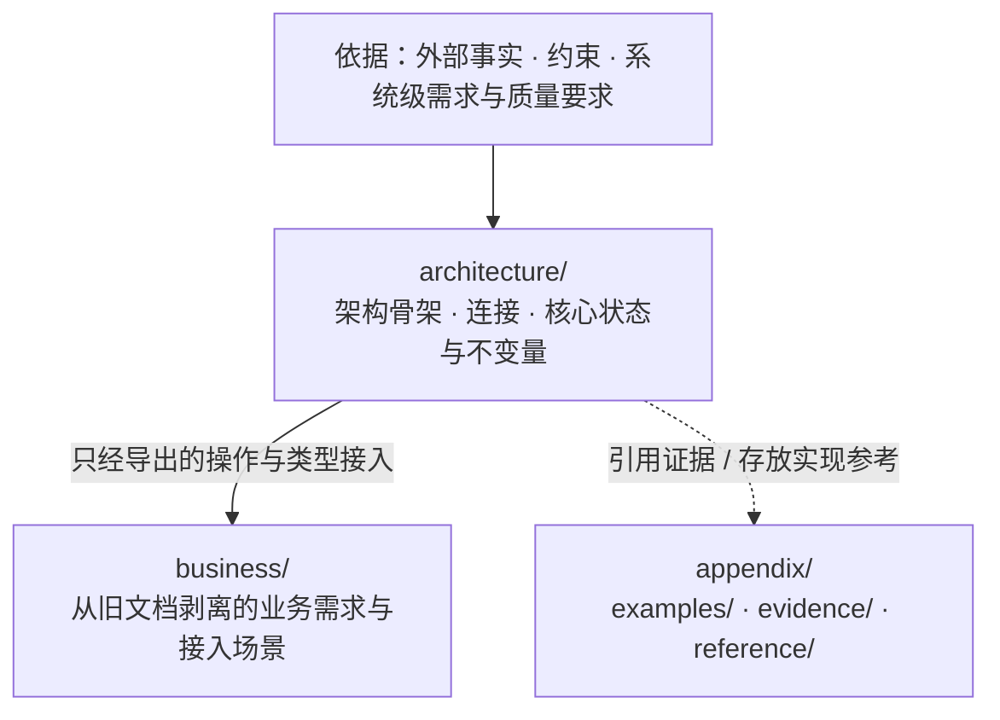

# SSoT

把软件的**架构骨架、模块连接与核心不变量**写成可机械检验的文学式形式化规格（Markdown + VDM-SL），作为独立于实现代码的设计真源。

## 解决什么问题

- **只写代码，设计承诺会被实现淹没**：代码必须完整可运行，不可违反的外部承诺与随时可替换的实现细节、边界处理混在一起，没有独立参照物检验实现是否跑偏。
- **只写自然语言，文档必然漂移**：文字无法编译检查，同一概念在各处叫法不一；AI 编写文档时尤其容易自造同义词、复述表面结构，或把具体实现与易变业务当成架构写进设计。

本仓库用两条硬边界锁死设计文档：

1. **骨架与实现分离**：骨架（由什么组成、用什么组成、为什么）先于业务，模块之间只经连接相接；**在连接不变时可以替换的做法属于实现，不写进设计**。
2. **形式化规格与受控文字分工**：连接、数据类型、状态、前置/后置条件（`pre`/`post`）与不变量（`inv`）写成 ```` ```vdm ```` 代码块里的 VDM-SL 规格；规格表达不了的语义（定时、跨连接时序、进程/部署/信任边界、崩溃接管）写成同文件的自然语言。**规格里的名字是设计唯一的词汇**，文字只能用双反引号（如 ```` ``Run`Start`` ````）指认规格中已有的元素，禁止自造词或复述规格。

## 为什么分成 `architecture`、`business`、`appendix` 三个桶

设计真正要锚定的是 `architecture/`（架构骨架与连接）；业务建在骨架导出的连接之上、随需求自由变动，不需要靠重型文档解释，也不应大量落入形式化规格。

但存量项目的旧文档往往把**架构承诺、业务逻辑、实现做法与过程计划**混写在同一段话里。如果直接让 AI“只提取架构”，AI 要么会擅自丢弃有价值的业务规则与上下文，要么会把业务分支和实现细节硬塞进架构层。为此，设计目录划分为三个职责与依赖方向严格隔离的桶：



| 目录 | 角色 | 约束规则 |
|---|---|---|
| `architecture/` | **设计核心**：模块树、对外连接（`exports`）、核心类型、状态与不变量 | 禁止引用 `business/`；父模块不依赖子模块；不得包含只服务单一业务单元的定义或分支 |
| `business/` | **业务隔离区与连接探针**：承接旧文档剥离出的业务需求，或用轻量场景验证骨架连接可走通 | 单向 import `architecture/` 导出的连接；业务单元之间只经导出操作协作 |
| `appendix/` | **实现与材料安置区**：示例（`examples/`）、调研与历史证据（`evidence/`）、实现参考（`reference/`） | 不出现在阅读次序中，不设立设计规则 |

## 仓库构成

本仓库由 `ssot` 定义贯穿写设计与审设计的**五条共同思维方式**（抽象边界与可替换性、源头事实与纯函数投影、视角与最小展开、一般规律与分层细化、形式化分工与名实对齐），并将写设计、审设计与存量迁移拆分为对称的阶段 skill：

| 目录 | 阶段 / 角色 | 说明 |
|---|---|---|
| [`skills/ssot`](skills/ssot/SKILL.md) | **总纲 · 共同思维与路由** | 定义三桶目录结构、贯穿全流程的五条共同思维方式、CLI 工具（`scripts/design.ts`）与模型审查脚本（`scripts/review.py`）、通过检查的[示例设计](skills/ssot/references/example/design/)，以及“写设计 / 审设计 / 迁移”三条流水线的阶段门控路由 |
| [`skills/ssot-arch`](skills/ssot-arch/SKILL.md) | **写设计 · 阶段 1** | 核心抽象与架构设计：运用共同思维，通过四步正向建表（依据 $\to$ 抽象边界表、模块树与正交底座划分、概念持有与最小展开表、连接面与生命周期嵌套表）设计 `design/architecture/` |
| [`skills/ssot-business`](skills/ssot-business/SKILL.md) | **写设计 · 阶段 2** | 业务单元、确定性判定与场景设计：运用共同思维，通过四步正向建表（业务单元与组合拓扑表、架构底线 $\to$ 业务策略细化表、问题域需求 $\to$ 全集纯函数 + 代表元场景表、跨模块实参值传递表）设计 `design/business/` |
| [`skills/ssot-spec`](skills/ssot-spec/SKILL.md) | **写设计 · 阶段 3** | VDM-SL 形式化规格、受控文字与工具验收：目录与 `README.md` 小节规范、VDM-SL 语法写法、受控文字（双反引号限定名与代码索引）、AST 与 `jev` 语义反模式、[本地 VDM 文档](skills/ssot-spec/references/vdm/README.md)及[多 Agent 并行编写指令表](skills/ssot-spec/references/commands.md) |
| [`skills/ssot-review-arch`](skills/ssot-review-arch/SKILL.md) | **审设计 · 阶段 1** | 抽象模型与架构/业务边界审查：通过四步正向推导（从依据构建抽象边界表、构建概念持有与视角展开表、构建架构底线到业务细化对齐表、执行连接不变可替换性检验），以推导表的断口或冲突判定架构与业务分工是否成立 |
| [`skills/ssot-review-flow`](skills/ssot-review-flow/SKILL.md) | **审设计 · 阶段 2** | 值流转、连接闭合与需求场景走通审查：通过三步正向追踪（函数形参到调用处实参的值传递链、业务需求到“全集纯函数 + 代表元单步场景”的对账表、生命周期开闭序列与跨连接时序表），检验业务需求与失败分支能否借架构连接走到底 |
| [`skills/ssot-review-spec`](skills/ssot-review-spec/SKILL.md) | **审设计 · 阶段 3** | 形式化规格严密性、证明义务与字面用词审查：运行 `ssot check` 与 `review.py`，通过三张对齐表（未定证明义务到上下文守卫推导表、说明注释承诺到谓词与帧条件对齐表、字面日常含义到规格函数值定义对齐表），完成规格严密性与词汇卫生验收 |
| [`skills/ssot-migration`](skills/ssot-migration/SKILL.md) | **存量旧文档迁移** | 将混杂的存量设计文档无损迁入三桶目录：遵循“只搬运、不判断对错、不改原意”，先勘察概念定义处与设计中心，搬完骨架后按区域把每条陈述拆层归入 `architecture/`、`business/` 或 `appendix/`；搬完一条从旧文档删一条，旧文档清空即迁移完成 |

## 三层检验机制

为防止 AI 用“合法但空洞”的规格敷衍（例如把规格写成空名字登记表、用字符串装一切状态、写 `post true` 或 `post r = r` 这类恒真条件），或审查时跳过抽象逻辑直接逐行找茬，验收由三层组成：

1. **确定性检查与形式化验证（`ssot check`）**
   - **布局与文字（`layout` / `form` / `prose`）**：核对目录与 `README.md` 小节次序、根 `README.md` 阅读次序完整性；正文只允许 `vdm` 与图/文法代码块（`mermaid`、`ebnf`、`text`），并用转译器拦截混入文字或图表块的 TypeScript 声明；校验双反引号引用的限定名全部存在，业务单元「需求」的每条都引用了走通它的场景；校验“索引：路径:行号”指向的文件与行存在（不写进 VDM 的内容要么留索引，要么写 `is not yet specified` 表示未定义）。
   - **结构与依赖（`structure`）**：强制一文件至多一个具名 VDM-SL 模块、每个定义与字段必有 `--` 说明注释、同名类型只在一个模块展开、模块依赖单向无环。
   - **AST 反模式（`antipattern`）**：拒绝规格中的字符串字面量（必须提升为类型）、显式体里的局部变量/循环/赋值、恒真的后置条件或不变式（`post true`、`post r = r`、`inv … == true`）、恒不可满足的后置条件或不变式（`post false`、`e < e`），以及规格内无处使用的顶层定义。
   - **VDMJ + QuickCheck（`parse` / `typecheck` / `quickcheck`）**：调用 VDMJ 完成语法与类型检查，生成证明义务并用 QuickCheck 搜索反例；末尾输出规格、注释、图与文字的行数占比，暴露向纯文字退化的苗头。
2. **语义反模式模型审查（`review.py`）**
   - 在 omp 的 `eval` 中调用 `jev`，对程序无法单凭语法判定的 12 类反模式做概率审查（问题与阈值经 [`review-calibration.json`](skills/ssot/scripts/review-calibration.json) 的调参集零误判校准，留出集只报误报与漏报）：用 `seq of char` 偷藏状态/身份、多 `bool` 字段堆叠互斥状态、逐项枚举失败原因、说明注释只复述类型形状、显式体写实现过程、空名字登记表、模拟时钟/进程等运行机制、把单一业务塞进架构、文字复述规格、文字自造词、依据无来源或拿技术选型当理由、图表块里塞其他语言代码。
3. **推导表驱动的三阶段审查流水线（`ssot-review-arch` → `ssot-review-flow` → `ssot-review-spec`）**
   - 每个阶段先从 `design/` 构造对应的映射与追踪表，所有审查发现均取自表中的断口、次序倒置或不一致，上一阶段建立的推导表作为下一阶段的输入。

## 安装

通过 GitHub 安装全部 8 个 skill（按实际使用的 Agent 调整 `--agent`）：

```sh
npx skills add mouriya-s-lab/SSoT --skill ssot ssot-arch ssot-business ssot-spec ssot-review-arch ssot-review-flow ssot-review-spec ssot-migration --global --agent claude-code codex --yes
```

检查依赖 **Java 11+** 与 **Bun**。不需要另外运行安装命令：首次加载 `ssot` skill 时，`SKILL.md` 里的 `` !`…` `` 行发现 `ssot` 或 `vdmj` 不在 `PATH` 上，就自动从 Maven Central 拉取 VDMJ 与 QuickCheck 最新正式版到 `${XDG_DATA_HOME:-~/.local/share}/vdmj/`，把这两个命令装进 `~/.local/bin`，并把安装结果（缺 Java、`~/.local/bin` 不在 `PATH` 上时的处理办法）放进加载的 skill 正文；已安装时这一行没有输出。Claude Code 在加载 skill 时执行这一行；不执行它的 agent 需手动运行一次 `bun ~/.agents/skills/ssot/scripts/design.ts setup`。细节见 [`references/setup.md`](skills/ssot/references/setup.md)。

后续更新：

```sh
npx skills update ssot ssot-arch ssot-business ssot-spec ssot-review-arch ssot-review-flow ssot-review-spec ssot-migration --global
```

## 使用

| 命令 | 用途 |
|---|---|
| `ssot setup` | 检查 Java，下载或更新 VDMJ 与 QuickCheck，把 `ssot` 与 `vdmj` 装进 `~/.local/bin` |
| `ssot init <repo>` | 初始化 `<repo>/design`（生成阅读次序 `README.md`、`architecture/README.md` 与 `appendix/` 三类子目录） |
| `ssot module <design> <a/b>` | 新建架构子模块目录与 `README.md`，并追加到阅读次序 |
| `ssot unit <design> <name>` | 新建业务单元目录与 `README.md`，并追加到阅读次序 |
| `ssot check <design> [--json]` | 运行全部确定性检查、VDMJ 类型检查与 QuickCheck 反例搜索 |
| `ssot graph <design> [--json]` | 导出目录、模块与 `imports` 依赖关系的 Mermaid 图或 JSON |
| `ssot vdmj <design> [args...]` | 以设计里的全部规格直接运行 VDMJ（如 `-i` 进入解释器、`-e` 求值） |
| `vdmj [args...] <files>` | VDMJ 本身（带 QuickCheck 插件），读 `.vdmsl` 文件 |

在 omp 的 Python `eval` 中运行语义反模式审查：

```python
%load skill://ssot/scripts/review.py
await review("/path/to/repo/design")
```

## 开发自测

修改本仓库的检查脚本或审查校准集后，运行以下自测（需已完成 `setup`；在仓库根运行 `bun skills/ssot/scripts/design.ts setup`，PATH 上的 `ssot` 就指向本仓库的脚本）：

```sh
# 用真实 VDMJ 跑 CLI 回归测试（仅在自有 /tmp/ssot-check-* 临时目录读写夹具）
bun test skills/ssot/tests/check.test.ts
```

改动 `review.py` 的问题措辞、阈值或 [`review-calibration.json`](skills/ssot/scripts/review-calibration.json) 后，在 omp 的 `eval` 中运行校准，全部样本零误判才算通过：

```python
%load skills/ssot/scripts/review.py
await calibrate()
```
