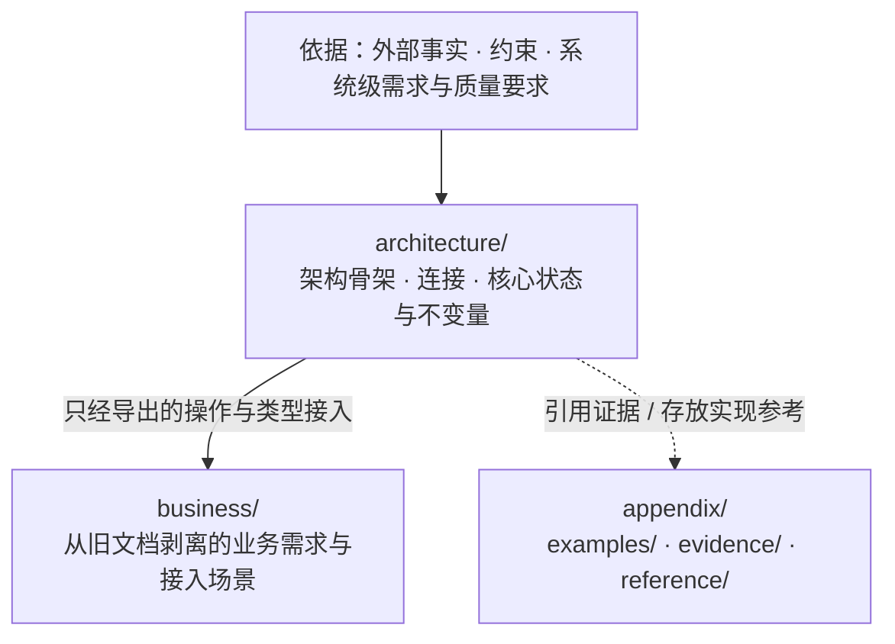

# SSoT

把软件的**架构骨架、模块连接与核心不变量**写成可机械检验的文学式形式化规格（Markdown + VDM-SL），作为独立于实现代码的设计真源。

## 解决什么问题

- **只写代码，设计承诺会被实现淹没**：代码必须完整可运行，不可违反的外部承诺与随时可替换的实现细节、边界处理混在一起，没有独立参照物检验实现是否跑偏。
- **只写自然语言，文档必然漂移**：文字无法编译检查，同一概念在各处叫法不一；AI 编写文档时尤其容易自造同义词、复述表面结构，或把具体实现与易变业务当成架构写进设计。

本仓库用两条硬边界锁死设计文档：

1. **骨架与实现分离**：骨架（由什么组成、用什么组成、为什么）先于业务，模块之间只经连接相接；**在连接不变时可以替换的做法属于实现，不写进设计**。
2. **形式化规格与受控文字分工**：连接、数据类型、状态、前置/后置条件（`pre`/`post`）与不变量（`inv`）写成 ```` ```vdm ```` 代码块里的 VDM-SL 规格；规格表达不了的语义（定时、跨连接时序、进程/部署/信任边界、崩溃接管）写成同文件的自然语言。**规格里的名字是设计唯一的词汇**，文字只能用双反引号（如 ```` ``Run`Start`` ````）指认规格中已有的元素，禁止自造词或复述规格。

## 为什么分成 `architecture`、`business`、`appendix` 三个桶

设计真正要锚定的是 `architecture/`（架构骨架与连接）；业务建在骨架导出的连接之上、随需求自由变动，不需要靠重型文档解释，也不应大量落入形式化规格。

但存量项目的旧文档往往把**架构承诺、业务逻辑、实现做法与过程计划**混写在同一段话里。如果直接让 AI“只提取架构”，AI 要么会擅自丢弃有价值的业务规则与上下文，要么会把业务分支和实现细节硬塞进架构层。为此，设计目录划分为三个职责与依赖方向严格隔离的桶：



| 目录 | 角色 | 约束规则 |
|---|---|---|
| `architecture/` | **设计核心**：模块树、对外连接（`exports`）、核心类型、状态与不变量 | 禁止引用 `business/`；父模块不依赖子模块；不得包含只服务单一业务单元的定义或分支 |
| `business/` | **业务隔离区与连接探针**：承接旧文档剥离出的业务需求，或用轻量场景验证骨架连接可走通 | 单向 import `architecture/` 导出的连接；业务单元之间只经导出操作协作 |
| `appendix/` | **实现与材料安置区**：示例（`examples/`）、调研与历史证据（`evidence/`）、实现参考（`reference/`） | 不出现在阅读次序中，不设立设计规则 |

## 仓库构成

本仓库由 `ssot` 阐述设计的思考思路（多视角下的权衡、值与动作的位置、积压感与责任边界、需要定义多少东西及定义得对不对），默认只专注于 `design/` 本身（不查看 `design/` 之外的仓库文件或 `git` 历史），并实行**显式单块路由**：用户未明确指定具体做哪一块时先询问并停止（不继续、不预读其他 skill）；用户明确指定后，必须完整读完并只执行对应的那一个子 skill：

| 目录 | 块 / 角色 | 说明 |
|---|---|---|
| [`skills/ssot`](skills/ssot/SKILL.md) | **总纲 · 思考思路与路由门控** | 阐述设计的思考思路、三桶目录结构、CLI 工具（`scripts/design.ts`）与模型审查脚本（`scripts/review.py`）、通过检查的[示例设计](skills/ssot/references/example/design/)，以及显式单块路由门控 |
| [`skills/ssot-migration`](skills/ssot-migration/SKILL.md) | **存量旧文档迁移块** | 将混杂的存量设计文档无损迁入三桶目录：遵循“只搬运、不判断对错、不改原意”，先勘察概念定义处与设计中心，搬完骨架后按区域把每条陈述拆层归入 `architecture/`、`business/` 或 `appendix/`；搬完一条从旧文档删一条，旧文档清空即迁移完成 |
| [`skills/ssot-draft`](skills/ssot-draft/SKILL.md) | **设计草稿块** | 写 VDM 之前分清定义、执行、事实与索引，给每条约束写出允许的变化、不变的关系与违反情形，经换跑法、删除、范围三项判定筛选，再判定由架构还是业务持有；草稿写成目标仓库的 `.tmp/ssot-draft/draft.yaml`，由 `ssot draft` 逐项核对 |
| [`skills/ssot-design`](skills/ssot-design/SKILL.md) | **按草稿写设计块** | 按约束类别选写法，用违反情形自检规格是否排除了它；每个 VDM 元素都对应草稿中的一条约束，写不进去时区分换写法与回草稿；落点与元素来由记进台账，由 `ssot design` 逐项核对 |
| [`skills/ssot-verify`](skills/ssot-verify/SKILL.md) | **独立验证块** | 由未参与设计的 `ssot:fable` 与 `ssot:argon` 先不看规格写出应有长相与应有约束，再逐条构造违反情形并用 VDMJ 求值核对，逐项审查元素、场景、调用、文字与模块，核对归属；每一步由 `ssot verify` 的子命令枚举判断义务，可按目录或约束分批；只报告，不修改 |

## 检验机制

为防止 AI 用“合法但空洞”的规格敷衍（例如把规格写成空名字登记表、用字符串装一切状态、写 `post true` 或 `post r = r` 这类恒真条件），或审查时跳过抽象逻辑直接逐行找茬，验收由三层组成：

1. **确定性检查与形式化验证（`ssot check`）**
   - **布局与文字（`layout` / `form` / `prose`）**：核对目录与 `README.md` 小节次序、根 `README.md` 阅读次序完整性；正文只允许 `vdm` 与图/文法代码块（`mermaid`、`ebnf`、`text`），并用转译器拦截混入文字或图表块的 TypeScript 声明；校验双反引号引用的限定名全部存在，业务单元「需求」的每条都引用了走通它的场景；校验“索引：路径:行号”指向的文件与行存在（不写进 VDM 的内容要么留索引，要么写 `is not yet specified` 表示未定义）。
   - **结构与依赖（`structure`）**：强制一文件至多一个具名 VDM-SL 模块、每个定义与字段必有 `--` 说明注释、同名类型只在一个模块展开、模块依赖单向无环。
   - **AST 反模式（`antipattern`）**：拒绝规格中的字符串字面量（必须提升为类型）、显式体里的局部变量/循环/赋值、恒真的后置条件或不变式（`post true`、`post r = r`、`inv … == true`）、恒不可满足的后置条件或不变式（`post false`、`e < e`），以及规格内无处使用的顶层定义。
   - **VDMJ + QuickCheck（`parse` / `typecheck` / `quickcheck`）**：调用 VDMJ 完成语法与类型检查，生成证明义务并用 QuickCheck 搜索反例；末尾输出规格、注释、图与文字的行数占比，暴露向纯文字退化的苗头。
2. **语义反模式模型审查（`review.py`）**
   - 在 omp 的 `eval` 中调用 `jev`，对程序无法单凭语法判定的 12 类反模式做概率审查（问题与阈值经 [`review-calibration.json`](skills/ssot/scripts/review-calibration.json) 的调参集零误判校准，留出集只报误报与漏报）：用 `seq of char` 偷藏状态/身份、多 `bool` 字段堆叠互斥状态、逐项枚举失败原因、说明注释只复述类型形状、显式体写实现过程、空名字登记表、模拟时钟/进程等运行机制、把单一业务塞进架构、文字复述规格、文字自造词、依据无来源或拿技术选型当理由、图表块里塞其他语言代码。
3. **逐项判断台账（`ssot draft` / `ssot design` / `ssot verify`）**
   - 语义判断仍由人或 agent 做，工具保证每一项都判了：从需求材料、草稿、规格语法树（元素、字段、`ext`、导出、场景里的调用与分支、显式体里的调用点）、`README.md` 段落、设计目录与 VDMJ 证明义务里枚举判断义务，要求台账逐项写下结论与证据；缺判、槽位没填、引用找不到、记录过期是错误，判为有问题或未能判定的是警告。
   - 审查问题一问一槽：元素的说明是否兑现、用词是否误导、展开与导出、结局与恢复、最小状态与投影、帧条件；场景的结局处理、校验次序与返回值；调用的值流；每段依据、需求、理由与语义；每个目录的拆分、包含关系、架构与业务边界、积压与应有长相；整份设计的整体长相与形式统计。
   - 反例写成结构化的调用或表达式，由工具拼出 `pre_Op`、`post_Op` 交给 VDMJ 求值，并核对没列进 `ext wr` 的状态分量前后相同；求值不为真的不算反例。
   - 每条记录盖章时记下它依据的原文，设计改了只让依据变了的记录过期；验证可按 `--dir` 或 `--constraint` 分批，不带范围没有错误才算整份判完。

## 为什么刚需 Fable 与 Argon：模型行为与 VDM 核心价值

VDM-SL 在本仓库的核心价值是**抽象过滤**：只锚定多视角权衡下的核心概念、模块连接与状态不变量，把外部观察者不分支、不读取的一切内部结构压回 `= token`。通用代码大模型受代码可验证奖励（RLVR / SWE-bench）训练影响，默认奖励“保住既有代码框架、找出局部可证伪 bug、做加法打补丁”，直接用于编写或审查 VDM-SL 会从四个机制上摧毁这一核心价值：

1. **以线性符号执行替代宏观视角审视**：面对上千行规格时，模型默认启动逐行脑内解释器，搜寻局部 `if/else` 分支差异或单行 `pre`/`post` 守卫遗漏，跳过“在当前软件视角下设计整体应该长什么样、哪些定义根本不该存在”的前提追问，只给既有模块划分发通行证。
2. **把上游过度定义的“假插头”当成下游未接通的实现管道**：当上游模块脱离观察者视角凭空展开了多余的结构体、字段或参数时，规格往往在下游塞入通配符丢弃（`-`）、恒传空映射（`{|->}`）、自比恒真式或只写不读字段以糊弄 VDMJ 类型检查。通用模型默认“已声明的类型与字段皆为神圣需求”，不提议把上游过度定义整片砍回 `= token`，反而要求在下游补齐数据装填管道、透传参数或持久化表，把用于做减法的形式化规格异化为不断膨胀的实现蓝图。
3. **用命令式实现与数据库存储习惯篡改形式化约定**：
   - 将刻意隐藏内部机制的 `= token` 误判为“未接通的接口”，要求补齐将业务值序列化塞入运行载体的装填连接；
   - 将连接面仅用于陈述 `inv` 与 `post` 的说明性数学 `state` 当成内存结构体或 SQL 表，要求做第三范式外键去重、合并状态映射，或追问运行期环境句柄在崩溃重启后从哪张表读取；
   - 将 VDM-SL 显式体无循环约定下的“全集纯函数 + 单代表元参数场景”误判为漏写 `for` 循环或批量接口，并顺手提出抽共用辅助函数（DRY）、补不可信 RPC 入参防御守卫、或用“首写胜出幂等锁”掩盖生命周期确认权归属不清。
4. **面对机械检查报错时规避检查器而非简化设计**：当状态映射嵌套过深引发 QuickCheck 组合爆炸超时，或 `review.py` 报出实现体（`impl_body`）与业务入架构（`business_in_arch`）时，通用模型倾向于把显式纯函数改写为无状态隐式 `operations`（`post r = ...`）以绕过 AST 提取，或仅删除注释里的敏感词而把越界结构留在 `architecture/`。

在强制实行“单块路由 + 两阶段阅读（先只读全部 `README.md` 与依赖图确立需求及应有长相，再读 `.md` VDM 规格对照）”并清除外部规则干扰后，主流模型在真实设计库上的优缺点、主观计分（优点计正分、缺点计负分，基准 $\pm 100$）与结果裁定如下：

| 模型 | 优点（对设计真源的正向贡献） | 缺点（盲区与对规格的破坏风险） | 优点计分 | 缺点计分 | 净分 | 结果裁定 |
|---|---|---|---:|---:|---:|---|
| `gemini-4-argon`（`ssot:argon`） | 1. 唯一顺着“谁实际观察值结构”反推，抓出根模块双层值 AST 过度展开及单一业务限制向事实记录层的泄漏；<br/>2. 唯一将 400+ 行臃肿模块拆解为三类混杂视角（越界拆形状、替下游重写反向图、循环维度脱节）；<br/>3. 完整覆盖输出拼接（`++`）抹平信任边界来源、崩溃分支误调出口裁决与空壳字段丢弃；<br/>4. 严格遵循 VDM-SL 代表元场景与静态类型可见性，零死代码或数据库范式误报。 | 1. 依赖图呈合法无环 DAG 时，对单纯从依赖方向暴露的视角倒置（静态契约反向导入运行期边界）不如 `fable` 敏感；<br/>2. 单跑会漏检“有判定无执行主人”的悬空责任与仅存于散文的受理窗口生命周期，且偶受上游假插头诱导提出补绑定说明。 | $+85$ | $-25$ | $+60$ | **优点远大于缺点**：结构减法、多视角拆解与 VDM-SL 语义守恒独一档；缺点主要是局部视角漏检而非破坏性药方，可由 `fable` 正交补齐 |
| `claude-fable-5-1`（`ssot:fable`） | 1. 第一阶段（仅读 `README.md` 与依赖图）直觉最敏锐，唯一直接从依赖图看穿“静态定义契约反向导入运行期执行边界”的视角倒置；<br/>2. 准确捕捉“有纯函数判定但全链路无主人触发”的悬空责任与仅写在散文里的生命周期窗口；<br/>3. 具备多步推演自我纠偏能力，能在思考链中自行推翻“配置未落库”等存储偏见伪问题。 | 1. 默认接受底座模块既有的多层值/形状 AST 前提，看不出跨层结构过度展开与业务限制向架构泄漏；<br/>2. 想法未经静态可见性校验时偶发“信口开河”，提议把需跨模块分支匹配的耐久事实改成 `seq of token`（忽略 VDM-SL 无泛型与向下转型、`architecture/` 不可反向导入 `business/`，照改会导致规格无法编译）。 | $+75$ | $-35$ | $+40$ | **优点大于缺点**：依赖方向与责任边界直觉无可替代；其违反 VDM-SL 类型可见性的假药方可通过与 `argon` 交叉合拢直接滤除 |
| `claude-opus-5-5` | 1. 能识别跨模块过程式图遍历算法积压（7 个图可达性函数/类型）并提议整片删除；<br/>2. 能识别中断结局放错层引发的四处特判积压与只写不读的快照字段。 | 1. 代码 RL 惯性重，易脑补运行期多线程并发抢写，开出“把事实落定操作改为首写胜出幂等锁”这类违背“机制即信号”的破坏性加法补丁；<br/>2. 漏检静态契约反向导入运行期边界的视角倒置，默认接受根模块多层 AST 过度展开；<br/>3. 难戒 Linter 手癖，仍夹带孤立未引用导出与“重连需重传配置”等代码级碎屑，且被假插头误导去补输入管道。 | $+50$ | $-70$ | $-20$ | **缺点大于优点**：有效发现已被 `fable` + `argon` 完全覆盖，而残留的并发幂等锁补丁与代码级找茬会把实现机制反向塞进架构连接面 |
| `gpt-6.1-sol` | 1. 局部契约与信任边界严密性高，能准确抓出输出映射拼接（`++`）破坏来源隔离导致不可信主体伪造捕获值的漏洞；<br/>2. 准确识别 `README.md` 依据循环自证与崩溃恢复责任缺口，不报死代码碎屑。 | 1. 架构立场极度保守，只要 `ssot graph` 无环即宣布“现有模块骨架成立，问题不是类型或模块太多，而是值没穿过连接”；<br/>2. 完全无法识别整片过程式图可达性算法冗余、跨层 AST 过度展开与模块依赖视角倒置；<br/>3. 面对上游过度定义的假插头，开出“规定静态程序与动态输入在何处结合进入闭包”的反向药方。 | $+35$ | $-75$ | $-40$ | **缺点远大于优点**：无条件给臃肿骨架发通行证并主导做加法补传参管道，单用会彻底抹杀 VDM-SL 做概念减法与抽象过滤的核心价值 |

单一模型即使被要求当场书写形式化推演证明，也无法跳出自身的感知盲区：看不见视角倒置或 AST 积压的模型，只会用证明工具去钉死局部边界 bug；而直觉敏锐的模型（`fable`）在未受静态可见性约束时，又容易开出在 VDM-SL 类型系统中无法编译的跨模块 `token` 化方案。

`fable` 与 `argon` 的能力长板与盲区恰好正交互补：

- **验证（`ssot-verify`）刚需 `fable` + `argon` 双模型独立盲审合拢**：由 `ssot:fable` 捕捉模块依赖方向上的视角倒置、有判定无主人的悬空责任与散文生命周期缺口；由 `ssot:argon` 顺着“谁观察值结构”穿透识别跨层 AST 过度展开、多来源职责积压与信任边界失守，并用 VDM-SL 模块类型可见性筛除不成立的重构提议，同时稳定遵循代表元场景、说明性 `state`、准入契约与可观察结局边界等数学语义。两方各写各的验证台账，主 agent 并列汇总、不裁决；主 agent 若非二者之一，必须同时派发 `ssot:fable` 与 `ssot:argon`；若已是其一，则派发另一方补齐视角。

## 兼容性

本仓库只兼容 omp，其他任何 harness 都需要当场改造。依赖 omp 的环节：

- 语义反模式审查 `review.py` 在 omp 的 Python `eval` 里调用 `jev`；
- 验证 subagent `ssot:argon` 与 `ssot:fable` 是 omp 的 agent 定义（[`skills/ssot/agents/`](skills/ssot/agents/)），模型按 omp 的模型名写定；
- skill 内的脚本与参考文件经 omp 的 `skill://` 地址加载。

## 安装

安装全部 5 个 skill：

```sh
npx skills add mouriya-s-lab/SSoT --skill ssot ssot-migration ssot-draft ssot-design ssot-verify --global --agent codex claude-code --yes
```

检查依赖 **Java 11+** 与 **Bun**。装好 skill 后运行一次：

```sh
bun ~/.agents/skills/ssot/scripts/design.ts setup
```

它从 Maven Central 拉取 VDMJ 与 QuickCheck 最新正式版到 `${XDG_DATA_HOME:-~/.local/share}/vdmj/`，把 `ssot` 与 `vdmj` 两个命令装进 `~/.local/bin`；缺 Java 或 `~/.local/bin` 不在 `PATH` 上时按输出处理，细节见 [`references/setup.md`](skills/ssot/references/setup.md)。

后续更新：

```sh
npx skills update ssot ssot-migration ssot-draft ssot-design ssot-verify --global
```

## 使用

| 命令 | 用途 |
|---|---|
| `ssot setup` | 检查 Java，下载或更新 VDMJ 与 QuickCheck，把 `ssot` 与 `vdmj` 装进 `~/.local/bin` |
| `ssot init <repo>` | 初始化 `<repo>/design`（生成阅读次序 `README.md`、`architecture/README.md` 与 `appendix/` 三类子目录） |
| `ssot module <design> <a/b>` | 新建架构子模块目录与 `README.md`，并追加到阅读次序 |
| `ssot unit <design> <name>` | 新建业务单元目录与 `README.md`，并追加到阅读次序 |
| `ssot check <design> [--json]` | 运行全部确定性检查、VDMJ 类型检查与 QuickCheck 反例搜索 |
| `ssot graph <design> [--json]` | 导出目录、模块与 `imports` 依赖关系的 Mermaid 图或 JSON |
| `ssot vdmj <design> [args...]` | 以设计里的全部规格直接运行 VDMJ（如 `-i` 进入解释器、`-e` 求值） |
| `ssot draft <子命令> <repo>` | 逐项核对草稿 `.tmp/ssot-draft/draft.yaml`（需求去向、对象、约束、归属、不进 VDM 的内容、取舍） |
| `ssot design <子命令> <design> [--stamp …]` | 逐项核对落点台账 `.tmp/ssot-design/`（每个规格元素的来由、每条草稿约束的落点） |
| `ssot verify <子命令> <design> --as <验证方> [--dir …] [--constraint …] [--stamp …]` | 逐项核对验证台账 `.tmp/ssot-verify/<验证方>/`（应有长相与应有约束、三问、五种违反情形与生命周期四问、元素与场景反查、调用值流、文字与模块、归属、证明义务、模型审查、结论）；`report` 把台账排成交付视图 |
| `vdmj [args...] <files>` | VDMJ 本身（带 QuickCheck 插件），读 `.vdmsl` 文件 |

在 omp 的 Python `eval` 中运行语义反模式审查；验证时用 `save` 把每条材料的判断存进验证方的台账根，交给 `ssot verify review`：

```python
%load skill://ssot/scripts/review.py
await review("/path/to/repo/design")
await review("/path/to/repo/design", save="/path/to/repo/.tmp/ssot-verify/<验证方>/review.json")
```

## 开发自测

修改本仓库的检查脚本或审查校准集后，运行以下自测（需已完成 `setup`；在仓库根运行 `bun skills/ssot/scripts/design.ts setup`，PATH 上的 `ssot` 就指向本仓库的脚本）：

```sh
# 用真实 VDMJ 跑 CLI 回归测试（仅在自有 /tmp/ssot-check-*、/tmp/ssot-judge-* 临时目录读写夹具）
bun test skills/ssot/tests/check.test.ts skills/ssot/tests/judge.test.ts
```

改动 `review.py` 的问题措辞、阈值或 [`review-calibration.json`](skills/ssot/scripts/review-calibration.json) 后，在 omp 的 `eval` 中运行校准，全部样本零误判才算通过：

```python
%load skills/ssot/scripts/review.py
await calibrate()
```
