# C4 模型的作者讲 C4 最常见的误用：四层不够、微服务怎么画、图怎么不过时

这篇整理自 Simon Brown 在 GOTO 2024 上的演讲《The C4 Model – Misconceptions, Misuses & Mistakes》（约 44 分钟）。Simon Brown 是 C4 模型的创造者，也是建模工具 Structurizr 的作者；他在演讲里说自己已经教了 C4 十到十五年，这场讲的是他在各地团队采用 C4 时反复看到的误解、误用和错误。他自己的说法是：嫌标题太负面的话，可以把它当成“C4 的进阶内容”。对已经在画架构图、或者想把团队的架构图规范起来的工程师来说，这篇能回答几个具体问题：消息队列、共享库、微服务、跨团队依赖在 C4 里分别该怎么画，四个层级“不够用”时该怎么办，以及怎样让图不随代码过时。文中的时间码对应原视频，便于回看。

## C4 是什么：四层抽象、四种图、像地图一样缩放

Brown 说他在世界各地看过大量架构图，大多数都很糟。过去很多人用 UML 画架构图，现在几乎没人用了，于是大家退回到随手画的方框加箭头，而这种图有一堆问题。他在幻灯片上用一本仿 O'Reilly 封面的恶搞书《97 Ways to Sidestep UML》列出他真实听到过的不用 UML 的借口：团队里别人不懂、只有我一个人懂、会显得老派、工具太烂、太细、是一种精致的浪费时间、敏捷里不需要、价值在于对话本身（00:58）。他创造 C4，就是想给这种随手画的方框连线图加上一点结构。

C4 的核心是四个有层级关系的抽象：软件系统（software system）由一个或多个容器（container）组成，容器指应用程序和数据存储，和 Docker 无关（他调侃说这个名字是他先用的）；容器里面是组件（component），即一组相关功能，在容器内部运行，有清晰的接口；组件由代码构成。与这四个抽象对应的是四种图：系统上下文图、容器图、组件图和代码图。C4 这个名字就来自这四种图：Context、Containers、Components、Code。

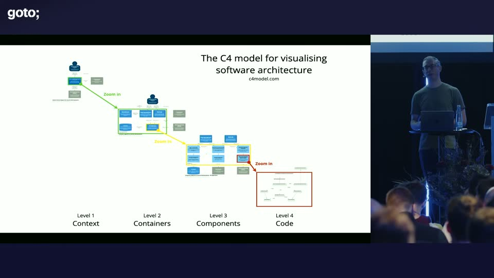

*图：幻灯片“The C4 model for visualising software architecture”，四张图从 Level 1 Context 依次放大（Zoom in）到 Level 4 Code（视频 01:58）。*

他用地图解释这种层级。他住在英吉利海峡的泽西岛，在 Google 地图上搜泽西，看到的那张图适合找机场和主城、规划路线；但如果你根本不知道泽西在哪，这张图一上来细节就太多了，于是你会双指缩小看更大的范围。反过来也可以一直放大，最后进入街景，那几乎是拍照那一刻现实世界的一比一映射。他想让架构图也这样：不同层级的图，向不同的听众讲不同的故事。

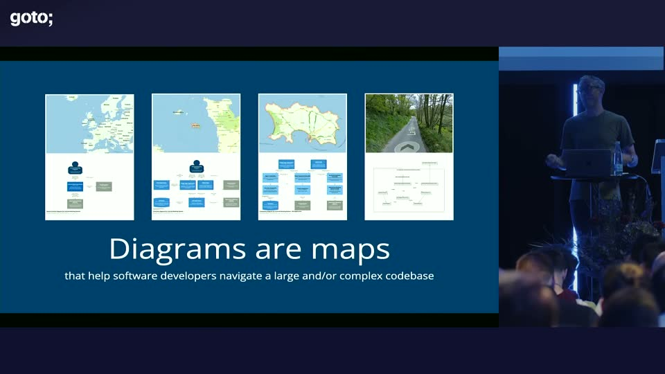

*图：“Diagrams are maps that help software developers navigate a large and/or complex codebase”，上排四张地图从欧洲放大到泽西岛的街景，下排是对应的四层架构图（视频 02:14）。*

演讲只简短讲了最上面两层。系统上下文图展示你正在关注、描述或设计的那个系统，以及它周围的人和其他软件系统。要画它，需要回答这几个问题：要建的东西范围是什么，哪些功能在里面、哪些在外面；谁在用它，也就是有哪些参与者、角色和真实用户；他们在用它做什么；系统和系统之间有哪些集成点（03:07）。他展示的例子是一张培训现场手绘的“金融风险系统”上下文图：中间红框是要设计的系统，周围是两类业务用户和若干已有的外部系统。

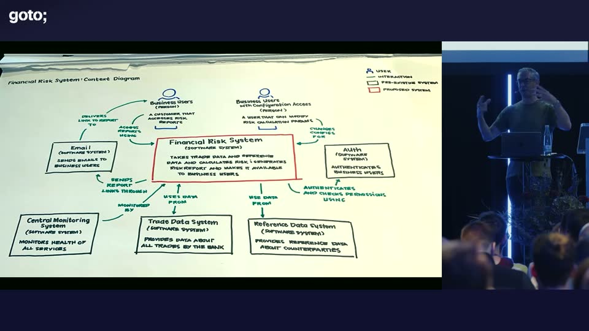

*图：一个小组在白板纸上画的 Financial Risk System 上下文图，红框是拟建系统，其余是业务用户、邮件、认证、交易数据、参考数据和中央监控等外部系统（视频 03:33）。*

对红框做一次“双指放大”，就到了第二层容器图。容器图要回答另一组问题：主要的技术构件是什么，也就是有哪些应用和数据存储；它们各自负责什么；用了什么技术；彼此怎样通信。回答完，就能画出组成这个软件系统的应用与数据存储。

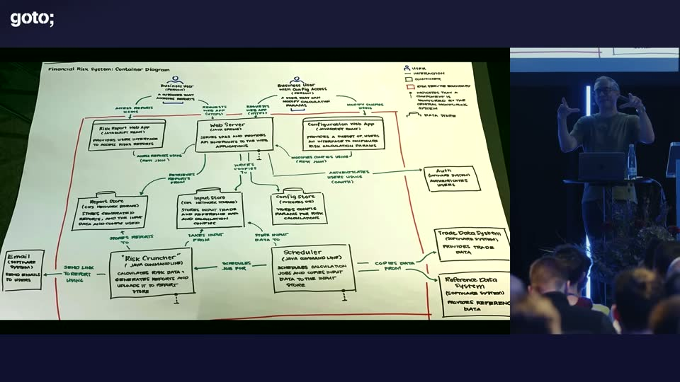

*图：放大红框后的 Financial Risk System 容器图，可见 Web 服务器、报表 Web 应用、配置 Web 应用、各类存储、调度器与“Risk Cruncher”计算程序（视频 04:09）。*

## 它比大多数人以为的要老

最近有不少人跟 Brown 说“我刚听说 C4，应该是新东西吧”。他考证后认为 C4 大约诞生在 2010 年。那年他在 QCon London 讲“Software architecture for developers”，当时还没有 C4 这些名字，但概念已经在了：系统的广角视图、长焦视图和微距视图，一路放大到代码。几个月后在伦敦另一场演讲里，C4 的名字开始出现，那时是 context、containers、components 和 classes，因为他当时主要面向 Java 和 C#。C4 这个缩写本身大约在 2011 年定下来。2018 年前后 C4 网站上线，classes 改成了更通用的 code（04:51–05:32）。

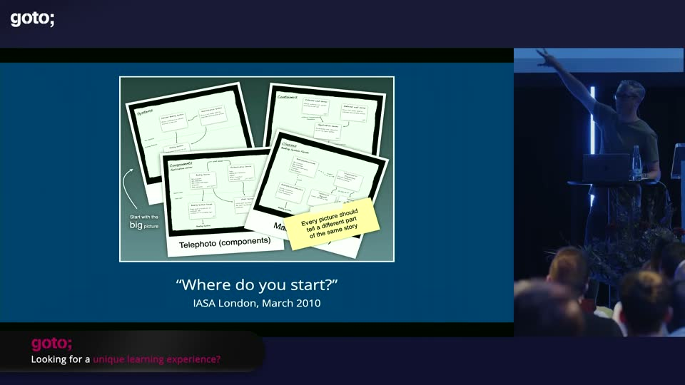

*图：2010 年 3 月 IASA London 演讲“Where do you start?”的幻灯片，四张手绘图依次标为 Systems、Containers、Components 和 Classes，旁注“每张图应讲同一个故事的不同部分”（视频 05:02）。*

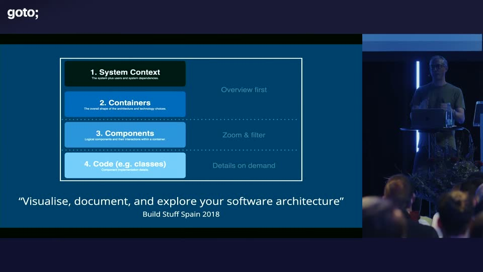

*图：2018 年 Build Stuff Spain 上的版本，第四层已改为“Code (e.g. classes)”，四层分别对应“先看概览、放大与过滤、按需看细节”（视频 05:31）。*

常有人问他为什么要重新发明 UML。他说他没有。C4 不是为了取代 UML 设计的，恰恰是因为人们不用 UML：他当时在教人做架构、画架构图，学员不愿意用 UML，他就干脆教他们自己是怎么画的。这就是 C4 的来历。

## 抽象、图、记法、工具：四件彼此独立的事

拆开来看，C4 很简单：一套四个层级的抽象；一套四种层级的图，外加几种补充图；不规定记法；因此也不绑定工具。他说如果你接受这一点，那么用 C4 的抽象和图类型、拿 UML 作记法完全可行；没人这么做只是因为大家不想用 UML，理论上换成 ArchiMate 之类的记法也可以。

他的一条建议是不必画全四层。大多数组织只用上面两层，即系统上下文和容器：画得快、性价比高，也不怎么变。第三、四层更贴近代码，每加一个功能都可能要改，所以他建议先用一、二层，其他两层有价值时再画（06:56）。

那为什么不干脆叫 C2+2、C3+1 之类的名字？他的回答是“落地”（grounding）（07:41）。四层抽象提供了一条从高层的软件系统一路下到代码的通道；去掉最下面一两层，剩下的高层抽象就悬在半空，和代码库接不上。他看重的是这套抽象带来的可追溯性：可以自上而下、也可以自下而上，缩小模型与代码之间的差距。你不必画那几层的图，但抽象要留着，所以仍然叫 C4。

## 记法：配色是偶然，文字和元数据是为了消除歧义

关于记法他收到很多问题。有人说蓝灰配色很无聊（08:31）。他承认这是他造成的：当年给 C4 网站和工作坊画示例图，总得选个颜色，他选了蓝和灰，仅此而已。C4 本身不规定记法，换别的颜色完全可以。问题在于很多工具采用 C4 时照搬了他示例图的外观，所以 C4-PlantUML、draw.io 模板等工具里都是同样的蓝灰方块。蓝灰示例在 C4 网站的幻灯片里仍然在，但现在刷新 C4 网站，示例图可能换成别的颜色。他为此给观众道歉，因为有人会抱怨“刚才明明是绿色的，怎么变红了”，不过“C4 都是蓝灰色、很无聊”的说法也就站不住了。

也有人批评 C4 的图太啰嗦，逼着人往图里写更多字。他的看法正相反：加字是为了解决歧义。他展示了一张很典型的图，每个方框里只有一两个词。盯着它看半天，问你“文件系统（File System）是干什么的”，唯一能答的是“存文件”。所以他明确说不要画一个只写着“file system”的框；他加文字，是为了写明职责、功能或存放的数据类型。改完以后，读图的人能看出这个文件系统存的是搜索索引。软件系统是有功能的，看一套房屋平面图时功能一目了然，看软件架构图时却不然。

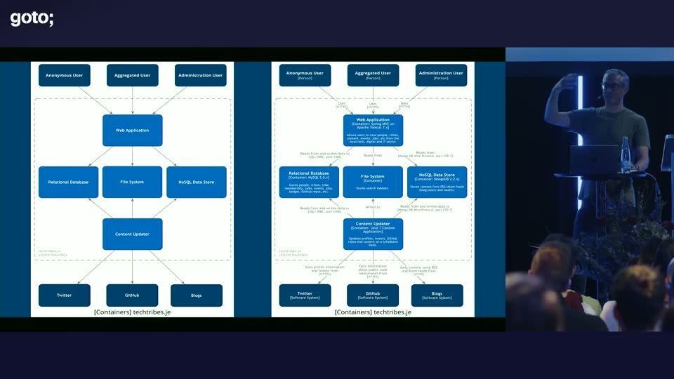

*图：techtribes.je 容器图的两个版本。左边每个框只有名字；右边写明了容器类型、技术选型和职责，例如 File System 一栏写着“Stores search indexes”（视频 10:48）。*

代价是图会变得啰嗦，他也承认。他的建议是字尽量短：一句话，或者最多三到六个要点（11:17）。如果做演示时不想让观众被文字分散注意力，就把这些细节关掉。在他看来这已经是工具问题：好的工具应该能一键开关细节。在 Visio 里这很痛苦，你得复制一份文件，逐个双击方框删掉文字，再把所有东西重新居中。本质上只是同一份信息在不同细节层级的不同呈现。

同样有人抱怨“元数据碍事”。这里的元数据指 C4 图上名字下面那一行，比如“这是一个容器”“这是一个软件系统”，以及技术选型。他很喜欢这行字，因为它消除了关于抽象层级的疑问：一个只有名字的框，到底是一个部署单元、一个系统，还是代码里的某样东西？删掉元数据当然可以，但对第一次看这张图的人来说，哪些是可部署的部分、哪些是应用、哪些是系统就看不出来了，抽象类型的信息丢了。所以他建议尽量保留元数据。

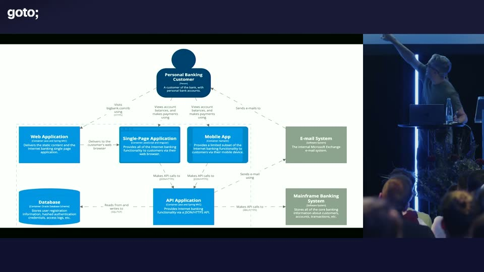

*图：网上银行系统的容器图，每个框在名字下标注了抽象类型和技术，如“[Container: Java and Spring MVC]”“[Software System]”。演讲随后展示了删掉这些标注后的同一张图（视频 12:11）。*

## C4 不画决策，部署靠补充图

有人说 C4 不擅长表达决策（13:00）。他说这个判断是对的：C4 本来就不是为此设计的，架构图也不该表达决策。架构图展示的是决策过程的结果，团队协作完成的设计工作，最终体现在图上。决策该用 ADR（架构决策记录）来记录。他的建议是 ADR 和架构图分开维护，但两者之间要能相互追溯。

也有人说 C4 缺了部署这部分（13:41）。他认为这多少也是他的问题：C4 以四种静态结构图命名，但要讲完整的故事还需要部署图这类别的图。C4 本身受 UML 和 Philippe Kruchten 的 4+1 视图模型启发，4+1 里同一个系统有多个视图，其中之一就是物理视图。因此 C4 网站描述了几种补充图，部署图是其中之一。C4 的部署图展示 C4 容器（应用和数据存储）如何映射到基础设施世界里的东西，比如服务器和 Docker 容器。比如把一个 Spring Boot 应用部署进一个 Docker 容器时，C4 容器和 Docker 容器之间恰好就是一对一的关系，他称之为“方便的巧合”。

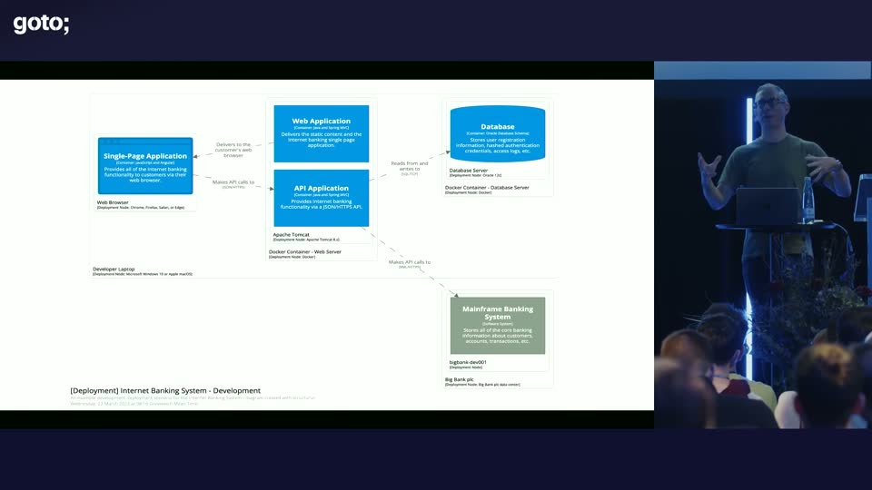

*图：网上银行系统开发环境的部署图，开发者笔记本上的 Docker 容器里运行着 Apache Tomcat 中的 Web 应用与 API 应用，以及数据库（视频 14:16）。*

同样的方法也能画常见的云架构图，带上 AWS、Azure、GCP 的图标，只是仍然以“把 C4 容器映射到云基础设施上”为思路。

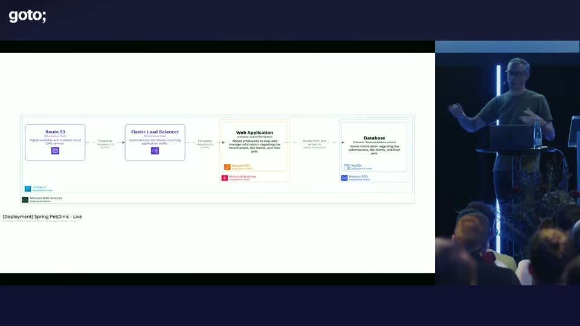

*图：Spring PetClinic 生产环境的部署图：Route 53 → Elastic Load Balancer → 自动伸缩组中 EC2 上的 Web 应用 → Amazon RDS 上的 MySQL 数据库（视频 14:51）。*

## “四层不够用”：真正的问题往往是概念混在了一起

定义四个层级，必然会有人说对他们来说不够，理由通常是规模和复杂度（14:56）。Brown 对此有两段回应。

第一段针对 Ilograph 博客上的一篇文章《Concrete Diagramming Models, a Lightweight Alternative to C4》。文章说：如今的系统里有各种各样的东西，服务器、数据库、虚拟化容器、API、流水线、代码仓库、包、库，还有大量云资源，它们都是真实、具体、有价值的东西，硬塞进 C4 的四个抽象层级里并没有多大意义。Brown 同意前半句，但指出那串东西里很多其实是部署层面的。他认为第一步是在脑子里把软件架构中的静态结构和部署内容分开；而且部署内容会随环境变化，开发环境和生产云环境的部署会大不相同。所以他主张把部署和静态结构分开处理。

同一篇文章还说：“数据库就是数据库，争论它是 C4 容器还是组件不值得。”在这一点上他明确不同意。“数据库”指的是什么？数据库服务器、数据库 schema，还是一批数据、一组表？这个词在很多场合都太模糊。比如很多人说“微服务不应该共享数据库”（16:55）。他说，多个服务把数据存进公司里同一个 Oracle RAC 集群、同一台数据库服务器，他可以接受；但如果多个微服务把数据塞进同一个关系型数据库 schema，一个服务就可能直接 join 另一个服务的表，这他就不太能接受了。所以术语必须更精确，而这正是 C4 提供的东西：把静态结构的构件逐个对应到系统、容器、组件上，会逼着你思考、逼着团队讨论“这到底是什么，它是否和组织里的其他东西共享”。

由此他得出一个判断：图很有用，很多人喜欢 C4 的图，但 C4 真正的力量在于那一小套有名字的抽象，它让团队对自己正在构建的系统形成一致的心智模型。幻灯片上的原话是：“C4 模型的力量，在于那一小套有名字的层级抽象，它帮助团队以结构化、更精确的方式推理自己的代码库。”他引用了 InfoQ 在演讲当年 7 月发表的一篇访谈作为旁证：迪卡侬（Decathlon）在用 C4，他此前并不知道。受访者 Tahar 说，C4 要求团队直面并同步他们对代码、组件、容器乃至应用上下文的心智模型，由此引出了有价值的讨论，知识得到分享、一些看法被重新审视。

第二段回应针对一个叫 LikeC4 的工具集。它的主页写着：受 C4 模型和 Structurizr DSL 启发，但更灵活，你可以定义自己的记法、自定义元素类型，以及“架构模型中任意数量的嵌套层级”，完全按你的需要定制（18:52）。Brown 说这本质上就像他的 Structurizr，只是允许多于四层的抽象，并且层级可以自己定义。这听上去很诱人：觉得 C4 只有四种东西太局限，觉得自己的组织独特、规模和复杂度超出 C4 的承受范围，现在有了自由。

问题出在 LikeC4 网站自己的示例上。它定义了一个 service，里面有 component，component 里面还有 component，组件嵌套了两层。他说他不知道这是什么意思，这正是 UML 的老问题：UML 把组件描述为“在其环境中可替换的模块化单元”，从软件开发的角度他同样不知道这是什么意思。

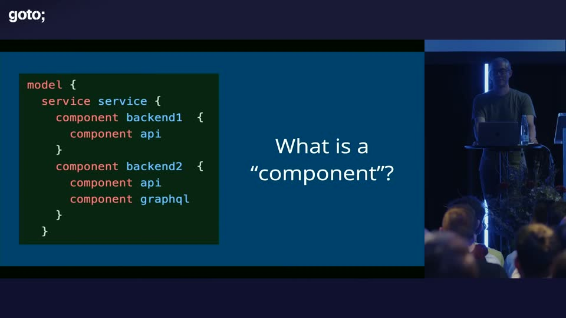

*图：LikeC4 网站示例的 DSL 片段，service 里的 component backend1、backend2 又各自包含 component api、graphql，旁边问“什么是一个‘组件’？”（视频 20:10）。*

还有人给 LikeC4 提 bug 时，用来复现问题的例子嵌套得更深。一个描述软件架构的领域专用语言能写出这种东西，让他很介意。

他把这件事放回历史里看：二十多年前大家随手画方框箭头，他给它加上结构、定义了一组抽象，这就是 C4；现在又有人说 C4 太死板，要更灵活的抽象层级。理论上 Ilograph 的“具体建模”和 LikeC4 都在往前走一步，提供更大的灵活性。但问题是定义抽象非常难（21:23）。他只有四个层级，十到十五年来还得不断修订这四个层级的定义，去回答教学中积累的各种问题。如果不愿意花力气把新增的灵活抽象定义清楚，结果往往不是扩展了 C4，而是绕了一圈回到原点：新抽象里只要有一点歧义，就又回到随手画方框的状态。

## 子系统、限界上下文、分层：是组织结构，不是新的抽象

他认为人们觉得 C4 太局限，是因为脑子里混了概念：想把所有东西都定义成抽象，而有些东西更适合当作组织结构，不必自成一种抽象。人们想额外建模的通常是三类东西。一是子系统：一个庞大的单体系统，想画一张简化图展示里面有哪些子系统。二是限界上下文：一个单体覆盖了好几个 DDD 限界上下文，底层的图惨不忍睹，于是画一张简化图展示各上下文怎样协作。三是分层：单体应用细节太复杂，就画一张只有几层的简图。三张示意图在幻灯片上都被打了红叉，他说他不认为这些图特别有用。

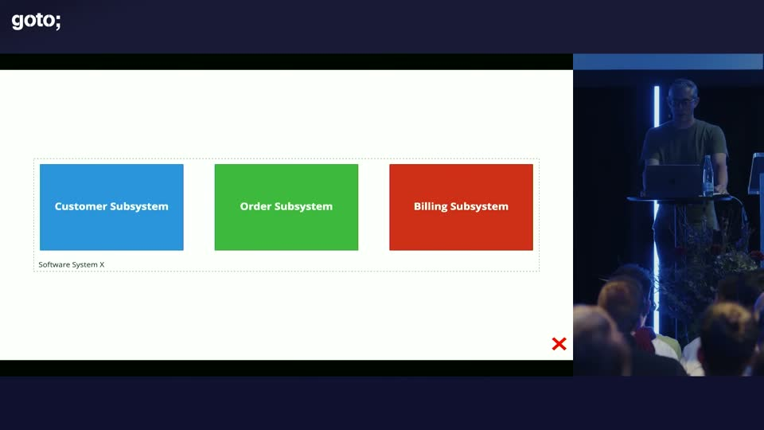

*图：Software System X 里只画三个彩色方块：Customer、Order、Billing Subsystem，右下角红叉表示不推荐（视频 22:30）。*

他强调，他不是说子系统、限界上下文和分层没用，而是认为它们不是独立的抽象，而是组织性的构造，在画 C4 图时这样理解更合适（23:17）。以分层为例：假设在用 Java、Spring Boot、Spring MVC 构建一个 Web 应用，里面有很多组件，按架构分层组织为 Web 层、业务（服务）层和数据层。图上仍然把两个 service 和两个 repository 画成组件，然后用虚线框把 service 圈起来，标注“这是服务层”，repository 层同理。如果想说明这些 repository 组件来自某个构建期的模块，比如一个 JAR 文件，也可以同样画一个框。分层和模块边界在这里都是叠加在 C4 抽象之上的组织结构。

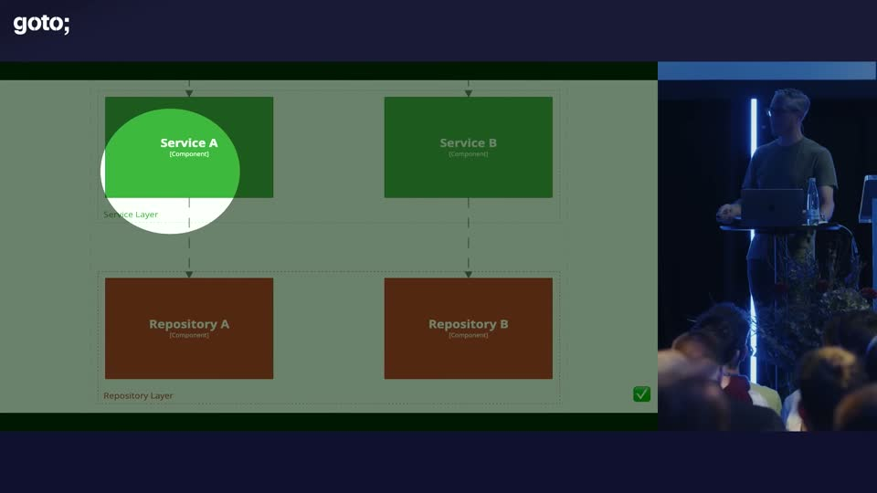

*图：Service A、Service B 两个组件被虚线框标为 Service Layer，Repository A、B 被标为 Repository Layer，右下角绿勾表示推荐（视频 24:04，画面中的圆形光圈是演示时的高亮效果）。*

## 消息驱动架构：队列和主题本身就是容器

消息驱动架构总是难倒人。最诱人的画法是把一堆服务都连到一条消息总线上，再由总线转发给另一堆服务。他说这不是用 C4 建模消息架构的好方法：结果是一个星形结构，所有东西进去、所有东西出来，看不到真实的细节。而且这种画法把消息总线（RabbitMQ 或 Kafka）当成了一个 C4 容器，这是错误的做法，所以图角上打了叉（24:45）。

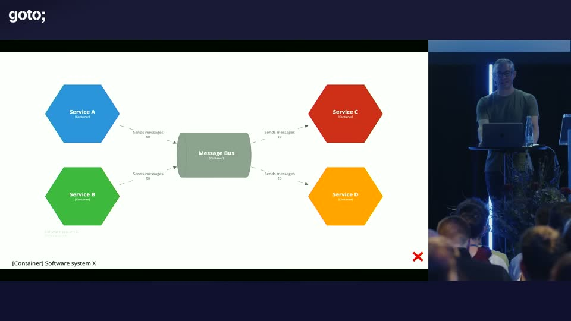

*图：Service A、B 都“Sends messages to” 一个 Message Bus 容器，再由它发往 Service C、D，右下角红叉（视频 24:46）。*

他会这样画：假设 Service A 通过一个叫 X 的队列与 Service C 点对点耦合，就照实画出来；Service B 和 D 之间通过队列 Y 也是一样。也就是把每个具体的主题和队列当成 C4 容器（25:45）。理由是 C4 容器要么是应用，要么是数据存储；一个队列或主题不是应用，但它是数据存储：一个桶，有东西往里放消息，有一个或多个进程从里面取消息。这样还能把静态视图和部署视图分开：开发时两个队列可能都在笔记本上的同一个 RabbitMQ broker 里；到了生产环境，队列 X 可能在一个集群上，队列 Y 在另一个集群上，甚至在另一个 AWS 区域。

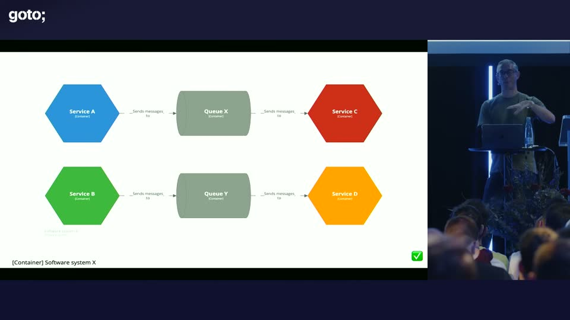

*图：Service A → Queue X → Service C、Service B → Queue Y → Service D，两个队列都是独立的容器，右下角绿勾（视频 25:49）。*

如果确实是一对一的点对点耦合，你可以说中间那些队列和主题只是添乱，为什么不直接在服务之间画箭头？他说也可以。C4 的作图和建模往往没有唯一正确的方式，几种方式本质相同，只是视觉上的杂乱程度和简洁程度不同。直接连线的版本视觉上更简单，箭头上写“via Queue X”，但主题和队列就变得隐含了。有人喜欢前一种，有人喜欢后一种，他觉得都行。

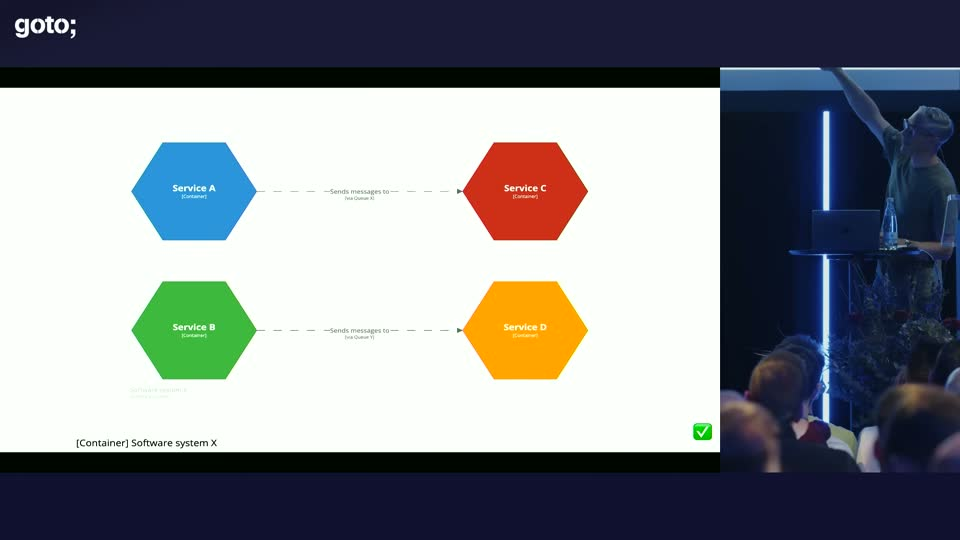

*图：Service A 直接指向 Service C，箭头标注“Sends messages to [via Queue X]”，下方 B→D 同理（视频 27:10）。*

到目前为止所有箭头都是从左向右的。如果是真正的发布订阅架构，尤其是一对多，可以把部分箭头反过来并改写说明：Service A“向队列 X 发布消息”，订阅方“从中订阅消息”。他认为这种写法更适合真正一对多的情况，鼓励大家多试试箭头方向，尤其是箭头上的描述。总之，把队列和主题当作容器，是用 C4 建模消息驱动架构最好的方式。

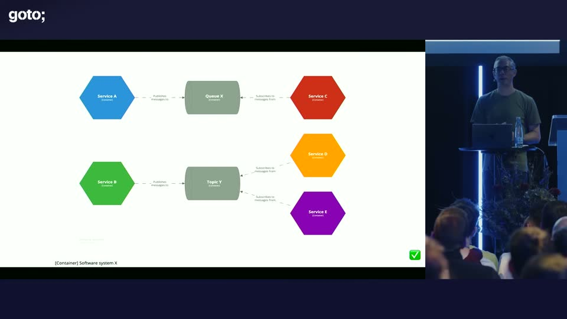

*图：Service A“Publishes messages to” Queue X，Service C“Subscribes to messages from”它；Service B 发布到 Topic Y，Service D、E 同时订阅（视频 27:55）。*

## 共享库：运行时有几份，就画几份

共享库和共享代码怎么画，也是他常被问到的问题（28:08）。假设两个应用都用了一个共享的日志组件，它来自一个共享库，可能发布在 NuGet、Maven Central 或 npm 上。很多人会把这个共享库画成一个 C4 容器，这样只需要画一份，再让两个应用都指向它，表示它是共享的。他说这不是最好的做法。

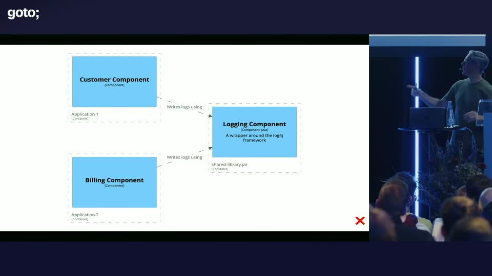

*图：Application 1 的 Customer Component 和 Application 2 的 Billing Component 都“Writes logs using”一个放在 shared-library.jar 容器里的 Logging Component（一个 log4j 封装），右下角红叉（视频 28:34）。*

从开发者的角度想：两个应用在运行，每个应用里都跑着一份共享代码。部署时实际上有两份共享代码，分别运行在两个独立应用、两个独立的容器边界里，所以就照这样画：两个应用容器里各有一份日志组件。有人会说这样看不出两个日志组件是共享代码，这没错，所以可以再加一层颜色编码，标出它们是共享代码，并记得在图例里说明。还可以用前面讲的组织结构，在日志组件外面画一个小框，标明它来自 shared-library.jar。这里是把几种手法组合起来用。

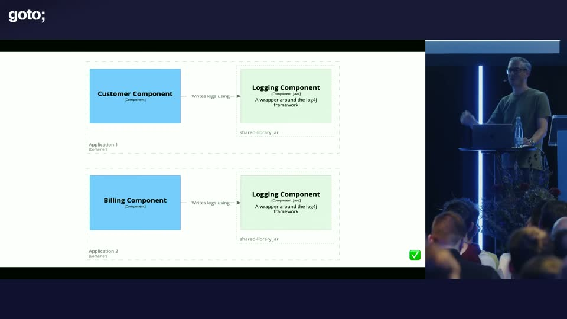

*图：两个应用容器里各有一个 Logging Component，用浅绿色标为共享代码，并各自套上 shared-library.jar 的虚线框，右下角绿勾（视频 29:58）。*

## 微服务：软件系统、容器，还是一组容器

微服务大概是他看到团队用 C4 时最挣扎的地方（30:07）。有一本很流行的软件架构书写道：C4 更适合单体架构，不能很好地支持分布式架构。他说这不对，他和那本书的作者谈过，两人观点不同，但从他的角度看这个说法不成立。

很多人一开始这样建模：把微服务画成容器，把 API 和数据库 schema 画成容器里的组件（30:36）。但在 C4 里，组件不是能单独运行的东西，所以把 API 和数据库 schema 表示成组件不符合抽象定义。这些人是从低了一层的地方起步，结果被迫毫无必要地往下多画好几层。他的答案是，微服务应当被建模为以下三者之一：一个软件系统、一个容器，或一组容器。可惜选项不止一个，于是他用一个场景把三种情况都演示了一遍。

假设我们在一家小创业公司，两三个开发者，一个团队，第一版做成单体。上下文图说：我们在建软件系统 X，向用户提供业务能力 A、B、C。容器图也很简单：一个单体 Web 应用提供单体界面，读写一个单体数据库 schema。

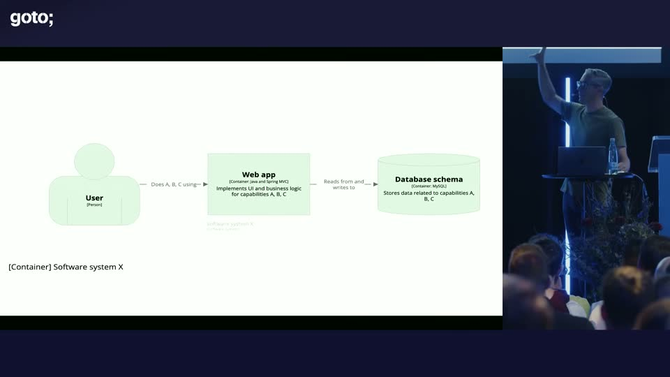

*图：Software System X 的容器图，User 通过 Web app（Java and Spring MVC）完成 A、B、C，Web app 读写一个 MySQL 数据库 schema（视频 31:52）。*

后来有了客户、有了增长、有了收入，也开始感到拖累，也许是单一代码仓库，也许是扩展性问题，于是想往微服务架构走。这就引出一个问题：什么是微服务？他采用 James Lewis 和 Martin Fowler 在 Fowler 网站上给出的定义：“简而言之，微服务架构风格是一种把单个应用开发成一组小服务的方法，每个服务运行在自己的进程中，通过轻量机制通信。”（32:18）他喜欢这个定义，但想把它“C4 化”，于是只改一个词：把“单个应用”改成“单个软件系统”。

这样一来，上下文图不变，因为仍然是一个团队在构建全部软件。容器图变了：保留单体 Web 界面，把能力 A、B、C 拆成独立服务，每个服务有自己独立的数据库 schema。每个服务因此由两样东西组成：一个 API（比如一个 Spring Boot 应用），加一个关系型数据库 schema。他用颜色表示成对的元素属于同一个服务；想更明确，可以再用组织结构的手法给每个服务画上边界。

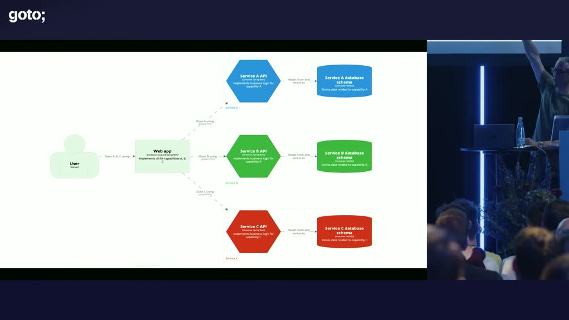

*图：Web app 分别调用 Service A、B、C 的 API，每个 API 读写自己的数据库 schema；同色元素外的虚线框标出 Service A、B、C 的边界（视频 33:46）。*

业务继续增长，系统加了能力 D，用一个 Python 写的 AWS Lambda 实现，完全无状态，不存数据。这时这个服务就是一个单独的 C4 容器。这张图展示了三种选项中的两种：微服务可以是单个容器（D），也可以是一组容器（A、B、C）。这里的前提是仍然只有一个开发团队。按照改写后的定义，微服务风格是用一组小服务开发单个软件系统的方式，所以这些服务全都在软件系统的边界之内：大家是一个团队，团队可以改其中任何一个服务。

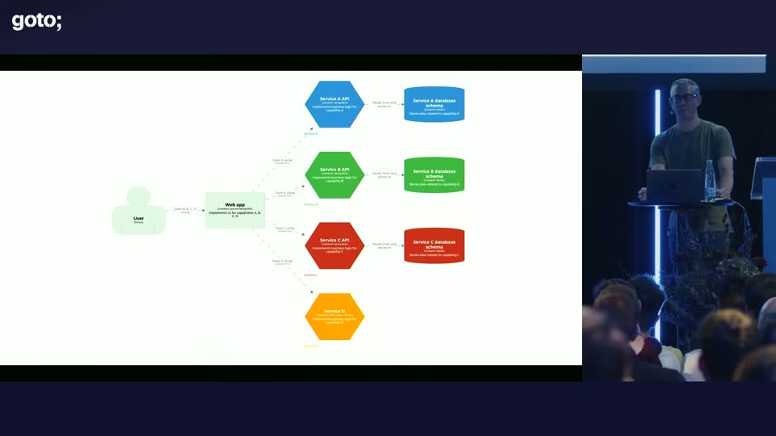

*图：在前一张图基础上新增 Service D，它只有一个容器，没有数据库（视频 33:58）。*

再假设钱多了起来，要按康威定律来组织（34:42）：开始为各个服务组建新团队，把服务推出原团队的边界，因为这样效率更高。“我”留在团队 X 继续构建软件系统 X，其他服务各自交给独立的团队。这时“我”的上下文图变了：我在建系统 X，用户使用我的系统，我的系统依赖那些服务，而那些服务都被当作独立的软件系统。你们去建服务 A 了，我看不到你们的内部实现；B、C、D 也一样。我的容器图仍然是那个单体 Web 应用，只是现在调用的是被映射成软件系统的外部服务。

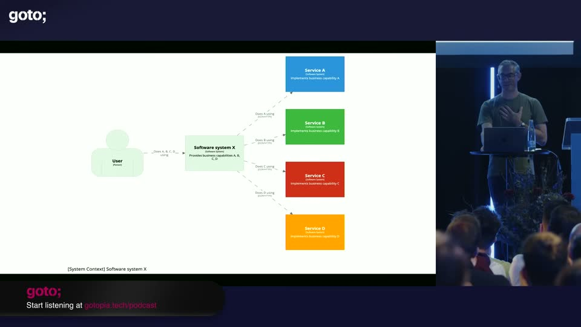

*图：团队 X 视角的系统上下文图：User 使用 Software system X，系统 X 依赖作为独立软件系统的 Service A–D（视频 35:08）。*

如果你们都加入了服务 A 的团队，你们的上下文图是：这是你们的系统，有一个来自我的系统的入站依赖；放大到容器图，你们在建的服务由一个 API 和一个数据库组成。这里用软件系统这个抽象来描述微服务，判断依据是团队边界：你能看到它的实现细节吗？

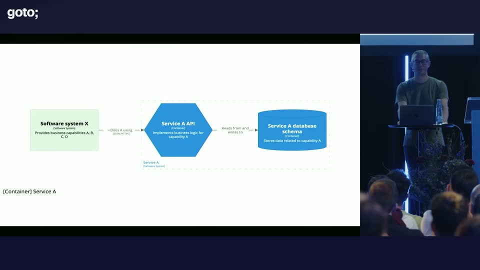

*图：服务 A 团队的视角：Software system X 调用 Service A API，Service A API 读写 Service A 的数据库 schema，两者在 Service A 的软件系统边界内（视频 35:54）。*

他顺带提了微前端，说那是更长的故事（36:10）。如果你在用微前端并且感到吃力，他建议看集成方式：是通过 npm 提供一组 JavaScript 组件嵌进页面，还是做成更独立的、按软件系统纵向切分、用 iframe 之类方式集成的形态？集成方式会把你引向正确的建模方向。

## 跨团队依赖：只画自己边界内的容器

他的建议是，画容器图时只展示自己软件系统边界内的容器（36:37）。比如我在建系统 A，它由一个 Spring Boot 应用组成，依赖你们在建的系统 B。我的容器图只展示我的内部细节，不展示你们的；你们的容器图展示你们的内部细节，比如一个 Node.js API，并显示一个来自我的系统的入站依赖，你们看不到我的实现。

他不建议把两张图混在一起，画成我的容器直接调用你的容器。原因是这样一来双方都知道了对方的细节：我把 Spring Boot 应用改写成别的技术，你的图就得改；你把单个 Node.js 应用拆成两个，我的图也得改。既然我对你们在做什么了解这么多，也许我们其实应该是一个团队。这里存在一种没人谈论的额外耦合，也许真该合并成一个团队。

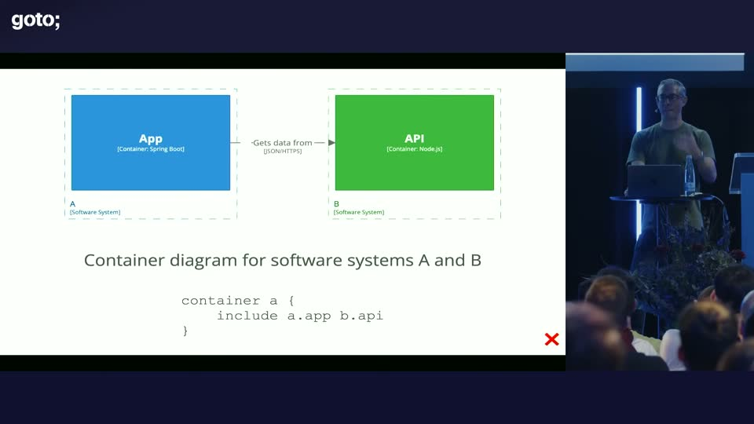

*图：系统 A 的 App（Spring Boot）直接调用系统 B 的 API（Node.js），对应的 Structurizr 视图写作 `include a.app b.api`，右下角红叉。推荐的版本只画 A 的 App 指向软件系统 B（视频 37:16）。*

这条规则有例外，比如共享数据库。他知道不该通过共享数据库做集成，但大量现存软件就是这样做的。假设系统 A 和系统 B 之间通过一个共享数据库交换数据，你要问的是：这个共享数据库归谁？如果大家定不下来，也许就在中间建一个约定俗成的系统来放它。消息架构也一样：两个系统通过一个队列通信，队列归谁？数据格式归谁？消息的 schema 归谁？回答了这些问题，就知道该把队列放进哪个系统的上下文；答不上来，也许就在中间放一个占位的东西。

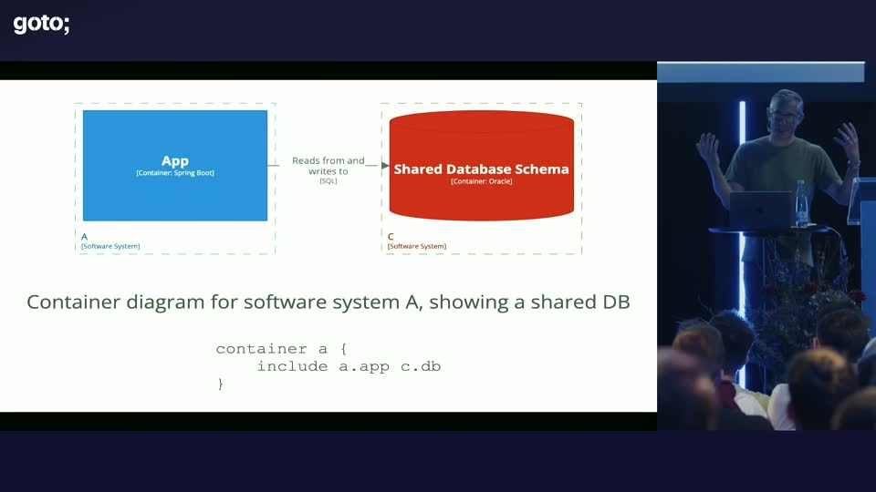

*图：系统 A 的 App 读写一个 Shared Database Schema（Container: Oracle），这个 schema 被放在单独的软件系统 C 里，视图写作 `include a.app c.db`（视频 38:00）。*

## “C4 不能扩展”是工具问题

很多人说 C4 无法扩展到大系统，他认为这是工具问题（38:39）。假设有一个微服务架构，八个服务，每个服务都是一个 API 加一个数据库 schema。八个还勉强能看，加到九个、十个、十二个、二十个，图很快就会乱成一团。

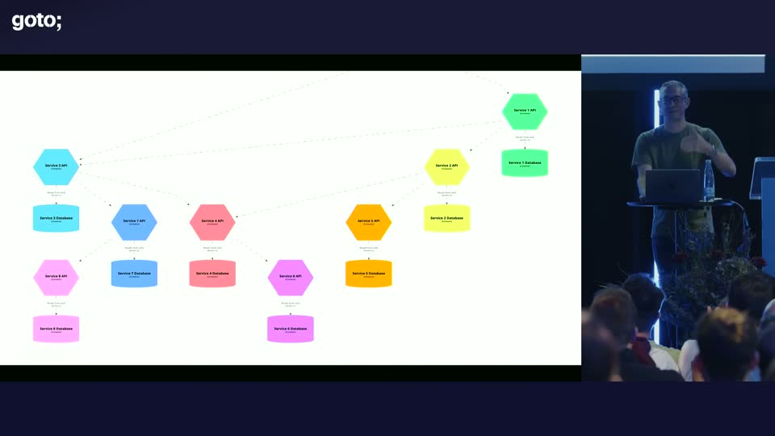

*图：八个服务的 API 与数据库 schema 全部画在一张容器图里，连线已经开始交错（视频 38:55）。*

一种办法是每个服务画一张图，只显示进出这个服务的东西，也就是收窄视角。用 Visio 做这件事非常难：你得弄清楚哪些元素相连，把它们复制到单独的标签页，还得一直保持同步。用他的 Structurizr，因为是基于模型的，写一个小表达式，剩下的事情自动完成；服务二、服务三的视图写法完全一样。这是在对模型做切片，展示信息的一个子集、一个分区。

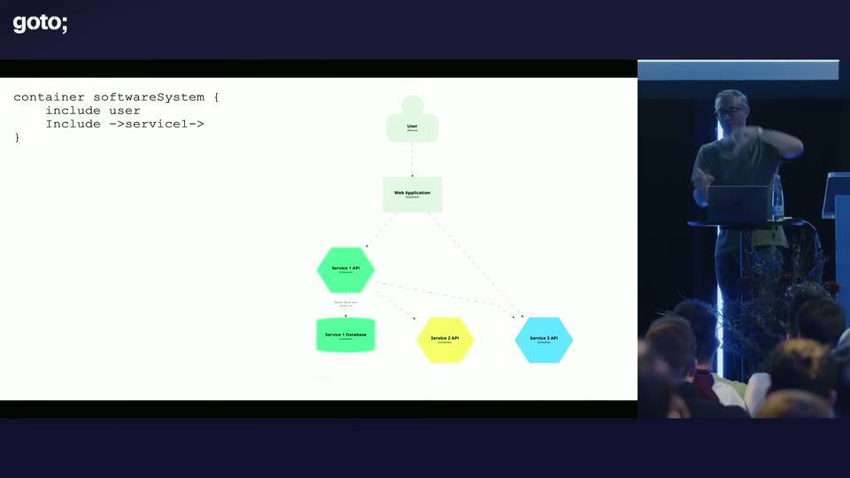

*图：左上角的视图定义 `include user` 和 `include ->service1->`，右边只显示与 Service 1 API 直接相连的元素（视频 39:17）。*

也可以换别的可视化形式。Structurizr 支持 D3 力导向图，完全可交互，展示这个软件系统里的所有容器，形式更紧凑；可以点来点去、显示最近的邻居，有提示框，可以嵌入元数据。他认为这种可视化风格更适合探索复杂的架构。同样，也可以把模型导入 Ilograph 这类能浏览层级数据结构的工具。

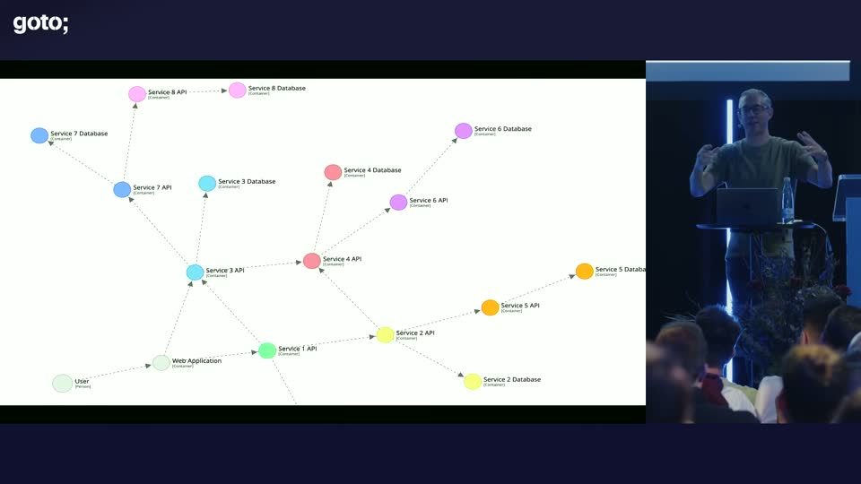

*图：同一个系统的所有容器以力导向图展示，节点是各服务的 API 与数据库（视频 39:52）。*

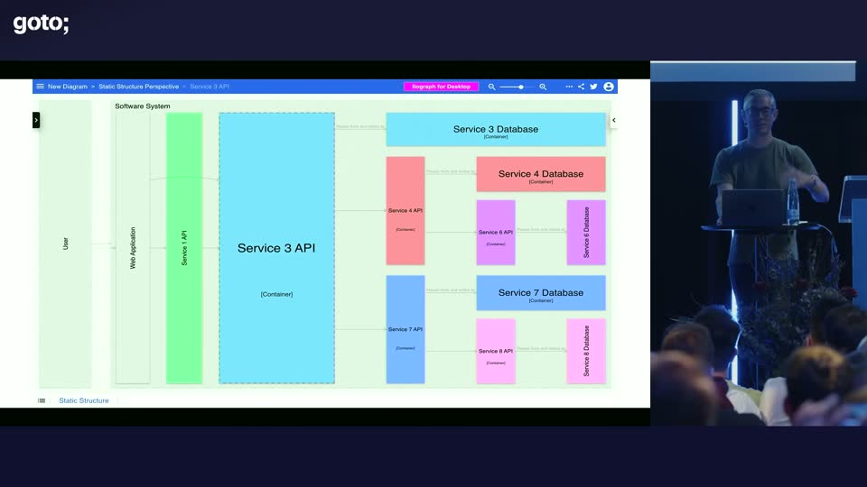

*图：同一模型在 Ilograph 中的层级视图，当前聚焦在 Service 3 API（视频 40:18）。*

## 图会过时：从已有的数据源生成

最后一个说法是“C4 还是解决不了图过时的问题”（40:21）。他说确实解决不了。C4 是一套抽象、一套图类型，与记法和工具都无关，所以要靠工具来让图保持最新。他按层级给了数据来源：

系统全景图和系统上下文图，应该从组织里已有的数据源引导生成。很多公司在 ServiceNow 或 Spotify 的 Backstage 上登记了服务和系统，就拿它当数据源：写点代码对接 Backstage 的 API，拉下所有服务、系统、应用及其之间的连接，用来生成 C4 系统全景图和上下文图（40:51）。容器图更难自动生成，但可以解析日志文件、解析构建脚本，或者用 OpenTelemetry 的链路追踪和可观测性数据，识别环境中在运行的东西，以及它们之间的连接、事件和消息。组件图放大到单个应用的边界之内，这里用传统的静态分析和逆向工程技术，作用于编译后的字节码或源代码，识别组件并从代码库自动生成组件图。

至于具体怎么做，他介绍了演讲前几周刚发布的 Structurizr 第 3 版，全部开源，基于 Java（41:57）。在 Structurizr DSL 里现在可以写一个 `!components` 块，把 DSL 指向一些编译好的 Java 代码和源代码。他的例子识别两类很不一样的组件：Web 控制器组件和 repository 组件。工具会找出它们之间所有的依赖关系，这一小段代码就能从真实代码库生成组件图。

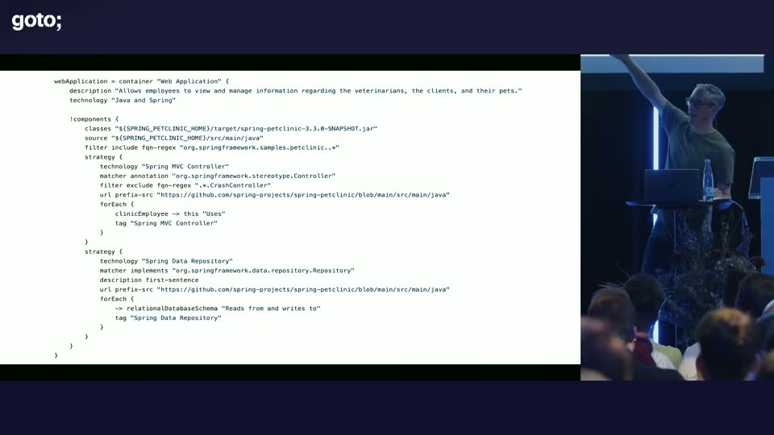

*图：针对 Spring PetClinic 的 DSL：`classes` 指向编译好的 jar，`source` 指向 src/main/java；一条策略按注解 `org.springframework.stereotype.Controller` 识别 Spring MVC Controller，另一条按是否实现 `org.springframework.data.repository.Repository` 识别 Spring Data Repository（视频 42:04）。*

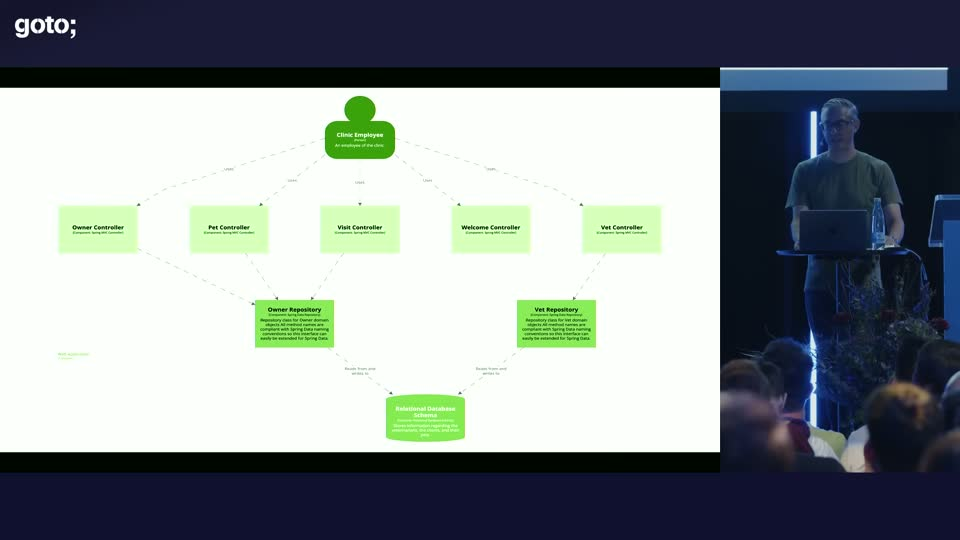

*图：上面那段 DSL 生成的组件图：Clinic Employee 使用 Owner、Pet、Visit、Welcome、Vet 五个控制器，控制器经 Owner Repository 和 Vet Repository 读写关系型数据库 schema（视频 42:34）。*

部署图也一样：解析 Terraform、CloudFormation 或 AWS 配置，用来生成部署图（42:36）。他说这方面他没有现成工具，不过“我们是开发者，大概可以自己做”。

## 架构图的成熟度模型

结尾他介绍了最近和客户一起用的一个“软件架构图成熟度模型”（42:52），分五级。第一级“初始”：没有架构图，很多团队在这里。第二级“临时”：画着他前面展示的那种随手画的图，不少团队在这里。第三级“已定义”：在通用作图工具里，用定义好的抽象和记法画架构图；仅仅采用 C4 就能到这一级，用作图工具或建模工具都行。要往上走，就得开始用建模工具，他认为这可能是最大的一跃。第四级“已建模”：用建模工具，手工编写模型。第五级“持续优化”：对接 Backstage，从数据源自动生成图，对模型做查询，比如把模型导入 Neo4j 向它提问。他说一旦跨过从作图工具到建模工具这道坎，能做很多有意思的事。

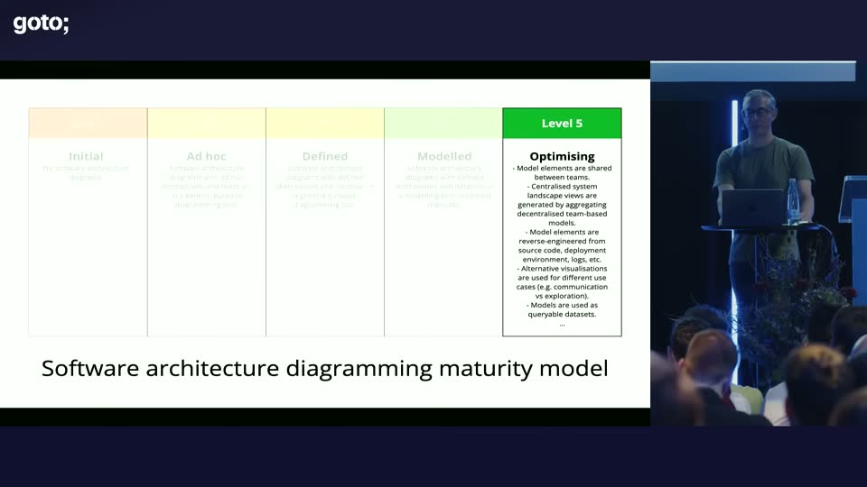

*图：“Software architecture diagramming maturity model”的第五级 Optimising：模型元素在团队间共享；集中的系统全景视图由各团队的去中心化模型聚合生成；模型元素从源代码、部署环境、日志等逆向工程得到；针对不同用途（沟通还是探索）使用不同的可视化；模型被当作可查询的数据集（视频 43:29）。*

他的收尾仍是开头那句话：C4 就是一套抽象、一套图类型，与记法无关，也与工具无关。
