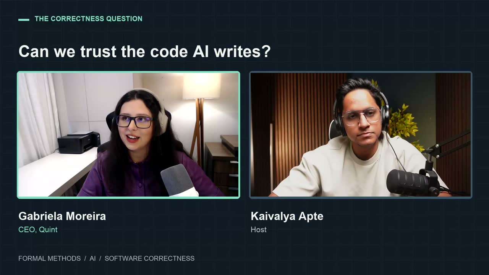
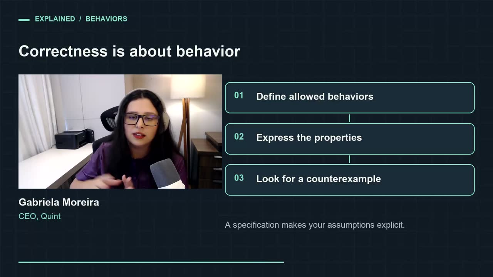
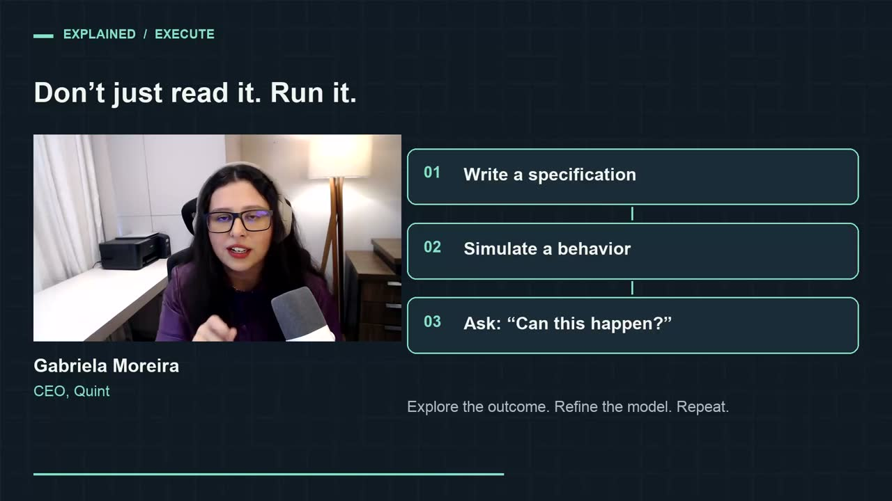
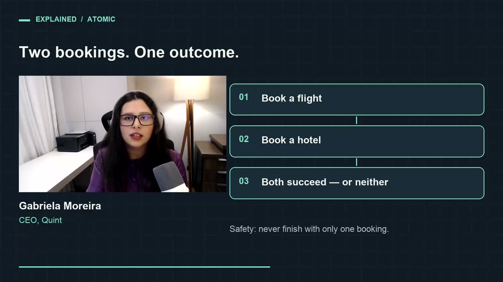
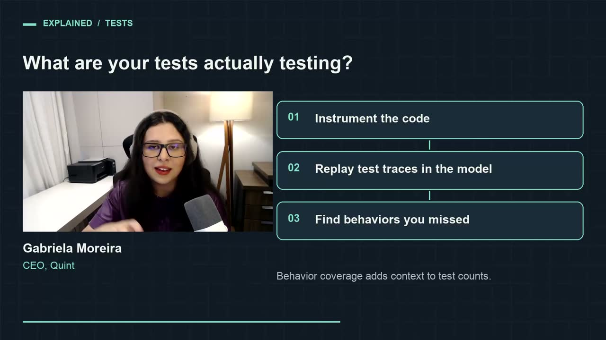
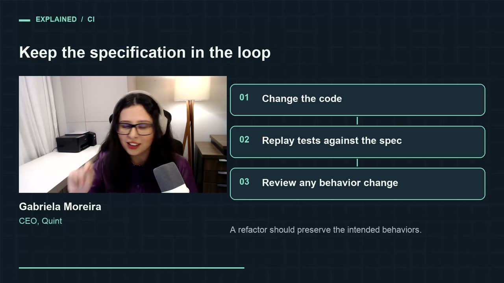
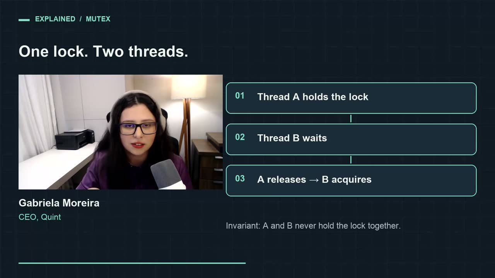
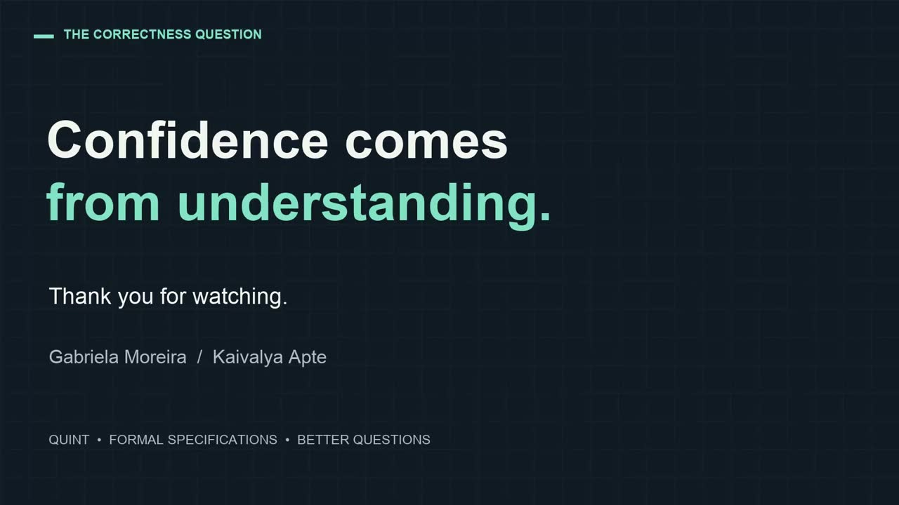

# AI 写的代码能信吗：Quint 的 Gabriela Moreira 谈形式化规格、行为与“理解带来的信心”

这篇整理自一期约 61 分钟的访谈视频《Can We Trust AI-Written Code? Gabriela Moreira on Quint & Formal Methods》。主持人是 Kaivalya Apte，嘉宾 Gabriela Moreira 是形式化规格语言 Quint 的创造者之一，也是 Quint 公司的 CEO。她来自巴西南部，大学快毕业时接触到形式化方法，同时在业界工作，做过分布式系统、消息队列、数据库这类东西；她觉得学术界的这套方法对工作非常有用，却因为形态太复杂很难推广，从那以后一直在做让形式化方法更易用的工具。她在上一家公司开始开发 Quint，做了将近五年，录制当年 Quint 分拆成独立公司，她全职做这件事（02:14–03:22）。访谈录制于某年 9 月（她在节目里提到录制月份，没有说年份），正值 Quint Studio 发布 beta。

对在用 AI 写代码、又说不清这些代码到底对不对的工程师，这篇讲清了她的几个核心判断：正确性应当用“行为”来定义；规格要运行而不是阅读；AI 让写规格几乎零成本，但定义属性仍然难；以及她的团队现在用 Quint 解决的具体问题：AI 生成的测试到底测了什么。文中时间码对应原视频。

*图：节目的分屏画面，标题“Can we trust the code AI writes?”，左为 Gabriela Moreira（CEO, Quint），右为主持人 Kaivalya Apte；底部标签为 Formal methods / AI / Software correctness（视频 25:25）。*

## “Claude 给我写了 400 个测试，我一个都不信”

节目开头剪进来的是她后面说的一句话：Claude 为她写了四百个测试，她对其中任何一个都毫无信心（00:00）。完整的语境出现在 30:51：他们团队自己用 AI 做了不少原型，碰到的正是这个问题。每次去看这些测试，都觉得很蠢，只是在断言一些无关紧要的东西，于是她不敢改这些软件，因为她不信任任何一个测试。反过来，回到她以前手写测试的开源 Quint 代码库，她对那些测试很有信心，改起来心里踏实得多。她的结论是：业界正想用形式化验证做很前沿的事，却先丢掉了用了多年的那个基础工具，也就是对测试的信任。所以她决定退一步，先解决测试的问题（30:51–31:36）。

## 什么叫“正确”：从类型系统到行为

主持人先请她定义软件正确性（03:26）。她从大多数人每天都在用的形式化方法讲起：类型系统。用带类型检查器的语言写程序，如果类型系统设计得好，写出的程序就是“类型正确”的：相对于类型来说它是对的，相对于别的东西它可能是错的。你写下某些东西应该是什么类型，这就是一份规格；类型检查器去检查它，不对就告诉你。她说拿这个来解释形式化方法有点“作弊”，因为它是非常轻量、非常普遍的一种。

更高层次的正确性能表达的远不止类型安全，而是关于整个系统、它能做什么的各种性质（04:52）。她喜欢把它说成“软件能有和不能有的行为”。用 Quint 或 TLA+ 写规格时，你在定义哪些行为是正确的，定义之外的都是错误的；然后去检查你的软件、你的方案是否只有你定义的那些行为，有没有越界的行为；再针对这些行为定义属性。

*图：节目插入的讲解卡“Correctness is about behavior”：01 定义允许的行为；02 写出属性；03 寻找反例。底注：“规格让你的假设变得明确。”（视频 05:20）*

她紧接着说，难的是定义属性（05:40）。尤其在 AI 时代，写出形式化规格本身已经容易得多：你不必坐下来专门学 TLA+ 或 Quint 的语法，也不必去适应它们和编程语言不同的那些细微之处，只要跟 agent 说“我有这个想法”或“我有这段代码，请帮我写一份形式化规格”。这部分现在很容易。可定义属性依然难。你可以让 agent 帮你找一些属性，但有些属性比另一些明显得多。很多团队默认属性可以推断出来，或者只检查最基本的属性，比如“软件不会崩溃”，这一点没有任何争议；或者“在某个阈值以内的崩溃可以容忍，阈值以内保证正确”。她更感兴趣的是那些需要停下来想一想“到底哪个才是对的”的情况：在这种场景下，我们希望软件做什么？她强调明显的属性仍然非常有用，能证明软件不崩溃、类型正确，都很了不起，这也是大家每天都在做的事；但她最关心的是那些微妙的、需要判断对错的部分（06:14–07:36）。

## AI 写代码、写规格、写测试，人还能在哪里把关

主持人说出了他自己对形式化规格的顾虑（07:38）：它对不熟悉的人来说一直很难接近，工程师本来就要写代码、理解分布式系统的各种故障模式，再去读规格让人望而生畏。AI 让规格变得可及，可如果代码、规格、测试都由 AI 来写，怎么确保规格是对的？他能读懂代码，大致理解测试，但读规格可能让人不知所措。到什么时候，人才能对 AI 写的规格有足够的信心，把代码部署到生产？

她先回应了“AI 写点什么，然后我就有信心”这个前提：她不太相信这种模式（08:54）。即使是形式化方法、即使是形式化证明也一样：AI 写了一个证明，好，可它证明了什么？你仍然得理解某样东西，要有信心，就得有理解，可能是理解代码，可能是理解规格，也可能是理解别的东西。

关于“读代码比读规格舒服”，她认为这对现在的大多数程序员来说是事实，因为大家习惯读代码、不熟悉规格的语言。但规格比代码更抽象（09:36）。代码里有日志、有解释细节的注释、有各种优化（“因为性能，必须这么写而不是那么写”）；看一个函数，日志、性能优化、正确性各种关注点都混在同一个作用域里。规格停留在更高的层次，只读规格往往比读一段夹杂着大量细节的代码更容易理解一个算法。所以理论上读规格可以比读代码容易，只是大家更习惯读代码，将来情况也许会变。她说明自己并不是在鼓吹这一点，只是指出存在这样一层抽象。

她对这个问题的核心回答是：我们检查的是行为（10:50）。她说她最喜欢的两个词是“行为”和“可执行”。她刚学编程时，写一段代码、运行、看结果，然后改一改再运行，那种感觉很好，程序员就是这样思考和工作的。现在不同了：写几句提示词，生成一大堆代码，你不一定会去运行它，也许配一些测试，这种可执行性正在丢失。如果有一份可以运行的系统描述，你能看到“它是这样表现的，这个行为我喜欢；它那样表现，这个行为不好”，那就是定义正确性的层次。简而言之，她认为你不该去读规格，而应该运行规格、看它的行为（11:46）：模拟一次，看到一种行为；再模拟一次，看到另一种。也不只是随机模拟，你可以向它提问：这件事有没有可能发生？工具去模拟，然后告诉你“可能，看，它是这样发生的”，给出一个具体的行为：用户先登录，然后点了这里，再点了那里，最后得到了那个结果。你一看就知道，这不应该发生。

*图：讲解卡“Don't just read it. Run it.”：01 写一份规格；02 模拟一个行为；03 提问“这能发生吗？”。底注：“探索结果，改进模型，重复。”（视频 12:01）*

她顺着自己举的前端例子说下去（12:22）：前端领域有行为驱动测试，你只描述高层的行为，由测试引擎去执行，她觉得这很漂亮。“行为”这个概念在前端好用，是因为那里有大量的非确定性：用户可以点这里、点那里，可以随时登出，可以同时开两个窗口，所以你必须考虑用户可能做的所有事情。分布式系统和并发系统也一样有大量非确定性，区别在于做出各种怪事的不是用户，而是处理器上的调度器：它会以你没想到的顺序安排事情，你的东西就会坏掉。所以她主张把行为驱动的测试也用在系统的核心部分，覆盖线程的不同执行顺序、文件被读取的不同顺序。

## 行为多到数不清怎么办

主持人不完全买账（13:44）：网页上用户能做的操作是有限的，比如一百种，可以枚举出来、在脑子里建立模型；复杂的分布式系统可能发生的事情有上百万种，写规格或验证规格时很难保证都考虑到了，这个差距怎么弥合？

她先讲了一段教学经历（15:06）。她在大学教形式化方法时，很多学生还没修分布式系统，甚至没学过操作系统、不熟悉线程，很难向他们解释“你需要一个工具来考虑所有可能的场景”，因为他们写的代码在脑子里就能想清楚所有情况。她主要用游戏来讲概念：游戏里会发生各种各样的事，你要有一种策略在每一种情况下都能赢过对手，这很像一个协议，必须在每一种情况下都保证某件事。后来一个学生带着一个前端 bug 来找她，说这里能用 Quint 吧？那是一个前端的并发 bug：两个用户同时打开同一个页面，一个用户删除了某样东西，另一个用户的页面没有自动刷新，那他去编辑那个已经被删除的东西时会怎样？应该怎样？可以直接报错，也可以覆盖写入，但哪个才是正确的行为？不知道，取决于业务领域、取决于他们想要什么。她的意思是复杂度可能出现在意想不到的地方，但最肯定会遇到复杂度的，还是分布式系统和各种故障模式。

在那里，她认为必须组合使用多种技术（16:57）。她很推崇混沌工程，也很欣赏 Antithesis 在做的事（一家做自主测试与模拟的公司），确定性模拟测试也是好办法。从形式化方法的角度看，你设计系统或方案、验证一些属性，但主持人说得对：模型多半无法涵盖现实世界里可能发生的全部复杂情况，总有遗漏。于是会出现规格是对的、代码却是错的情况，而你真正在乎的是代码。怎样检查代码与规格一致？她提到的一种技术是基于模型的测试：从模型生成各种行为、各种执行轨迹，拿去在代码上回放。在分布式系统里这非常有挑战性，因为你没法回放调度器当时做了什么，需要确定性模拟引擎才能做到。她对确定性模拟测试近来的发展很期待，认为这能帮形式化方法领域的人更好地测试这类系统、覆盖更多场景，但这件事很难（17:42–18:27）。

主持人把这段归纳为：不能只靠看规格获得信心，要运行它，也不能止步于此，要从各个角度，用确定性模拟、混沌测试等手段反复冲击系统去找 bug；而且这是个持续的过程，需求变了、发现改进点了，规格也要跟着变（18:30–19:23）。

## 模型该抽象到什么程度

主持人接着问（19:27）：模型是生产代码的简化版，有意省略了大量实现细节，那该包含哪些东西，怎样才不至于写得几乎和代码一样？

她说这是个大问题，展开能讲一个小时，先讲些基础（19:56）。首先她不确定“简化版”这个说法，规格是更抽象的版本，“更简单”不一定是对的词。文献里推荐的一种做法是：如果代码里某处要排序，你选择调用快速排序；规格里并不需要实现或定义快速排序再去调用它，因为你并不担心快速排序本身对不对，可以假设它能把列表排好，于是只写“这个函数接收一个无序列表、返回一个有序列表”，不必关心细节。这是她教书时会讲的标准答案。

但她认为真正最有用的判断标准是：这份规格足以捕获 bug 吗？我建模的东西足以捕获某一类 bug 吗（21:12）？以一个能容错的分布式系统为例：一个节点故障，你不希望整个系统失败；超过半数节点故障时也许确实无能为力，但少数节点故障时要能容忍。这种情况下模型就不只是代码的简化版了，模型必须搭建出一个包含多个节点、节点会故障的环境。代码里你永远不会写“在这里随机失败一下”，你不会去实现故障；但建模、想看清现实中会发生什么时，必须把这个环境也建进去：任何时刻最多有 N 个节点可能崩溃。崩溃又意味着什么？不再响应消息？丢掉消息缓冲区？这些都要在模型里定义。所以这类场景下模型和代码看起来很不一样，因为多了这整片“对抗面”（adversarial surface，模型里那些外部环境可能对系统使坏的方式）。她认为把对抗面建对，是模型好坏的关键之一（21:46–22:42）。

工具也能帮忙，因为规格是可执行的。她换了个例子：共识里的两阶段提交（22:53）。常见的例子是订机票和订酒店：只有两者都订成功才算数，有机票没酒店不行，有酒店没机票也不行。这是一个一致性属性：永远不会出现只有其中一个的状态。

*图：讲解卡“Two bookings. One outcome.”：01 订机票；02 订酒店；03 要么都成功，要么都不成功。底注：“安全性：永远不会只完成其中一项预订。”（视频 23:20）*

如果你想验证这个属性，带着完整的对抗面去运行模型，结果找不到任何违反属性的情况，这时反而要怀疑一下：也许模型没有覆盖所有方面。那就改进模型，直到能找到会出问题的场景；然后正确地实现算法，问题就不会再出现。换句话说，先实现一个错误的版本，看它是否真的会破坏属性，再去写正确的版本（23:27–23:52）。同样，还要检查模型到底有没有做任何有意义的事：一个什么都不做的模型永远满足这个属性，一张机票、一间酒店都不订的模型完全符合“不会只订一个”。所以要确认模型确实有时会订到机票和酒店，同时又满足属性。他们会借助模拟器乃至模型检查器（对软件做验证的那个工具）来判断模型是否足以捕获 bug（23:58–24:34）。

## Quint 为什么诞生，现在又在解决什么

谈到 Quint 本身（25:16），她先讲了它的起源。当时的问题是：TLA+ 非常有用，但你去跟团队说“我们给这个写个 TLA+ 模型吧，它能帮我们解决问题”，对方多半会拒绝。就算你说“那我自己来”，写完拿给大家看，“看，我写了这个很棒的模型，还用它找到了 bug，我们也修好了”，对方会说“挺酷的，但我得学这门语言”，然后这件事就被锁进抽屉。即使一个人从中得到了很多价值，也很难在团队里推开，只有少数公司做成了。他们当时就在用 TLA+，也有成功的案例，可仍然说服不了工程师采用它，甚至说服不了工程师去读别人写好的规格，更不用说自己写。于是他们决定需要一门更好的语言和更符合开发者预期的工具（25:22–26:39）。

她说“更好的语言”是指更适合开发者的语言，而不是在所有方面都更好（26:39）。数学家也很喜欢 TLA+：她的学生里有一位数学博士，她允许学生用 TLA+ 或 Quint 完成考试，两者很相似，她两种都讲；那位学生选了 TLA+，很满意它的语法和那些他熟悉的数学写法，反倒对编程式的语法不适应。他们考虑的是工程领域和开发者，所以选择了更适合开发者的语法，以及工具。

工具也在演进（27:23）。他们发现，一个人学着写规格，敲完最后一个字符，第一个问题是“怎么运行它？”而 TLA+ 规格怎么运行？答案是不能运行。你运行的是模型检查器，去验证你定义的东西，没有“TLA run 某个文件”这样的东西。他们觉得大家确实需要这个，于是做了 `quint run`，为此实现了一个模拟器，最初只是很简单的随机模拟器。他们大量使用模拟器，从中学到了很多，而模拟器做的并不是形式化验证，它仍然可能漏掉场景；他们由此认识到，光是形式化规格这一部分就有很大的价值，不一定非要做验证，之后越来越多地利用这一点（27:52–28:20）。

然后 AI 来了（28:20）。她说自己一直在做的事，就是降低从规格中获得价值的成本：TLA+ 学习成本高，那就降低它；工具难上手，降低它；模型检查器跑得太久、不知道怎么优化，那就用模拟器。同时提高价值：规格不只能找 bug，还能连接测试环境、带来更好的测试，还可以做更好的入门材料，让新人上手去“玩”规格，而不是读长篇文档。AI 一下子把这两件事都做了：成本几乎降到零，让 agent 写就行；价值也上去了，因为现在有工具替我们写代码，人人都在问怎么知道它写得对不对，形式化验证就成了一个显而易见的答案（29:11–29:38）。

能做的事一下子多了，他们要选自己最相信的方向（29:38）。他们试过做设计工具：用形式化规格做“计划模式”，效果不错，相关的 skills 已经开源。她从这个实验得到的主要结论是：它会提出更好的问题。普通的计划模式会问“这个文件要放在这里吗”这类底层问题，她并不在乎；用形式化规格的计划模式，因为要写出规格，会问“这种场景下应该怎么做”这样的好问题。但她认为这不是最紧迫的问题，最紧迫的是：我有这么多代码，怎么知道能不能发布？于是回到了开头那四百个测试。

他们现在把 Quint 打包进一个产品，叫 Quint Studio（31:36）：不是语言本身，而是一个更易用、可以点来点去的工具。它要解决的主要问题是：怎样重新信任你的测试？做法是拿你现有的测试套件去和形式化模型对照，模型也是用 agent 生成的。先生成模型，运行你的测试，确认模型能复现你的测试；再看测试实际覆盖了多少行为，系统有哪些重要行为没有被测试覆盖：“你从来没有执行过这个非常重要的行为，也许应该测一下；你从来没有触发过这个状态转移，也许应该测一下。”她认为用“行为”作为人和 AI 之间的共同语言，说清楚哪个是正确的行为、哪个是错误的行为，也许能解决用 AI 开发代码时遇到的认知问题（31:58–32:46）。

*图：讲解卡“What are your tests actually testing?”：01 对代码插桩；02 在模型中回放测试轨迹；03 找出你漏掉的行为。底注：“行为覆盖为测试数量补上了上下文。”（视频 32:17）*

## 什么样的测试，怎么知道能不能测

主持人追问（32:52）：说的是单元测试还是集成测试？规格说某些行为没被覆盖，它怎么知道这些行为在测试环境里真的测得出来？

她说是所有类型的测试（33:36）。他们现在的做法是对源代码插桩。以银行为例：有取款、存款、转账，代码里每次取款就记一条“我取了这么多钱”，存款同理；然后运行你的测试套件，看哪些测试执行到了这些函数，打印了取款日志，就说明执行了取款。无论是单元测试、行为测试、端到端测试还是集成测试，只要执行到了就能度量，再拿去在模型上回放，看模型是否兼容、是否正确地建模了这些行为。之后要告诉你缺哪些测试，就去找没被测到的行为，告诉你“应该测这个”，产品里有个按钮可以直接“为这个添加测试”（33:40–34:44）。

但主持人说得对，不一定总能测（34:44）。前面谈到确定性模拟测试时说过，有时你控制不了调度器，就很难测。他们不在模型层面去预测能不能测，而是先告诉你应该测哪个场景，你可以自己判断这是否重要、是否该测。真的去测时，也许会发现不重构代码就测不了，比如需要把调度器隔离出来、作为参数传进去，然后才能触发这个行为，所以工具会建议一些重构。他们也有把确定性模拟测试之类的技术更多地整合进来的想法，她认为那里有很多值得探索的东西，但这确实是个难题（34:49–35:32）。

## 放进日常开发：行为的 diff

主持人举了一个场景（35:34）：我在做一个数据库系统，加了一个新功能，团队之前从没用过形式化规格，但我想用它在上生产前找出更多 bug，该怎么做？规格多久运行一次？它怎样和构建、测试、CI/CD 这套传统流程结合？

她说要先看是什么样的改动（36:26）。如果改动本身是一整套新设计，可能要单独检查。但更常见的是小改动，这时你想确认没有破坏已有行为：有很多期望的行为，也有很多不期望的行为。改动可以分几类：做性能优化，你不希望改变任何行为；新增行为，你想确认新行为是对的；移除行为，比如发现某个行为是 bug，不想要了，要确保发布的版本不再有这个行为，同时保留其他好的行为。她把这称为“行为的 diff”：增加、删除、修改，或者在重构和性能优化时保持行为（36:36–37:40）。

要谈 diff 就要有基线（37:40）。评估一个改动，先把改动拿掉，回到 Git 的 HEAD，为改动所在的范围建一份规格，比如你改的是数据库的某个模块，就为那部分写一份 Quint 规格，生成它，用它评估你的测试。这时也很适合先改进测试套件：如果测试有很多盲区，在改之前先把它们覆盖上，确保不会弄坏东西。她说这和对待遗留软件很像：要改遗留代码，第一件事是什么？“往死里测它”，测到你确信测试覆盖了需要的一切，然后才能放心地改。她认为很多 AI 生成的代码也要这样对待：接手一个项目，功能很好，但代码很烂、是 AI 生成的，怎么办？先往死里测，然后才能开始维护（37:58–38:48）。

先把已有的、想保留的东西测充分，改动时才更有信心只改了这一处，没有意外地改别的。然后你就有了一份和现有测试（希望是好的测试）关联起来的规格（38:53–39:07）。现在改代码而不动规格，再运行测试、把这些行为拿到规格上回放，多半会发现分歧，因为代码的行为变了，规格还没更新。这正好提醒你别忘了更新规格（39:17–39:36）。把这个检查放进 CI：它只是运行带插桩的测试、在规格上回放，不是让某个 agent 去“看看规格有没有过时”。CI 会告诉你：你忘了更新规格，你在改变行为，你注意到了吗？如果你本来只是想重构、却意外改变了行为，这时就会发现：“我不是故意的，丢掉这个 PR 重来。”如果确实是要改行为，那就去更新规格，可以让 agent 来改；用 Quint Studio 的话这一步是自动的。这样规格也成了一种不会过期的文档（39:39–40:35）。

她的结论是：只有规格和代码完全没有联系时，规格才会过时；如果规格和代码之间有联系（方式有很多种），在 CI 里运行这些联系，就能看到规格什么时候过时（40:39–40:56）。

*图：讲解卡“Keep the specification in the loop”：01 修改代码；02 在规格上回放测试；03 审查任何行为变化。底注：“一次重构应当保留预期的行为。”（视频 39:41）*

## 行为到底是什么，该划多大

主持人请她举一个分布式系统里的行为的好例子和坏例子（41:15）。她先给出定义：在 Quint 和其他形式化方法里，行为是一串状态，从初始状态出发，依次经过其他状态。她觉得把它想成一串步骤或状态转移更容易理解：从初始状态开始，存一笔钱，余额变了；再取一笔，余额又变了。如果把模型看成一个状态机，一个行为就是状态机里的一条路径，可以用笔画出来的一条（41:31–42:08）。

在并发系统里，比如互斥锁（42:14）：有线程 A 和线程 B，A 拿到锁，B 尝试拿锁失败、被阻塞；A 做完自己的事，B 仍在等；A 释放锁，B 拿到锁，然后 B 释放。这一串就是一个行为。如果 B 先拿到锁，那是另一个行为。这些都是允许的。在一个正确实现的互斥锁模型里，不允许的行为是 A 和 B 同时持有锁，那就是这个定义下的坏行为（42:14–43:04）。

*图：讲解卡“One lock. Two threads.”：01 线程 A 持有锁；02 线程 B 等待；03 A 释放后 B 获得锁。底注：“不变式：A 和 B 永远不会同时持有锁。”（视频 42:43）*

主持人说他问的“坏”是指定义行为时的好坏（43:13）：一条路径要走多深？互斥锁的例子是停在“A 释放、B 拿到”，还是要继续往下，把 A、B 接下来做什么、锁又怎样都包进同一个行为里？边界在哪里？

她的回答和“什么是好模型”一样：足以捕获问题的就是好的（44:23）。决定行为范围的，也正是决定对抗面的那些东西：够不够捕获好的和坏的情况。没有绝对的对错。如果把一个线程一生里做的所有事都放进来，多半会超出范围，大到没法推理，在同一个范围里混进太多关注点。行为的粒度，就是能写出好规格的那个粒度（44:41–45:07）。

她介绍了他们的实际做法（45:07）：第一步是扫描代码库，找出不同的“组件”，他们说的组件就是一个个状态机。把整个代码库当成一个状态机没有用，大到什么都做不了；要找的是足够小、又大到值得研究的状态机。以电商为例：往购物车里放商品、另一个购物车，这里需要互斥，“购物车加互斥锁，这是个有意思的状态机，就选它”。对抗面是什么？两个用户同时把同一件商品加进购物车怎么办？库存怎么处理？这就是对抗面，确认模型覆盖了它，得到一个好模型，再写出它的 Quint 版本，然后检查测试是否是针对这个模型的行为的好测试。模型最终界定了行为的范围。她承认“行为”是一个很宽泛的词，所以必须找到合适的粒度（45:07–46:30）。

## 最难的不是技术，是让人相信“理解”

主持人提到 TLA+ 至今仍是形式化规格的黄金标准，AWS 就用它在 S3 里发现过严重 bug；他问在让 Quint 更易用的过程中，最难的挑战和取舍是什么（47:04）。

她说挑战很多，挑最近的一个讲（47:45）：经常有人问 Quint 应该处在软件开发生命周期的哪个阶段。这个答案变化很大。AI 之前，大家会把形式化方法、形式化规格看作设计阶段的事，因为写代码太贵，bug 发现得越早越好。这依然没错，但现在写代码便宜了，设计阶段本身也可能包含大量代码，一切都混在一起。她觉得其实没人知道现在是怎么回事，大家都在摸索新的开发生命周期，LinkedIn 上每条帖子都在提一种新方案。所以要搞清楚 Quint 现在最好的切入点是什么，机会太多了。他们试过的设计工具效果不错，但它是不是让人开始尝试的最佳入口，她不确定（48:03–49:00）。

另一个难点是很多人的预期：以为它就是一个打勾工具，交给它一个任务，它告诉你“通过”或“不通过”，然后就不用管了（49:08）。可实际上要深入得多，因为她不相信没有理解的信心。她说最难、也最有回报的部分，是带来理解。她不太相信“你应该用 Quint，因为它能证明你的软件是对的”这个说法；她更相信的是：“你应该用 Quint，因为你会更理解你的软件在做什么，因此能更有信心地发布；它能帮你理解你的测试到底在测什么，即使测试是 AI 生成的，你也能理解它、改进它，有了更多理解，就有了更多信心。”（49:21–50:06）她说 AI 反而在帮忙，因为 AI 让“我们其实不理解”这件事变得非常明显：它写了一大堆代码，我们却在问“它到底在干什么”。

这是她最相信的故事，因为她亲身经历过（50:27）。她曾经和一家做大量拜占庭容错（容忍部分节点恶意或任意出错的共识机制）的公司合作，那非常复杂，她不是分布式系统出身，学得很吃力。Quint 帮了她很大的忙：看规格、写规格、运行模拟器，去问“协议里这个机制真的有必要吗？我想不出需要它的场景”，然后 Quint 给她呈现一个场景，她就明白了。比如拜占庭节点太多时怎么会出现分歧：数学告诉你，恶意节点太多就一定会有分歧，但到底是怎么发生的？你可以去看它怎样发生，然后真正理解。她说那种感觉非常好。难的是怎样说服别人、怎样让这件事足够容易，因为在获得那种感觉之前障碍越多，人们就越不可能走完全程（50:27–51:40）。

主持人说他每天用 AI agent 写复杂代码，也常常要停下来问自己到底懂不懂：他懂测试、懂代码、心里有个大致的计划，但什么给了他这种理解？结果往往是读大量代码、问 AI 很多问题，而 AI 可能产生幻觉、解释得不一样，归根到底取决于他能不能问对问题（52:15–52:57）。她接过这一点说（53:50）：她也有同感，网上很多人分享让 AI 解释的各种好办法，但她觉得大家都需要更多“结构”。找到一种好的理解方式后，应该把它固化成一个 AI 能用的小框架，反复使用，让信息总是以同样的结构呈现。现在的东西要么是一段文字，要么是随手生成、每次都不一样的 HTML 页面加图表，没有标准化、没有结构，这让她很困扰。她在 Quint 里用“行为”来做这件事，这是她的贡献，但她认为还有很多东西需要更多结构（53:50–54:43）。

*图：节目的片尾卡：“Confidence comes from understanding.”（信心来自理解），底部标签为 Quint · Formal specifications · Better questions（视频 1:01:16）。*

## 用户的故事：找到 bug，也找到理解

主持人问有哪些 Quint 帮公司或个人解决问题的例子（53:12）。她说她个人最喜欢的是人们因此获得了更多理解的故事，但最引人注目的还是发现 bug、在 bug 发生前阻止它的故事（54:49–55:07）。

他们团队在区块链生态里做审计时，在一次迁移发生之前发现了其中的 bug，避免了大概数百万美元的损失，用的就是 Quint（55:10）。

更近的一个是 Turso 数据库团队发的一篇博客：他们用 Quint 在 SQLite 里发现了 10 个 bug（55:23）。背景和前面讨论的很像：要重写一个系统，就像对待遗留代码，先往死里测，让测试固定住正确的行为，然后就能放心地改。他们对 SQLite 做的就是这件事：想把久经考验的 SQLite 的行为捕获下来，放进 Turso，确保 Turso 也有同样的好行为。据她理解，他们并不是专门去找 bug，结果却用 Quint 在 SQLite 里找到了一批，其中一些已在上游修复。这个案例完全是外部的，是 Turso 的一位工程师自己做完再告诉 Quint 团队的（55:23–56:19）。

她特别喜欢的一个来自 OpenHands（56:25）。这是一家做智能体的公司，已经在用 Quint 配合 AI：Quint 有一个开源的 LLM kit，是一组让 agent 使用 Quint 的 skills，他们把它接进了自己的工作流。他们的一个 Kubernetes 部署在生产环境里出问题：部署几周后开始触发告警，原因是竞态条件。他们准备了修复，她记得他们已经把修复发了出去，但心里没底：这个修复真能覆盖所有场景吗？于是去问装了 Quint skills 的 agent：我的修复对吗？Quint 把他们在生产里遇到的竞态和修复方案都建了模，结论是“不行，这个修复不对，在这种情况下解决不了问题”。后来事实也是如此：部署几周后，同一个问题的告警又出现了。他们又试了几种修复，最后一种通过了 Quint 的检验，发布之后再没出问题。Quint 团队把那篇博客命名为“Quint told me no”：在你动手实现之前，它告诉你“这样不行”，这也是一种验证设计的方式（56:25–57:56）。她说，那位工程师主动来跟 Quint 团队分享经历时，最让她高兴的不是找到 bug，而是对方说：那是 Kubernetes 集群里一块她原本完全看不懂的代码，用 Quint 走了一遍之后，她觉得自己理解了，能对那段代码做更多的事（57:56–58:28）。她还说最期待测试方向上能出现更多这样的案例。

## 怎样开始

收尾时她介绍了现状（59:12）：Quint 语言完全开源，给 LLM agent 用的 skills 也开源，都在 GitHub 上。他们在开发的产品 Quint Studio，把这些放进一个界面和一个 MCP 服务器里，更易用，重点是改进测试套件，也能在系统里找 bug；它用他们实现的一系列技术自动为你生成规格，并把现有测试的行为和模型做匹配，确保两者一致，全程由 agent 自动完成。它是本地工具，安装后用你自己机器上的 agent 运行。她说录制节目的那周（9 月）刚发布 beta，可以注册申请试用。他们的文档网站和博客上有更多资料，她自己也经常在 LinkedIn 上发这方面的内容（59:13–1:00:42）。
