# 把架构图写成代码：从 PlantUML 到 LikeC4 的一次现场演示

这篇整理自 2025 年 2 月 1 日 Expert Talks Bengaluru 的一场分享《Visual Architecture: Code-Driven Diagramming》（约 59 分钟），幻灯片上印着 Equal Experts 的标志。讲者 Prasanth Jayaprakash 是后端开发者，入行约十六年，在现在的公司待了将近八年，平时前端、后端、DevOps、测试都做。他讲的是自己从传统画图工具转向“图即代码”的经历：先说传统画图的痛点，再介绍 C4 模型，然后过一遍几种用代码生成图的工具，最后用 LikeC4 现场从零搭一个航班预订系统的架构图，并回答了“图怎么保持不过时”等现场提问。对已经在用 draw.io、Visio 画架构图、苦于图总是过时的团队，这篇可以当作一份选型和上手的参考。文中的时间码对应原视频。

*图：标题页“Visual Architecture: Diagram as a code”，右侧栏是活动信息（Expert Talks Bengaluru，2025 年 2 月 1 日，讲者 Prasanth Jayaprakash）（视频 01:01）。*

## 为什么要画图，传统工具又卡在哪里

他先回顾了架构图的价值（03:26）。新人加入项目、或者你想弄清系统怎么运转时，看一张图比翻大量文档、读一堆文字更容易理解。图还能帮你和不懂技术的利益相关者沟通。更长远的作用是给后来的人留下遗产：项目开局时大家都有漂亮的架构，代码写完之后系统会进入多年的维护期，任何时候出了问题，“问题发生在哪里、影响了哪些系统”，看图最快得到答案。

传统上大家用 draw.io、Visio 这类工具画架构图（05:05）。他描述了一个几乎每天都在发生的场景：你到了新项目，认真研究一张架构图，带着疑问去问资深同事，对方说“那张图过时了，系统早就变了，别看那张，另外有一张”。你花了大力气理解的东西白费了，这是他认为传统画图工具最大的问题：图与图之间难以保持一致，也很难保持最新。动手改也不轻松：打开 draw.io 的链接，改一根线，整个布局就乱了；想撤回不知道怎么撤，想加一个框又不知道塞在哪里，画图和维护图都要花大量时间。

他亲身遇到的另一个痛点是所有权。页面上的图挂在某个人名下，别人改不了；这个人离职前忘了移交所有权，这张图就成了孤儿。他说现在很多公司里都有大量这样的孤儿图，传统工具的协作能力非常有限（07:16）。最后是与开发流程的脱节：大家天天讲测试驱动开发、持续集成、持续交付，可这些画图工具有多少真正接入了日常的开发工具链？GitHub 的 README 现在能渲染图，Confluence 能嵌入 draw.io 的链接，已经比过去进步很多，但开发环境里的迭代体验仍然不到位。

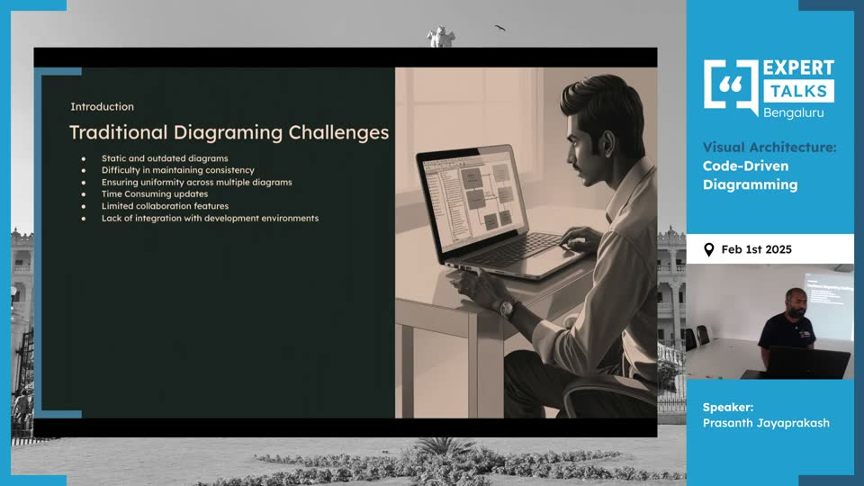

*图：“Traditional Diagraming Challenges”：图是静态的、会过时；难以保持一致；多张图之间难以统一；更新耗时；协作能力有限；不与开发环境集成（视频 05:10）。*

他补充说，几年前进入任何项目都会看到同一种模式：图已经过时，而且往往只有非常局部的图，比如一张讲系统 A 和系统 B 怎么交互的时序图，却没有整体视图；五六张图散落在好几个 Confluence 页面上，无法把上下文串起来。

## C4 模型：让架构图像地图一样讲故事

他认为 C4 模型正是为解决“串不起上下文”而来的（09:06）。C4 由 Simon Brown 提出，核心观点是图应该讲一个故事，而且应该像地图一样读。他用现场所在地举例：如果有个印度以外的人问“Expert Talks 在哪儿办”，你回答“在 MG Road”，对方不会懂。你会先说在南印度，对方问南印度哪里，你说班加罗尔；再问班加罗尔哪里，你才说 MG Road。每多问一句就往下深入一层，C4 希望系统架构图也这样讲故事：先在很高的层级建立上下文，再一步步往里钻。

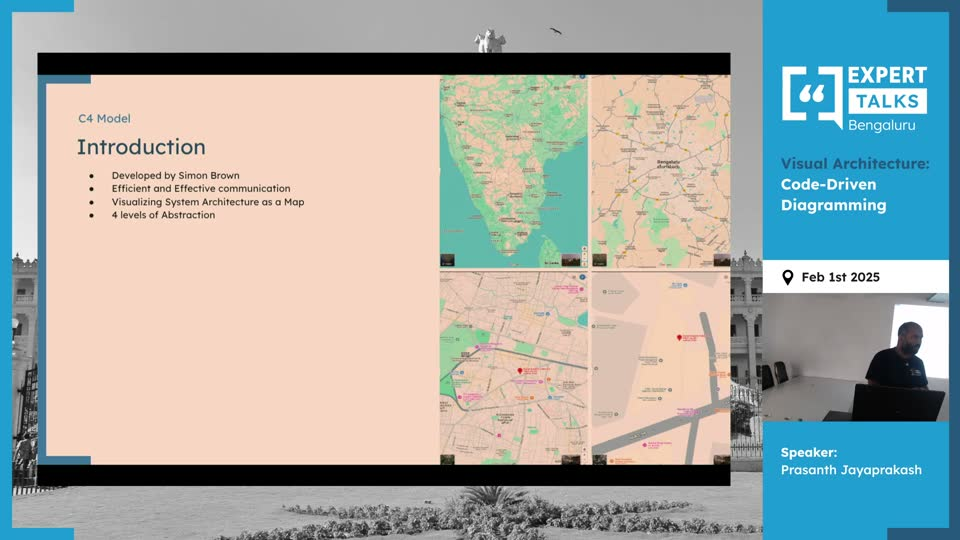

*图：“C4 Model – Introduction”页，右侧四张地图从南印度逐级放大到班加罗尔、MG Road 附近和会场所在的街区（视频 09:07）。*

C4 为此定义了四个抽象层级（10:45）。第一层是系统上下文，说明软件系统处在什么环境里。第二层叫容器，他特别提醒不要把它理解成 Docker 容器，这个词在 C4 里出现得比 Docker 还早。他把容器解释为由一个团队负责的那部分系统，可以把它看作团队边界，而不是某个部署单元：以电商网站为例，电商网站是系统，往里一层有商品页、购物车与收藏夹、订单，每块由一个团队管理，这就是容器。第三层是组件，他以订单系统为例，说它有一个前端和一个后端，这就是两个组件。第四层是代码本身，是能下到的最低一层。

> 编者注：讲者对“容器”和“组件”的解释与 C4 官方定义不同。C4 网站和 Simon Brown 本人把容器定义为一个可单独运行或部署的单元，即一个应用或一个数据存储；组件是容器内部的一组相关功能，不能单独运行。按官方定义，“订单系统的前端和后端”更接近两个容器。按团队边界划分的单位，Brown 在 GOTO 2024 的演讲中建议建模为软件系统，见同目录的《C4 模型的作者讲 C4 最常见的误用》。

用 C4 表达系统之后，面对完全外部的人，你只讲系统上下文：几个方框，用户怎样和系统交互。对方想深入，你就往下一层。给新加入团队的人，你也许会一直讲到代码层，让他看清系统到底怎么工作。他说如今用 C4 时很少画代码层的图，通常只有三层，最多讲到组件层，因为作为技术人员，代码可以直接在 IntelliJ 这类工具里读，这些工具也能替你生成那一层的图。

他之所以要先讲 C4，是因为他认为 C4 彻底改变了人们思考架构图的方式：从那以后，大家开始琢磨怎样用一个工具在同一张图里表达不同层级的上下文，并且能逐层深入。

## 图即代码带来什么

他说 Simon Brown 同时引入了代码驱动作图的做法，做了 Structurizr 这个工具和它的 DSL（领域专用语言），代码驱动作图由此起步（14:13）。此前也有画时序图的代码工具，但只限于时序图这类局部的东西；从 Structurizr 开始，讨论的是整个系统的架构。

好处是一旦图变成代码，就能放进版本控制，系统的每次变化都有记录；图在代码库里，就能接入 CI/CD 流水线；在流水线里，协作也随之而来：我能改这段代码，别人也能改同一段代码，合并交给工具去做。

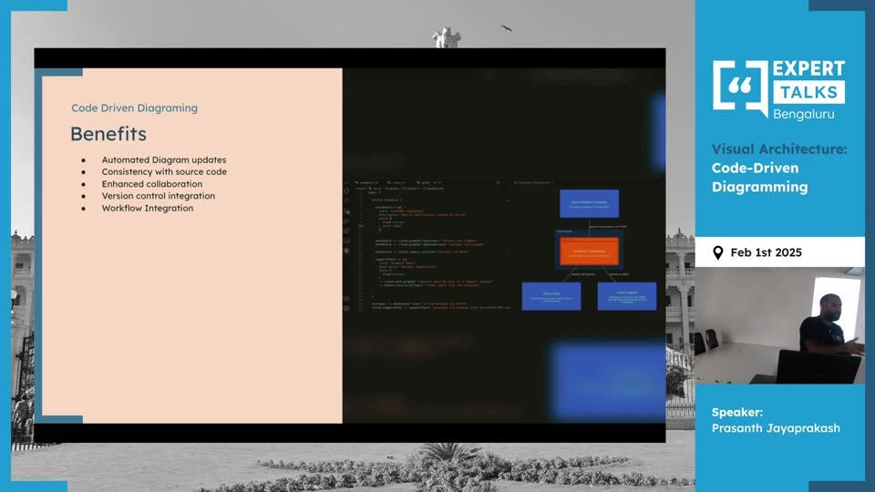

*图：“Code Driven Diagraming – Benefits”：图自动更新、与源代码一致、协作更好、接入版本控制、接入工作流；右侧是一段代码和由它生成的图（视频 14:17）。*

他说今天要介绍的工具各有长处，各自适合特定的用例；“代码”也有不同形式，有的是工具自己的 DSL，有自己的写法，有的直接用 Python 这类通用编程语言。

## 工具一：PlantUML，适合时序图

第一个是大多数人听说过的 PlantUML（16:34）。他说项目里现在看到的很多时序图，多半是从 PlantUML 开始的。工具的 DSL 风格各不相同，但概念总是一样：定义参与者，定义参与者之间的关系，再写出一步步的交互。他展示的是一个比较粗糙的电商时序图，特意请观众不要在意架构本身，只看 PlantUML 能做到什么：右边的图完全由左边的代码生成。

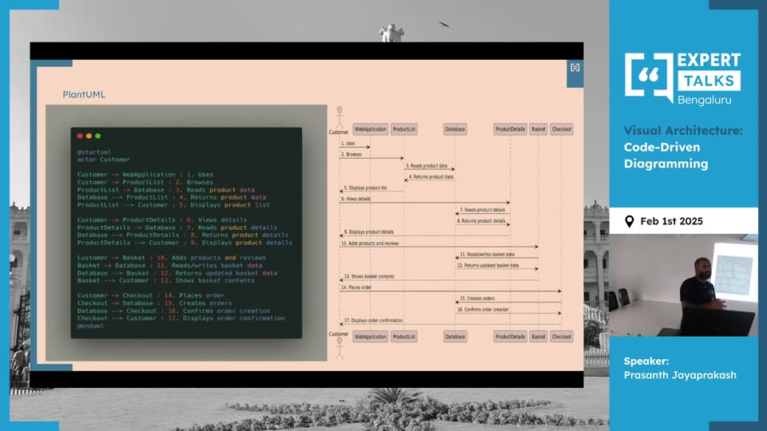

*图：左边是 PlantUML 代码（`@startuml` … `@enduml`），Customer 依次经过 WebApplication、ProductList、Database、ProductDetails、Basket、Checkout 的 17 步交互；右边是渲染出的时序图（视频 16:43）。*

他认为它最大的好处是图由代码生成，虽然停留在较低的组件层级，讲不了高层的系统架构，但至少能把用户的调用顺序讲清楚。它还能接入流水线：在某个微服务的 CI/CD 流水线里多加一步，从这段代码生成 PNG 或 JPG，作为构建产物发布。之后每次代码变化，都可以检查 UML 是否也该改；时序变了就改代码，下一次构建立刻生成新的图片，Confluence 页面引用的就是这张图，于是图始终是最新的。

## 工具二：Mermaid，更好看，支持更多图类型

第二个是 Mermaid（17:17）。他说 PlantUML 看上去不够醒目，像老式应用，和现代漂亮的网页界面比起来不够现代；Mermaid 在这个基础上加了一些“时髦感”，还支持更多类型的图，时序图之外还能画用户旅程。语法和 PlantUML 非常像，几乎看不出区别：同样是定义参与者，再写出一步步的交互。

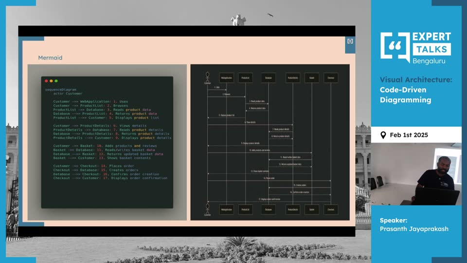

*图：同一个电商流程的 Mermaid 写法（`sequenceDiagram`），右边是深色主题下渲染出的时序图（视频 18:53）。*

他还提到 Mermaid（PlantUML 也一样）可以加入一些 CSS 之类的样式。比如第二张图里有一条备选的用户旅程，可以给它上不同的颜色，让看图的人一眼看出这里有一条备选路径。

不过回到 C4 的语境，他说 PlantUML 和 Mermaid 虽然也能画 C4 图，但一个文件生成一张图，图与图之间、不同层级之间没有交互。

## 工具三：Python 的 diagrams，偏向云基础设施

第三个是基于 Python 的 diagrams（19:32）。前两个工具都有自己的 DSL，diagrams 直接用 Python 写。现场有观众问它是不是 diagrams.net，讲者一时没答清；从他幻灯片最后的参考链接看，这里指的是 diagrams.mingrammer.com 上的 Python 库，与 diagrams.net（draw.io）是两回事。

他说 diagrams 更偏向云基础设施，因此画部署图比画系统上下文图容易得多（20:46）：它自带 GCP、AWS、Azure 等平台的图标，画部署图很方便。好处是不用学新东西，已经熟悉 Python 的人可以拿它在很高的层级快速勾画系统架构的原型。

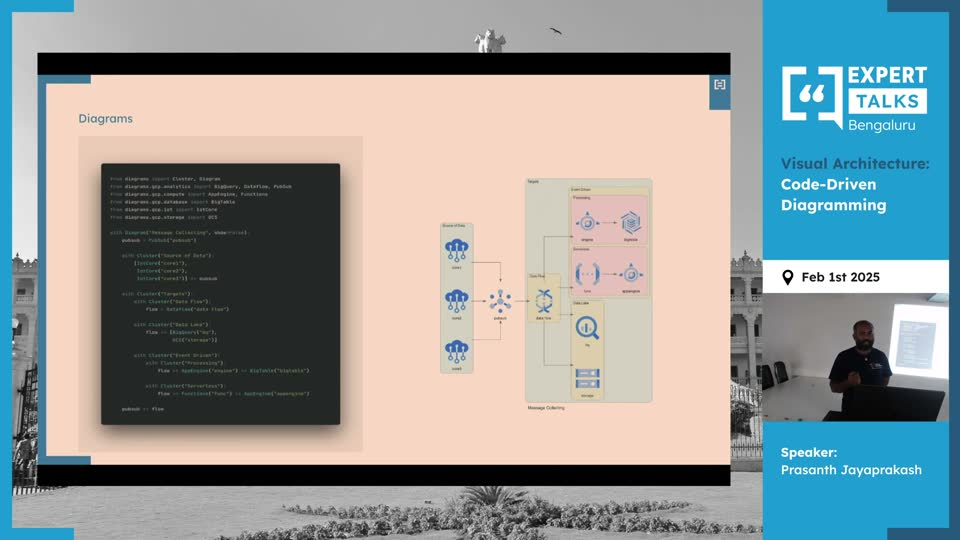

*图：diagrams 的示例：左边的 Python 代码用 `with Diagram(...)` 和 `with Cluster(...)` 分组，引入 GCP 的 Pub/Sub、Dataflow、BigQuery、BigTable、App Engine、Functions、GCS 等节点；右边是生成的“Message Collecting”数据流图（视频 21:45）。*

## 工具四：Structurizr，真正的 C4 交互图

到这里为止，讨论的工具都是“一段代码、一张图”，C4 那种逐层建立上下文的结构还没有出现。他说接下来的工具解决的正是这个问题（21:43）：Structurizr 有自己的 DSL，用它写出的模型生成的是可交互的图。你定义系统上下文，然后可以点进去，深入到容器层；他只做了两层，但同样的做法可以从容器继续往下到组件。这样就得到了一张讲完整个系统架构的交互式图。

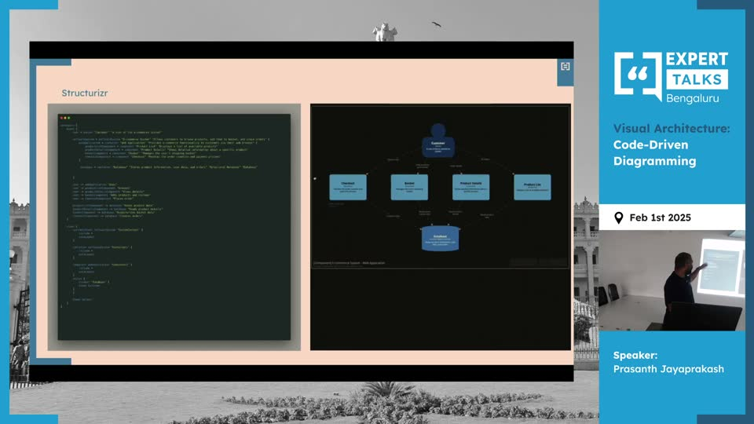

*图：左边是 Structurizr DSL，右边是电商系统 Web 应用的组件图：Customer 使用 Checkout、Basket、Product Details、Product List，它们都读写同一个数据库（视频 23:05）。*

他说自己很喜欢 C4 的理念，认为这是构建系统架构图的正确方式。但就个人口味而言，Structurizr 的图看上去还是很旧、不够现代；虽然可交互，一旦想偏离 Structurizr DSL 的默认样式，比如换别的颜色、把图做得更好看，就越来越棘手。另一个他觉得困难的地方，是与现有工具体系的集成：如果团队已经有自己的 Backstage 之类放文档的平台，怎样把它接进去？他认为工具必须能很容易地与正在使用的现有工具协同。

## 工具五：LikeC4，基于 React 的 C4 建模

这就是他要重点介绍并现场演示的 LikeC4（24:51）。他说用 LikeC4 可以完整表达前面讨论的 C4 模型，它对时序图也有自己的一套做法，后面会讲。

它好在哪里（25:15）：首先它基于 React，所以一切在你的掌控之中；它是开源的，想怎么折腾都可以；有了 React，就能把图嵌进已有的网站，也可以生成一个静态网站，部署到自己的环境里。其次是他一直想要的 CI/CD 自动化：图应该从流水线里生成，LikeC4 提供了命令行，如果用 GitHub，还有预定义好的 GitHub Actions 可以直接生成图。它支持导出 PNG、JPEG 等多种格式，但也不一定要导出成图片，可以直接放进网页，得到可交互的图。最后是和现有开发生态的集成：它有 Visual Studio Code 插件，写代码时就能看到图。

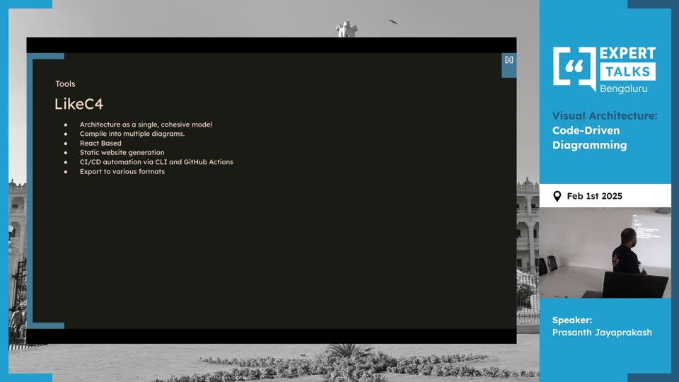

*图：“Tools – LikeC4”：整个架构是单一、连贯的模型，可编译成多张图；基于 React；可生成静态网站；通过 CLI 与 GitHub Actions 做 CI/CD 自动化；可导出多种格式（视频 25:18）。*

## 现场演示：用 LikeC4 搭一个航班预订系统

演示从一个新建的空仓库开始。唯一要做的准备是在 VS Code 里装 LikeC4 插件，装好以后就有了语法高亮和自动补全（27:42）。他说自动补全是他评估各种工具时很看重的一点：写错了马上就知道，不必渲染出来才发现不对，能省下不少开发时间。

LikeC4 的文件分三大块（29:43）：specification、model 和 views。它也支持部署等其他内容，时间允许的话再谈。specification 是系统的规格，声明有哪些参与方会出现在系统里；model 描述这些参与方之间的关系；views 决定怎样查看这些图。

他先在 specification 里声明了 user，以及 C4 的三种主要抽象 system、container、components，又因为系统里多半会有数据库，加了一个 database。他强调选哪些元素类型由你自己定：虽然要画的是 C4 图，但 LikeC4 不把你限制在某一套固定概念上，你可以按自己需要的定义来建。

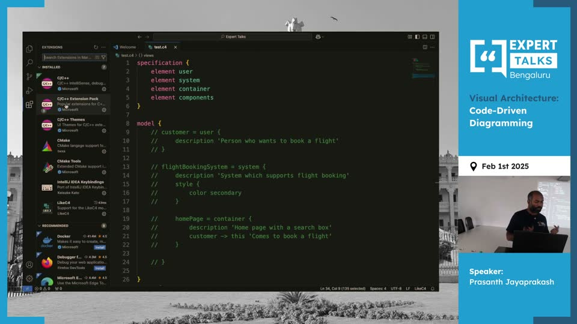

*图：`test.c4` 中的 `specification` 块声明了 `element user`、`system`、`container`、`components`，下面注释掉的 `model` 是准备好的模型代码，左侧扩展列表里能看到已安装的 LikeC4 插件（视频 27:45）。*

为节省时间，他事先写好了一部分代码。模型里有一个 customer，类型是 user，描述是“想订机票的人”。他借此强调：好的图应该能自己解释自己，如果看图之后还得去别处读一整份文档才知道是什么意思，开发体验就不好，所以 LikeC4 有 description，描述会直接显示在图上。另一个元素是 flightBookingSystem，类型是 system，描述是“支持机票预订的系统”。

现场有人问为什么还看不到图。他解释说到目前为止只定义了系统和关系，要创建视图才能看到。他写了一个基础视图 `view index { include * }`，打开预览，画面上出现两个方框，彼此之间没有关系，只有各自的描述，交代了这两个参与者是谁（31:53）。

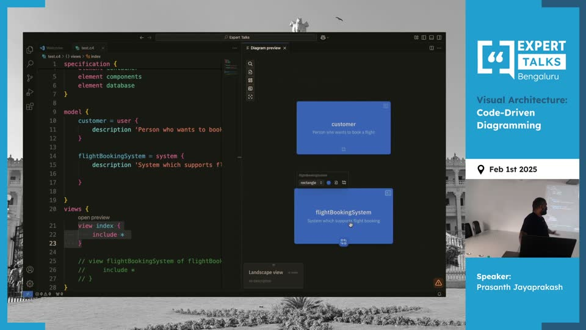

*图：右侧预览里的 customer 与 flightBookingSystem 两个方框，各自显示描述；左侧代码中 `views` 下的 `view index { include * }`（视频 32:10）。*

接着他加了第一条关系：用户要用航班预订系统来订机票。在系统的代码块里写 `customer -> this 'Comes to book a flight'`，预览里两个方框之间就出现了带说明的箭头（33:46）。他顺便演示了样式：这里写的 `color secondary` 是 LikeC4 给的默认色值之一，不加样式时元素是蓝色，secondary 是它很浅的一个色调；改成 red，颜色立刻就变了（34:24）。框一多就不可能逐个去读，所以要让人一眼认出参与者的类型，他给 customer 加了 `shape person`，方框里随即出现了人形（34:52）。他说做这类自定义外观相当容易。

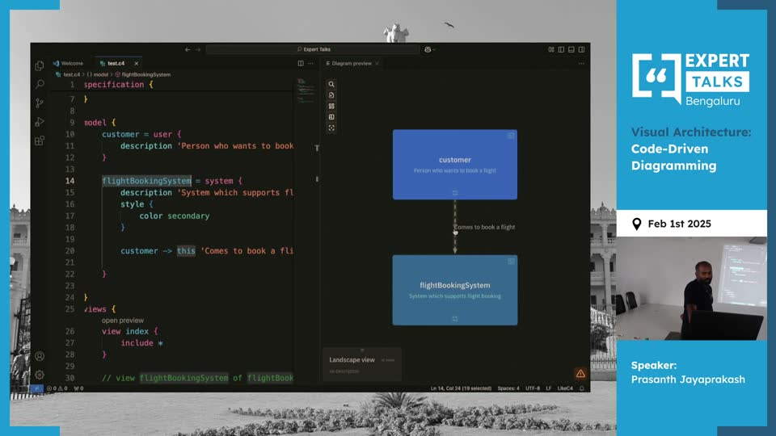

*图：customer 指向 flightBookingSystem，箭头上写着“Comes to book a flight”；代码中系统块里有 `style { color secondary }` 和 `customer -> this 'Comes to book a flight'`（视频 33:49）。*

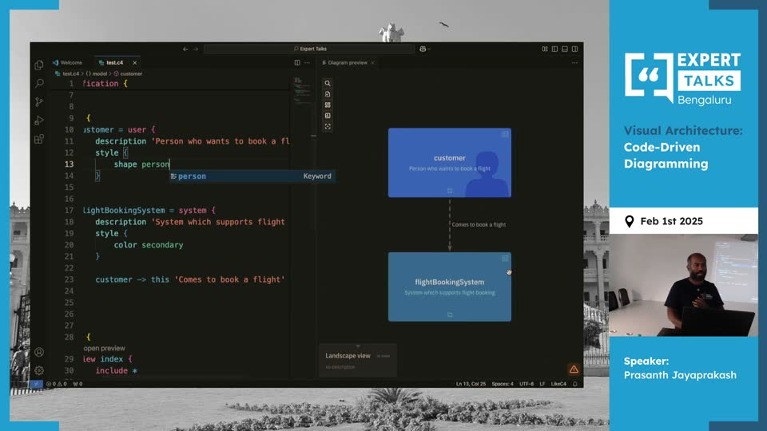

*图：输入 `shape person` 时插件给出自动补全，预览里的 customer 方框换成了人形图案（视频 34:56）。*

有了系统上下文，下一步是看航班预订系统内部。任何系统都有首页，他在系统里加了一个容器 homepage，描述写“带搜索框的首页”。他说首页通常是静态网页，假设团队用 Adobe AEM（Experience Manager）来做，就把 technology 写成 AdobeAEM，让图上带有它是怎样构建的信息。然后他把用户的关系从系统挪到首页上：用户并不知道背后的整个大系统，他直接来到的是首页。

他指出一个细节（36:42）：关系从系统层级挪到了容器内部，系统上下文图仍然在正确的层级显示这条关系，没有钻到系统里面去，因为工具已经理解这个容器位于这个系统的上下文中。但这时还看不到首页在哪儿，需要再加一个视图 `view flightBookingSystem of flightBookingSystem { include * }`。视图加上之后，系统方框上多了一个放大按钮，点进去就能看到系统里的首页（37:13）。

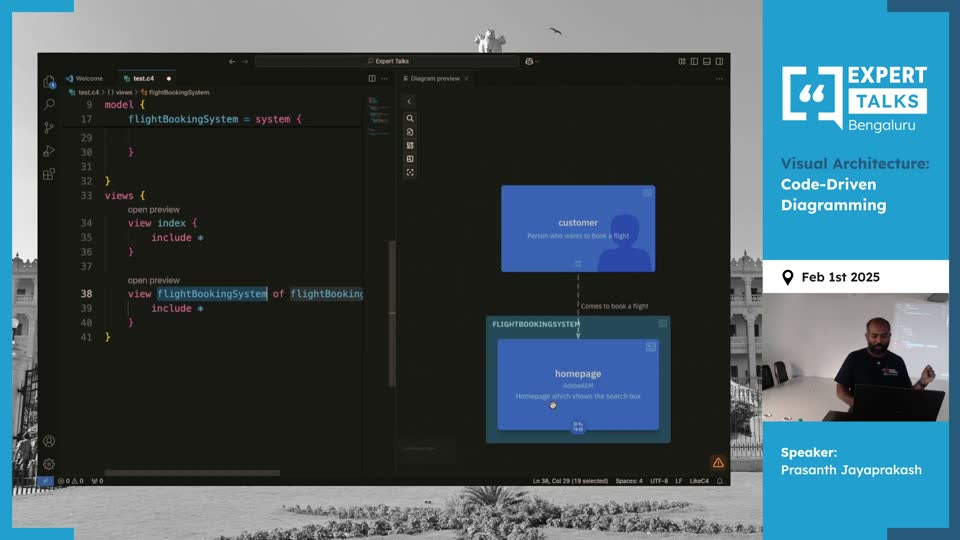

*图：新增的视图 `view flightBookingSystem of flightBookingSystem { include * }`；预览里 FLIGHTBOOKINGSYSTEM 边界内出现 homepage 容器（AdobeAEM，“Homepage which shows the search box”），customer 的箭头指向它（视频 37:20）。*

用户在首页输入搜索词，系统要去搜索，于是他又建了一个容器 searchService，技术写 Kotlin。他把它设想成纯后端，由一个团队负责搜索，不需要界面。关系写在 searchService 块里：`homepage -> it 'searches for the flight'`。他解释说 `this` 和 `it` 都表示“当前这个上下文”，和编程语言里的用法类似；不在块内写时，也可以直接写成 `homepage -> searchService`。

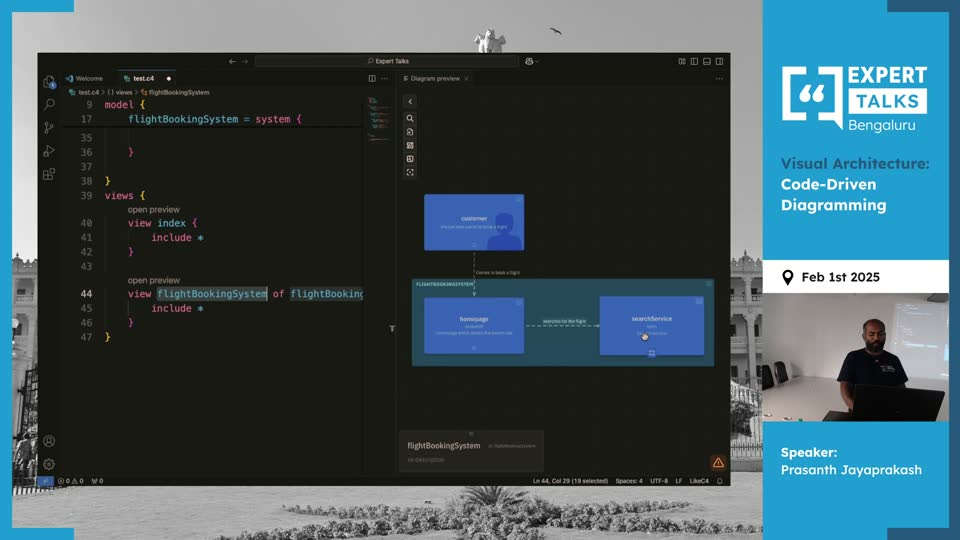

*图：FLIGHTBOOKINGSYSTEM 内部现在有 homepage 和 searchService 两个容器，箭头写着“searches for the flight”（视频 39:16）。*

他继续往 searchService 里加两个组件：一个 searchApi，技术 Kotlin；一个 searchDB，技术 MongoDB。预览里还看不到它们，同样要建一个视图，起一个唯一的名字 searchServiceView，定义为 searchService 的视图（40:53）。加上以后，searchService 方框上出现了放大图标，点进去就能看到两个组件。

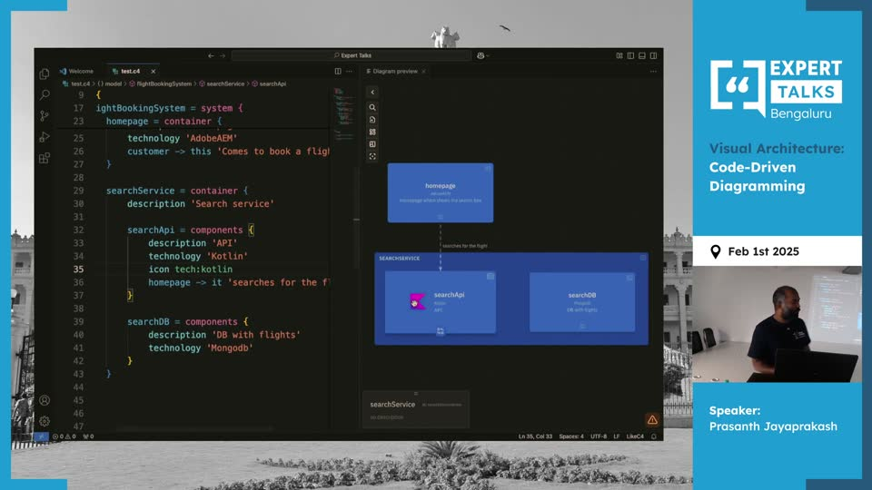

*图：searchApi 的代码里加了 `icon tech:kotlin`，预览中 SEARCHSERVICE 边界内的 searchApi 方框显示 Kotlin 图标，旁边是 searchDB（视频 41:44）。*

组件之间还没有关系，因为他还没写；首页其实应该调用的是 API，于是他把首页的箭头改指 searchApi。他说光有一堆文字，比如写着用 Kotlin、用 MongoDB，并不能帮人快速理解，所以 LikeC4 支持图标：`icon tech:kotlin` 让 searchApi 带上 Kotlin 图标，`icon tech:mongodb` 让 searchDB 带上 MongoDB 图标（41:43）。为了让数据库在视觉上像数据库，他再加上 searchApi 到 searchDB 的关系，并把 searchDB 的形状设为 `shape cylinder`，方框就变成了圆柱（42:40）。他还演示了其他可选形状：queue（队列）、storage（和 cylinder 类似的存储）、mobile、browser、person，默认是 rectangle。

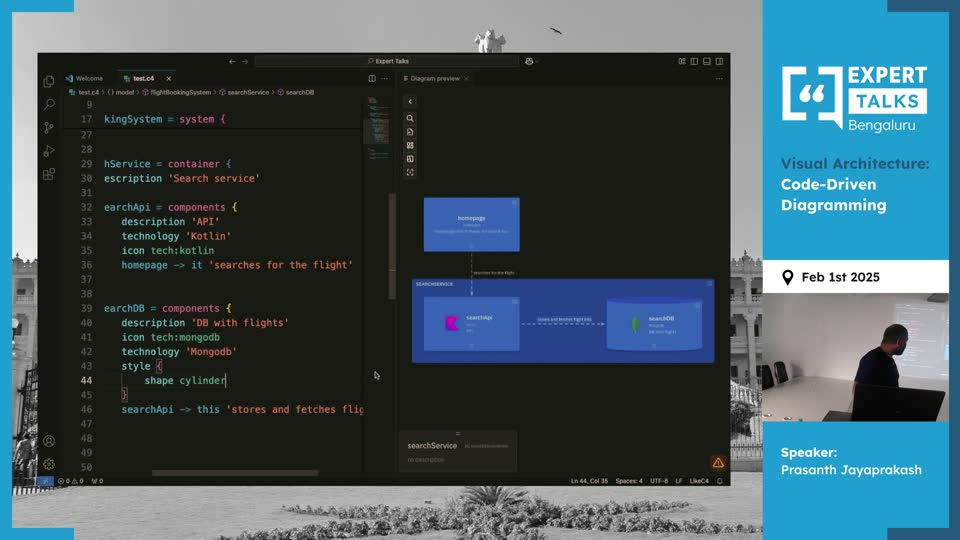

*图：searchDB 加了 `icon tech:mongodb` 与 `style { shape cylinder }`，并有 `searchApi -> this 'stores and fetches flights'`；预览里 searchDB 变成带 MongoDB 图标的圆柱（视频 42:40）。*

样式不一定写在模型上。他在 searchServiceView 视图里写了 `style searchDB { shape storage }`，只改变这个视图中 searchDB 的外观。

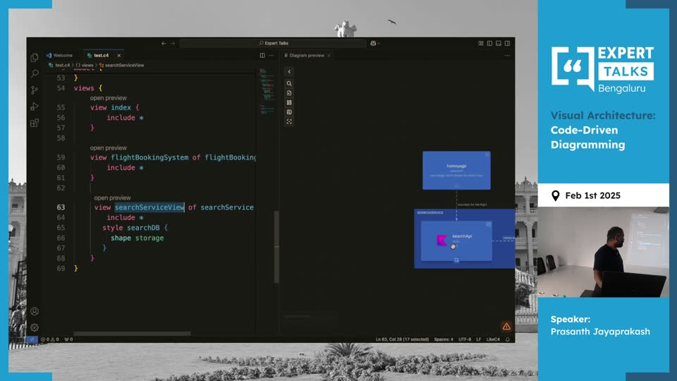

*图：`views` 中三个视图：`index`、`flightBookingSystem of flightBookingSystem`，以及带 `style searchDB { shape storage }` 的 `searchServiceView of searchService`（视频 44:10）。*

他回头把整张图从头讲了一遍（44:08）：用户来到航班预订系统订票；系统里有两个团队，一个负责由 Adobe AEM 管理的首页，一个负责承担全部航班搜索的搜索服务；点进搜索服务，首页调用搜索 API，API 从数据库取数据。他说这些说明不一定要写成方框里的文字，也可以在上面加注释（note），另一个演示里会展示。做好的这个应用可以部署到任何地方，和自己的页面集成；如果部署成一个应用，甚至可以在 Confluence 里显示，得到一张可交互的 React 图。

文件变多、变复杂时，可以把内容拆到不同文件里（45:04）。他把 specification 剪出来，一开始报错，因为规格不见了；新建一个 specification.c4 放进去，就恢复了正常。

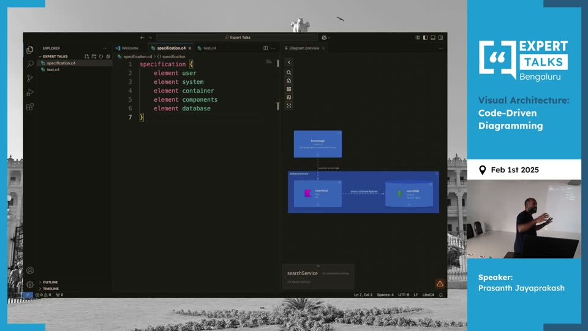

*图：左侧文件树里多了 `specification.c4`，里面是 `element user`、`system`、`container`、`components`、`database` 五条声明，模型仍在 `test.c4` 里（视频 45:05）。*

拆文件时要注意一件事：他说它和 JavaScript 一样，所有内容最终都进入同一个作用域，相当于“提升”（hoisting）。所以同一个工作区里不能再建第二个 flightBookingSystem。另一方面，元素定义在哪一层也有关系：比如 searchDB 原本在 searchService 里，他在 homepage 里也建了一个 searchDB，这是允许的，因为它属于 homepage 的上下文，会被读作 homepage.searchDB，而不是 searchDB；如果在同一层再建一个已存在的名字，就不会生效。工具有这类校验，需要指明是哪一个时就用点号写法（45:57）。

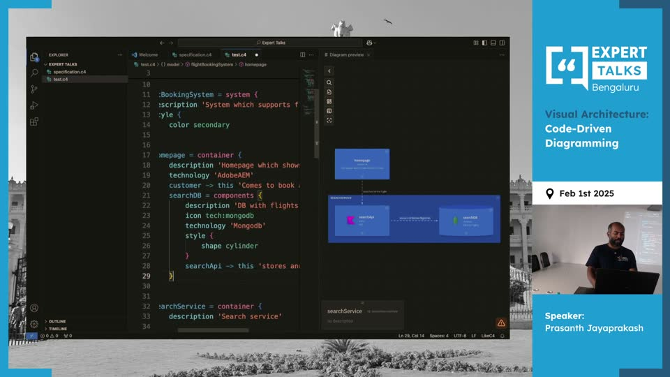

*图：homepage 容器内部也定义了一个 `searchDB = components { ... }`，它在 homepage 的作用域内，与 searchService 里的 searchDB 不冲突（视频 45:50）。*

## 更完整的例子：外部系统、多层视图与动态视图

他接着打开了事先做好的一个更完整的航班预订模型（47:19）。它有类似的系统，加了一些外部系统，元素都带图标，组件之间的关系更完整，还有几种不同的视图。

从头看：一位顾客，一个航班预订系统。点进系统能看到一个浏览器，因为用了 browser 形状，它画得像浏览器窗口；然后是首页，这次他把 AEM 当成外部系统，所以首页显示为灰色，他说记法本身就能表达这些信息，读者在任何页面上都能看出这些方块代表什么。再往下是航班信息服务（Flight Info Service）：系统不自己保存印度航空（Air India）和靛蓝航空（IndiGo）的航班信息，于是建了 Air India System 和 IndiGo System 两个外部系统。航班信息服务里有航班列表页、航班 API 和航班数据库，航班 API 调用两家航空公司的系统来补全信息，比如确切的起飞时间，这些不在本地保存，而是假设从外部系统取得。

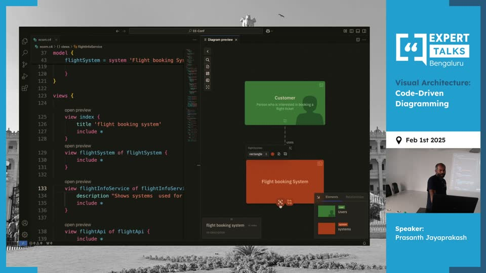

*图：`ecom.c4` 中的 `view index { title 'flight booking system' include * }`，预览里 Customer（人形）通过“uses”指向 Flight booking System，右下角的图例列出 Users 与 systems（视频 48:00）。*

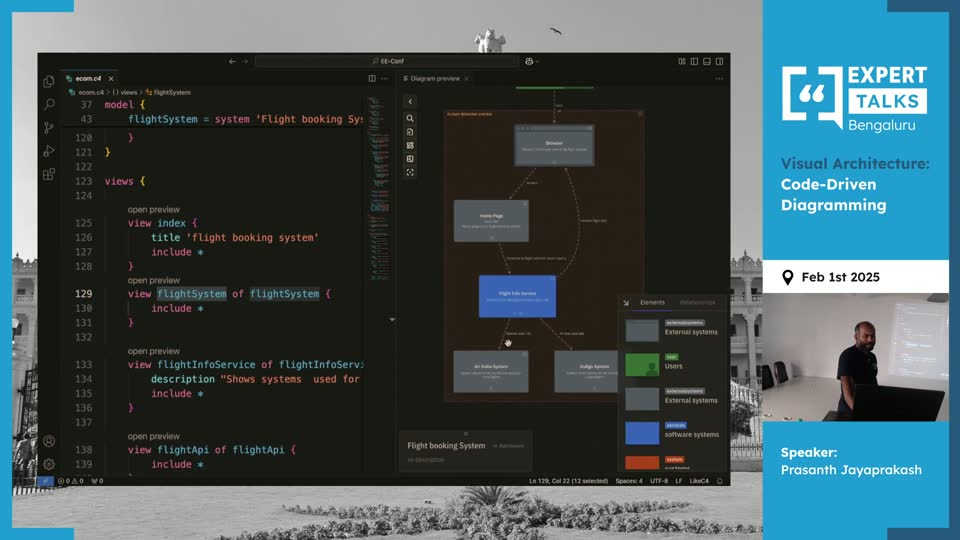

*图：Flight booking System 内部：Browser、Home Page、Flight Info Service 之间用箭头相连，Flight Info Service 再连到 Air India System 与 IndiGo System；外部系统以灰色显示，图例里区分了 External systems、Users、software systems（视频 48:29）。*

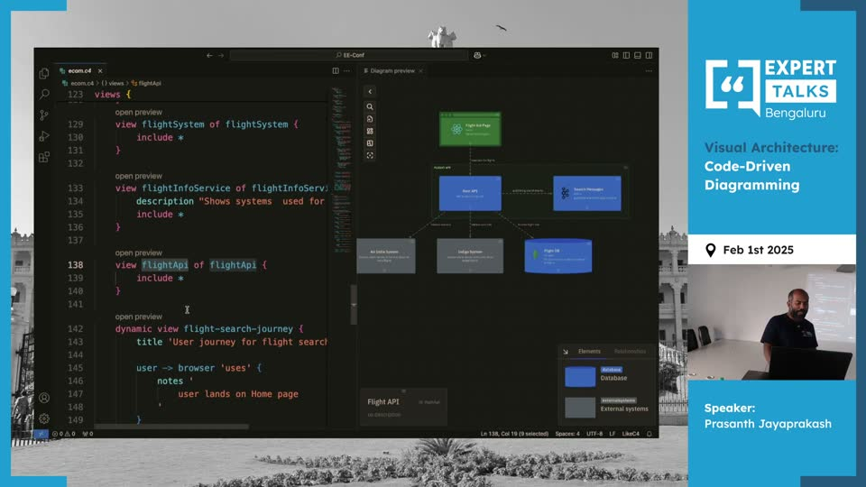

*图：`view flightApi of flightApi` 的预览：Flight list Page 调用 Flight API，Flight API 关联 Search Messages，并访问 Air India System、IndiGo System 和 Flight DB；左侧代码下方开始定义 `dynamic view flight-search-journey`（视频 49:25）。*

光看这张系统视图，可以解释航班 API 是一个 REST API，它查数据库，再请求外部系统补全信息。但他指出问题在于你仍然不知道整个过程具体怎样发生。为此 LikeC4 有动态视图（dynamic view）的概念，可以把它理解成时序图（49:23）。他建了一个标题为“User journey for flight searching”的动态视图，描述一次航班搜索的用户旅程：用户用浏览器打开首页，在首页输入搜索词并回车，来到航班列表页；加载列表页要调用 API，API 查询数据库拿到信息。每一步上的文字都是自己写的，想写什么都可以，也可以附上 notes。

接下来是并行调用（50:36）。他说想稍微优化一下架构：拿到所有航班后，并行调用印度航空和靛蓝航空的系统，为各自的航班获取座位信息。在动态视图里用 `parallel { ... }` 把这两步包起来，播放时它们会标注为 PARALLEL。取到全部信息后，API 返回给列表页，列表页再渲染回浏览器。

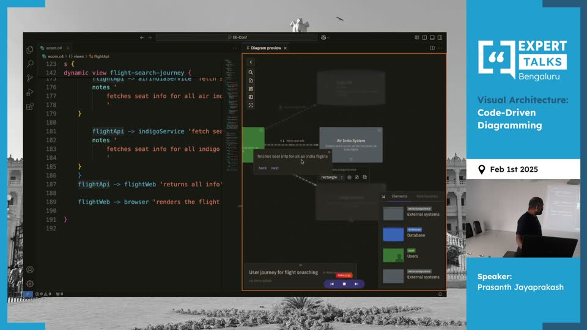

*图：动态视图逐步播放到第 7.1 步：Flight API 向 Air India System“fetch seat info”，弹出的注释写着“fetches seat info for all air india flights”，底部播放条上标着 PARALLEL（视频 50:50）。*

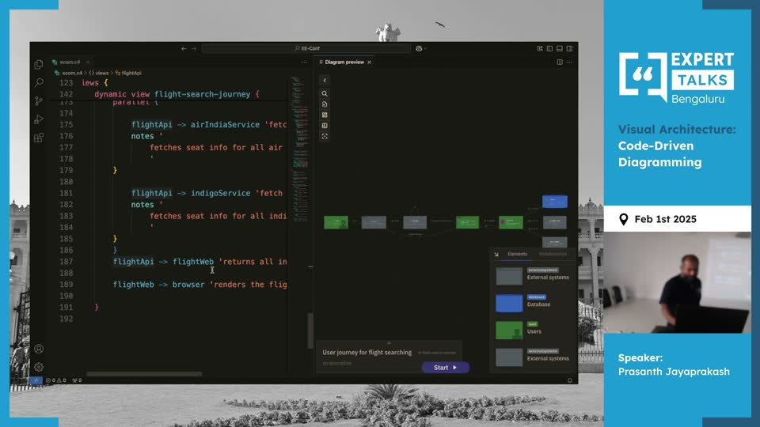

*图：动态视图的全貌，各步骤从左到右排开；左侧代码里的 `parallel { flightApi -> airIndiaService ... flightApi -> indigoService ... }` 之后是 `flightApi -> flightWeb 'returns all info'` 与 `flightWeb -> browser 'renders the flight ...'`（视频 51:57）。*

这样，同一个模型里既有整个系统的 C4 架构，又有基于这些元素的用户旅程（51:01）。他说可以为不同的用户建多条旅程：比如有人不是来搜索的，而是已经知道航班号、只想看那一班，这条旅程也许根本不需要查数据库，而是直接从航空公司系统的 API 获取，可以再单独画一条。

## 其他工具与 LikeC4 的后续能力

他列出了这次讲到的工具，强调全都是免费开源的，可以用在自己的项目里（51:55）。另外提到一个付费的专有工具 IcePanel（52:18）：它提供云端服务，可以在云上创建工作区，支持 LikeC4 支持的那些 C4 能力。相比之下，前面那些开源工具都要在本地使用，虽然有网页版 playground，但不太方便分享。他认为 LikeC4 的优势仍在于它基于 React、你能掌控它的呈现方式，而且项目目前非常活跃。

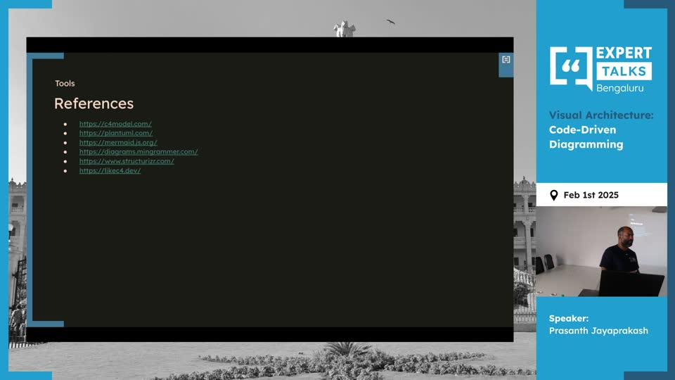

*图：“References”页：c4model.com、plantuml.com、mermaid.js.org、diagrams.mingrammer.com、structurizr.com、likec4.dev（视频 53:05）。*

LikeC4 也支持部署图（53:02）。部署图可以表达系统部署在哪里：用了几台 EC2 实例、在哪个 AWS 区域、是否跑在 Kubernetes 上，或者是 AEM 这样的云端 SaaS。做部署图时不用新建一张图，而是复用已经建好的元素和模型，叠加在系统之上。这样一处重构、改了名字，所有用到它的图都会跟着变。他还提到 Structurizr 的一个优点是能把 ADR（架构决策记录）等文档作为工具的一部分来管理（53:54），LikeC4 当时也在做 ADR 支持，将来可以在同一个项目里写文档，并在文档里直接展示这些图。命令行方面，前面已经说过，可以用 CLI 一次导出多张 PNG 或 JPEG。

## 问答：导出格式，以及图怎么保持不过时

第一个问题是能否导出 GIF 或 MP4（54:59）。他说 LikeC4 支持四五种格式，WebP、PNG、JPEG 他确定支持，GIF 不确定；现场展示的动图是他自己录屏做的。项目更新很快，建议到官网确认。

第二个问题回到开头：怎样保证图不过时，和代码保持同步（55:38）？他说他们项目里的做法是让图紧挨着代码，而不是单独维护（55:47）。具体怎么组织由团队决定，比如你是负责航班搜索这个容器的团队，就只维护航班搜索那部分图，然后通过 CI/CD 流水线把它导出到更大的项目里。做需求或任务时，在工作项里加一条检查项，比如在 Jira 任务里写一条“这次改动是否影响我们的架构”；结对编程时，搭档可以互相提醒。他特别说明这不是一个 PR，只是一条检查清单项，用来确保改代码时把图也一起改了。他认为在需求本身附近做这件事，比单独维护要容易得多。至于 IDE，LikeC4 当时还不支持 IntelliJ，但他们在做插件；用 VS Code 的话就能让图和代码待在一起。

最后一个问题是能不能分成多个文件、放在不同仓库里。他说可以，怎么组织由你决定，并介绍了他们处理文档的做法（57:52）：组织内约定每个仓库都有一个 docs 目录，里面放图和其他文档；由一个赋能团队之类的角色抓取组织里所有仓库的 docs 目录，汇总到一个统一的文档站点并部署。保持文档最新是各团队自己的责任，汇总由那个团队负责。团队很小时可能不需要这样做；改动时也可以再加一条流水线负责抓取同步，用这种机制推动大家及时更新文档。
