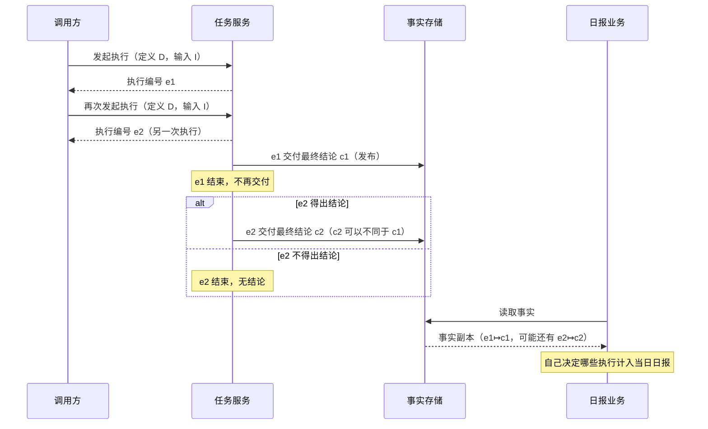
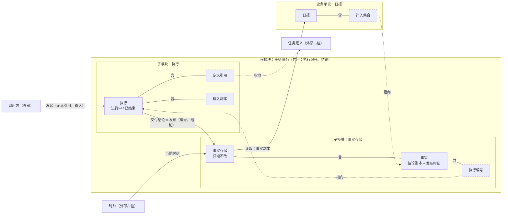

# 设计草稿：任务执行与结论事实

范围：`request.md` 的五条需求——同一定义同一输入的多次执行、每次执行至多一个最终结论、已发布结论不可改写而可继续新增、事实存储保存与读取结论、日报业务自定计入哪些执行。目标仓库尚无 `design/`，本草稿是新系统的第一份形状。

## 〇、同名异物

| 名字 | 指的对象 | 不是 |
|---|---|---|
| 任务定义 | 要做什么的一份定义，外部给定 | 一次执行 |
| 执行 | 某个定义配某组输入的一次运行，有自己的生命周期 | 定义与输入这对组合；同一对组合可以有多次执行 |
| 执行编号 | 指向一次执行的索引，不装任何值 | 执行本身 |
| 结论 | 一次执行交付的最终结论值 | 事实 |
| 事实 | 结论发布进事实存储后留下的记录，比执行活得久 | 执行的状态 |

“至多一个结论”写在**执行**上；“不可改写”写在**每条事实**上，事实存储整体仍可增长。两者都不写在“定义 + 输入”上。

## 一、基线：一次执行从发起到被日报读到

| 对象 | 是什么 | 从哪来 | 为什么需要 |
|---|---|---|---|
| 调用方 | 要求运行任务的一方 | 系统外 | 执行由它发起 |
| 任务定义 | 要做什么 | 系统外，本次不设计其登记与版本 | 执行总是某个定义的执行 |
| 输入 | 一次执行所用的一组值 | 调用方发起时给出 | 同一定义配同一输入是需求第一条的前提 |
| 执行 | 定义配输入的一次运行 | 任务服务在每次发起时新建 | 需求要求同一组合可运行多次、各得结果 |
| 执行编号 | 一次执行的索引 | 任务服务新建执行时发出 | 调用方、事实、日报都要指到某一次执行而不触达它 |
| 结论 | 执行的最终结论 | 执行交付 | 需求的核心产出 |
| 事实存储 | 保存与读取已发布结论的地方 | 本系统 | 需求第四条；执行结束后结论仍要能读到 |
| 事实 | 已发布的结论记录 | 执行交付时由事实存储写下 | 日报读的就是它 |
| 日报业务 | 按日汇总执行的业务 | 本系统业务层 | 需求第五条 |

## 二、架构图

图例：虚线框是索引（定义引用、执行编号、计入集合），拿掉它指向的东西后不剩内容；实线框拿掉组合与指向后仍有内容（执行剩生命周期，事实存储剩事实集合，事实剩结论与发布时刻）。实线箭头是作用与数据，虚线箭头只说明索引此刻代表谁。日报没有任何箭头到达执行；指向执行的只有事实里的执行编号。

### 根模块：任务服务

- **是什么、露出什么：** 只放两个共用值——执行编号（索引）与结论（值，占位 `token`）。没有状态。
- **为什么单独存在：** 执行模块要调用事实存储的发布，事实存储要以执行编号为键。执行编号若定义在执行模块，事实存储就得导入执行模块，与执行导入事实存储成环；若定义在事实存储，执行的身份就由存储定义，存储越界。放在共同父模块是唯一无环的位置。
- **约定还是实现：** 执行编号“是索引、不复用”是约定；编号的具体格式是实现。

### 子模块：执行

- **露出：** `发起执行(定义引用, 输入) → 执行编号`；`交付结论(执行编号, 结论)`；`结束(执行编号)`（无结论地结束）。
- **关住：** 发出过的执行编号、每次执行绑定的定义引用与输入副本、每次执行的生命周期（进行中 → 已结束）。
- **为什么单独存在：** 拿掉它，谁都可以用任意编号往事实存储发布，“每次执行至多一个结论”和“每条事实都来自一次真实执行”都无处保证。并进事实存储，存储就同时装着只活到执行结束的进行中状态和永久留存的事实，日报读取的读面与发起、交付连接同处一个模块；执行生命周期一改（例如加取消），存储的只增不改规则就要跟着重审。
- **约定还是实现：** 生命周期与三个连接是约定；任务怎样被调度、在哪个进程里跑、怎样产出结论是实现。

### 子模块：事实存储

- **露出：** 写面 `发布(执行编号, 结论)`，只供执行模块使用；读面 `读取 → 事实副本`，供业务使用。
- **关住：** 事实集合，键是执行编号；每条事实含结论副本与发布时刻。
- **为什么单独存在：** 事实比执行活得久——执行结束后它关住的进行中状态不再有意义，结论却要一直能读。拿掉它，结论没有执行结束后的落脚处，日报只能去读执行模块。并进执行的后果见上一节。
- **约定还是实现：** 只增不改、读写两面是约定；数据库、索引、键的物理布局是实现。

### 业务单元：日报

- 只导入事实存储的读面；不导入写面，不导入执行模块的任何连接。
- 持有“哪些执行计入当日”的挑选；挑选规则本身留在代码里（见取舍 D7）。

## 三、语义的落点

| 基线上的语义 | 由谁保证 | 拿掉或合并后怎样被破坏 |
|---|---|---|
| 同一定义同一输入可执行多次，互不覆盖 | 执行模块每次发起都发出新的执行编号；事实存储以执行编号而非“定义 + 输入”为键 | 若以“定义 + 输入”为键，第二次执行的结论要么覆盖第一次（违反不可改写），要么被拒（违反可执行多次） |
| 各次执行允许得到不同结论 | 设计中**不存在**从“定义 + 输入”到结论的函数或唯一性约束 | 一旦加上，就额外承诺了执行结果确定，与需求第一条相悖 |
| 每次执行至多交付一个最终结论 | 执行模块：交付即结束，结束不可逆 | 拿掉生命周期，执行可第二次交付，只能撞上存储的准入条件——那是调用方违约，而不是结局 |
| 已发布结论不能改写 | 事实存储：所有操作前后，已有事实原样保留 | 并进执行后，修改执行状态的操作与事实同处一份状态，改写事实无结构性阻挡 |
| 之后仍可新增其他执行的结论 | 事实存储不封存；新执行编号随时可发布 | 若存储按日或按“定义 + 输入”封存，晚到的执行就发布不进来 |
| 事实存储负责保存与读取 | 事实存储的写面与读面 | — |
| 日报自己决定计入哪些执行 | 日报业务单元；读面原样交出事实，不替业务筛选 | 若读面提供“当日计入的执行”，判定就被搬进架构 |
| 日报拿到的是值，改不动事实 | 读面交出副本；日报不导入写面 | 日报若导入写面，读者就成了写者 |

### 有意不画

| 不画的东西 | 理由 |
|---|---|
| 执行内部步骤、中间结果 | 不改变执行对外露出的三个连接与“至多一个最终结论” |
| 调度、工作进程、并发、超时 | 不改变任何对象露出或关住的东西 |
| 重试 | 重试就是一次新的执行，已被“新编号、结束不可逆”覆盖，不需要单独的对象 |
| 崩溃恢复、交付与发布的原子性做法 | 实现手段；约定只要求交付与发布是同一步（D3） |
| 无结论结束的原因细分 | 调用方遵守契约时不需要区分；日报也不读它（D4） |
| 任务定义的登记、版本、存在性校验 | 本次需求不涉及；定义是外部占位 |
| 事实记录的字段布局、键编码、索引、写入时机 | 记录形状，不改变存储露出什么、关住什么 |
| 读面的查询方式（全量、按时间区间） | 不做判定的取数方式属于实现；判定留在日报 |
| 日报的挑选规则、是否在事后重算、怎样呈现与投递 | 业务怎样运行，换一种跑法形状不变 |
| 调用方鉴权、第三方查看 | 需求未涉及 |

## 四、形状与归属

| # | 形状 | 范围 | 为什么需要 | 持有者 |
|---|---|---|---|---|
| S1 | 每次发起都产生一次新执行，执行编号从不复用；执行一经发起，其编号及所绑定的定义引用与输入不再改变 | 执行模块发出过的全部执行 | 多次执行要互不覆盖；执行中途换绑，它交付的结论就说不清属于哪组定义与输入 | 架构：执行 |
| S2 | 执行生命周期只有一个方向：进行中 → 已结束；交付结论与无结论结束都使它结束；已结束的执行不再交付，也不复活 | 每一次执行 | 这就是“每次执行至多交付一个最终结论” | 架构：执行 |
| S3 | 事实存储只增不改：任一操作之后，之前的每条事实键与值原样保留；未出现过的执行编号随时可以新增 | 事实存储的整个事实集合，覆盖它今后的每个操作 | 已发布结论不能改写，同时仍可新增其他执行的结论；把它写成对全部操作成立的约束，日后有人加“修正结论”操作时检查会失败 | 架构：事实存储 |
| S4 | 事实只经执行模块的交付进入事实存储；每条事实的执行编号指向一次已发出且已结束的执行（有事实 ⇒ 该执行已结束） | 事实存储的写面与事实里的执行编号 | 否则会有不来自任何执行的结论，或一次仍在进行的执行已有“最终”结论 | 架构：执行（唯一写者）；事实存储的写面只导出给执行 |
| S5 | 日报计入的每个执行都已有事实；日报只经读面取事实副本，触达不到执行，也写不了事实存储 | 日报单元 | 需求说日报读这些事实来决定；计入一个没有事实的执行，就越过了它读到的东西 | 业务：日报（计入集合 ⊆ 读到的事实的执行编号）；“只读”由导入关系保证 |

### 被筛掉的候选

| 候选 | 去向 |
|---|---|
| 同一定义同一输入，在所有执行里只有一个结论 | 违反需求第一条；VDM 中不得出现 |
| 同一定义同一输入只能有一次进行中的执行 | 换一种调度策略就会变，是业务跑法 |
| 事实存储里同一执行编号至多一条事实 | 由 S2 与 S3 合起来推出，不单列 |
| 读取不改变事实存储 | S3 已覆盖所有操作 |
| 日报一经生成不再改变 | 是否事后重算是业务决定 |

## 五、取舍

| # | 决定 | 依据 | 在什么情况下会错 |
|---|---|---|---|
| D1 | 执行的身份是执行模块发出的执行编号，与“定义 + 输入”分离 | 需求第一条：同一组合可运行多次、结果可不同 | 编号必须由外部系统给定（例如调用方自带幂等键并要求同键同执行）时，编号来源要移到系统外，S1 的“每次发起都新建”要改 |
| D2 | 任务服务为根，执行与事实存储为两个兄弟子模块，共用值放根 | 事实比执行活得久；两者互相要用执行编号，只有共同父模块无环 | 事实存储也要收其他来源（非执行）的结论时，S4 不成立，事实存储应独立成根，执行编号改为它认识的外部占位 |
| D3 | 交付与发布是同一步，不存在“已交付未发布”的状态 | 需求只对执行说“交付”、对结论说“发布”，没有提出两者之间的环节 | 结论发布前需要审核或确认时，中间出现新对象（待发布结论），S2 与 S4 要重写 |
| D4 | 无结论结束只记在执行模块，不成为事实 | 需求说事实存储保存结论；日报读的是“这些事实” | 日报要统计失败或未出结论的执行时，“无结论结束”也要发布为事实，S3 的范围随之扩大 |
| D5 | 事实带有事实存储写下的发布时刻，与结论一起不可改写；时钟是外部占位 | 日报要按“当日”决定计入，读面必须交出可以归到某一天的事实；发布时刻是事实存储自己唯一能见证的时间。这是读面应当提供什么，不是形状 | “当日”按执行发起时刻或输入里的业务日期算时，要由执行在交付时带上该时刻；S3 不变，只是事实多一项 |
| D6 | 事实存储不校验执行编号对应的执行是否存在、是否已结束 | 事实存储的职责只是保存与读取；校验会让它依赖执行模块而成环；S4 由唯一写者保证 | 同 D2：出现第二个写者 |
| D7 | 日报的挑选规则不进 VDM，VDM 只写 S5 的子集关系 | 需求说日报“自己决定”；常变的业务留在代码里 | 挑选规则需要两个实现必须算出同一结果（例如对外结算）时，应在日报单元写成显式纯函数 |
| D8 | 不承诺执行结果确定 | 需求第一条明确允许不同结果 | 需求改为可复现执行时，那是新的形状，不是对本稿的修补 |
