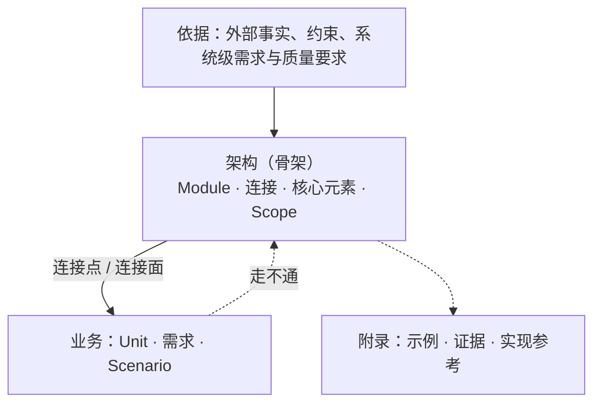
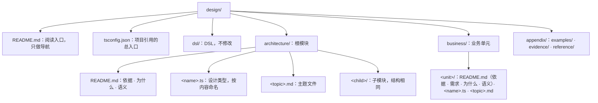

# software-design

## 设计是什么

设计是代码化的文档。设计元素用 DSL 类型写成，由 `tsc` 检查；类型说不清的语义写成 Markdown，作为类型的额外解释。设计的价值是作为参考，并陈述不变量。

设计与实现的界线：

- **判据：在连接不变时可以替换的做法属于实现。** 一段内容只规定怎样兑现连接，并且换一种做法时连接的类型与定律都不变，它就是实现，不写进设计。
- **失败与并发按同一判据划分。** 会改变部件、连接、状态空间，或改变使用方能观察到的承诺的决定属于设计，例如是否承诺恰好一次、"结果未知"是不是一种结局、崩溃后由谁接管。罕见不等于是实现：一个低频事件改变了这些，它就属于设计。
- **设计不展开逐情形的处理。** 不改变连接、状态空间、不变量和可观察承诺的处理细节属于实现，例如逐项的拒绝原因、编码与字节细节、在既定承诺下选哪种算法。一段细节保护某条不变量时，设计只写这条不变量。
- **设计不要求组合成整体。** 组合根、适配器、总入口、完整调用链、为编译通过补的实现都属于实现。设计类型只要求本身合法、引用能解析。

design 的类型与 src 的类型相互独立。实现可以 import design 类型，也可以用 DSL 的投影（`Shape`、`Signature`、`Implementation`）得到普通 TypeScript 形状，也可以定义自己的类型；本 skill 不规定实现怎样使用 design 类型。design 不依赖 src，因为设计不能随实现改变。

## 骨架与优先级

骨架就是架构。架构回答三个问题：

1. **由什么组成**：有哪些模块，各是什么，谁在谁里面。
2. **用什么组成**：模块由哪些核心元素拼成，彼此经由哪些连接相接。
3. **为什么**：为什么是这些模块和这些材料，依据哪些事实、约束与需求。

业务建在骨架上，只经连接接入。架构贴近抽象，业务贴近实现；两者分开写，混在一起时谁都看不出架构是什么样。



- **依赖方向。** 业务引用架构，架构不引用业务；由项目引用强制，架构项目看不到业务文件。架构里也不得有只为某一个业务单元存在的类型、分支或规则。
- **架构由需求证明。** 改变骨架的需求与质量要求写进架构的依据，写明来源；架构的依据可以说明它来自哪类业务场景，但架构不引用业务单元的类型。
- **对不上时判断哪一边错。** 业务在骨架上写不出来，或场景走不通时，判断是业务表达错了、这项业务不属于本系统，还是骨架的抽象不成立，不预设结论。改骨架是单独的决定：写出哪条依据变了，改完后让每个业务单元与场景重新通过检查。
- **附录不设立规则。** 正文可以指向附录中的证据，附录可以引用正文。

## 两条轴

抽象层级与模块划分是两条独立的轴。

- **抽象层级**是架构模块树的深度：`architecture/` 是根模块，每个子目录是一个子模块。父模块粒度粗，子模块粒度细。父模块用 `parts` 列出子模块，可以在 `provides` 里转交子模块提供的连接，作为自己对外的连接；父模块的其他元素不使用子模块的核心元素与连接。`requires` 只写外部需要的连接：本模块或子模块提供的连接不写进 `requires`。
- **模块划分**是每个模块固定的三部分，不论它在哪一层：

| 部分 | 写在哪里 |
|---|---|
| 外部连接 | `Module` 的 `provides` 与 `requires`：本模块提供与需要的连接 |
| 核心代码 | `Module` 的 `core`：本模块拥有的核心元素，以及定义它们的类型文件 |
| 内部设计 | `Module` 的 `parts`：由哪些子模块组成；`README.md` 与主题文件：类型说不清的语义 |

模块的划分只按抽象：一组可以对外陈述连接、内部决定可以对其他模块隐藏的元素，成为一个模块。篇幅不是拆分模块的理由。

业务不分三部分。业务单元用 `Unit` 声明它接在哪些连接上、向其他业务单元提供哪些连接、拥有哪些类型。业务单元之间只经连接协作，不直接使用对方的类型。

## DSL

skill 自带的 `templates/dsl.ts` 由 `init` 复制为设计目录中的 `dsl/dsl.ts`，设计文件不修改它。每个设计元素是一个导出的类型别名，右侧直接是一个 DSL 构造器，第一个参数是这个元素的说明。元素名是整个设计中的唯一标识，文字用元素名指认它。

| 元素 | 写法 | 是什么 |
|---|---|---|
| `Value` | `Value<'说明', T>` | 一个带说明的值；`T` 是普通类型或另一个数据元素 |
| `Opaque` | `Opaque<'说明'>` | 使用方拿不到内部结构的值，表达"不承诺" |
| `Struct` | `Struct<'说明', { 字段: Value<…> }>` | 一组一起出现的字段 |
| `Variant` | `Variant<'说明', { 字段 }, [OpRef<…>]>` | 结局中的一支；第三个参数是拿到这一支之后要走的操作 |
| `Outcome` | `Outcome<'说明', { 名字: Variant<…> }>` | 使用方必须区分处理的几类结局，闭合 |
| `Op` | `Op<'说明', { 参数: Value<…> }, 结果>` | 一个操作；参数都带说明，结果是 `Value` 或 `Outcome` |
| `Point` | `Point<'说明', Op<…>, ['定律']>` | 连接点：一个操作，一个接入方 |
| `Face` | `Face<'说明', '共享的不变量', { 名字: Op<…> }, ['定律']>` | 连接面：共享一条不变量、必须由同一个实现提供的一组操作 |
| `OpRef` | `OpRef<连接, '操作名'>` | 指向连接上的一个操作；连接点省略操作名 |
| `External` | `External<'说明'>` | 设计之外的参与方或事件 |
| `Lifecycle` | `Lifecycle<'说明', 开始锚点, 结束锚点>` | 一段生命周期；锚点是 `OpRef` 或 `External`；说明写由谁确认结束 |
| `Module` | `Module<'说明', { provides; requires; core; parts }>` | 架构模块 |
| `Unit` | `Unit<'说明', { plugsInto; provides; types }>` | 业务单元 |
| `Scope` | `Scope<'说明', 'process' \| 'lifecycle' \| 'trust' \| 'deploy', [被包含者]>` | 一种包含关系中的一个范围；嵌套的范围必须是同一种包含，不同种类的包含各自成树 |
| `Step` | `Step<参与方, OpRef<…>, '分支'>` | 场景中的一步：参与方调用一个操作，走其中一个结局分支 |
| `Scenario` | `Scenario<'说明', [Step<…>, …]>` | 沿连接逐步走通的一条路径，包括失败分支 |

DSL 的约束由 `tsc` 直接执行：缺说明、成员不是 DSL 元素、引用连接上不存在的操作、场景走不存在的分支、模块的核心里放了连接、业务接在不是连接的元素上，都编译不过。说明只能检查有没有写，空字符串仍能通过，靠审查清单把关。

### 载体与高阶类型

连接不规定同步还是异步。DSL 用高阶类型表达载体：`Implementation<Async, RunFace>` 与 `Implementation<Sync, RunFace>` 从同一个连接得到两种签名。需要别的载体时，按 `TypeLambda` 写一个新的载体：

```ts
interface Result extends TypeLambda {
  readonly type: { readonly ok: true; readonly value: this['A'] } | { readonly ok: false };
}
```

值随一个类型变化时，写带类型参数的辅助别名，用在元素内部的字段、参数或结果里，例如 `type Keyed<T> = Value<'按请求号存放的值', ReadonlyMap<string, T>>`。设计图只从直接用 DSL 构造器写成的具名元素读取，所以放进 `Module`、`Unit`、`Scope` 列表的元素，以及连接的操作表、结局的分支表，都直接写出来，不经辅助别名。

## 连接

连接是一等概念。业务与架构在哪里相关、模块之间在哪里相接，都由连接写清。一个连接面是不是面，看它的操作是否共享同一条不变量，例如同一个确认方、同一段生命周期；不看它们是否写在一起。

| 内容 | 写在哪里 |
|---|---|
| 位置与形状 | `Point` 或 `Face`，由某个模块的 `provides` 拥有 |
| 交换 | `Op` 的参数与结果 |
| 结局 | 结果中的 `Outcome`，只列使用方必须区分处理的结局，不逐项列出原因 |
| 失败与恢复 | 使用方能观察到的失败结局，例如"结果未知"，是 `Outcome` 中的一支；这一支的 `Then` 写恢复要走的操作，说明写谁确认 |
| 生命周期 | `Lifecycle` 的开始与结束锚点；锚点可以在不同连接上，也可以是 `External` 事件 |
| 不承诺 | `Opaque` |
| 准入定律 | `Point` 或 `Face` 的定律元组：类型强制不了、实现接入必须满足的等式、幂等、次序、不伪造结果 |
| 质量承诺 | 约束实现能否接入的质量承诺写进定律；改变骨架的质量要求写进依据 |
| 参与方 | 提供方是 `provides` 列出它的最深的模块；使用方是 `requires` 或 `plugsInto` 列出它的模块与业务单元 |
| 跨连接的语义 | 多个连接之间的时序、定时规则、并发写在模块 `README.md` 的「语义」或它链接的主题文件 |

签名对得上不等于满足定律；一个结构上相容、却违反定律的实现不能接入。只陈述定律，不设计测试。

例：一个有生命周期、结果可能未知、并且有恢复通道的连接面。

```ts
import type { Face, Lifecycle, Module, Op, OpRef, Outcome, Value, Variant } from '../../dsl/dsl.ts';
import type { RecordFinish } from '../store/store.ts';
import type { RunHandle } from '../system.ts';

export type StartOutcome = Outcome<'start 的结局', {
  Started: Variant<'运行已经开始；之后必须用 finish 结束', { handle: Value<'结束时交回的句柄', RunHandle> }, [OpRef<RunFace, 'finish'>]>;
  Rejected: Variant<'提供方拒绝，没有产生运行'>;
  Unknown: Variant<'结果未知；使用方不得重试，改用 status 确认', {}, [OpRef<RunFace, 'status'>]>;
}>;

export type StatusOutcome = Outcome<'status 的结局', {
  Running: Variant<'运行存在且未结束', { handle: Value<'这次运行的句柄', RunHandle> }, [OpRef<RunFace, 'finish'>]>;
  Absent: Variant<'这次运行不存在'>;
}>;

export type RunFace = Face<
  '运行的连接面',
  'start、status、finish 共享同一段运行生命周期，由同一实现提供',
  {
    start: Op<'开始一次运行', { request: Value<'调用方给出的请求号，用于 status 找回运行', string> }, StartOutcome>;
    status: Op<'按请求号确认一次运行是否存在', { request: Value<'start 时给出的请求号', string> }, StatusOutcome>;
    finish: Op<'结束一次运行', { handle: Value<'要结束的运行', RunHandle> }, Value<'结束已由提供方确认', void>>;
  },
  ['同一句柄 finish 两次与一次效果相同', '同一请求号 start 两次只产生一次运行']
>;

export type RunLifecycle = Lifecycle<'一次运行；结束由 RunFace 的提供方确认', OpRef<RunFace, 'start'>, OpRef<RunFace, 'finish'>>;

export type Runner = Module<'执行运行并在结束时记录', {
  provides: [RunFace];
  requires: [RecordFinish];
  core: [StartOutcome, StatusOutcome, RunLifecycle];
}>;
```

`RunHandle` 同时被 `runner` 与 `store` 使用，所以它是两者共同的父模块的核心元素，不是 `runner` 的。

## 场景

场景是设计的走查，写成 `Scenario`：参与方沿连接一步步调用操作，每一步写明走哪个结局分支。关键的正常路径、每一种失败结局、生命周期中断都各写一个场景。

```ts
export type LaunchUnknown = Scenario<'启动结果未知时找回运行并结束', [
  Step<Launch, OpRef<RunFace, 'start'>, 'Unknown'>,
  Step<Launch, OpRef<RunFace, 'status'>, 'Running'>,
  Step<Launch, OpRef<RunFace, 'finish'>, 'done'>,
]>;
```

`tsc` 检查操作与分支存在；`check` 检查参与方确实使用这个连接、下一步属于上一步分支的 `Then`、场景不停在要求后续操作的分支上。写不出某个场景，说明连接、结局或骨架缺了东西：回到对应的类型去改，不另写走查报告。

## 文字

Markdown 写类型说不清的语义，是类型的额外解释：

- **定时与调度**：例如周期发送、按给定节奏观察、不承诺有限时间内结束。这类规则写一句话比写代码清楚。
- **时序与并发**：跨越多个连接的次序，哪些可以同时发生、哪些必须先后。
- **事实与副本**：谁确认一件事发生了，哪些记录是源头事实，哪些是取回的副本或索引。
- **失败与恢复**：跨越多个连接的恢复，例如崩溃后由谁接管哪些运行。
- **定律的展开**：定律元组里一句话说不完的等式与关系。
- **依据、需求与理由**：见「依据与理由」。

写法：

- 一句陈述一条事实或一条规则；规则用"必须、不得、可以、只"。
- 用元素名指认东西，写在反引号里，例如 `RunFace`、`RunFace.start`、`StartOutcome.Unknown`；`check` 校验它们存在并且当前文档看得见。字面量值带引号写，例如 `'Unknown'`。
- 没有对应元素的概念，在一处文字里说清它是什么，其他地方链接到那里。
- 数量写数值、单位和条件。
- 模块的组成、范围、连接、场景由 `graph` 从类型导出，不在 Markdown 里另画；Markdown 里的图只画类型说不清的东西，例如定时序列。

## 依据与理由

**依据**是会改变设计的外部事实、约束与需求：

- 架构模块的依据写改变模块、连接或核心元素的事实、约束、系统级需求与质量要求；业务单元的依据写约束这个单元的事实与约束。
- 每条一句话，写出来源，并接一句"所以……"，说明它让骨架或这个业务单元多了或少了什么。
- 质量要求写成"在〈环境〉下，〈刺激〉发生时，〈响应〉满足〈度量〉"，并写出来源。数值只在有出处时写，不为凑格式编造指标。
- 当前实现的目录、调用步骤和偶然行为不是依据。
- 影响整个系统的依据写在根模块；只影响一个模块的写在该模块；只约束一个业务单元的写在该单元。篇幅大的证据放进附录，依据只引用它。
- 不编号，不建追溯矩阵。

**需求**写在业务单元 `README.md` 的「需求」：需求是必须在问题域中成立、可以被观察到的结果，例如用户或外部系统看到什么，不是机器的功能列表。每条写出来源，并至少由一个场景走通。

**理由**写在「为什么」：

- 每个改变骨架或业务形状的决定都写理由，理由引用依据或需求。
- 确实存在可信替代时，写一句为什么不选它。
- 理由引用的依据不再成立时，决定要重审。决定依赖的前提不在依据里时，把前提写进理由。
- 只关系到一个元素的选择，理由写进这个元素的说明。

## 目录与文件



- 目录与项目配置由 `init`、`module`、`unit` 生成，不手改。
- `architecture/` 与 `business/` 各是一个 TypeScript 项目；业务项目引用架构项目，架构项目看不到业务文件。
- 每个模块目录声明恰好一个 `Module`，每个业务单元目录声明恰好一个 `Unit`；父模块的 `parts` 恰好是它的直接子目录中的模块。
- 每个元素声明在拥有它的模块或业务单元的目录里。
- **类型文件。** 一组一起变化的元素放在一个文件里，文件按内容命名，例如 `run.ts`。两组各自独立变化时分成两个文件。不按篇幅拆分。
- **README。** 标题之后先写一段：这个模块或业务单元负责什么、不负责什么。之后的小节按固定次序，没有内容的小节不写。
- **主题文件。** 一组一起变化、类型说不清的语义，在 `README.md` 里展开会遮住骨架时，放进主题文件。主题文件开头用一段话说明它展开 `README.md` 的哪一节、负责什么，`README.md` 的那一节链接它；主题文件内部的小节按内容写。拆开会迫使读者跨文件拼出同一个不变量、生命周期或失败窗口时不拆。
- `design/README.md` 只列阅读次序与各模块、业务单元的位置。
- 附录分三类：`examples/` 演示已有规则，`evidence/` 存放依据的证据，`reference/` 说明实现可以怎样满足连接。附录文件按内容命名，不设立规则；附录里出现新规则时，把它移到所属的模块或业务单元。
- 文档只写当前设计：不标状态，不并列新旧规则，不写变更历史。

## 脚本

skill 的 `scripts/design.ts` 初始化骨架、检查设计、导出设计图。首次使用前在 `scripts/` 目录运行一次 `bun install --no-save`。`tsc -b` 的声明输出写在仓库根的 `.design-build/`，不在 `design/` 里；把它加进仓库的 `.gitignore`。

| 命令 | 作用 |
|---|---|
| `bun scripts/design.ts init <仓库根>` | 在 `<仓库根>/design` 生成骨架：导航、项目引用、DSL、根模块目录、附录目录 |
| `bun scripts/design.ts module <design 目录> <a/b>` | 建立子模块目录；父模块目录必须已存在 |
| `bun scripts/design.ts unit <design 目录> <名字>` | 建立业务单元目录；第一个业务单元同时生成业务项目 |
| `bun scripts/design.ts check <design 目录>` | 检查全部规则，逐条列出违规，有违规时退出码为 1 |
| `bun scripts/design.ts graph <design 目录> [--json]` | 从类型导出设计图：模块树、模块表（提供、需要、核心元素、子模块）、每个模块的组成、业务接入、每种范围、每个场景的时序、连接表、生命周期 |

`check` 依次检查：

1. **目录与配置**：只有模板中的目录与文件，隐藏条目只允许 `.gitkeep`，名字只用英文小写字母、数字与连字符；`dsl/dsl.ts` 与项目配置和生成时一致。
2. **类型**：`tsc -b` 构建全部项目，DSL 的约束与架构不引用业务在这里检查。
3. **设计图**：每个数据元素与连接有且只有一个拥有者并声明在拥有者的目录里（`Module`、`Unit`、`External`、`Scope`、`Scenario` 不属于任何拥有者）；每个目录恰好一个模块或业务单元，`parts` 与子目录一致；模块的元素只使用自己与祖先的核心元素，不使用后代的连接，`requires` 不含本模块或子模块提供的连接；业务单元之间只经连接协作；需要的连接有提供方；模块之间的依赖不成环；同一种包含中一个元素只属于一个范围，嵌套的范围同种、不成环；场景中的参与方使用该连接，下一步属于上一步分支的 `Then`，场景不停在要求后续操作的分支上。
4. **文字**：README 小节与次序，主题文件有链接与开头说明，反引号里的元素名存在且当前文档看得见，`.成员` 是连接的操作或结局的分支。

`check` 证明规则被遵守、名字存在、图上的关系成立；说明写得对不对、定律与依据是否成立，仍靠「审查清单」。`graph` 的输出用来审查骨架：只看图，能否说出系统由什么组成、用什么组成、谁在谁里面、关键场景怎样走。

## 工作顺序

1. 用 `init` 生成骨架，写根模块 `README.md` 的依据。
2. 写根模块的类型：核心元素、对外的连接、`Module`。
3. 写根模块 `README.md` 的为什么与语义。
4. 用 `module` 建立每个子模块，写它的依据、类型与 README，逐层向下；父模块的 `parts` 随之更新。
5. 用 `unit` 建立业务单元：先写依据与需求，再写 `Unit` 与业务类型，最后写为什么与语义。
6. 为关键路径、每种失败结局与生命周期中断写 `Scenario`。写不出来时回到第 2 到 5 步修正。
7. 运行 `check`，用 `graph` 导出设计图审查骨架，再按「审查清单」逐项检查。

改动的传递：

- 骨架变了，先改依据、类型与理由，再让每个业务单元与场景重新通过 `check`。
- 业务变了，先改业务；业务或场景在骨架上走不通时，按「骨架与优先级」判断哪一边错。
- 重写已有设计时，先在新骨架中建立模块与连接，旧文档只作取证材料；不沿旧目录逐文件改写，也不默认旧结论仍然成立。

## 审查清单

骨架：

1. 只看 `graph` 导出的模块树、组成与范围，能否说出系统由什么组成、用什么组成、谁在谁里面？
2. 每条依据是否写出了来源，并说明它让设计多了或少了什么？改变骨架的需求是否都进了依据？
3. 每个改变骨架的决定是否都有理由，理由是否引用了依据？
4. 每个模块是否按抽象划分，而不是按篇幅或执行步骤划分？README 开头是否写了它负责什么、不负责什么？
5. 每种适用的包含关系是否都声明了 `Scope`？模块树本身不代表任何包含。

连接：

6. 每个结局是否只列使用方必须区分处理的分支？每种可观察的失败是否都是一支，恢复是否由 `Then` 指出？
7. 每个连接面的不变量是否真的被它的全部操作共享？准入定律是否写全了类型强制不了的约束？
8. 生命周期的开始与结束锚点、确认方是否都写清了？

场景与业务：

9. 每条需求是否至少由一个场景走通？关键的失败结局与生命周期中断是否都有场景？
10. 业务单元之间是否只经连接协作？

文字：

11. 每个元素的说明是否写了它是什么、承诺什么，而不是复述它的形状？
12. Markdown 是否只写类型说不清的语义？是否与类型矛盾？

设计与实现：

13. 是否有在连接不变时可以替换的做法写进了设计？
14. 是否展开了不改变连接、状态空间、不变量和可观察承诺的逐情形处理？
15. 是否要求了组合根、适配器、总入口，或为编译通过补了实现？
16. 附录是否设立了规则？
