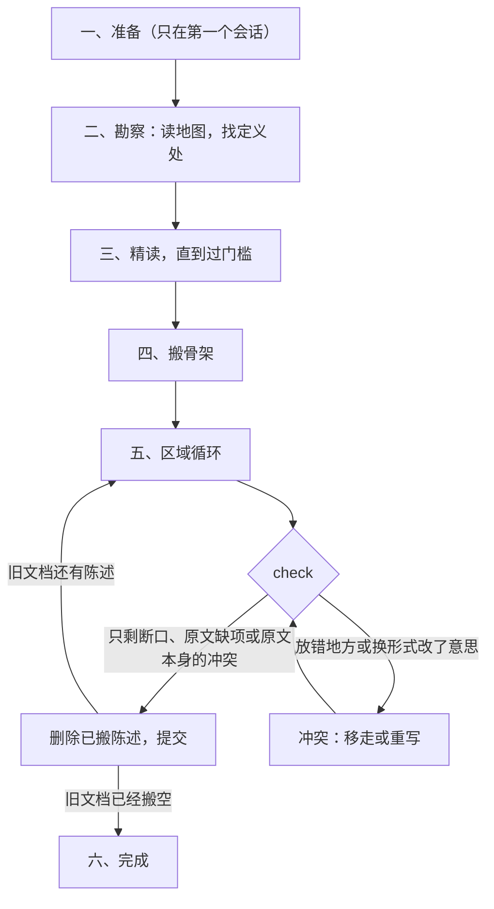

# design-migration

把旧文档的内容原样搬进 `software-design` 的设计目录。新目录的写法、`check` 与 `graph` 见 `software-design`，开始前先读它。

## 禁令

**迁移只搬运。** 禁止考虑旧文档内容的问题：不判断它对不对、好不好、算不算设计、前后是否矛盾、有没有更好的写法。任何改动原意的行为都不是迁移：不增、不删、不改、不补全、不修正、不精简。这是绝对的禁令。

迁移中只允许下面几件事，它们都不改变原意：

1. **决定放在哪里**：哪个模块目录、哪个文件，规格还是文字，正文还是附录。
2. **换形式，不换意思**：
   - 把原文能精确表达的部分写成 VDM-SL：规格里的每个约束原文都有，原文的每个约束规格里都有，不多也不少。对应关系见「换成 VDM-SL」。
   - 或者把原文原样搬进文字，只把 Markdown 的写法换成 LaTeX 的写法；LaTeX 排不了的部分（例如 Mermaid 图、代码）放进 `verbatim` 环境。

   写成规格需要原文没有做出的决定时（类型要精确到原文没说的程度，或者要选原文没选的结构），就不写成规格，把原文原样搬进文字。
3. **合并**：同一内容在旧文档里出现在几处（重述、复述、不同文档各写一遍），搬过来只留一份，放在拥有者那里，其余位置的这条陈述都算搬完。应当合并的必须合并，不在新设计里保留重复。只合并意思相同的内容；意思不同的两条各自按原文搬。
4. **统一措辞**：同一个东西在旧文档里有不同的叫法，当场就能判断是同一个东西，并且能说出哪个更先进时，统一成更先进的那个叫法。“更先进”要有原文里的证据，按这个次序认：原文明说一个取代了另一个（“改名为”“旧称”“不再叫”）；定义处用的叫法先于使用处用的叫法。没有这样的证据，或者原文有意保留两套叫法（例如给用户的词与程序里的名字），就各自保留原来的叫法。

允许的判断只有一种：搬过去的位置与形式是否忠实于原文。

发现的问题不处理：不改，也不在新文档里加注释、评论或待办。迁移中不问用户：去处有默认规则，形式拿不准就搬原文；内容里的漏洞与矛盾，搬过来之后由编译器与审查查出来，那是迁移之后的事。

`software-design` 的写作规则与本禁令冲突时（例如文字复述了规格、依据没写来源、缺少说明注释、缺少负责范围、附录里有状态），以本禁令为准。由此留下的 `check` 诊断与模型审查结果不是迁移要消除的。

## 名词

- **陈述**：旧文档里承载一个完整意思的最小单位，例如段落里的一句、一个列表项、一个表格行、代码里的一个顶层声明（连同它的注释）、一张图。标题不是陈述；标题下的陈述都搬走之后，标题随之删除。
- **层**：一条陈述里可以各自放到不同位置的意思，用「拆层」的问题清单拆出来。
- **概念**：原文给出了结构或规则的名字，例如组件、类型、记录、状态、操作、进程、规则。只用来组织文档的词（“顺序”“反例”“正文”）、示例里的取值、局部变量名不是概念。
- **定义处**：给出一个概念的结构或规则的地方；其余提到它的地方是使用处。几处都给出结构或规则时，几处都是定义处：意思相同的按「合并」搬成一份，意思不同的各自按原文搬，不判断谁对。
- **区域**：阅读与搬运的单位。有标题的文档里，是一个概念的定义处所在的那一节，到下一个同级或更高级标题为止；没有标题的文件（例如代码、IDL）整个文件是一个区域。
- **组件目录**：`design/architecture/` 下的一个目录，对应原文的一个组件。一个组件目录里可以有零个或几个 VDM-SL 模块；`check` 与 `graph` 说的“模块”指 VDM-SL 模块。
- `check` 的诊断分三类：
  - **断口**：因为相关内容还没搬过来而出现的诊断：VDMJ 的未解析名字（`Error 3182 Name … is not in scope`、`3196 No such module`、`3191 No export declared for import`、`3430 Unable to resolve type name`、`3213 Operation … is not in scope`、`3126 Unknown type … in constructor`），以及 `\vdmref` 指向的元素不存在。
  - **原文缺项**：原文本来就没有、所以永远搬不过来的东西：定义或字段缺说明、`README.tex` 缺负责范围。不补。
  - **冲突**：其余的诊断，例如类型不符、依赖方向反了、目录之间成环、反模式、QuickCheck 找到反例。

## 流程

## 一、准备

只在第一个会话做一次。之后的会话从「每个会话」开始。

1. **找出依赖旧文档的实现。** 不只是 import：代码、测试与脚本以任何方式用到的旧设计文件都算，例如 import 的类型文件、运行时读取的 Markdown、作为测试夹具读取的示例。把这些文件复制一份到实现里，改好引用与读取路径；跑仓库自己的构建、类型检查，以及用到这些文件的测试，确认没有破坏。原件留在旧文档里，作为待搬内容。仓库自己的检查在准备之前就失败的部分，如实记下，不在迁移里修。
2. **改名与初始化。** 把旧文档目录改名为 `legacy-design/`（例如 `git mv design legacy-design`），再用 `software-design` 的 `init` 生成 `design/`。`init` 只生成空模板，不算往 `design/` 写内容。
3. **改仓库的说明与规则。** `AGENTS.md`、`README.md`、agent 规则文件等指向设计文档的地方改成：`design/` 是搬过来的设计；`legacy-design/` 里剩下的是还没搬的旧文档。与迁移禁令冲突的规则，在迁移期间对 `legacy-design/` 与 `design/` 不适用，写明迁移禁令优先，例如：要求“读设计必须全文读”的规则、要求“发现问题必须当场修正”的规则、要求实现直接引用设计文件的规则、禁止改动设计目录或禁止使用 `/tmp` 的规则。
4. 提交。此时 `check` 只会报根模块缺负责范围，这是断口。

## 二、勘察

目标是知道旧文档里有什么、每个概念在哪里定义。只读地图：每个出现位置只读它所在的那一句，不读整节正文。

笔记写在 `/tmp/<仓库名>-survey.md`，只供当前会话使用，不提交；每个会话按 `legacy-design/` 剩下的内容重做一遍。

1. 列出 `legacy-design/` 下的全部文件。
2. 每个文件读标题层级与第一段（没有标题的文件读开头的注释或第一段），归入下表的一种文档类型。
3. 收集候选概念：标题里的名字、代码与文法里声明的名字、表格第一列的名字、加粗的名字。去掉只用来组织文档的词、示例里的取值与局部名字。当场就能看出是同一个东西的不同叫法，记成一个概念，按「统一措辞」记下更先进的叫法。
4. 对每个概念，在 `legacy-design/` 里搜索它出现的全部位置，读每处所在的那一句，判断是定义处（给出结构或规则）还是使用处。一句话判断不了的，记为“未定”，在精读时解决。
5. 记下设计中心：景观文档明确说是各组件共用的那几个概念；景观文档没有这样说时，取多数组件文档都依赖的概念。

| 文档类型 | 特征 | 何时精读 |
|---|---|---|
| 景观 | 讲整个系统：由哪些组件组成，组件之间怎样协作 | 过门槛之前 |
| 组件 | 讲一个组件：职责、模型、接口 | 组件目录的 README 在过门槛之前；其余进区域循环 |
| 横切 | 讲贯穿多个组件的机制 | 区域循环 |
| 契约 | 接口定义、类型文件、IDL | 区域循环 |
| 依据材料 | 问题域、需求、质量场景、调研 | 区域循环，用到时 |
| 走查 | 端到端的过程、失败与恢复 | 所涉概念都搬完之后 |
| 实现映射 | 语言、库、存储、代码结构 | 区域循环，任何时候 |
| 附录 | 示例、证据、参考资料 | 区域循环，任何时候 |
| 过程记录 | 计划、状态、变更、评审、待办 | 区域循环，任何时候 |

文档类型只决定读的次序。搬的时候每条陈述照样逐层判断去处。

笔记内容：每个文件的文档类型；每个概念的定义处（文件与节）、使用它的文件、未定项；设计中心。

## 三、精读，直到过门槛

读够之前不往 `design/` 写内容。过早搬运会把局部的说法当成整体，把内容放错地方。

全文读：景观文档；设计中心各概念的定义处；每个组件的 README（没有 README 的组件，读它每篇文档的第一节）。然后检查是否过了门槛：

1. 不看旧文档，能说出系统由哪些组件组成，各组件负责什么，组件之间怎样协作；能说出设计中心是什么。
2. 笔记里的每个概念都能说出拥有它的组件，未定项都已解决。拥有者按原文定：原文说由谁拥有、由谁写，就是谁；原文没说，定义处在某个组件的文档里，就是这个组件；定义处在横切或契约文档里、原文又没说，就是根模块。一个类型写在某个契约文件里，不等于原文说它归那个组件。

说不出拥有者或还有未定项，就去读相关的定义处，直到说得出为止。

## 四、搬骨架

1. 景观文档里的每个组件建成一个组件目录：用 `module` 建目录，目录名取原文的组件名（换成小写字母、数字与连字符），父子关系按原文的组件包含关系。
2. 原文里说某个组件负责什么、不负责什么的陈述，原样搬进该组件目录 `README.tex` 标题下的第一段。
3. 设计中心各概念的区域，按「五、区域循环」的第 3 到 7 步搬进根模块或它们的拥有者。
4. 引用还没搬过来的概念时，就让引用悬着。骨架连不起来是正常的；不写占位定义，不用 `token` 冒充还没读过的结构，不写空操作。

## 五、区域循环

每一轮只处理一个区域。

1. **选区域。** 按这个次序找：
   1. `check` 的断口：缺失的名字在 `legacy-design/` 里的定义处。
   2. 已搬进 `design/` 的内容（包括 `verbatim` 文字）提到、但定义处还在 `legacy-design/` 里的概念。`check` 看不见文字里的引用，所以要拿勘察笔记里的概念对照 `design/` 去找。
   3. 按文档类型的次序：横切、契约、组件剩下的部分、依据材料、走查、实现映射、附录与过程记录。
2. **读。** 全文读这个区域。区域里提到的概念，拥有者或含义不读就定不了去处时，去读它的定义处。读到区域里每条陈述的每一层都知道去哪里为止。
3. **拆层。** 对每条陈述逐个问下面的问题，每个回答“是”的问题就是一层：

   | 问题 | 去处与形式 |
   |---|---|
   | 它命名或定义了一个概念吗？ | 拥有者里的类型、状态、操作或函数；原文对它的描述原样作为说明注释 |
   | 它说某个东西必须满足什么吗？ | 拥有者的 `inv`、`pre`、`post`；写不成与原文一样精确的谓词，就原文搬进拥有者的「语义」 |
   | 它说两个概念或组件之间的关系吗？ | 提供方的 `exports` 与使用方的 `imports`；包含关系（同进程、同部署、同存续期）原文搬进「语义」 |
   | 它说次序、时间、并发、进程、崩溃或持久化吗？ | 原文搬进所属组件目录的「语义」或主题文件 |
   | 它说为什么吗？ | 原文搬进所属组件目录的「为什么」 |
   | 它说外部事实、约束、需求或质量要求吗？ | 原文搬进「依据」；业务单元的需求搬进它的「需求」 |
   | 它描述一次端到端的过程吗？ | 写成场景操作；写成场景需要原文没有的决定时，原文搬进主题文件 |
   | 它是实现、示例或证据吗？ | 原样搬进 `appendix/reference/`、`appendix/examples/`、`appendix/evidence/` |
   | 它是计划、状态、变更、评审或待办吗？ | 整条原样搬进 `appendix/evidence/`；里面夹带的决定也一起搬，不抽出来当作当前规则 |
   | 它只是导航，例如“见下文”“如上表”？ | 随它指向的内容：指向的内容搬完时一起删除 |
   | 它是指向别的文件的路径或链接吗？ | 目标已经搬进 `design/` 的，改指新位置；还没搬的，仍指 `legacy-design/` 里的原位置，目标搬走时再改。这是换形式 |

   所属组件目录与「语义」「为什么」「依据」的小节，按 `software-design` 的目录约定放；放不进 `README.tex` 固定小节的，放进按内容命名的主题文件。

4. **放置，整条处理。** 处理一条陈述，就在同一轮里把它的每一层都放好。需要的组件目录还不存在、但拥有者已经清楚时，用 `module` 或 `unit` 建出来。只要有一层的去处还定不下来，这条陈述就整条不动，回到第 2 步继续读，不先搬其中容易的那一半。读完相关内容之后，原文仍然没有说清的，用默认去处：拥有者原文没说就是根模块；形式拿不准就把原文搬进所属组件目录的「语义」或主题文件。所以每条陈述最终都有去处。陈述只有两种状态：没动过，或者整条搬完。

   一层意思新设计里已经有了（之前从别处合并过来的），这一层就算放好；同一轮里几条陈述意思相同，按「合并」搬成一份。搬的时候一律用统一后的叫法；新出现了更先进的叫法时，把新设计里已搬过来的地方一并改成它。
5. **检查。** 运行 `check`。断口与原文缺项留着；冲突按「冲突」处理。
6. **删除。** 从 `legacy-design/` 删掉整条搬完的陈述；一节里的陈述删光时，连标题一起删；文件删空时删掉文件。不改写旧文档里剩下的文字。
7. **提交。** 搬入与删除放在同一个提交里，`git show` 就是这一轮的去向记录。提交说明写这一轮的区域，以及留下了哪些属于原文本身的冲突诊断。

### 一条陈述拆成几层的例子

原文的一个列表项：

> stop hook 是 harness 的功能，属于 Workspace 的 harness 插槽，不属于核心；例如 Claude Code 通过 `.claude/settings.json` 注入。

拆层：它说了两个组件之间的关系（stop hook 属于 Workspace，不属于核心），搬进 Workspace 组件目录的文字；它举了一个实现的例子（Claude Code 怎样注入），搬进 `appendix/reference/`。两层都放好之后，这一项从旧文档删掉。只搬了前一层就停下，是不允许的。

### 换成 VDM-SL

原文的写法与 VDM-SL 精确对应时才写成规格，否则把原文放进 `verbatim`：

| 原文 | VDM-SL | 条件 |
|---|---|---|
| 有限个取值的枚举或字符串字面量联合，例如 `'table' \| 'json'` | quote 并类型 `<Table> \| <Json>` | 取值就是全部情况 |
| 记录或接口，字段都有类型 | 记录 `::` | 每个字段都能精确对应 |
| 可缺省的字段 `x?: T` | `[T]` | |
| 数组、列表 | `seq of T` | 原文说非空才用 `seq1 of T` |
| 集合 | `set of T` | |
| 映射，不在乎顺序 | `map K to V` | 原文要求保持顺序时不对应，放 `verbatim` |
| 原文说是整数、自然数的数 | `int`、`nat`、`nat1` | 原文没说是整数时用 `real` |
| 不透明的身份、带 brand 的字符串 | `token` | 原文说使用方不读结构 |
| 原样传递的文本 | `seq of char` | 原文说它是给人看或原样传递的文本 |
| 整数常量的并，例如退出码 `0 \| 2 \| 3` | `nat` 加 `inv` | |
| `unknown`、泛型、函数类型、按字符串内容区分的规则 | 不对应 | 放 `verbatim` |

## 冲突

按这个次序怀疑，前一种排除了才看下一种：

1. **放错了地方，这是最常见的情况。** 例如该进子目录的放进了父目录，业务放进了架构，同名的两个概念放进了同一个模块。按原文重新判断拥有者，把它移到该在的位置。
2. **换形式时改了意思。** 规格比原文多了约束或少了约束。按原文重写规格，或者改为把原文搬进文字。
3. **原文本身就是这样。** 位置与形式都忠实于原文，诊断仍然在，就说明原文本身是这样。不必判断哪一方对，诊断留着，在提交说明里记下。

禁止为了消除诊断改动意思：不挑选其中一方，不把意思不同的说法合并成一种，不加标志、特例或额外的结局分支。

## 每个会话

- **开始**：确认工作区干净；运行 `check`；按 `legacy-design/` 剩下的内容重做勘察笔记；重读设计中心，以及已经搬进 `design/` 的根模块。
- **结束**：每条处理过的陈述都已整条搬完、删除并提交。

`check` 通过不代表迁移的连接都接上了：搬成 `verbatim` 的文字越多，`check` 能核对的就越少，`graph` 里的边也越少。迁移进度只看 `legacy-design/` 剩下多少，不看 `check` 是否通过。

## 六、完成

`legacy-design/` 搬空时，迁移就结束了。在同一个提交里删掉 `legacy-design/`，并把仓库说明与规则里指向它、为迁移而放宽的地方改回只指 `design/`。

`check` 里剩下的诊断、模型审查的结果，以及对设计的审查与修改，属于后续阶段，按 `software-design` 进行，那已经不是迁移。
