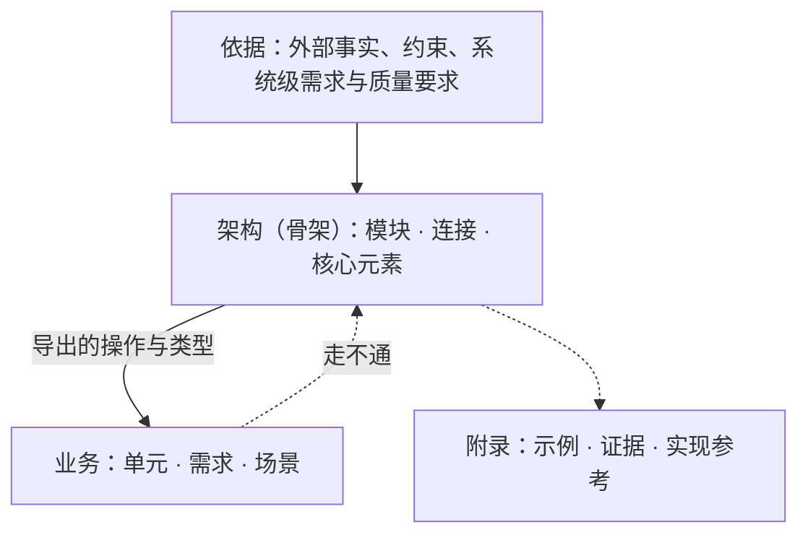
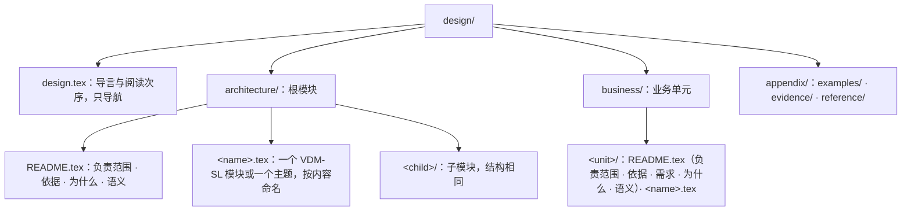

# software-design

## 设计是什么

设计是代码化的文档。它的价值是作为参考，并陈述不变量；实现对照它检验，它不随实现改变。

- **判据：在连接不变时可以替换的做法属于实现。** 一段内容只规定怎样兑现连接，换一种做法时连接与不变量都不变，它就是实现，不写进设计。两个独立的实现者各写一份时必须得出同一外部行为的内容，才写进设计。
- **失败与并发按同一判据划分。** 会改变部件、连接、状态空间或使用方可观察承诺的决定属于设计，例如是否承诺恰好一次、“结果未知”是不是一种结局、崩溃后由谁接管。罕见不等于是实现。
- **设计不展开边界情况与逐情形处理。** 不改变连接、状态空间、不变量和可观察承诺的处理细节属于实现，例如逐项的拒绝原因、编码与字节、在既定承诺下选哪种算法。一段细节保护某条不变量时，设计只写这条不变量。
- **设计不要求组合成整体。** 组合根、适配器、总入口、完整调用链、为通过检查补的实现都不属于设计。规格只要求本身合法、引用能解析。
- **设计与实现的类型是两码事。** design 不依赖 src，因为设计不能随实现改变；实现怎样表达这些类型由实现决定。

为什么不直接写代码：代码必须完整、能运行，设计决定、可替换的选择与为了能跑而补的边界处理混在一起，读不出哪一行是不能改的承诺；而且代码是唯一产物时，没有独立的参照可以检验它。为什么不只写文字：文字没法机械核对，同一个概念在各处的说法会漂移，AI 写文字会自造词，并把边界处理与业务写进设计。所以能形式化的部分写成 VDM-SL 规格，由工具检查；规格说不清的语义写成文字，文字只引用规格里已有的名字。

## 骨架与优先级

骨架就是架构。架构回答三个问题：

1. **由什么组成**：有哪些模块，各是什么，谁在谁里面。
2. **用什么组成**：模块由哪些核心元素拼成，彼此经由哪些连接相接。
3. **为什么**：为什么是这些模块和这些材料，依据哪些事实、约束与需求。

业务建在骨架上，只经连接接入。架构贴近抽象，业务贴近实现；两者分开写，混在一起时谁都看不出架构是什么样。

- **依赖方向。** 业务引用架构，架构不引用业务；check 拒绝架构模块 import 业务模块。架构里也不得有只为某一个业务单元存在的类型、分支或规则。
- **架构由需求证明。** 改变骨架的需求与质量要求写进架构的依据，写明来源；依据可以说明它来自哪类业务场景，但架构不引用业务单元的规格。
- **对不上时判断哪一边错。** 业务在骨架上写不出来，或场景走不通时，判断是业务表达错了、这项业务不属于本系统，还是骨架的抽象不成立，不预设结论。改骨架是单独的决定：写出哪条依据变了，改完后让每个业务单元与场景重新通过检查。
- **附录不设立规则。** 正文可以指向附录中的证据，附录可以引用正文。

## 两条轴

抽象层级与模块划分是两条独立的轴。

- **抽象层级**是架构目录树的深度：`architecture/` 是根模块，每个子目录是一个子模块。父模块粒度粗，子模块粒度细。子模块可以使用祖先拥有的材料；父模块不依赖子模块，几个子模块共用的材料放在它们共同的父模块。
- **模块划分**是每个模块固定的三部分，不论它在哪一层：

| 部分 | 写在哪里 |
|---|---|
| 外部连接 | 本目录各 VDM-SL 模块的 `exports`：导出的操作、函数与类型 |
| 核心代码 | 本目录各 VDM-SL 模块里的类型（带 `inv`）、状态、函数与操作 |
| 内部设计 | 子目录；`README.tex` 的「语义」与主题文件：规格说不清的语义 |

模块的划分只按抽象：一组可以对外陈述连接、内部决定可以对其他模块隐藏的元素，成为一个模块。篇幅不是拆分模块的理由。

业务不分三部分。业务单元是 `business/` 下的一个目录，用自己的 VDM-SL 模块 import 架构导出的操作与类型接入，向其他业务单元导出它提供的操作。业务单元之间只经导出的操作协作；不带 `struct` 导出的类型对使用方不透明，使用方不能依赖它的结构。

## 规格：VDM-SL

规格用 VDM-SL 写在文学式 LaTeX 文件里：文字在外，规格在 `\begin{vdm_al}` 与 `\end{vdm_al}` 之间，VDMJ 只解析规格块。一个文件至多一个 VDM-SL 模块，规格必须写在具名的 `module … end` 里。写法范例在 [`references/vdm.md`](references/vdm.md)。

| 设计概念 | VDM-SL |
|---|---|
| 连接点 | 一个导出的操作或函数 |
| 连接面 | 同一模块导出、共享该模块状态与 `inv` 的一组操作；共享的不变量就是状态不变式 |
| 交换 | 操作的参数与结果类型 |
| 结局 | 结果的并类型，每支是 quote 或记录；只列使用方必须区分处理的结局，不逐项列原因 |
| 可观察的失败 | 结局中的一支，例如结果未知；恢复要走的操作写在这一支的说明里 |
| 准入定律 | `pre`、`post`、`inv`；写不成谓词的定律与质量承诺进「语义」 |
| 不承诺 | 不带 `struct` 导出的类型，或 `token` |
| 生命周期 | 模块状态里的集合或映射：开始操作的 `post` 加入，结束操作的 `pre` 要求存在、`post` 移除；嵌套写成状态不变式；确认者写在操作的说明里 |
| 场景 | 一个操作依次调用连接 |

- **先写隐式规格。** 连接写成只有 `pre`/`post` 的隐式操作或函数：说做到什么，不说怎么做。只有计算本身就是设计决定时才写显式体，例如两个实现必须得出同一结果的判定算法；不为了能执行而补显式体。
- **类型优先，说明跟着类型。** 先写类型，再写文字；文字不替代类型的描述。每个定义前写 `--` 注释，说明它是什么、承诺什么，而不是复述形状；记录与状态的每个字段在同一行末尾或上一行写 `--` 注释。check 拒绝缺说明的定义与字段。
- **名字就是词汇。** 规格里的名字是设计唯一的词汇；文字只用这些名字指认元素，不另造同义词。一个概念重要到要在文字里反复提，就把它写成规格元素；不重要就不起名字。
- **场景。** 关键的正常路径、每种可观察的失败结局、生命周期中断都各写一个场景操作。类型检查核对场景用到的操作与结局存在；证明义务把每一步的前置条件写成待证命题，QuickCheck 找它们的反例。写不出某个场景，说明连接、结局或骨架缺了东西：回到规格去改，不另写走查报告。
- **规格说不清的不硬写。** 进程、并发、崩溃窗口、持久化顺序、定时规则在 VDM-SL 里没有直接表达；不要为它们造模拟机制，写进「语义」。

## 文字

文字写规格说不清的语义，是规格的额外解释：

- **定时与调度**：例如周期发送、按给定节奏观察、不承诺有限时间内结束。
- **时序、并发与进程**：跨越多个连接的次序，哪些可以同时发生、哪些必须先后；进程边界与崩溃窗口。
- **事实与副本**：谁确认一件事发生了，哪些记录是源头事实，哪些是取回的副本或索引。
- **失败与恢复**：跨越多个连接的恢复，例如崩溃后由谁接管哪些运行。
- **包含关系**：哪些模块在同一进程、同一部署、同一信任范围或同一存续期内；模块树本身不代表任何包含。
- **定律的展开**：一句谓词写不清的等式与关系。
- **依据、需求与理由**：见「依据与理由」。

写法：

- 一句陈述一条事实或一条规则；规则用“必须、不得、可以、只”。
- 用 `\vdmref{模块}`、``\vdmref{模块`名字}``、``\vdmref{模块`名字.字段}`` 指认规格元素；check 拒绝指向不存在元素的引用。
- 数量写数值、单位和条件。
- 不在文字里复述规格已经说清的内容，不与规格矛盾。
- 模块的组成与依赖由 `graph` 从规格导出，不在文档里另画。

## 依据与理由

**依据**是会改变设计的外部事实、约束与需求：

- 架构模块的依据写改变模块、连接或核心元素的事实、约束、系统级需求与质量要求；业务单元的依据写约束这个单元的事实与约束。
- 每条一句话，写出来源，并接一句“所以……”，说明它让骨架或这个业务单元多了或少了什么。
- 质量要求写成“在〈环境〉下，〈刺激〉发生时，〈响应〉满足〈度量〉”，并写出来源。数值只在有出处时写，不为凑格式编造指标。
- 当前实现的目录、调用步骤和偶然行为不是依据。
- 影响整个系统的依据写在根模块；只影响一个模块的写在该模块；只约束一个业务单元的写在该单元。篇幅大的证据放进附录，依据只引用它。
- 不编号，不建追溯矩阵。

**需求**写在业务单元 `README.tex` 的「需求」：需求是必须在问题域中成立、可以被观察到的结果，例如用户或外部系统看到什么，不是机器的功能列表。每条写出来源，并至少由一个场景走通。

**理由**写在「为什么」：

- 每个改变骨架或业务形状的决定都写理由，理由引用依据或需求。
- 确实存在可信替代时，写一句为什么不选它。
- 理由引用的依据不再成立时，决定要重审。决定依赖的前提不在依据里时，把前提写进理由。
- 只关系到一个元素的选择，理由写进这个元素的说明注释。

## 目录与文件

- `init`、`module`、`unit` 生成目录与 `README.tex`；文件名只用英文小写字母、数字与连字符。
- `design.tex` 以 `\input` 列出阅读次序，每个 `architecture/`、`business/` 下的 `.tex` 恰好一次；它不写规则。
- **README.tex**：以 `\section{模块名}` 开头，先写一段本模块负责什么、不负责什么，之后的小节按固定次序，没有内容的小节不写。架构是「依据」「为什么」「语义」；业务是「依据」「需求」「为什么」「语义」。其余内容放进主题文件。
- **规格文件**：一组一起变化的元素放在一个文件、一个 VDM-SL 模块里，文件按内容命名，例如 `run.tex`。两组各自独立变化时分成两个文件。不按篇幅拆分，也不预设类型的名字。
- **主题文件**：一组一起变化、规格说不清的语义，在 `README.tex` 里展开会遮住骨架时，放进主题文件；它开头用一段话说明它展开 `README.tex` 的哪一节。拆开会迫使读者跨文件拼出同一个不变量、生命周期或失败窗口时不拆。
- **附录**分三类：`examples/` 演示已有规则，`evidence/` 存放依据的证据，`reference/` 说明实现可以怎样满足连接。附录不设立规则；附录里出现新规则时，把它移到所属的模块或业务单元。
- 文档只写当前设计：不标状态，不并列新旧规则，不写变更历史。

**依赖方向**由 check 按 import 核对：

- 架构模块不得 import 业务模块。
- 父模块不得 import 子模块；共用的材料放在共同的父模块。
- 目录之间的 import 不成环；同一目录内的模块可以互相引用。

## 脚本与检查

需要 Java 11 以上与 Bun。首次使用前在本 skill 目录运行一次 `bun scripts/design.ts setup`，它从 Maven Central 取 VDMJ 与 QuickCheck 的最新正式版，放在 `scripts/.vdmj/`；想换到更新的版本时再运行一次。

| 命令（相对本 skill 目录） | 作用 |
|---|---|
| `bun scripts/design.ts init <仓库根>` | 生成 `<仓库根>/design`：`design.tex`、根模块 `README.tex`、三类附录目录 |
| `bun scripts/design.ts module <design> <a/b>` | 建立架构子模块目录与 `README.tex`，并加入阅读次序；父模块必须已存在 |
| `bun scripts/design.ts unit <design> <名字>` | 建立业务单元目录与 `README.tex`，并加入阅读次序 |
| `bun scripts/design.ts check <design> [--json]` | 检查全部规则，逐条列出违规，有违规时退出码为 1 |
| `bun scripts/design.ts graph <design> [--json]` | 输出目录、模块与 import 关系的 Mermaid 图或 JSON |
| `bun scripts/design.ts vdmj <design> [参数]` | 用全部规格文件运行 VDMJ，例如 `-i` 进解释器、`-e` 求值 |

`check` 依次检查：

| 阶段 | 内容 |
|---|---|
| layout | 只有约定的目录与文件，名字合规，每个模块与业务单元目录有 `README.tex` |
| parse | VDMJ 能解析每个文件的规格块 |
| structure | 一个文件至多一个具名模块；每个定义与字段有说明；依赖方向与无环 |
| prose | `\vdmref` 都指向存在的元素；`README.tex` 的开头段与小节次序；`design.tex` 恰好列出每个文件 |
| typecheck | VDMJ 类型检查全部模块 |
| quickcheck | 生成证明义务，QuickCheck 没有找到反例 |

通过表示规格类型正确、结构与方向成立、文字引用的名字都存在、QuickCheck 没有找到反例。它不表示证明义务都成立：输出列出“未定”“未评估”的义务，它们与说明、依据、理由一样靠审查清单判断。

`design.tex` 用 XeLaTeX 编译成 PDF，例如 `tectonic -X compile design.tex`；它用到 `ctex`（fandol 字体）与 `vdmlisting`。检查不依赖 TeX，并忽略 `design.pdf` 等编译产物。

## 工作顺序

1. 用 `init` 生成目录，写根模块 `README.tex` 的负责范围与依据。
2. 写根模块的规格：核心类型、对外的连接、状态与不变量。
3. 写根模块的「为什么」与「语义」。
4. 用 `module` 建立每个子模块，写它的依据、规格与 `README.tex`，逐层向下。
5. 用 `unit` 建立业务单元：先写依据与需求，再写接入的规格，最后写为什么与语义。
6. 为关键路径、每种失败结局与生命周期中断写场景操作。写不出来时回到第 2 到 5 步修正。
7. 运行 `check`，用 `graph` 导出模块图审查骨架，再按「审查清单」逐项检查，包括输出列出的未定义务。

改动的传递：

- 骨架变了，先改依据、规格与理由，再让每个业务单元与场景重新通过 `check`。
- 业务变了，先改业务；业务或场景在骨架上走不通时，按「骨架与优先级」判断哪一边错。
- 重写已有设计时，先在新骨架中建立模块与连接，旧文档只作取证材料；不沿旧目录逐文件改写，也不默认旧结论仍然成立。

## 审查清单

骨架：

1. 只看 `graph` 导出的模块图与各 `README.tex` 的负责范围，能否说出系统由什么组成、用什么组成、谁在谁里面？
2. 每条依据是否写出了来源，并说明它让设计多了或少了什么？改变骨架的需求是否都进了依据？
3. 每个改变骨架的决定是否都有理由，理由是否引用了依据？
4. 每个模块是否按抽象划分，而不是按篇幅或执行步骤划分？
5. 适用的包含关系（进程、部署、信任、存续）是否都在「语义」写明？

连接：

6. 每个结局是否只列使用方必须区分处理的分支？每种可观察的失败是否都是一支，恢复是否写明？
7. 共享状态的一组操作是否真的共享那条不变量？准入定律是否写全了类型强制不了的约束？
8. 生命周期的开始与结束、确认方是否都写清了？
9. 输出列出的未定证明义务是否逐条判断过：它是成立的，还是规格少了前置条件或不变式？

场景与业务：

10. 每条需求是否至少由一个场景走通？关键的失败结局与生命周期中断是否都有场景？
11. 业务单元之间是否只经导出的操作协作？

文字：

12. 每个说明注释是否写了它是什么、承诺什么，而不是复述它的形状？
13. 文字是否只写规格说不清的语义？是否与规格矛盾？是否用了规格里没有的词指认东西？

设计与实现：

14. 是否有在连接不变时可以替换的做法写进了设计？是否为了能执行而补了显式体？
15. 是否展开了不改变连接、状态空间、不变量和可观察承诺的边界情况与逐情形处理？
16. 是否要求了组合根、适配器、总入口？附录是否设立了规则？
