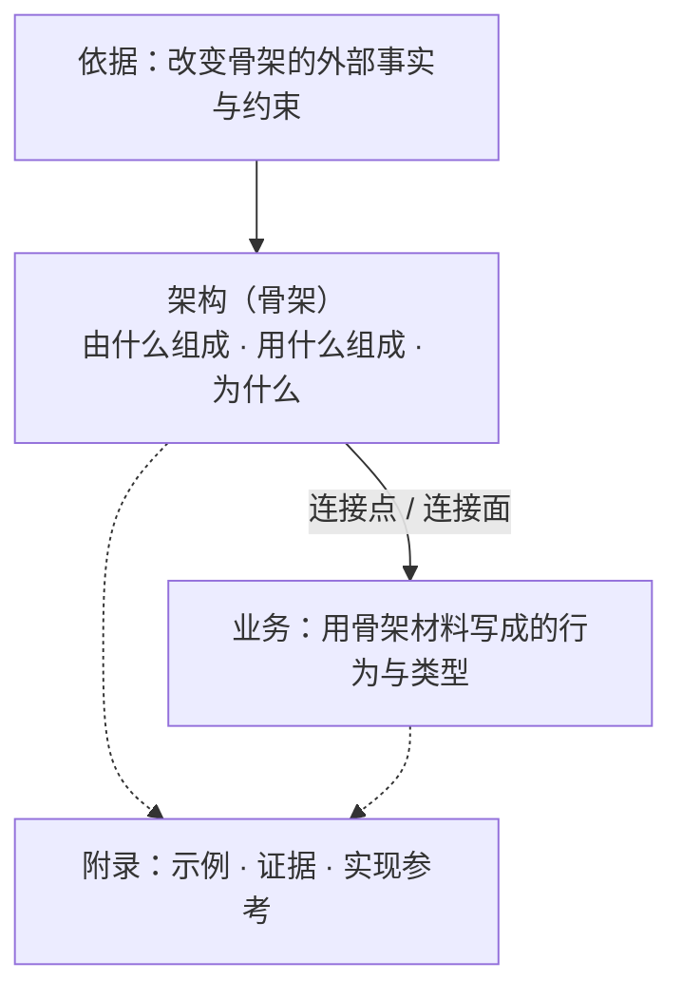
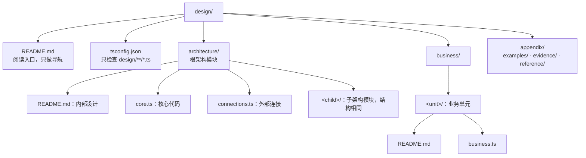

# software-design

## 设计是什么

设计是代码化的文档。能用类型表达的写成 TypeScript 类型，由 `tsc` 检查；类型表达不了的语义写成文字。设计的价值是作为参考，并陈述不变量。

设计与实现的区别：

- **设计不处理边界情况。** 罕见输入、失败组合、编码与字节细节、逐项的拒绝清单、竞态的逐一裁决都属于实现。一段细节保护某条不变量时，设计只写这条不变量，细节既不写成类型，也不写成文字。
- **设计不要求组合成整体。** 组合根、适配器、总入口、完整调用链、为编译通过补的实现都属于实现。每份设计类型只要求本身合法、import 能解析。
- **精确不等于实现。** 核心状态的闭合和类型、字段之间的关联、按标签取值的类型族属于设计。判断一段内容是不是实现，看它是在陈述抽象与不变量，还是在规定怎样处理某个情形。

design 的类型与 src 的类型相互独立。实现可以 import design 类型，也可以定义自己的类型；本 skill 不规定实现怎样使用 design 类型。design 一侧只有一条要求：design 类型不依赖 src，因为设计不能随实现改变。

## 骨架与优先级

骨架就是架构。架构回答三个问题：

1. **由什么组成**：有哪些部件和子模块，各是什么。
2. **用什么组成**：组合的材料和组合方式，即部件由哪些核心抽象拼成、彼此经由哪些连接相接。
3. **为什么**：为什么是这些部件和这些材料，依据哪些事实与约束。

业务建在骨架上，只用骨架给出的材料表达：核心抽象、连接点、连接面。架构贴近抽象，业务贴近实现；两者分开写，混在一起时谁都看不出架构是什么样。



优先级由依赖方向表达，不在文档中另作声明：

- 业务引用架构，架构不引用业务。架构的文字和类型都不提任何业务。
- 业务与骨架对不上时，先对照骨架修正业务。
- 改骨架是单独的决定：写出哪条依据变了，改完骨架后让每个业务单元重新通过检查。不为单个业务在骨架里加专用类型或分支。
- 附录不设立规则。正文可以指向附录中的证据，附录可以引用正文。

## 两条轴

抽象层级与模块划分是两条独立的轴。

- **抽象层级**是架构模块树的深度。父模块粒度粗，子模块粒度细。父模块的组成由子模块经它们的外部连接接成；父模块只用类型名指认子模块 `connections.ts` 中的连接，不依赖子模块的内部设计和核心代码。
- **模块划分**是每个架构模块固定的三部分，不论它在哪一层：

| 部分 | 文件 | 内容 |
|---|---|---|
| 内部设计 | `README.md` | 文字：依据、组成、材料、为什么、语义 |
| 核心代码 | `core.ts` | 用代码写出本模块的核心抽象与组合材料：关键类型与函数签名，不写实现 |
| 外部连接 | `connections.ts` | 本模块提供或需要的连接点、连接面的类型 |

业务不分三部分。业务单元经连接点或连接面接到架构上，并可以使用架构的核心抽象作为材料；结构见「目录与文件」。

## 连接

连接是一等概念。业务与架构在哪里相关、子模块之间在哪里相接，都由连接写清。

- **连接点**：一个单独的操作或值，一个接入方。例如一个可替换的函数、一个外部程序在某个角色上的入口。
- **连接面**：一组必须由同一个实现一起提供的操作，写成一个类型，各操作是它的成员。判定一组操作是不是面，看它们是否共享同一条不变量，例如同一个确认方、同一段生命周期；不看它们是否写在一起。

每个连接写清四项：

| 项 | 写法 |
|---|---|
| 位置 | 所在模块的 `connections.ts` 与类型名 |
| 形状 | 点或面 |
| 抽象 | 类型：输入、输出、错误，以及面中各成员之间的关联 |
| 准入规则 | 类型能强制的部分写进类型；类型强制不了的定律写在该连接类型的注释里 |

准入定律是实现接进来必须满足的不变量：等式、幂等、次序、由谁确认、不伪造结果等。只陈述定律，不设计测试。签名对得上不等于满足定律；一个结构上相容、却违反定律的实现不能接入。

只属于一个连接的定律写在它的注释里；面的定律写在面这个类型的注释里。跨越多个连接的时序、生命周期与定时规则写在模块 `README.md` 的「语义」一节。

系统与外部世界交换的现象，就是根架构模块 `connections.ts` 中的连接；不另写现象表。

## 类型

类型用 TypeScript 写，在设计一开始就写，由 `tsc` 检查。

- **先写类型，再写说明文字。** 依据是写类型之前的输入；除依据外，每个模块先写 `core.ts` 与 `connections.ts`，再写 `README.md` 的其余各节。文字不复述类型。
- **架构类型与业务类型分开。** 业务单元的 `business.ts` 可以 import 架构模块的 `core.ts` 与 `connections.ts`，以及其他业务单元的 `business.ts`；架构类型不 import 业务类型；design 类型不 import src。业务单元之间的 import 不得成环。
- **架构内部的 import 方向。** 架构模块可以 import 祖先模块的 `core.ts` 与 `connections.ts`，以及兄弟模块和祖先的兄弟模块的 `connections.ts`；除祖先外，不得 import 其他模块的 `core.ts`，也不得 import 后代模块的任何文件。父模块在「组成」中用类型名指认子模块的连接。import 图不得成环。
- **术语就是类型名。** 不另立术语表。文字要指认一个东西时写它的类型名，所以不存在用词对不齐的问题。没有类型的概念只出现在一处文字里，并在那里说清它是什么。
- **类型能表达的不写文字。** 闭合集合写成和类型；字段之间的关联用类型排除不可能的组合；随标签变化的形状写成类型族。
- **合法即可，不求组合。** 签名可以写成函数类型或 `declare function`。不为编译通过补实现、适配器、mock 或入口。

### 先问变化的是什么

设计一开始就为每处可变的地方选写法，选能表达它的最弱写法：

| 变化的是 | 写法 |
|---|---|
| 一个值类型 | 普通泛型，例如 `Tree<Leaf>` |
| 一个闭合的标签 | 索引访问、条件类型、`Extract`，例如 `ArgsByRole[R]` |
| 类型构造器本身 | `this` 类型 lambda |

只有当一个操作要在签名中保持一个任意的类型构造器 `F<_>` 时，才用高阶类型，写法固定为：

```ts
/** 一个类型构造器：接收类型参数 `A`，产出类型 `type`。 */
export interface TypeLambda {
  /** 构造器接收的类型参数。 */
  readonly A: unknown;
  /** 构造器把 `A` 映射成的类型；实现者用 `this['A']` 写出它。 */
  readonly type: unknown;
}

/** 把类型构造器 `F` 应用到类型参数 `A` 上得到的类型。 */
export type Kind<F extends TypeLambda, A> = (F & {
  /** 本次应用的类型参数。 */
  readonly A: A;
})['type'];
```

### 注释

每个类型和它的每个成员都有自己的注释：字段、联合的每一支、函数类型的成员与参数。联合中内联写出的一支（对象类型或字面量），注释写在 `|` 之后、这一支之前，例如 `| /** 结果未知。 */ { readonly kind: 'Unknown' }`；以具名类型出现的一支，在那个类型自己的声明处注释。函数类型的每个参数写一条 `@param 参数名 说明`。

- 数据写它是什么、标识什么、不是什么，例如"显示用的时间，不是仍在运行的证据"。
- 函数写它做什么：把什么变成什么，什么时候被调用，失败时得到什么。
- 注释不复述形状：不把联合、字段、可选条件翻译成自然语言。
- 注释不声称类型没有强制的性质。遇到这种性质，要么加强类型，要么在注释里写明它是不变量、类型不强制它。
- 注释不写操作步骤，也不写边界情况怎么处理。

### 检查

本 skill 的 `scripts/design.ts` 负责初始化目录与检查规则。首次使用前在 `scripts/` 目录运行一次 `bun install --no-save`。

| 命令 | 作用 |
|---|---|
| `bun scripts/design.ts init <仓库根>` | 在 `<仓库根>/design` 建立模板：`README.md`、`tsconfig.json`、根架构模块、`business/`、`appendix/` 的三个目录 |
| `bun scripts/design.ts module <design 目录> <a/b>` | 在 `architecture/a/b` 建立子架构模块；父模块必须已存在 |
| `bun scripts/design.ts unit <design 目录> <名字>` | 在 `business/<名字>` 建立业务单元 |
| `bun scripts/design.ts check <design 目录>` | 检查全部规则，逐条列出违规，有违规时退出码为 1 |

`check` 检查下面几类规则：

- **目录与文件**：只有模板中的文件；目录名只用英文小写字母、数字与连字符。
- **`README.md` 小节**：只用模板中的小节，次序与模板一致，没有空小节；有子模块的架构模块在「组成」中有 mermaid 图。
- **import**：只用 `import type`，路径写成带 `.ts` 后缀的相对路径，只指向 design 内的 `core.ts`、`connections.ts`、`business.ts`；不用 `import("…")` 类型和动态 import；符合「类型」中的 import 方向；import 图不成环。
- **注释**：每个声明、每个成员、联合中内联的每一支都有带说明文字的文档注释；函数类型的每个参数都有 `@param`。
- **类型**：用 TypeScript 编译器按 `design/tsconfig.json` 检查全部类型文件。

`check` 只能证明规则被遵守、注释存在；注释写得对不对、文字是否只写类型表达不了的语义，仍靠「审查清单」。

## 文字

架构文档与业务文档只写类型表达不了的语义：

- **定时与调度**：例如周期发送、按给定节奏观察、不承诺有限时间内结束。这类规则写一句话比写代码清楚。
- **时序与生命周期**：开始与结束锚点、确认方、内层在外层之内结束。
- **并发**：哪些可以同时发生，哪些必须先后。
- **事实与副本**：谁确认一件事发生了，哪些记录是源头事实，哪些是取回的副本或索引。
- **失败与恢复**：失败的类别写成类型；文字只写类型说不出的部分，例如谁确认失败、失败之后由谁恢复、"结果未知"意味着什么。不写每个情形怎么处理。
- **定律**：类型签名说不出的等式与关系，例如一个集合是满足某条件的最小集合。
- **依据与理由**：见「依据与理由」。

写法：

- 一句陈述一条事实或一条规则；规则用"必须、不得、可以、只"。
- 用类型名指认东西。
- 数量写数值、单位和条件。
- 结构图用 mermaid，按图意选语法：组成用 `flowchart`，生命周期用 `stateDiagram-v2`，交互次序用 `sequenceDiagram`。

## 依据与理由

**依据**是会改变骨架的外部事实与约束：

- 只写改变部件、材料或连接的事实与约束。只影响边界情况处理的事实不写。
- 每条一句话，写出来源，并接一句"所以骨架有……"。
- 不编号，不列需求清单，不建追溯矩阵。需求由业务承载。
- 质量要求只在改变骨架时写；数值只在有出处时写，不为凑格式编造指标。
- 当前实现的目录、调用步骤和偶然行为不是依据。
- 影响整个系统的依据写在根架构模块；只影响一个模块的写在该模块。篇幅大的证据放进附录，依据只引用它。

**理由**写在架构模块 `README.md` 的「为什么」：

- 每个改变骨架的决定都写理由，理由引用依据。
- 只在确实存在可信替代时，写一句为什么不选它。
- 理由引用的依据不再成立时，决定要重审。决定依赖的前提不在依据里时，把前提写进理由。
- 只关系到一个类型的选择，理由可以写在该类型的注释里。

## 目录与文件

目录与文件都预先固定，不自由新增文件。目录用 `init`、`module`、`unit` 三个命令建立，见「检查」：



架构模块 `README.md` 的小节固定如下，没有内容的小节不写：

| 小节 | 内容 |
|---|---|
| 依据 | 影响本模块的外部事实与约束 |
| 组成 | 由什么组成：子模块与它们之间经哪些连接相接，附一张 mermaid 组成图 |
| 材料 | 用什么组成：`core.ts` 中的核心抽象怎样拼成本模块；只指认类型名，不复述类型 |
| 为什么 | 每个决定的理由，以及确实存在的可信替代 |
| 语义 | 类型表达不了的语义，见「文字」 |

业务单元 `README.md` 的小节固定如下：

| 小节 | 内容 |
|---|---|
| 接入 | 本单元接在哪些连接点或连接面上，写类型名 |
| 语义 | 本单元的业务语义中类型表达不了的部分 |

规则：

- 一个模块的文件放不下时，拆出子模块，子模块套用同一模板；业务单元放不下时，拆成多个业务单元。不新增主题文件。
- `design/README.md` 只列阅读次序与各模块、各业务单元的位置，不设立规则。
- 附录分三类：`examples/` 演示已有规则，`evidence/` 存放依据的证据，`reference/` 说明实现可以怎样满足连接。这三个目录下的文件按内容命名，不受模板限制。附录不设立规则；附录里出现新规则时，把它移到所属的模块或业务单元。
- 文档只写当前设计：不标状态，不并列新旧规则，不写变更历史。

## 工作顺序

1. 用 `init` 建立目录，写根架构模块的依据。
2. 写根模块的 `core.ts` 与 `connections.ts`：组合材料、核心抽象、对外的连接。
3. 写根模块 `README.md` 的组成、材料、为什么、语义。
4. 用 `module` 建立每个子模块，写它的依据，再对它重复第 2、3 步，逐层向下。
5. 用 `unit` 建立业务单元：在连接点上写 `business.ts`，再写 `README.md`。
6. 运行 `check`，再按「审查清单」逐项检查。

改动从骨架往外传：

- 骨架变了，先改骨架的依据、类型与理由，再让每个业务单元重新通过检查。
- 业务变了，只改业务。业务在骨架上写不出来时，要么修改骨架的抽象（这是一个单独的骨架决定），要么判定这项业务不属于这个骨架。
- 重写已有设计时，先在新模板中建立骨架，旧文档只作取证材料；不沿旧目录逐文件改写，也不默认旧结论仍然成立。

## 审查清单

骨架：

1. 只读 `design/architecture/` 的各个 `README.md` 与 `core.ts`，能否说出系统由什么组成、用什么组成、为什么？
2. 每条依据是否写出了来源，并说明它让骨架多了或少了什么？
3. 每个改变骨架的决定是否都有理由，理由是否引用了依据？
4. 架构的文字和类型中，是否出现了任何业务？
5. 「组成」中的每个部件、「材料」中的每个抽象，是否在 `core.ts` 或 `connections.ts` 中有对应的类型？

连接：

6. 每个连接是否写清了位置、点或面、抽象、准入规则？
7. 每个连接面是否说明了它的成员共享哪条不变量？
8. 每个业务单元是否只经连接点、连接面和核心抽象使用骨架，并且它的 `business.ts` 能通过 `tsc`？
9. 骨架里是否有只为某一个业务存在的类型或分支？

类型与文字：

10. `check` 是否通过？它覆盖类型检查、import 方向与成环、注释是否齐全。
11. 每个类型与成员的注释，是否写了它是什么或做什么，而不是复述形状？是否有注释声称了类型没有强制的性质，却没有写明类型不强制它？
12. 文字里是否有类型已经表达的内容？
13. 文字是否只写类型表达不了的语义？类型注释与 `README.md` 是否互相矛盾？

设计与实现：

14. 是否写进了边界情况、失败组合、编码细节、逐项拒绝清单或逐字的用户文案？
15. 是否要求了组合根、适配器、总入口，或为编译通过补了实现？
16. 每处细节删掉之后，它保护的不变量是否还在？

结构：

17. 目录与文件是否只用 `init`、`module`、`unit` 建立，并且没有模板之外的文件？`check` 会报出模板之外的文件。
18. 附录是否设立了规则？
