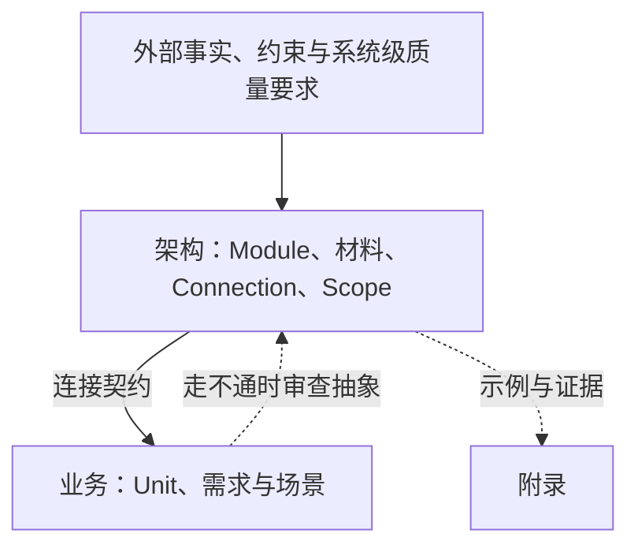
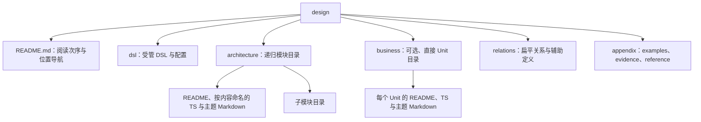

# software-design

## 设计是什么

设计是代码化的文档。类型写定义、值的形状、连接与可判定关系；Markdown 写类型说不清的含义。设计的价值是作为参考，并陈述不变量。

**在连接不变时可以替换的做法属于实现。** 如果一种做法只规定如何兑现连接，换掉它时连接的类型与定律不变，就不写进设计。组合根、适配器、总入口、完整可运行调用链和为编译通过补的实现不属于设计交付。

失败与并发也遵守这个判据。恰好一次、结果未知、崩溃后的接手方等会改变状态空间或可观察承诺，属于设计；罕见不等于实现。不改变连接、不变量或可观察承诺的逐项拒绝原因、编码、字节与算法细节不展开，只陈述它保护的不变量。

设计类型与 `src` 类型独立。实现可以 import 设计类型，使用 `Shape`、`Signature`、`Implementation` 投影，或定义自己的类型；skill 不规定实现如何消费设计。设计不依赖 `src`，不随实现的偶然行为改变。

## 骨架与优先级

骨架就是架构，必须先回答三问：

1. **由什么组成**：有哪些模块，各是什么，谁在谁里面。
2. **用什么组成**：模块拥有哪些核心材料，经哪些连接相接。
3. **为什么**：哪些事实、约束、需求证明这些材料与划分。

业务建在骨架上，只经连接接入。架构贴近抽象，业务贴近实现，两者分开写。



业务引用架构，架构不得引用业务；独立项目引用检查这个方向。只为某个业务存在的类型、分支与规则不塞进架构。改变骨架的业务需求与质量要求进入架构的依据，注明来源，但不让架构反向引用业务类型。

业务写不出来或场景走不通时，判断是表达错误、不属于本系统，还是骨架抽象不成立。改变骨架是单独决定：指出依据变化，改完后重新检查所有业务与场景。附录只演示或取证，不设规则。

## 两条轴

抽象层级与模块划分是独立的轴。

- **抽象层级**由 architecture 目录树表达。根目录是根 Module，子目录是子 Module；父模块的 parts 恰好列出直接子模块。父模块用 Expose 转交子模块的公开连接，用 public 延续直接子模块的显式材料公开路径。
- **模块划分**在每一层都保持三部分：外部连接、核心材料、内部设计。

|部分|表达|
|---|---|
|外部连接|ports 定义归属；provides 声明自身能力；requires 声明外部需要；reexports 声明转交|
|核心材料|core 列出 Data、Family、Carrier、Event、Lifecycle，类型文件按内容命名|
|内部设计|parts 列出直接子模块；README 与主题文件解释类型说不清的语义|

模块只按抽象划分：能陈述公开连接、能隐藏内部决定的一组元素成为模块，篇幅不是拆分理由。父模块的外部 requires 不绑定给自己或后代模块。

业务不分三部分。Unit 用 types、ports、provides、必填 plugsInto 陈述材料与接入，业务之间只随公开连接契约交换材料，不直接共享私有类型。Unit 没有独立 public 旁路。

## DSL 与投影

[`templates/dsl.ts`](templates/dsl.ts) 包含完整类型签名与投影。init 生成 `design/dsl/dsl.ts`；该受管文件不手改，用 upgrade 更新。泛型、alias、re-export、interface 辅助定义由 native compiler 解释，不限制作者必须直接书写构造器。内联成员不强迫逐个导出。

具名节点的身份是 `相对文件路径#声明名`，不要求名称全设计唯一。透明 alias/re-export 引用同一定义，不复制拥有者；独立定义即使字段相同仍各有身份。说明解释是什么，不承担身份。

|类型组|表达的事实|
|---|---|
|Value、Opaque|已描述的标量/数据；不承诺结构的稳定领域 key|
|Struct、Tuple|具名字段的积；有位置意义的数据集合|
|Case、Choice|核心和类型的闭合分支，不附带操作后继|
|Variant、Outcome|操作结局、字段与 End/Next/Later 后继|
|TypeLambda、Family、Apply|类型构造器、公开构造器说明、本次显式容器应用|
|Carrier、Point、Face|允许载体与准入定律；一个操作；共享不变量的一组操作|
|Op、OpRef、Returned、Occurred|参数/结果、操作引用、已返回合法分支、已发生事件|
|Event、Duty、Lifecycle|确认者与 payload、完成责任与事实、key 及 starts/ends/within|
|Module、Unit、External|架构模块、业务单元、外部参与方及声明能力/使用|
|Expose、Binding、Composition|公开转交路径、消费者局部选择、可选部分组合|
|Scope、Step、EventStep、Scenario|独立包含分组、调用/事件事实、有限走查及完成/中断|

Value 的原生叶子只接受 string、number、boolean、bigint、symbol、null、undefined、void 及相应字面量、模板字面量和品牌交叉。领域字段使用 Struct；不将普通领域 object、ReadonlyMap 或 unknown 塞进 Value 隐藏结构。结构未知时使用 `Opaque<'说明','稳定领域键'>`。

```ts
import type { Apply, Family, Shape, Struct, Tuple, TypeLambda, Value } from '../dsl/dsl.ts';

interface ListF extends TypeLambda { readonly type: readonly this['A'][] }
interface ByKeyF extends TypeLambda {
  readonly type: this['A'] extends readonly [infer K, infer V] ? ReadonlyMap<K, V> : never;
}
export type ListFamily = Family<'有序只读集合', ListF>;
export type Item = Struct<'一项业务数据', { case: Value<'业务分类', string> }>;
export type Items = Apply<'这些业务数据的有序集合', ListFamily, Item>;
export type Keyed<K extends string> = Apply<'按键读取数据', ByKeyF, Tuple<'键和值', [Value<'键', K>, Item]>>;
type NativeItems = Shape<Items>;
```

Apply 保留 doc/lambda/argument，唯一投影为 `Kind<F,Shape<A>>`，不二次扫描 F 的原生输出。多参构造器用 Tuple 或 Struct 的投影接收参数。Choice/Outcome 投影统一为 `{ readonly case: K; readonly fields: ... }`，业务字段叫 case 或 kind 也不碰撞。

Family 说明公开构造器；私有 TypeLambda 可以只是辅助定义。Point/Face 必填非空 carriers 元组，Carrier 保存 key、lambda、laws。`Implementation<某个允许的Carrier,某连接>` 只接受该连接列出的载体；同步与异步不是隐含全局默认。相容的签名不证明接入定律或接受时刻、失败、取消语义成立，这些仍需说明和人工审查。

## 连接、公开与组合

连接是一等概念。Face 的操作必须共享不变量，例如确认方与生命周期；不是因为写在同一个文件就成为 Face。

ports 决定 Connection 的定义拥有者，provides 决定原始能力，requires/plugsInto/uses 决定使用。External 是参与方，不兼作事件。Event 单独陈述 confirms 与数据。静态确认关系不从某次组合反写到定义。

Module.public 显式公开 Data/Event/Lifecycle；公开连接的交换数据、载体、Family、Follow/Fact 中事件与必要辅助定义则随连接契约可见。两种通道不同：签名里的材料不能被任意摘出成为全局 public。Lifecycle 的 key 随它公开，Fact 连接、事件和 within 必须另外可见；Unit 的 Lifecycle 不成为其他 Unit 的公开 within。

Expose 声明公开转交路径，不选择运行提供方。多条不同 From 可以并存，同一路径不可重复。父模块不能跳过隐藏子模块边界；business/External 从根架构契约进入。

每项使用默认是 Role，保留所有合法候选，零候选与唯一候选都不自动绑定。设计不要求全体组合；需要表达一次局部选择时，在 relations 写独立 Composition/Binding。Binding 必须保留消费者，选择已声明 provides 且公开可达的原始提供方。同一组合的同一消费者/连接只绑定一次，其他使用仍是 Role。不同 Composition 互不影响。

只有显式绑定产生确定依赖。工具分别检查每个已声明组合的同层绑定环，不声称全部可能组合无环，也不把候选边当成已经选择。

## 事实、义务与场景

生命周期从事实开始、以事实结束，不把发起 start 调用当成已经成功。`Returned<OpRef<RunFace,'start'>,'Started'>` 选择已返回分支；Occurred 引用已发生 Event。Lifecycle 的 key 是具名 Data，在两侧参数/所选结果或事件 payload 中都须出现；within 表达静态嵌套，不模拟每个运行值。

```ts
import type { Carrier, Duty, Face, Later, Lifecycle, Op, OpRef, Outcome, Opaque, Returned, Sync, Value, Variant } from '../dsl/dsl.ts';

export type RunHandle = Opaque<'关联开始与结束的凭据', 'run-handle'>;
export type Direct = Carrier<'直接返回已确认结果', 'direct', Sync, ['返回时已接受并完成确认']>;
export type Started = Outcome<'开始的可观察结局', {
  Started: Variant<'运行已开始，调用方最终负责结束', { handle: RunHandle }, Later<'可以先做其他工作', [Duty<'最终结束运行', 'caller', Returned<OpRef<RunFace, 'finish'>, 'done'>>]>>;
  Rejected: Variant<'没有开始运行'>;
}>;
export type RunFace = Face<'运行契约', '同一凭据关联运行，finish 幂等', {
  start: Op<'开始运行', {}, Started>;
  finish: Op<'确认结束', { handle: RunHandle }, Value<'已确认结束', void>>;
}, [Direct]>;
export type RunLifecycle = Lifecycle<'一次运行', {
  key: RunHandle;
  starts: Returned<OpRef<RunFace, 'start'>, 'Started'>;
  ends: Returned<OpRef<RunFace, 'finish'>, 'done'>;
}>;
```

Next 约束产生它的 actor 的下一次 Call，其他 actor 和 EventStep 可以穿插；Later 允许任意合法中间步骤，正常完成前履行全部 Duty。Duty 的责任可为 caller、provider 或具名 Participant，完成条件为 Fact。provider 在 Bound 上要求选定提供方，在 Role 上只能由一个合法候选作见证，不因此推断绑定。

Scenario 是有限声明走查，默认 Uncomposed，也可指定一个部分 Composition。Complete 不遗留义务或 pendingNext；Interrupted 必须有非空步骤，最后一步就是中断事实，并保存接手方和未履行项。每个完成步骤至多匹配一次义务，工具使用最大匹配而非贪心消费。真实关联值、结束时序、责任兑现与覆盖性仍需人工审查。

关键正常路径、每种可观察失败结局与生命周期中断都应有场景。写不出场景时回到连接、结局或骨架，不另外堆走查报告，不补运行实现。

## 文字、依据与理由

Markdown 写类型说不清的语义：时间/调度、跨连接次序与并发、事实与副本、恢复责任、定律展开、依据、需求与理由。

- 一句陈述一条事实或规则；规则用必须、不得、可以、只。
- 用反引号指认元素与成员，规范性引用优先完整 id，例如 `architecture/run.ts#RunFace.finish`。唯一可见名称可简写；歧义用路径限定。无关的 JSON/HTTP 等 code span 不被猜成设计引用。
- 没有类型对应的概念在所属文字中解释一次，其他地方链接；数量给出数值、单位与条件。
- 类型已有的模块组成、范围、连接、场景用 `skill://software-design-graph` 临时查看，不在 Markdown 保存另一份生成图。语义图只表达类型说不清的时序等内容。

**依据**是会改变设计的外部事实、约束与需求。每条注明来源并说明它让设计多了或少了什么。质量要求用环境、刺激、响应、度量表达，只使用有出处的数值。当前实现目录与偶然调用顺序不是依据。系统级依据放根模块，局部依据放所属模块或 Unit，长证据进附录；不编号，不建追溯矩阵。

**需求**写业务 README 的需求节，是必须在问题域成立、可观察的结果，不是机器功能列表。每条有来源，至少由一个场景走通。

**理由**写为什么节，引用依据或需求。存在可信替代时说明为什么不选；前提不在依据中时写进理由。前提变化需要重审决定。只关系一个元素的理由可以写入元素说明。

## 目录与文件



每个 architecture 目录恰好一个 Module，每个 business 直接子目录恰好一个 Unit，业务不嵌套。relations 放跨单元 External/Scope/Scenario/Composition 和辅助定义，架构与业务不得反向 import 它；Event/Lifecycle 留在定义拥有者目录。只服务架构端口的 External 放根 architecture 或最小共同模块，只服务单 Unit 的 External 可放该单元，跨层参与方放 relations。

类型文件与主题文件按内容命名，不预定义领域类型名，也不限每目录一个文件。一起变化的材料放一起，不按篇幅拆。主题介绍说明展开 README 的哪节，由该 README 的真实行内或 reference-style 链接接入。

README 标题之后先介绍负责与不负责的范围。architecture 的二级节按依据、为什么、语义排列；business 按依据、需求、为什么、语义；空节不写，出现的节须有正文。relations README 作导航和语义说明，不设领域规则。根 README 只导航，不维护第二份完整模块树。

附录 examples 演示已有规则，evidence 保存依据证据，reference 说明实现可以如何满足连接；附录不设规则。文档只写当前设计，不写状态或历史，不并列互相矛盾的新旧指导。

## 脚本与检查

首次运行检查或 Graph 前，在本 skill 的 scripts 目录执行 `bun install --no-save`。init/module/unit 只依赖生成器与文件系统，不提前加载 compiler 或 Markdown parser。native 检查从不 build/emit，不创建 `.design-build`、`.d.ts` 或 `.tsbuildinfo`。

|命令（相对本 skill 目录）|作用|
|---|---|
|`bun scripts/design.ts init <repo>`|生成 repo/design 导航、DSL、配置、根模块与 relations、三类附录；不生成领域定义|
|`bun scripts/design.ts module <design> <a/b>`|建立模块目录和标题；父目录必须存在|
|`bun scripts/design.ts unit <design> <name>`|建立 Unit 目录；首次创建 business 项目并刷新受管配置|
|`bun scripts/design.ts upgrade <design> --check`|只报告 UpToDate/UpgradeAvailable 与固定受管路径|
|`bun scripts/design.ts upgrade <design>`|按当前模板替换 DSL/config，保留全部领域 TS/Markdown，再检查并报告迁移位置|
|`bun scripts/design.ts check <design> [--json]`|五阶段自动检查；成功始终保留人工待审事项|

检查保证、公开闭包、场景义务与失败分类见 [`references/checking.md`](references/checking.md)。成功表示自动结构检查通过，不表示设计语义已被确认。类型、解析、关系或文字拒绝时不产生部分 Graph。Graph 的 view/search/neighbors/path 全部通过 `skill://software-design-graph` 运行，父 CLI 不提供 graph 命令。

## 工作顺序与审查

1. init 后先写根模块依据，再写核心材料、连接与 Module。
2. 写为什么与语义，按抽象用 module 逐层分解，并维护父 parts。
3. 用 unit 写业务依据、需求、接入类型与语义。
4. 为关键正常、失败与中断路径写 Scenario；必要时另写可选 Composition。
5. 运行 check，再用 Graph 子 skill 临时查看结构与查询关系。
6. 人工核对以下事项；自动成功不能代替这些判断。

|审查方面|必须回答|
|---|---|
|骨架|只看结构能否说清组成、材料、层级？划分是否按抽象而非篇幅/步骤？Scope 是否与模块树分开？|
|依据与理由|来源是否真实？改变骨架的需求是否进入依据？决定是否有前提与取舍？|
|连接|分支是否只列使用方必须区分的结局？Face 是否真的共享不变量？载体定律与质量承诺是否足够？|
|生命周期|锚点、关联值、静态确认关系与真实结束责任是否清楚？Next/Later 是否准确表达恢复？|
|组合|未绑定选择是否有意保留？局部绑定是否符合意图，而非被工具自动选择？|
|场景与业务|关键需求、失败和中断是否覆盖？业务是否只经连接合作？实际履责与关联是否成立？|
|文字|说明是否解释承诺而非复述形状？Markdown 是否只补类型说不清的含义且不与类型矛盾？|
|实现界线|是否混入可替换做法、逐情形处理、组合根或凑编译的实现？附录是否偷设规则？|

骨架变化先改依据、类型与理由，再重查所有业务和场景。业务变化先改业务，走不通时判断抽象是否成立。重组旧设计时先建立新骨架与连接，旧文档只作证据，不默认旧结论仍成立。
