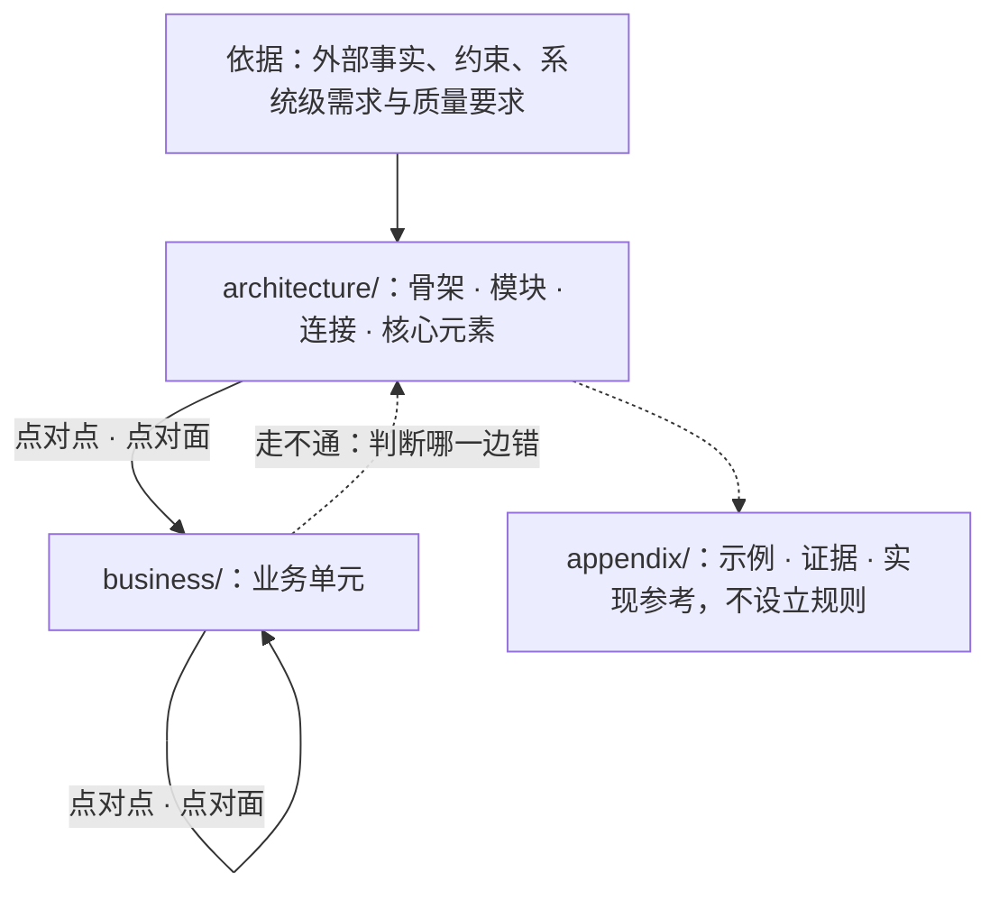
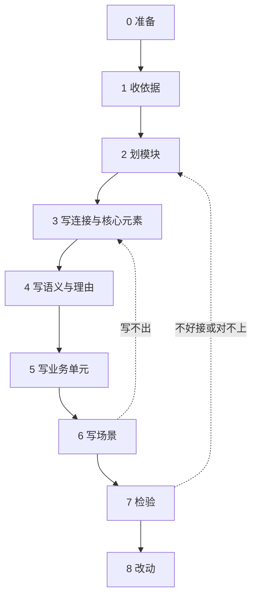
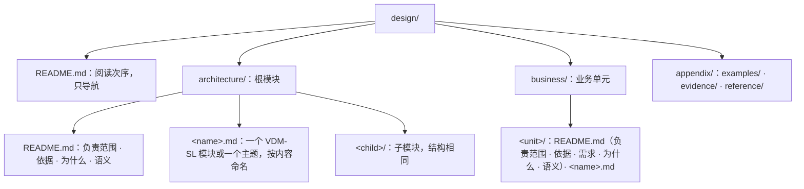

# software-design

本 skill 分三部分：

- **思路**：设计是什么，一样东西写不写、写在哪一层，用什么词描述模块之间的关系。
- **做事方法**：从依据到检验的九步。每一步写明谁做、写在哪、怎么做、做完的标志，示例就地给出。
- **要点**：交付前逐条核对的审查清单。

「参考」收目录约定、VDM-SL 写法、反模式、脚本与并行编写，做事方法用到时去查。示例全部取自通过 `check` 的[示例设计](references/example/design/)；标着“反例”的片段与输出是在它的副本上改出来的。

## 角色

| 角色 | 是谁 | 做什么 |
|---|---|---|
| 作者 | 写设计的 agent；几个 agent 并行时是主控与写手（见「并行编写」） | 写全部内容；运行 `check`、`review`、`graph`；按「要点」自查并在交付时报告结论 |
| 用户 | 提出设计任务的人 | 给出需求与依据的来源；已有旧文档时决定搬运还是只作参考 |
| `check` | `scripts/design.ts check` | 判断程序能确定的规则：目录、说明、方向、引用、反模式、类型、QuickCheck 反例 |
| `review` | `scripts/review.py` 交给 jev | 判断需要理解含义的反模式 |

# 思路

## 设计是什么

设计是代码化的文档：它陈述不变量，作为实现的参照；实现对照它检验，它不随实现改变。

- 只写代码不行：代码必须完整、能运行，不能改的承诺、可替换的选择与为了能跑而补的边界处理混在一起，读不出哪一行是承诺；代码是唯一产物时，也没有独立的参照检验它。
- 只写文字不行：文字没法机械核对，同一个概念的说法会漂移，AI 会自造词，并把边界处理与业务写进设计。
- 所以能形式化的写成可以检查的 VDM-SL 规格，规格说不清的写成文字，文字只用规格里的名字。

## 写不写

**在连接不变时可以替换的做法属于实现，不写进设计。** 判断时问：两个独立的实现者各写一份，是否必须得出同一外部行为？必须，写进设计；不必，是实现。

这条判据同样决定下面几件事：

- **失败与并发**：会改变部件、连接、状态空间或使用方可观察承诺的决定属于设计，例如是否承诺恰好一次、“结果未知”是不是一种结局、崩溃后由谁接管。罕见不等于是实现。
- **边界情况**：不改变连接、状态空间、不变量与可观察承诺的处理细节属于实现，例如逐项的拒绝原因、编码与字节、在既定承诺下选哪种算法。一段细节保护某条不变量时，只写这条不变量。
- **组合成整体**：组合根、适配器、总入口、完整调用链、为通过检查补的过程都不属于设计。设计只要求本身合法、引用能解析。
- **类型**：设计的类型与实现的类型是两码事。实现用自己的语言表达同样的类型，对照规格检验。

## 写在哪一层

骨架就是架构，它回答三个问题：

1. **由什么组成**：有哪些模块，各是什么，谁在谁里面。
2. **用什么组成**：模块由哪些核心元素拼成，彼此经由哪些连接相接。
3. **为什么**：为什么是这些模块和这些材料，依据哪些事实、约束与需求。

业务建在骨架上，只经连接接入。业务贴近实现，但也有自己的抽象。两者分开写，混在一起时谁都看不出骨架是什么样。



**一样东西归骨架还是业务，按它对组合的作用判断。** 问：没有它，哪两样东西接不上，或者接上之后哪条定律不再成立？说得出，它属于骨架；它只让某一项业务成立，属于业务。出处不改变归属：旧文档或类型文件里写着的条件照样这样判断。一类东西有多个成员时分开判断：任何成员都要满足的定律回答得出这个问题，进骨架；每个成员各自的精确定义回答不出，进业务。

依赖只有一个方向：业务引用骨架，骨架不引用业务；骨架里没有只为某一个业务单元存在的类型、分支或规则。附录不设立规则：正文可以指向附录中的证据，附录可以引用正文。

## 用什么词说模块之间的关系

模块之间只经连接相接；连接写清楚之后，两边可以各自替换实现。下表是设计的全部关系词，右列是示例设计里的对应物。

| 概念 | 是什么 | 示例设计里 |
|---|---|---|
| 连接点 | 一个可以被调用的操作或函数 | `Run`Status` |
| 连接面 | 共享同一份状态与同一条不变量的一组操作；共享的不变量就是这个面的规则 | `Start`、`Status`、`Finish` 共享状态 `Runs` 与 `inv mk_Runs(b, l) == l subset rng b` |
| 点对点 | 使用方一步调用一个连接点，按它的结局分支 | `Report` 调 `Submit`Submit` |
| 点对面 | 使用方接入一个连接面，承担它共享的不变量与生命周期：由这个面开始的，也由它结束 | `Submit` 接入 `Start` 与 `Status`：结果未知之后用 `Status` 找回，依赖两者共享的 `Runs` |
| 交换 | 连接收进与交出的数据 | `Start: RequestNo ==> StartOutcome` |
| 结局 | 一次调用的全部可能结果；只列使用方必须区分处理的分支 | `StartOutcome = Started \| <Rejected> \| <Unknown>` |
| 可观察的失败 | 结局中的一支；写明恢复走哪个连接 | `<Unknown>`，说明里写明改用 `Status` 找回 |
| 准入定律 | 实现必须满足的前置条件、后置条件与不变量；签名对得上不等于可以接入 | `Start` 的 `post`：同一请求号重复开始，得到同一运行 |
| 不承诺 | 对使用方隐藏结构的类型：使用方只能原样传递，不能读、不能造 | `RunId = token`，导出时不带 `struct` |
| 生命周期 | 一样东西从开始到结束：由哪个连接开始、哪个连接结束，嵌套在谁之内，由谁确认 | 运行由 `Start` 加入 `live` 开始、由 `Finish` 移出结束 |
| 场景 | 按次序调用连接，走通一条需求、一种失败结局或一次生命周期中断 | `Run`Recover`、`Submit`Submit`、`Report`Daily` |
| 判定 | 两个实现必须得出同一结果的计算；计算本身就是设计决定 | `Attempt`Unresolved` |

# 做事方法



每一步都是作者做；`check`、`review` 与用户参与的地方单独写明。模块之间互不阻塞时，第 2 到 6 步可以按「并行编写」分给几个 agent。一次写不对，先写出来，再按第 7 步反复改。

## 第 0 步：准备

- **谁**：作者；已有旧文档时由用户决定去留。
- **在哪**：本 skill 目录与目标仓库根。
- **怎么做**：
  1. 首次使用在本 skill 目录运行 `bun scripts/design.ts setup`（需要 Java 11 以上与 Bun）。
  2. 运行 `bun scripts/design.ts init <仓库根>`，生成 `design/`。
  3. 仓库里已有旧设计文档时，请用户选：搬运（按 `design-migration` 原样搬，迁移完成之后再按本 skill 审查与修改），或只作参考（按本 skill 从零设计，旧文档的内容在第 1 到 5 步逐条判断去处，见第 8 步）。
- **做完**：`check` 只报根模块缺负责范围。

## 第 1 步：收依据

依据是会改变设计的外部事实、约束与需求。

- **谁**：作者从用户给的需求、外部接口说明与调研材料里取；来源由用户或材料给出，作者不编。
- **写在哪**：影响整个系统的写进 `architecture/README.md` 的「依据」；只影响一个模块的写进该模块 `README.md` 的「依据」；只约束一个业务单元的写进该单元的「依据」。改变骨架的需求与质量要求写进骨架的依据：可以说明它来自哪类业务场景，但不引用业务单元的规格。篇幅大的证据放进 `appendix/evidence/`，依据只引用它。
- **怎么做**：每条一句话：事实或约束，括号写来源，再接一句“所以……”，说明它让骨架或这个单元多了或少了什么。质量要求写成“在〈环境〉下，〈刺激〉发生时，〈响应〉满足〈度量〉”；数值只在有出处时写。不编号，不建追溯矩阵。
- **判断**：拿掉这一条，设计会变吗？不会，它不是依据。当前实现的目录、调用步骤、偶然行为与技术选型不是依据。
- **示例**：

  ```markdown
  上游在超时之后仍可能已经开始了运行（来源：上游接口说明，证据见附录 `evidence/upstream-timeout.md`）。所以 ``Run`StartOutcome`` 有结果未知一支，调用方经 ``Run`Status`` 找回运行。

  在上游可用的情况下，调用方用同一个请求号重复调用 ``Run`Start`` 时，系统只产生一次运行（来源：示例需求）。所以 ``Run`Start`` 按 ``Run`RequestNo`` 幂等，运行表记下请求号到运行的对应。
  ```

- **做完**：每条依据都有来源与“所以”；改变骨架的需求都在骨架的依据里。

## 第 2 步：划模块

- **谁**：作者；用 `bun scripts/design.ts module <design> <a/b>` 建子模块目录。
- **写在哪**：`architecture/` 是根模块，子模块是它下面的目录；每个模块目录的 `README.md` 以「# 模块名」开头，第一段写它负责什么、不负责什么。
- **怎么做**：
  1. **按抽象划分**：一组可以对外陈述连接、内部决定可以对其他模块隐藏的元素，成为一个模块。篇幅与执行步骤不是划分的理由。
  2. **定层级**：父模块粒度粗，子模块粒度细。子模块可以使用祖先拥有的材料；父模块不依赖子模块，几个子模块共用的材料放在它们共同的父模块。
  3. **每个模块三部分**：外部连接（`exports` 里别的模块能用的操作、函数与类型）；核心代码（本模块拥有的类型、不变量、状态、函数与操作）；内部设计（子模块，以及「语义」里规格说不清的本模块语义）。
- **判断**：能否说出每个模块对外的连接，以及它向其他模块隐藏了哪个决定？说不出隐藏了什么，它不是一个模块。只看负责范围与 `graph` 导出的模块图，能否说出系统由什么组成、谁在谁里面？
- **示例**：子模块 `Attempt` 使用父模块的材料 `imports from Run types RunId renamed RunId`。单独成为子模块的理由写在它的 `README.md`：

  ```markdown
  尝试的记录只追加，所以单独成为子模块：它只用到父模块的 ``Run`RunId``，父模块不需要知道记录怎样保存。
  ```

  反例：父模块 `Run` import 子模块 `Attempt`，或架构模块 `Run` 的头部加上 `imports from Report operations Daily renamed Daily`，`check` 输出：

  ```text
  architecture/run.md:5: [structure] 父模块 Run 不得依赖子模块 Attempt；共用的材料放到共同的父模块。
  architecture/run.md:5: [structure] 模块目录之间的依赖成环：architecture -> architecture/attempt -> architecture。
  architecture/run.md:5: [structure] 架构模块 Run 不得引用业务模块 Report。
  architecture/run.md:5: [structure] 模块目录之间的依赖成环：architecture -> business/report -> business/submit -> architecture/attempt -> architecture。
  ```

  `graph` 导出的示例设计模块图：

  ```mermaid
  flowchart TB
    subgraph d_architecture["architecture"]
      m_Run["Run"]
      subgraph d_architecture__attempt["architecture/attempt"]
        m_Attempt["Attempt"]
      end
    end
    subgraph d_business__report["business/report"]
      m_Report["Report"]
    end
    subgraph d_business__submit["business/submit"]
      m_Submit["Submit"]
    end
    m_Attempt -->|import| m_Run
    m_Report -->|import| m_Run
    m_Report -->|import| m_Submit
    m_Submit -->|import| m_Run
    m_Submit -->|import| m_Attempt
  ```

- **做完**：`check` 的 structure 阶段没有方向与成环诊断；`graph` 的模块图能回答由什么组成、谁在谁里面。

## 第 3 步：写连接与核心元素

- **谁**：作者。每个元素的拥有者是定义它的模块；读一份状态的查询，拥有者是这份状态的拥有者。
- **写在哪**：模块目录下按内容命名的 `<name>.md`，`` ```vdm `` 块里一个具名 `module`。一组一起变化的元素放一个文件；两组各自变化时分成两个文件。写法查「VDM-SL 写法」。
- **怎么做**，按这个次序：
  1. **类型**：先写类型，再写文字。每个定义与字段前一句 `--` 说明：它是什么、承诺什么，不复述形状。
  2. **状态与不变量**：共享同一份状态、受同一条不变量约束的操作放进同一个模块，成为一个连接面。
  3. **连接**：写成隐式操作，只写 `ext`、`pre` 与 `post`，说做到什么，不说怎么做；不为了能执行而补过程。
  4. **结局**：只列使用方必须区分处理的分支；可观察的失败是一支，说明里写恢复走哪个连接。
  5. **交换**：一次调用的结果要交给下一次调用时，由连接交回，使用方不去读提供方的状态拼出它；使用方只需原样传递的类型导出时不带 `struct`。
  6. **生命周期与先后约束**：写清一样东西由哪个连接开始、哪个连接结束，嵌套在谁之内，由谁确认。对每条跨模块的“这一步必须在那一步之后”，问：使用方违反它时，类型检查或某个 `pre` 会拦下吗？不会，就把它写进交换（后一步要前一步交出的值）或 `pre`。
  7. **判定**：两个实现必须得出同一结果的计算写成显式函数体；其余不写显式体。
- **判断**：每个元素按「写不写」与「写在哪一层」各问一遍。
- **示例**：
  - `Run`Start` 只有 `post`：它规定开始之后运行表是什么样，不规定怎样查找、怎样插入。[`appendix/reference/run-store.md`](references/example/design/appendix/reference/run-store.md) 写了一种实现；换一种，签名与 `post` 都不变，所以它在附录。
  - 没有 `Runs` 的不变式 `l subset rng b`，`Start` 结果未知之后 `Status` 就找不回同一次运行，所以它在骨架；“找不回就算被拒绝”只让提交这项业务成立，所以写在 `Submit`Submit`。
  - “结束一次运行之前它必须已经开始”：`Finish` 要的 `RunId` 不带 `struct` 导出，只能来自 `Start` 或 `Status` 交回的值，违反它的调用过不了类型检查。
  - 反例，逐项列出拒绝原因：

    ```vdm
    -- 反例：逐项列出拒绝原因
    StartOutcome = Started | <QuotaExceeded> | <BadRequest> | <UpstreamBusy> | <Unknown>;
    ```

  - 反例，删掉 `Finish` 前面的说明，`check` 输出：

    ```text
    architecture/run.md:60: [structure] Run`Finish 前面缺少说明它是什么、承诺什么的 -- 注释。
    ```

- **做完**：`check` 的 structure、antipattern、typecheck 与 quickcheck 阶段通过。

## 第 4 步：写语义与理由

- **谁**：作者。
- **写在哪**：模块 `README.md` 的「语义」与「为什么」。一组一起变化的语义在 `README.md` 里展开会遮住骨架时，放进按内容命名的主题文件，开头一段说明它展开 `README.md` 的哪一节；拆开会迫使读者跨文件拼出同一条不变量、生命周期或失败窗口时不拆。
- **怎么做（语义）**：文字只写规格说不清的语义：
  - 定时与调度：周期发送、按给定节奏观察、不承诺有限时间内结束；
  - 时序、并发与进程：跨越多个连接的次序，哪些可以同时发生、哪些必须先后，进程边界与崩溃窗口；
  - 事实与副本：谁确认一件事发生了，哪些记录是源头事实，哪些是副本或索引；
  - 失败与恢复：跨越多个连接的恢复，例如崩溃后由谁接管；
  - 包含关系：哪些模块在同一进程、部署、信任范围或存续期内；模块树本身不代表任何包含；
  - 定律的展开：一句谓词写不清的等式与关系。

  一句陈述一条事实或规则，规则用“必须、不得、可以、只”；数量写数值、单位与条件；不复述规格，不与规格矛盾，不为这些语义造模拟机制。
- **怎么做（理由）**：每个改变骨架或业务形状的决定写理由，引用依据或需求；有可信替代时写一句为什么不选它；决定依赖的前提不在依据里时，把前提写进理由；只关系到一个元素的选择，理由写进这个元素的说明。理由引用的依据不再成立时，决定要重审。
- **怎么做（用词）**：规格里的名字是唯一的词汇。文字用双反引号包住限定名指认元素，例如 ``` ``Run`Status`` ```；不另造同义词。一个概念重要到要在文字里反复提，就把它写成规格元素。
- **示例**：

  ```markdown
  调用方得到结果未知之后，两次调用 ``Run`Status`` 至少相隔 ``Run`RetrySeconds`` 秒。``Run`` 与 ``Attempt`` 运行在同一进程内；进程崩溃后，新进程按 ``Run`Runs.byRequest`` 接管尚未结束的运行。

  运行表与开始、找回、结束放在同一个模块，因为它们共享“活着的运行都来自某个请求”这条不变量（``Run`Runs``）。不让调用方自己记下请求号与运行的对应：结果未知时调用方手里没有运行身份，只有提供方能按请求号找回。
  ```

  反例：依据里把 ``` ``Run`Status`` ``` 写成规格里没有的 ``` ``Run`Lookup`` ```，`check` 输出：

  ```text
  architecture/README.md:7: [prose] ``Run`Lookup`` 指向的规格元素不存在；只引用规格里已有的模块、定义或字段，不造新词。
  ```

- **做完**：`check` 的 prose 阶段通过；`review` 的文字复述规格、自造词不报。

## 第 5 步：写业务单元

- **谁**：作者；用 `bun scripts/design.ts unit <design> <名字>` 建目录。
- **写在哪**：`business/<unit>/README.md`（负责范围、依据、需求、为什么、语义）与按内容命名的 `<name>.md`。业务单元不嵌套。
- **怎么做**：
  1. **需求**：写必须在问题域中成立、可以被观察到的结果（用户或外部系统看到什么），不是机器的功能列表；每条写来源，并由至少一个场景走通。
  2. **接入**：只 import 骨架与其他业务单元导出的东西，点对点或点对面接入；依赖不成环；对不承诺结构的类型只原样传递。
  3. **抽象**：业务单元也按抽象划分。几个单元按同样次序调用同一组连接时，这组调用就是一个抽象，收成一个单元导出的连接点，上层单元不再 import 被收起来的模块。
  4. **从骨架挪进来的东西**：先指出它接在骨架的哪个连接上。指不出来，是骨架缺了连接，回第 3 步。
- **示例**：`Submit` 点对面接入 `Run` 的 `Start` 与 `Status`，点对点接 `Attempt`Record`，收成连接点 `Submit`Submit` 导出；`Report` 只接 `Submit`Submit` 与 `Run`Finish`，不处理结果未知，也不 import `Attempt`：

  ```vdm
  exports
    types struct Submitted; struct SubmitOutcome
    operations Submit: RequestNo ==> SubmitOutcome
  ```

  需求写成：

  ```markdown
  每天生成一份日报（来源：示例需求），由 ``Report`Daily`` 走通。
  ```

- **做完**：每条需求都指向一个场景；`graph` 里业务单元之间没有环。

## 第 6 步：写场景

- **谁**：作者。
- **写在哪**：场景所走的需求或失败属于哪个模块或单元，就写在那里，作为显式操作，说明以“场景：”开头。
- **怎么做**：关键的正常路径、每种可观察的失败结局、每种生命周期中断各写一个场景。按次序调用连接，用 `cases` 按结局分支。写完逐个追溯实参：每个实参必须来自场景参数或前面某个连接交回的值。
- **判断**：写不出某个场景，或某个实参追溯不到来源，说明连接、结局或骨架缺了东西：回第 3 步改连接，不另写走查报告。类型检查只拦得住不带 `struct` 的值，带 `struct` 的值靠这次追溯。
- **示例**：`Run`Recover` 走通结果未知之后的恢复（见「VDM-SL 写法」的显式操作）。反例：`Report`Daily` 丢掉 `Submit` 交回的运行，自己造一个交给 `Finish`，把 `mk_Submitted(run) -> Finish(run)` 改成 `mk_Submitted(-) -> Finish(mk_token(1))`，`check` 输出：

  ```text
  business/report/report.md:20: [typecheck] Error 3217: Unexpected type for argument 1 in 'Report' (business/report/report.md) at line 20:26；Expected: RunId /* opaque */；Actual: token
  ```

- **做完**：每条需求、每种可观察的失败与生命周期中断都有场景，场景的实参都追溯得到。

## 第 7 步：检验

验证就是运行 `check` 与 `review`、读它们的输出，加上作者按「要点」自查。没有编译步骤，也没有排版：不把设计转换成别的格式查看效果，不为显示效果改动内容。

- **谁**：`check` 与 `review` 出诊断；作者处理诊断、审骨架、自查。
- **在哪**：在本 skill 目录运行命令（见「脚本与检查」）；`review` 在 omp 的 Python eval 里运行。
- **怎么做**：
  1. 运行 `bun scripts/design.ts check <design>`，逐条处理违规；输出列出的“未定”证明义务逐条判断：它成立，还是规格少了前置条件或不变式。
  2. 在 eval 里运行 `review`（见「反模式」），逐条处理。
  3. 运行 `bun scripts/design.ts graph <design>` 导出模块图，按「要点」的骨架一组审查。
  4. **检验骨架好不好接**：拿一个业务单元接上骨架，再设想增加或删除一个连接点，数要改哪些模块。改动只落在拥有这个连接点的模块，骨架就切对了。波及别的模块时，对每个被波及的模块问它为什么要知道这件事，把这件事移到唯一需要它的模块；只能由业务自己维持的约束，交给对应的连接面拥有。
  5. **对不上时判断哪一边错**：业务在骨架上写不出来，或场景走不通时，判断是业务表达错了、这项业务不属于本系统，还是骨架的抽象不成立，不预设结论。
  6. 按「要点」逐条作答。
- **示例**：设想 `Run` 增加一种开始的结局：要改的是 `Run` 与接它的 `Submit`，`Report` 只看 `SubmitOutcome`，不用改。反例：`Submit`Submit` 要处理骨架没有的结局，把 `<Rejected> -> return <Rejected>` 改成 `<Lost> -> return <Rejected>`，`check` 输出下面一行；这时判断是业务写错了、这项业务不属于本系统，还是骨架少了一个结局：

  ```text
  business/submit/submit.md:30: [typecheck] Error 3311: Pattern cannot match in 'Submit' (business/submit/submit.md) at line 30:7
  ```

- **做完**：`check` 通过；`review` 列出的每处都已处理；「要点」每条都有结论，随交付报告给用户。

## 第 8 步：改动

- **谁**：作者。
- **怎么做**：
  - **骨架变了**：改骨架是单独的决定。先写出哪条依据变了，再改依据、规格与理由，然后让每个业务单元与场景重新通过 `check`。
  - **业务变了**：先改业务；业务或场景在骨架上走不通时，按第 7 步判断哪一边错。
  - **旧文档只作参考**：旧文档里的每样东西按「写不写」与「写在哪一层」判断去处；它记下的外部事实、约束与原始意图是依据，篇幅大的放进 `appendix/evidence/`。完成之前对照旧文档逐类说出内容的去处：骨架、某个业务单元，或者属于实现所以不写。
  - **文档只写当前设计**：不标状态，不并列新旧规则，不写变更历史。
- **做完**：改过的部分重新走完第 7 步。

# 要点

交付前的审查清单。作者在第 7 步逐条作答，随交付报告给用户；`check` 与 `review` 已经判断的规则不在此列。第 21 条模型判断不了，由人看：作者写出结论，用户复核。

骨架：

1. 只看 `graph` 导出的模块图与各 `README.md` 的负责范围，能否说出系统由什么组成、用什么组成、谁在谁里面？
2. 每条依据是否写出了来源，并说明它让设计多了或少了什么？改变骨架的需求是否都进了依据？
3. 每个改变骨架的决定是否都有理由，理由是否引用了依据？
4. 每个模块是否按抽象划分，而不是按篇幅或执行步骤划分？
5. 适用的包含关系（进程、部署、信任、存续）是否都在「语义」写明？
6. 骨架里的每条不变量与条件，是否都说得出没有它时哪两样东西接不上？只让某项业务成立的，是否都在业务里？

连接：

7. 每个结局是否只列使用方必须区分处理的分支？每种可观察的失败是否都是一支，恢复是否写明？
8. 共享状态的一组操作是否真的共享那条不变量？准入定律是否写全了类型强制不了的约束？
9. 生命周期的开始与结束、确认方是否都写清了？每条跨模块的先后约束，违反时是否有类型检查或 `pre` 拦下？
10. 输出列出的未定证明义务是否逐条判断过？

场景与业务：

11. 每条需求是否至少由一个场景走通？关键的失败结局与生命周期中断是否都有场景？
12. 业务单元之间是否只经导出的连接，点对点或点对面协作？几个单元按同样次序调用同一组连接时，是否收成了一个连接点？
13. 设想增加或删除一个连接点，改动是否只落在拥有它的模块？
14. 场景的每个实参是否都追溯得到场景参数或前面某个连接交回的值？

文字：

15. 每个说明注释是否写了它是什么、承诺什么，而不是复述它的形状？
16. 文字是否只写规格说不清的语义？是否与规格矛盾？是否用了规格里没有的词指认东西？

设计与实现：

17. 是否有在连接不变时可以替换的做法写进了设计？是否为了能执行而补了显式体？
18. 是否展开了不改变连接、状态空间、不变量和可观察承诺的边界情况与逐情形处理？
19. 是否要求了组合根、适配器、总入口？附录是否设立了规则？

反模式：

20. `review` 列出的反模式是否逐条处理了？
21. 每个说明里的承诺是否都写进了 `pre`、`post` 或 `inv`？每个场景是否走通了它对应的需求的每一步？

# 参考

### VDM 本地文档

VDM 的本地文档在 [`references/vdm/`](references/vdm/README.md)，随时查阅：

| 文档 | 用途 |
|---|---|
| [语言手册](references/vdm/language-manual.md) | VDM-SL 的全部语法与语义 |
| [运算符速查](references/vdm/operators.md) | 集合、序列、映射等运算符 |
| [诊断信息](references/vdm/messages.md) | VDMJ 错误与警告的编号和原文，读 `check` 的输出时用 |
| [VDMJ 用户指南](references/vdm/vdmj-user-guide.md) | 解释器、证明义务与命令行 |
| [外部格式](references/vdm/external-formats.md) | VDMJ 能读的文件格式；`check` 自己从 Markdown 里取出 ```` ```vdm ```` 块交给 VDMJ，行号与 Markdown 一致 |
| [QuickCheck](references/vdm/quickcheck.md) | 证明义务的反例搜索 |

### 文件与目录



- `init`、`module`、`unit` 生成目录与 `README.md`；文件名只用英文小写字母、数字与连字符。
- 设计目录根上的 `README.md` 用一个列表列出阅读次序，`architecture/`、`business/` 下的每个 `.md` 恰好出现一次；它不写规则。
- **规格文件**：文字在外，规格写在 ```` ```vdm ```` 代码块里，VDMJ 只解析这些块。一个文件至多一个 VDM-SL 模块，规格必须写在具名的 `module … end` 里。一组一起变化的元素放在一个文件，文件按内容命名，例如 `run.md`；两组各自独立变化时分成两个文件；不按篇幅拆分。
- **README.md**：以一级标题「# 模块名」开头，先写一段本模块负责什么、不负责什么，之后的二级标题按固定次序，没有内容的不写。架构是「依据」「为什么」「语义」；业务是「依据」「需求」「为什么」「语义」。其余内容放进主题文件。
- **主题文件**：一组一起变化、规格说不清的语义，在 `README.md` 里展开会遮住骨架时，放进主题文件；它开头用一段话说明它展开 `README.md` 的哪一节。拆开会迫使读者跨文件拼出同一个不变量、生命周期或失败窗口时不拆。
- **文字引用**：用双反引号包住限定名指认规格元素，例如 ``` ``Run`Status`` ```、``` ``Run`Runs.byRequest`` ```；check 拒绝指向不存在元素的引用。
- **代码块只有两种**：规格用 ```` ```vdm ````；图与文法用 ```` ```mermaid ````、```` ```ebnf ````、```` ```text ````（ASCII 图）。其他语言的代码块不放进正文。类型、接口、签名一律写成 VDM-SL：check 用 Bun 的转译器判断图与文法块、文字段落里的内容，带 TypeScript 专有语法的就拒绝。设计正文是规格加文字，不是换了格式的代码。
- **附录**分三类：`examples/` 演示已有规则，`evidence/` 存放依据的证据，`reference/` 说明实现可以怎样满足连接。附录不设立规则。
- 文档只写当前设计：不标状态，不并列新旧规则，不写变更历史。

### VDM-SL 写法

每个片段之后列出语言手册里对应的内容。

**文学式文件。** Markdown 标题与文字在外，规格在 ```` ```vdm ```` 代码块里：

````markdown
# 运行连接

```vdm
module Run
````

**模块头。** `exports` 列出别的模块能用的东西，`struct` 表示连同结构一起导出；`imports` 逐项列出用到的名字，`renamed` 让本模块用短名：

```vdm
exports
  types RunId; struct RequestNo; struct Started; struct StartOutcome; struct StatusOutcome
  values RetrySeconds : nat1
  operations
    Start: RequestNo ==> StartOutcome;
    Status: RequestNo ==> StatusOutcome;
    Finish: RunId ==> ();
    Recover: RequestNo ==> ()
```

```vdm
imports
  from Run
    types RequestNo renamed RequestNo; RunId renamed RunId; Started renamed Started
    operations Start renamed Start; Status renamed Status,
  from Attempt
    types Entry renamed Entry
    operations Record renamed Record
```

**类型。** `token` 是没有结构的值；`inv` 给类型加不变式；`::` 定义记录，字段之间不加分号，分号结束整个定义；`|` 组成并类型，`<Rejected>` 是 quote 值：

```vdm
  -- 一次运行的身份；提供方造出，使用方不读结构
  RunId = token;

  -- 调用方给出的请求号，从 1 开始；同一请求号代表同一次请求
  RequestNo = nat
  inv r == r > 0;

  -- 运行已经开始；调用方之后必须用 Finish 结束它
  Started ::
    run : RunId;  -- 结束时交回的身份

  -- Start 的结局：使用方必须区分已开始、被拒绝与结果未知；结果未知时改用 Status 找回
  StartOutcome = Started | <Rejected> | <Unknown>;
```

**值。** 有名字的常量：

```vdm
values
  -- 结果未知之后，两次找回之间至少相隔的秒数
  RetrySeconds : nat1 = 30;
```

**状态。** 模块的状态是一条记录，带不变式与初值；`map`、`set of`、`seq of` 是映射、集合与序列。`init` 要写成 `r = mk_Runs(...)` 的形式：VDMJ 要执行它来初始化模块，才能生成并检验证明义务；写成别的谓词时 `check` 报 Error 4144：

```vdm
state Runs of
  byRequest : map RequestNo to RunId  -- 请求号到它产生的运行
  live : set of RunId  -- 已开始、尚未结束的运行
  inv mk_Runs(b, l) == l subset rng b
  init r == r = mk_Runs({|->}, {})
end
```

**隐式操作。** 只写 `ext`（读写哪些状态分量）、`pre` 与 `post`，不写过程；`post` 里 `byRequest~` 是调用前的值，`++` 覆盖映射，`is_Started` 判断记录类型：

```vdm
  -- 开始一次运行；同一请求号重复开始只产生一次运行
  Start(request: RequestNo) r: StartOutcome
  ext wr byRequest wr live
  post (is_Started(r)
          and (request in set dom byRequest~ => r.run = byRequest~(request))
          and byRequest = byRequest~ ++ {request |-> r.run}
          and live = live~ union {r.run})
       or ((r = <Rejected> or r = <Unknown>) and byRequest = byRequest~ and live = live~);
```

**显式函数。** 写出计算；这里用集合推导式、`inds`（序列下标）与 `exists`：

```vdm
  -- 需要找回的运行：最后一条尝试是结果未知的运行；两个实现必须得出同一集合，所以写显式体
  Unresolved: seq of Entry -> set of RunId
  Unresolved(log) ==
    {log(i).run | i in set inds log &
       log(i).outcome = <Unknown>
       and not exists j in set inds log & j > i and log(j).run = log(i).run};
```

**显式操作。** 按次序调用别的操作；`cases` 按结局分支，`mk_Started(run)` 拆开记录，`let` 绑定中间结果，`;` 表示先后：

```vdm
  -- 场景：开始的结果未知时，按请求号找回运行并结束它
  Recover: RequestNo ==> ()
  Recover(request) ==
    cases Start(request):
      mk_Started(run) -> Finish(run),
      <Rejected> -> skip,
      <Unknown> ->
        let found = Status(request) in
          if found <> <Absent> then Finish(found)
    end;
```

**说明注释。** `--` 写在定义前面，字段的说明写在同一行末尾；check 要求每个定义与字段都有。

语言细节查[语言手册](references/vdm/language-manual.md)：模块与导入导出、类型与不变式、状态、隐式与显式定义、表达式与模式；运算符查[运算符速查](references/vdm/operators.md)。

### 反模式

规格可以通过 `check`，却仍然不是设计：它可能只是一张名字登记表，靠字符串表达含义，或者写成了实现。那样的规格只是让文字引用有名字可指、让类型检查有东西可查，`check` 就退化成了字符串检测器，只核对名字存在，不再检验设计。反模式分两层查：程序能确定的，由 `check` 的 antipattern 阶段按 VDMJ 的语法树判断，不匹配源码文本；需要理解含义的，由 jev（omp 的 judge 模型）按校准过的问题判断。

#### 程序判断（`check`）

| 反模式 | 为什么不是设计 |
|---|---|
| 字符串字面量 | 含义靠比较字符串内容，类型与谓词什么也没说 |
| 显式体里有赋值、循环或 `dcl` | 写的是怎样做，不是做到什么 |
| `is not yet specified` | 不承诺任何东西 |
| 隐式定义的 `post` 恒为 `true`，或只说结果是它的类型里的某一支（例如结果是 `Found = Job \| <Miss>` 时写 `post is_Job(r) or r = <Miss>`） | 不承诺任何东西 |
| 规格里没人用的顶层定义 | 只是一个名字，只为文字引用而存在（来自 VDMJ 的 Warning 5000） |

反例：

```vdm
  -- 是否完成
  Done: Job -> bool
  Done(j) == j.status = "done";

  -- 加入
  Add: Job ==> ()
  Add(j) == (dcl i : nat := 0; while i < 3 do i := i + 1; jobs := jobs ^ [j]);

  -- 恒真
  Always(n: nat)
  ext rd jobs
  post true;

  -- 只说结局是哪一支
  Look(n: nat) r: Found
  ext rd jobs
  post is_Job(r) or r = <Miss>;
```

```text
architecture/bad.md:24: [antipattern] Bad`Done：规格里出现了字符串字面量：设计靠类型与谓词表达含义，不比较字符串内容；改用 quote、token 或记录。
architecture/bad.md:29: [antipattern] Bad`Add：显式体里有局部变量声明（dcl）、循环语句、赋值语句：这是实现。连接写成隐式定义的 post；显式体只用于场景与判定，不改状态、不写循环。
architecture/bad.md:32: [antipattern] Bad`Always：隐式定义的 post 恒为 true，不承诺任何东西：写出它做到什么。
architecture/bad.md:37: [antipattern] Bad`Look：隐式定义的 post 只说结果是它的类型里的某一支，不承诺任何东西：写出它做到什么。
```

#### 模型判断（jev）

| 反模式 | 判断对象 | 为什么不是设计 |
|---|---|---|
| 字符串当类型 | `check` 找出的每个 `seq of char` | 身份、状态、种类或结构藏在字符串里；原样传递的文本不算 |
| bool 堆叠 | `check` 找出的、有两个以上 `bool` 字段的记录或状态 | 几个 bool 一起表示互斥的状态，应当是一个 quote 并类型 |
| 逐项列原因 | `check` 找出的、有四个以上 quote 分支的并类型 | 把失败或拒绝的原因逐项列出，是展开边界情况 |
| 说明复述形状 | 每个定义与它的说明 | 说明没说它是什么、承诺什么 |
| 显式体是实现 | 每个显式体 | 缓存、查找、生成身份这些是怎样做 |
| 名字登记表 | 每个模块 | 模块只有名字，没有结构、不变式或 pre/post |
| 模拟运行机制 | 每个模块 | 时钟、进程、调度应当写进「语义」，不建模 |
| 业务进架构 | 每个架构定义 | 只为某个业务单元存在 |
| 文字复述规格 | 每段文字与同目录的规格 | 规格已经说清，文字是重复 |
| 自造词 | 每段文字与规格的全部名字 | 文字用了规格里没有的名字 |
| 依据不成立 | 「依据」里的每段 | 没有来源，或拿实现与技术选型当理由 |
| 图与文法块里是代码 | 每个 ```` ```mermaid ````、```` ```ebnf ````、```` ```text ```` 块 | 这些块只放图与文法；任何语言的声明、签名、函数体都不在这里（TypeScript 由 `check` 直接拒绝，其余语言由模型判断） |

在 omp 的 eval（Python）里运行：

```python
%load ~/.agents/skills/software-design/scripts/review.py
findings = await review("/path/to/repo/design")
```

`review` 先运行 `bun scripts/design.ts review <design>` 取得判断对象，再交给 jev，输出格式与 `check` 相同。例如在示例设计的一个副本里加入这些反例：

```vdm
  -- 运行的信息
  RunInfo ::
    status : seq of char  -- 运行状态：waiting、running 或 done
    running : bool  -- 正在运行
    finished : bool;  -- 已结束

  -- Start 失败的原因
  FailReason = <QuotaExceeded> | <AuthExpired> | <UpstreamBusy> | <BadRequest> | <Unknown>;
```

```text
architecture/run.md:23: [review:bool_stack] 几个 bool 字段一起表示互斥的状态：改成一个 quote 并类型。 (p=0.84)
architecture/run.md:24: [review:stringly] 这里用字符串代表身份、状态、种类或结构：给它一个类型（token、quote 并类型或记录）。 (p=0.93)
architecture/run.md:29: [review:reasons] 结局逐项列出了失败或拒绝的原因：合成一支，原因不写进设计。 (p=0.95)
```

示例设计本身的模型审查结果是 0 处。

问题的措辞与阈值用 [`scripts/review-calibration.json`](scripts/review-calibration.json) 里的正反样本校准过，每个问题在样本上零误判。改动措辞或阈值之后，在 eval 里运行 `await calibrate()`，零误判才算校准通过；遇到误判的新情形，把它加进样本再校准。

jev 判断不了两件事：说明里的承诺有没有写进 `pre`、`post` 或 `inv`，场景有没有走通需求的每一步。实验里这两类问题的正反样本分不开，所以它们留在「要点」由人判断。

### 脚本与检查

需要 Java 11 以上与 Bun。首次使用前在本 skill 目录运行一次 `bun scripts/design.ts setup`，它从 Maven Central 取 VDMJ 与 QuickCheck 的最新正式版，放在 `scripts/.vdmj/`；想换到更新的版本时再运行一次。

| 命令（相对本 skill 目录） | 作用 |
|---|---|
| `bun scripts/design.ts init <仓库根>` | 生成 `<仓库根>/design`：`README.md`（阅读次序）、根模块 `README.md`、三类附录目录 |
| `bun scripts/design.ts module <design> <a/b>` | 建立架构子模块目录与 `README.md`，并加入阅读次序；父模块必须已存在 |
| `bun scripts/design.ts unit <design> <名字>` | 建立业务单元目录与 `README.md`，并加入阅读次序 |
| `bun scripts/design.ts check <design> [--json]` | 检查全部规则，逐条列出违规，有违规时退出码为 1 |
| `bun scripts/design.ts graph <design> [--json]` | 输出目录、模块与 import 关系的 Mermaid 图或 JSON |
| `bun scripts/design.ts vdmj <design> [参数]` | 用全部规格文件运行 VDMJ，例如 `-i` 进解释器、`-e` 求值 |
| `bun scripts/design.ts review <design>` | 输出模型审查的判断对象（JSON），由 `scripts/review.py` 交给 jev，见「反模式」 |

`check` 依次检查：

| 阶段 | 内容 |
|---|---|
| layout | 只有约定的目录与文件，名字合规，每个模块与业务单元目录有 `README.md` |
| parse | VDMJ 能解析每个文件的规格块 |
| structure | 一个文件至多一个具名模块；每个定义与字段有说明；依赖方向与无环 |
| antipattern | 语法树上的反模式：字符串字面量、显式体里的赋值与循环、`is not yet specified`、`post` 恒为 `true` 或只说结果是哪一支、没人用的顶层定义 |
| form | 正文的代码块只有 `vdm` 与 `mermaid`、`ebnf`、`text`；图与文法块、文字段落里没有 TypeScript 声明 |
| prose | 双反引号里的限定名都指向存在的元素；`README.md` 的开头段与二级标题次序；根上的 `README.md` 恰好列出每个文件 |
| typecheck | VDMJ 类型检查全部模块 |
| quickcheck | 生成证明义务，QuickCheck 没有找到反例 |

`check` 的输出最后一行是正文的形式统计：规格多少行、说明注释多少行、文字多少行、图与文法多少行。规格行远少于文字行，说明设计正在退化成文字文档。

通过表示规格类型正确、结构与方向成立、文字引用的名字都存在、QuickCheck 没有找到反例。它不表示证明义务都成立：输出列出“未定”“未评估”的义务，例如示例设计里的这一条：

```text
  未定：Recover: subtype obligation in 'Run' (architecture/run.md) at line 73:44
```

它要求 `Finish(found)` 的参数是 `RunId`；`found <> <Absent>` 保证了这一点，所以这条义务成立。未定的义务与说明、依据、理由一样靠审查清单判断。诊断编号的含义查[诊断信息](references/vdm/messages.md)。

### 并行编写

几个 agent 同时编写同一份设计时，按模块目录分工：主控建目录、分配归属并做集成检查，每个写手只写自己的目录。写手之间只用[指令表](references/commands.md)里的指令通信：名字一律写成限定名，种类用 VDM-SL 的关键字，签名写成 VDM-SL，诊断原样转发。还没拿到的名字照样引用，`check` 把它报成断口，不妨碍各自继续。
