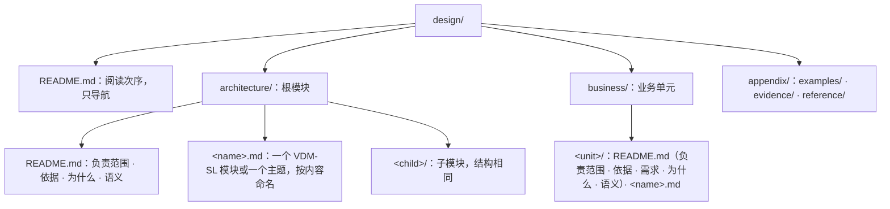

# 设计文档的写法

`ssot-design` 落地时照这里写文件、规格与文字。正面示例取自 [`../../ssot/references/example/design/`](../../ssot/references/example/design/)；VDM 语法查 [`../../ssot/references/vdm/`](../../ssot/references/vdm/README.md)。

## 一、文件与目录



- **生成命令**：用 `ssot init`、`ssot module`、`ssot unit` 生成目录与 `README.md`；文件名只用英文小写字母、数字与连字符。
- **根 `design/README.md`**：用一个列表列出阅读次序，`architecture/`、`business/` 下的每个 `.md` 恰好出现一次；只导航，不写规则。`ssot module`、`ssot unit` 只加入它们生成的 `README.md`，规格文件要自己加进去。
- **模块与单元的 `README.md`**：以一级标题「`# 模块名`」开头，先写一段本模块**负责什么、不负责什么**；之后的二级标题按固定次序排列，没有内容的不写：
  - 架构目录：`## 依据` → `## 为什么` → `## 语义`
  - 业务目录：`## 依据` → `## 需求` → `## 为什么` → `## 语义`
  - 其余内容放进按内容命名的规格文件或主题文件。
- **规格文件**：文字在外，规格写在 ```` ```vdm ```` 代码块里，VDMJ 只解析这些块。一个文件至多一个 VDM-SL 模块，规格写在具名的 `module … end` 里。一组一起变化的元素放在一个文件，按内容命名（如 `run.md`）；两组各自独立变化时分成两个文件；不按篇幅拆分。
- **主题文件**：一组一起变化、规格说不清的语义，在 `README.md` 里展开会遮住架构时，放进主题文件；开头用一段话说明它展开 `README.md` 的哪一节。拆开会迫使读者跨文件拼出同一个不变量、生命周期或失败窗口时不拆。
- **代码块只允许两类**：规格用 ```` ```vdm ````；图与文法用 ```` ```mermaid ````、```` ```ebnf ````、```` ```text ````（ASCII 图）。其他语言的代码块不放进正文；类型、接口、签名一律写成 VDM-SL。
- **文档只写当前设计**：不标状态，不并列新旧规则，不写变更历史。

## 二、VDM-SL 写法

**文学式文件。** Markdown 标题与文字在外，规格在 ```` ```vdm ```` 代码块里：

````markdown
# 运行连接

```vdm
module Run
````

**模块头。** `exports` 列出别的模块能用的东西，`struct` 表示连同结构一起导出（不带 `struct` 则使用方不能读字段或分支匹配）；`imports` 逐项列出用到的名字，`renamed` 让本模块用短名：

```vdm
exports
  types RunId; struct RequestNo; struct Started; struct StartOutcome; struct StatusOutcome
  values RetrySeconds : nat1
  operations
    Start: RequestNo ==> StartOutcome;
    Status: RequestNo ==> StatusOutcome;
    Finish: RunId ==> ();
    Recover: RequestNo ==> ()
```

```vdm
imports
  from Run
    types RequestNo renamed RequestNo; Started renamed Started
    operations Start renamed Start; Finish renamed Finish,
  from Attempt
    types Entry renamed Entry
    operations Record renamed Record
```

**类型。** `token` 是没有结构的值；`inv` 给类型加不变式；`::` 定义记录，**字段之间不加分号，分号结束整个定义**；`|` 组成并类型，`<Rejected>` 是 quote 值：

```vdm
  -- 一次运行的身份；提供方造出，使用方不读结构
  RunId = token;

  -- 调用方给出的请求号，从 1 开始；同一请求号代表同一次请求
  RequestNo = nat
  inv r == r > 0;

  -- 运行已经开始；调用方之后必须用 Finish 结束它
  Started ::
    run : RunId;  -- 结束时交回的身份

  -- Start 的结局：使用方必须区分已开始、被拒绝与结果未知；结果未知时改用 Status 找回
  StartOutcome = Started | <Rejected> | <Unknown>;
```

**值。** 有名字的常量：

```vdm
values
  -- 结果未知之后，两次找回之间至少相隔的秒数
  RetrySeconds : nat1 = 30;
```

**状态。** 模块的状态是一条记录，带不变式与初值；`map`、`set of`、`seq of` 是映射、集合与序列。`init` 必须写成 `r == r = mk_Runs(...)` 的形式：VDMJ 要执行它来初始化模块，才能生成并检验证明义务；写成别的谓词时 `ssot check` 报 `Error 4144`：

```vdm
state Runs of
  byRequest : map RequestNo to RunId  -- 请求号到它产生的运行
  live : set of RunId  -- 已开始、尚未结束的运行
  inv mk_Runs(b, l) == l subset rng b
  init r == r = mk_Runs({|->}, {})
end
```

**隐式操作。** 只写 `ext`（读写哪些状态分量）、`pre` 与 `post`，不写过程；`post` 里 `byRequest~` 是调用前的值，`++` 覆盖映射，`is_Started` 判断记录类型。`ext wr` 列出的分量，每个 `or` 分支都要写出它这一支怎样变；没变就写 `x = x~`，否则那一支允许它变成任意值：

```vdm
  -- 开始一次运行；同一请求号重复开始只产生一次运行；结果未知时提供方可能已经开始了运行，运行表因此可能多出这个请求号的记录，调用方按请求号找回
  Start(request: RequestNo) r: StartOutcome
  ext wr byRequest wr live
  post (is_Started(r)
          and (request in set dom byRequest~ => r.run = byRequest~(request))
          and byRequest = byRequest~ ++ {request |-> r.run}
          and live = live~ union {r.run})
       or (r = <Rejected> and byRequest = byRequest~ and live = live~)
       or (r = <Unknown> and byRequest = byRequest~ and live = live~)
       or (r = <Unknown>
            and request not in set dom byRequest~
            and exists run in set live \ live~ &
                  byRequest = byRequest~ ++ {request |-> run}
                  and live = live~ union {run});
```

不读写任何状态的定义写成函数（`functions`），不写成隐式 `operations`。

**显式函数。** 写出唯一确定的判定计算；用集合推导式、`inds`（序列下标）、`forall`/`exists`，递归函数配 `measure` 证明终止；不写局部变量（`dcl`）、赋值（`:=`）与循环：

```vdm
  -- 需要找回的运行：最后一条尝试是结果未知的运行；两个实现必须得出同一集合，所以写显式体
  Unresolved: seq of Entry -> set of RunId
  Unresolved(log) ==
    {log(i).run | i in set inds log &
       log(i).outcome = <Unknown>
       and not exists j in set inds log & j > i and log(j).run = log(i).run};
```

**显式操作。** 仅用于场景：按次序调用别的操作，`cases` 按结局分支，`mk_Started(run)` 拆开记录，`let` 绑定中间结果，`;` 表示先后（不写 `dcl`、不写 `:=` 改状态、不写 `while`/`for` 循环）。涉及集合的约束由显式纯函数算出全集或候选集合，场景接收单个代表元走通单步调用：

```vdm
  -- 场景：开始的结果未知时，按请求号找回运行并结束它
  Recover: RequestNo ==> ()
  Recover(request) ==
    cases Start(request):
      mk_Started(run) -> Finish(run),
      <Rejected> -> skip,
      <Unknown> ->
        let found = Status(request) in
          if found <> <Absent> then Finish(found)
    end;
```

**说明注释。** `--` 写在每个顶层定义前面，记录与状态的每个字段说明写在同一行末尾（写不下时写在紧邻的上一行）；`ssot check` 强制每个定义与字段都有说明。说明写“它是什么、承诺什么”，不复述类型形状；说明里提到的每个参数、载荷字段或状态区分，都要在定义中真实存在。名字按字面容易让人联想到实例、缓存、存储或拷贝时，在 `--` 说明里写清它在函数与值模型中的含义。

## 三、索引与未定义

一个定义的内容不写进 VDM 时，体写成 `is not yet specified`，再按情况二选一：

- 不适合进 VDM、直接写成了代码或文字的，在它的 `--` 说明里留 `索引：路径:行号`（或 `路径:起始行-结束行`，路径从仓库根算起），`ssot check` 核对指向的文件与行存在；
- 还没有定的，不留索引，`is not yet specified` 就表示未定义。

草稿里已经定下的约束不能藏进 `token` 或 `is not yet specified`；有状态的连接也不写成显式 `== is not yet specified`。

## 四、规格说不清的语义与受控文字

文字只写 VDM-SL 规格说不清的语义，作为规格的补充约束：

- **定时与调度**：例如周期发送、按给定节奏观察、不承诺有限时间内结束。
- **时序、并发与进程**：跨越多个连接的次序，哪些可以同时发生、哪些必须先后；进程边界与崩溃窗口。
- **事实与副本**：谁确认一件事发生了，哪些记录是源头事实，哪些是取回的副本或索引。
- **失败与恢复**：跨越多个连接的恢复，例如崩溃后由谁接管哪些运行。
- **包含关系**：哪些模块在同一进程、同一部署、同一信任范围或同一存续期内（模块树本身不代表任何物理或运行期包含关系）。
- **定律的展开**：一句谓词写不清的等式与关系。

写法：

1. **名字就是词汇。** 规格里的名字是设计唯一的词汇；文字里提到任何规格元素，一律用双反引号包住限定名（如 ``` ``Run`Status`` ```、``` ``Run`Runs.byRequest`` ```），`ssot check` 拒绝指向不存在元素的引用；不另造同义词。一个概念重要到要在文字里反复提，就把它写成规格元素；不重要就不起名字。
2. **一句一条，不复述规格。** 一句陈述一条事实或一条规则，规则用“必须、不得、可以、只”；数量写数值、单位和条件（常量定义在规格 `values` 中再由文字引用）。凡是规格的类型、`inv`、`pre`、`post` 已经表达清楚的内容，文字一律不重复叙述，也不为运行期语义在 VDM-SL 里造时钟、进程、锁等模拟机制。

示例（[`architecture/README.md`](../../ssot/references/example/design/architecture/README.md) 的「语义」）：

```markdown
调用方得到结果未知之后，两次调用 ``Run`Status`` 至少相隔 ``Run`RetrySeconds`` 秒。``Run`` 与 ``Attempt`` 运行在同一进程内；进程崩溃后，新进程按 ``Run`Runs.byRequest`` 接管尚未结束的运行。
```
