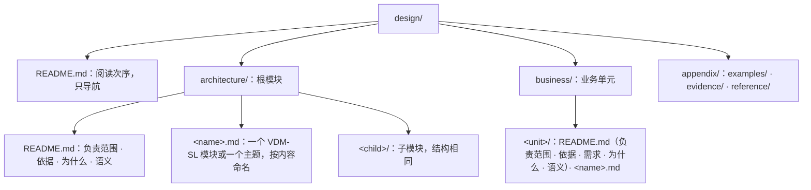

# ssot-spec：VDM-SL 形式化规格、受控文字与工具验收

## 这个阶段解决什么问题

把 `ssot-arch` 与 `ssot-business` 定好的架构模块、业务单元、连接、判定与场景，写成符合布局规范、VDM-SL 语法规则与受控文字约束的 Markdown 文件，并通过 `ssot check` 与 `jev` 模型审查（`review.py`）。

全部正面示例取自通过检查的 [`../ssot/references/example/design/`](../ssot/references/example/design/)。

---

## 一、文件与目录布局



- **生成命令**：用 `ssot init`、`ssot module`、`ssot unit` 生成目录与 `README.md`；文件名只用英文小写字母、数字与连字符。
- **根 `design/README.md`**：用一个列表列出阅读次序，`architecture/`、`business/` 下的每个 `.md` 恰好出现一次；只导航，不写规则。
- **模块与单元的 `README.md`**：以一级标题「`# 模块名`」开头，先写一段本模块**负责什么、不负责什么**；之后的二级标题按固定次序排列，没有内容的不写：
  - 架构目录：`## 依据` $\to$ `## 为什么` $\to$ `## 语义`
  - 业务目录：`## 依据` $\to$ `## 需求` $\to$ `## 为什么` $\to$ `## 语义`
  - 其余内容放进按内容命名的规格文件或主题文件。
- **规格文件**：文字在外，规格写在 ```` ```vdm ```` 代码块里，VDMJ 只解析这些块。**一个文件至多一个 VDM-SL 模块，规格必须写在具名的 `module … end` 里。** 一组一起变化的元素放在一个文件，按内容命名（如 `run.md`）；两组各自独立变化时分成两个文件；不按篇幅拆分。
- **主题文件**：一组一起变化、规格说不清的语义，在 `README.md` 里展开会遮住架构时，放进主题文件；开头用一段话说明它展开 `README.md` 的哪一节。拆开会迫使读者跨文件拼出同一个不变量、生命周期或失败窗口时不拆。
- **代码块只允许两类**：规格用 ```` ```vdm ````；图与文法用 ```` ```mermaid ````、```` ```ebnf ````、```` ```text ````（ASCII 图）。其他语言的代码块不放进正文。类型、接口、签名一律写成 VDM-SL：`ssot check` 用 Bun 的转译器检查图与文法块、文字段落，带 TypeScript 专有语法的直接拒绝。
- **文档只写当前设计**：不标状态，不并列新旧规则，不写变更历史。

---

## 二、先立 VDM 框架，再填内容

编写或重写规格分两步推进，每一步都必须先在工作区或 `/tmp` 临时设计目录跑通 `ssot check`：

1. **第一步：立最小 VDM 框架（模块边界、签名与 `token` 占位）**
   - 用 `ssot init`、`ssot module`、`ssot unit` 建好目录，写清每个模块的 `imports`、`exports`、不透明 `token`、最小 `state` 与连接签名；
   - **框架阶段不预埋尚未使用的类型、状态字段或 `imports`**（VDMJ 对未使用的定义报 `Warning 5000`，`ssot check` 直接判为反模式错误），也不把有状态的连接写成显式 `== is not yet specified`；
   - **`--` 说明注释与紧随其后的签名/字段同步对齐**：说明里提到的每个参数、载荷字段或状态区分，都必须在定义中真实存在；
   - 运行 `ssot check <design>` 与 `ssot graph <design>`，确认模块依赖单向无环、类型引用全部闭合后，才展示框架或进入第二步。
2. **第二步：填入谓词、纯函数、场景与受控文字**
   - 填入隐式连接的 `post`、显式判定函数与显式场景操作，补齐各 `README.md` 的「依据」「需求」「为什么」「语义」，跑通 `ssot check` 与 `review.py`。

---

## 三、VDM-SL 写法规范

**文学式文件。** Markdown 标题与文字在外，规格在 ```` ```vdm ```` 代码块里：

````markdown
# 运行连接

```vdm
module Run
````

**模块头。** `exports` 列出别的模块能用的东西，`struct` 表示连同结构一起导出（不带 `struct` 则使用方不能读字段或分支匹配）；`imports` 逐项列出用到的名字，`renamed` 让本模块用短名：

```vdm
exports
  types RunId; struct RequestNo; struct Started; struct StartOutcome; struct StatusOutcome
  values RetrySeconds : nat1
  operations
    Start: RequestNo ==> StartOutcome;
    Status: RequestNo ==> StatusOutcome;
    Finish: RunId ==> ();
    Recover: RequestNo ==> ()
```

```vdm
imports
  from Run
    types RequestNo renamed RequestNo; Started renamed Started
    operations Start renamed Start; Finish renamed Finish,
  from Attempt
    types Entry renamed Entry
    operations Record renamed Record
```

**类型。** `token` 是没有结构的值；`inv` 给类型加不变式；`::` 定义记录，**字段之间不加分号，分号结束整个定义**；`|` 组成并类型，`<Rejected>` 是 quote 值：

```vdm
  -- 一次运行的身份；提供方造出，使用方不读结构
  RunId = token;

  -- 调用方给出的请求号，从 1 开始；同一请求号代表同一次请求
  RequestNo = nat
  inv r == r > 0;

  -- 运行已经开始；调用方之后必须用 Finish 结束它
  Started ::
    run : RunId;  -- 结束时交回的身份

  -- Start 的结局：使用方必须区分已开始、被拒绝与结果未知；结果未知时改用 Status 找回
  StartOutcome = Started | <Rejected> | <Unknown>;
```

**值。** 有名字的常量：

```vdm
values
  -- 结果未知之后，两次找回之间至少相隔的秒数
  RetrySeconds : nat1 = 30;
```

**状态。** 模块的状态是一条记录，带不变式与初值；`map`、`set of`、`seq of` 是映射、集合与序列。**`init` 必须写成 `r == r = mk_Runs(...)` 的形式**：VDMJ 要执行它来初始化模块，才能生成并检验证明义务；写成别的谓词时 `check` 报 `Error 4144`：

```vdm
state Runs of
  byRequest : map RequestNo to RunId  -- 请求号到它产生的运行
  live : set of RunId  -- 已开始、尚未结束的运行
  inv mk_Runs(b, l) == l subset rng b
  init r == r = mk_Runs({|->}, {})
end
```

**隐式操作。** 只写 `ext`（读写哪些状态分量）、`pre` 与 `post`，不写过程；`post` 里 `byRequest~` 是调用前的值，`++` 覆盖映射，`is_Started` 判断记录类型：

```vdm
  -- 开始一次运行；同一请求号重复开始只产生一次运行；结果未知时提供方可能已经开始了运行，运行表因此可能多出这个请求号的记录，调用方按请求号找回
  Start(request: RequestNo) r: StartOutcome
  ext wr byRequest wr live
  post (is_Started(r)
          and (request in set dom byRequest~ => r.run = byRequest~(request))
          and byRequest = byRequest~ ++ {request |-> r.run}
          and live = live~ union {r.run})
       or (r = <Rejected> and byRequest = byRequest~ and live = live~)
       or (r = <Unknown> and byRequest = byRequest~ and live = live~)
       or (r = <Unknown>
            and request not in set dom byRequest~
            and exists run in set live \ live~ &
                  byRequest = byRequest~ ++ {request |-> run}
                  and live = live~ union {run});
```

**显式函数。** 写出唯一确定的判定计算；用集合推导式、`inds`（序列下标）、`forall`/`exists`，递归函数配 `measure` 证明终止：

```vdm
  -- 需要找回的运行：最后一条尝试是结果未知的运行；两个实现必须得出同一集合，所以写显式体
  Unresolved: seq of Entry -> set of RunId
  Unresolved(log) ==
    {log(i).run | i in set inds log &
       log(i).outcome = <Unknown>
       and not exists j in set inds log & j > i and log(j).run = log(i).run};
```

**显式操作。** 仅用于场景：按次序调用别的操作，`cases` 按结局分支，`mk_Started(run)` 拆开记录，`let` 绑定中间结果，`;` 表示先后（不写 `dcl`、不写 `:=` 改状态、不写 `while`/`for` 循环）：

```vdm
  -- 场景：开始的结果未知时，按请求号找回运行并结束它
  Recover: RequestNo ==> ()
  Recover(request) ==
    cases Start(request):
      mk_Started(run) -> Finish(run),
      <Rejected> -> skip,
      <Unknown> ->
        let found = Status(request) in
          if found <> <Absent> then Finish(found)
    end;
```

**说明注释。** `--` 写在每个顶层定义前面，记录与状态的每个字段说明写在同一行末尾；`ssot check` 强制要求每个定义与字段都有说明，说明必须写“它是什么、承诺什么”，不能只复述类型形状。若某个名字按字面容易让人联想到实例、缓存或存储，必须在它的 `--` 说明里写清它在抽象模型中的函数与值含义。

**索引与未定义。** 一个定义的内容不写进 VDM 时，体写成 `is not yet specified`，再按情况二选一：
- 不适合进 VDM、直接写成了代码或文字的，在它的 `--` 说明里留 `索引：路径:行号`（或 `路径:起始行-结束行`，路径从仓库根算起），`ssot check` 核对指向的文件与行存在；
- 还没有定的，不留索引，`is not yet specified` 就表示未定义。

---

## 四、规格说不清的语义与受控文字

文字只写 VDM-SL 规格说不清的语义，作为规格的补充约束：

- **定时与调度**：例如周期发送、按给定节奏观察、不承诺有限时间内结束。
- **时序、并发与进程**：跨越多个连接的次序，哪些可以同时发生、哪些必须先后；进程边界与崩溃窗口。
- **事实与副本**：谁确认一件事发生了，哪些记录是源头事实，哪些是取回的副本或索引。
- **失败与恢复**：跨越多个连接的恢复，例如崩溃后由谁接管哪些运行。
- **包含关系**：哪些模块在同一进程、同一部署、同一信任范围或同一存续期内（模块树本身不代表任何物理或运行期包含关系）。
- **定律的展开**：一句谓词写不清的等式与关系。

### 受控文字写法

1. **名字就是词汇。** 规格里的名字是设计唯一的词汇；文字里提到任何规格元素，一律用双反引号包住限定名（如 ``` ``Run`Status`` ```、``` ``Run`Runs.byRequest`` ```）。`ssot check` 拒绝指向不存在元素的引用；不另造同义词。一个概念重要到要在文字里反复提，就把它写成规格元素；不重要就不起名字。
2. **一句一条，不复述规格。** 一句陈述一条事实或一条规则，规则用“必须、不得、可以、只”；数量写数值、单位和条件（常量定义在规格 `values` 中再由文字引用）；**凡是规格的类型、`inv`、`pre`、`post` 已经表达清楚的内容，文字一律不重复叙述**，也不为上述运行期语义在 VDM-SL 里造时钟/进程/锁等模拟机制。

示例（[`architecture/README.md`](../ssot/references/example/design/architecture/README.md) 的「语义」）：

```markdown
调用方得到结果未知之后，两次调用 ``Run`Status`` 至少相隔 ``Run`RetrySeconds`` 秒。``Run`` 与 ``Attempt`` 运行在同一进程内；进程崩溃后，新进程按 ``Run`Runs.byRequest`` 接管尚未结束的运行。
```

---

## 五、反模式与工具验收

规格可以通过类型检查，却仍然不是设计（例如退化成空名字登记表、靠字符串表达含义、写了恒真条件或写成了实现过程）。验收必须同时通过 `ssot check` 与 `jev` 模型审查（`review.py`）。

### 1. 程序确定性反模式（`ssot check`）

| 反模式 | 为什么不是设计 |
|---|---|
| 字符串字面量 | 含义靠比较字符串内容，类型与谓词什么也没说；两个相同的字符串是不是同一样东西也无从判断。必须提升为 quote、token 或记录 |
| 显式体里有赋值（`:=`）、循环或 `dcl` | 写的是怎样做的实现过程，不是做到什么；连接写成隐式 `post`，显式体只用于纯函数判定与无循环场景 |
| 隐式定义没有 `post`，或 `post` 恒为 `true` | 不承诺任何东西 |
| 约束恒真 | `post` 或 `inv` 写出条件却排除不了任何情形：`post r = r`、`inv … == true`、`e <= e`、`not false`、`P or not P` |
| 约束恒不可满足 | `post` 或 `inv` 恒不成立：`post false`、`e <> e`、`e < e`、`not true`、`P and not P` |
| 规格里没人用的顶层定义 | 只是一个孤立名字，只为文字引用而存在（来自 VDMJ Warning 5000） |

### 2. 语义反模式模型审查（`jev` / `review.py`）

在 omp 的 Python `eval` 里运行：

```python
%load skill://ssot/scripts/review.py
findings = await review("/path/to/repo/design")
```

| 反模式 | 判断对象 | 为什么不是设计 |
|---|---|---|
| `stringly`（字符串当类型） | 每个 `seq of char` | 身份、状态、种类或结构藏在字符串里；原样传递的纯文本不算 |
| `bool_stack`（bool 堆叠） | 有两个以上 `bool` 字段的记录或状态 | 几个 `bool` 一起表示互斥状态，应当合成一个 quote 并类型 |
| `reasons`（逐项列原因） | 有四个以上 quote 分支的并类型 | 把失败或拒绝的原因逐项列出，是展开边界情况 |
| `comment_shape`（说明复述形状） | 每个定义与它的 `--` 说明 | 说明只复述了类型结构，没说它是什么、承诺什么 |
| `impl_body`（显式体是实现） | 每个显式体 | 缓存、查找、生成身份这些是怎样做，不是两个实现必须一致的判定 |
| `registry`（名字登记表） | 每个模块 | 模块只有名字，没有结构、不变式或 `pre`/`post` |
| `simulation`（模拟运行机制） | 每个模块 | 时钟、进程、调度、锁应当写进「语义」，不在 VDM 里建模 |
| `business_in_arch`（业务进架构） | 每个架构定义 | 只为某个业务单元存在 |
| `prose_restates`（文字复述规格） | 每段文字与同目录规格 | 规格已经说清，文字是重复 |
| `coined`（自造词） | 每段文字与规格全部名字 | 文字用了规格里没有的名字指认概念 |
| `basis`（依据不成立） | 「依据」里的每段 | 没有来源，或拿实现与技术选型当理由 |
| `figure_code`（图与文法块里是代码） | 每个 `mermaid`/`ebnf`/`text` 块 | 这些块只放图与文法；任何语言的声明、签名、函数体都不放这里 |

### 3. 证明义务与形式统计

- `ssot check` 末尾输出正文形式统计（规格行、说明注释行、文字行、图与文法行）：规格行远少于文字行说明设计正在退化成文字文档。
- 对 `ssot check` 列出的 `未定` / `未评估` 证明义务（如 subtype obligation），必须逐条核对上下文守卫是否已保证其成立（如 `Recover` 中 `found <> <Absent>` 保证了 `Finish(found)` 的参数必为 `RunId`）。


### 4. 工具诊断的正向修正准则

| 工具信号 | 反映的真实设计问题 | 正向修正方式 |
|---|---|---|
| QuickCheck 耗时过长、超时或证明义务数量暴增 | 模块 `state` 展开了过多嵌套 `map`/`seq` 或观察者不读的内部记录字段，导致状态空间组合爆炸 | 回到 `ssot-arch` 的最小展开表，把外部观察者不读字段的结构退回 `token`，删掉冗余状态分量 |
| `jev` 报 `[review:business_in_arch]` | `architecture/` 里混入了只服务于单一业务单元的类型、分支或业务概念说明 | 将该定义移入对应的 `business/<unit>/`，或在架构层退化为与业务无关的 `token`（不只删改注释里的“业务”字眼） |
| `jev` 报 `[review:impl_body]` | 显式体写成了具体实现步骤或非唯一定律的内部过程 | 提炼为两个实现必须得出同一结果的纯函数判定，或移入代码/`appendix/reference/`（不把纯函数改写成无状态的隐式 `operations` `post r = ...` 来规避检查） |
---

## 六、本地 VDM 文档与多 Agent 并行编写

### 1. 本地 VDM 文档

VDM 的本地文档在 [`references/vdm/`](references/vdm/README.md)，随时查阅：

| 文档 | 用途 |
|---|---|
| [运算符速查](references/vdm/operators.md) | 查集合、序列、映射、记录 `mu` 等运算符写法时 |
| [诊断信息](references/vdm/messages.md) | `ssot check` 报出 `Error XXXX` 或 `Warning XXXX`，按编号 `grep` 查含义时 |
| [语言手册](references/vdm/language-manual.md) | 查特定 VDM-SL 语法构造（如模式匹配、量化表达式、模块导入导出）时 |
| [QuickCheck](references/vdm/quickcheck.md) | 查证明义务生成规则与反例搜索策略时 |
| [VDMJ 用户指南](references/vdm/vdmj-user-guide.md) | 用 `ssot vdmj` 调解释器或命令行参数时 |
| [外部格式](references/vdm/external-formats.md) | 了解文学式块行号映射机制时 |

### 2. 多 Agent 并行编写

几个 agent 同时编写同一份设计时，按模块目录分工：主控运行 `init`/`module`/`unit`、分配目录归属并做最终集成检查；每个写手只写自己目录的文件。写手之间只用 [`references/commands.md`](references/commands.md) 定义的固定格式指令（`分配`、`需要`、`已导出`、`不归我`、`公告`、`签名变更`、`改名`、`新模块`、`冲突`、`重做`、`完成`、`停止`）通信。
