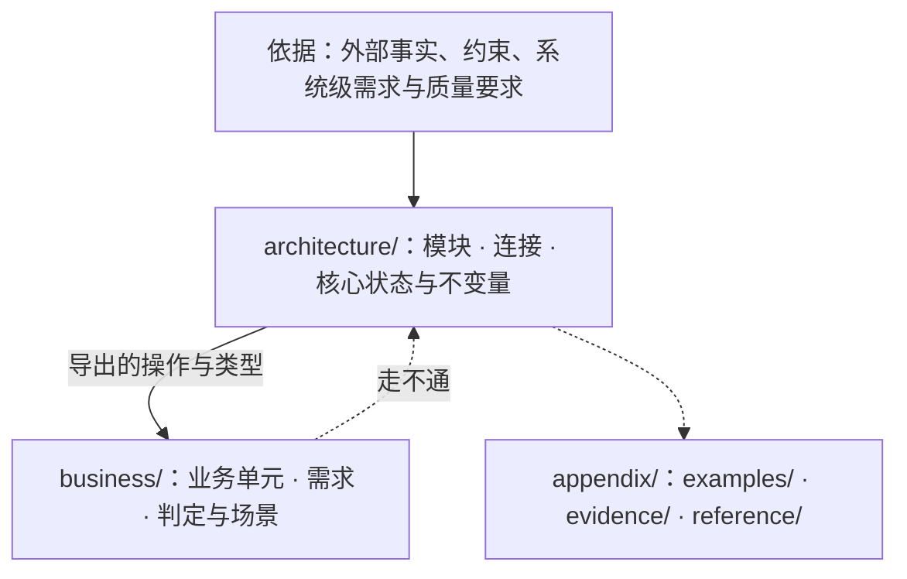

# ssot

把程序核心的设计写成可机械检验、独立于实现代码的文学式形式化规格（Markdown + VDM-SL）。

**没有编译步骤，也没有排版。** 设计的使用者是 VDMJ 与读 Markdown 的人：规格放在 ```` ```vdm ```` 代码块里由 `ssot check` 与模型审查验收，文字在任何 Markdown 查看器里直接阅读。不把设计转换成别的格式去查看效果，也不为显示效果改动内容。

## 一、三桶目录结构



| 目录 | 职责 | 依赖与边界约束 |
|---|---|---|
| `design/README.md` | 阅读次序导航 | `architecture/` 与 `business/` 下的每个 `.md` 恰好出现一次；不写规则 |
| `architecture/` | 系统的核心模块树、对外连接（`exports`）、核心类型、状态与不变量 | 不引用 `business/`；父模块不依赖子模块；不包含只服务单一业务单元的类型、角色或分支 |
| `business/` | 建在架构连接之上的业务单元：需求、确定性判定（纯函数）与走通需求的场景（操作） | 单向 `imports` 架构导出的连接；业务单元之间只经导出连接点对点或点对面无环组合；不持有持久 `state` |
| `appendix/` | 示例（`examples/`）、依据的证据（`evidence/`）、可替换的实现参考（`reference/`） | 不出现在阅读次序里，不被 `check` 检查，不设立规则 |

完整通过检查的示例设计见 [`references/example/design/`](references/example/design/)。

---

## 二、贯穿全流程的五条共同思维方式

以下五条思维方式同时适用于**写设计与审设计**、同时适用于**架构模块与业务单元**。进入任何子 skill 前，先以这五条思维作为共同前提：

### 1. 抽象边界与可替换性（什么进设计，什么归实现）
- **边界内外分明：** 系统通过声明的连接与类型划定抽象边界，只承认经声明边界交出的值与结局；被抽象掉的外部过程与内部细节（未声明的副作用、进程内部状态、同一调用换一次物理执行会不会输出不同、底层传输与存储介质）在设计模型中**不存在**。
- **连接不变可替换即实现：** 一段内容只规定怎样兑现连接，换一种做法时对外连接与状态不变量都不变，它就是实现，不写进设计。**两个独立实现者各写一份时必须得出同一外部行为的核心承诺，才写进设计。**
- **只写不变量与连接，不写保护不变量的内部机制：** 一段机制（如引用计数 `AcquireRef`/`ReleaseRef`、两阶段发送屏障 `Barrier`、内存队列、文件锁、缓存索引、逐项细分拒绝原因）只是用来保护某条不变量或兑现某个连接时，设计只写那条不变量与可观察结局（如 `<Fresh> | <Stale>`、`<Accepted> | <Rejected> | <Unknown>`）。
- **失败与并发按同一判据划分：** 会改变部件、连接、状态空间或使用方可观察承诺的决定属于设计（如“结果未知”是否为一支结局、崩溃后由谁接管）。
- **不要求组合根，不参考实现代码：** 组合根、适配器、总入口不属于设计；写设计或重写文档只从问题域事实与需求出发，不阅读或参考实现代码。

### 2. 函数、值、源头事实与纯函数投影（怎样建模状态与流转）
- **从函数与值出发，不从存储与实例出发：** 核心语义用静态定义、不可变值、纯函数、闭合的和类型/积类型与已发布事实表达；不把概念当作有可变状态或内存地址的面向对象实例。判断某样东西是否完备，只问**“它由哪些值决定、这些值沿哪条连接传进了哪个函数或事实”**，不问“存在哪张表里、怎么持久保存”。
- **事实是唯一状态，其余皆为投影：** 模块的 `state` 只保存不可派生的源头事实，不变量越简单越好；其余状态（如运行整体状态、已结算视图、时间轴、对比视图、通道阻塞集合）一律写成源头事实上的纯函数投影，不在 `state` 里放冗余缓存或派生字段。
- **生命周期按锚点严格嵌套：** 有生命周期的对象写清开始连接、结束连接、嵌套关系与确认者；内层必须在外层开始锚点之后开始，结束外层前必须先结束其全部内层并固化证据，最后才写外层结束锚点；内层关闭失败时绝不伪造外层结束锚点。

### 3. 视角、持有者与最小展开（同一样东西在不同位置的形态）
以信号灯 `SignalColour = <Red> | <Amber> | <FlashingAmber> | <Green>` 为例，视角规则对架构模块与业务单元同等适用：
- **定义在持有者，全局只展开一次：** 一样东西只在持有它的模块定义一次；展开两处就有多重解释。
- **由观察者反推是否展开（连持有者内部也一样）：**
  - 只有当外部观察者必须在它的分支上做不同决定、读取它的字段，或外部可观察不变量非它不可时，持有者才将其展开为记录（`::`）或并类型（`|`）并带 `struct` 导出；
  - 若观察者只原样传递凭据、靠调用持有者的操作获取结局（如 `RunId`、观察位置 `LogPosition`、写尝试身份 `AttemptId`），则**即使在持有它的模块内部也保持 `= token`**，不展开内部存储字段或阶段状态机。
- **行为归做出方，规则归持有方：** 红灯不能过路口是司机的行为，写在司机那里；信号灯倒计时切换规则由谁持有，就在谁那里展开细节，在消费者那里只是概括。
- **软件内的隐含前提必有位置：** 隐含前提属于软件一部分时，在观察者处是 `imports` 的占位符，在持有者处可找到定义；非软件前提（如电力）不进设计。

### 4. 一般规律与分层细化（上下层如何配合）
无论是父模块对子模块、架构模块对业务单元、还是连接契约对场景调用方，上下层都遵循**一般规律与分层细化**：
- **上层立底线，下层做细化：** 上层给出最一般的值代数、位置坐标、等价关系许可与事实完整性底线不变量；下层在此底线规律之内取子集、定策略、做组合。
- **细化不是重复，也不是冲突：**
  - 下层只启用上层一般结构的一个子集（如架构坐标支持任意层数，当前业务只启用单层），或下层策略比上层底线不变量更窄（如架构底线只排除未得出结论的 `<Stopped>`，派生业务进一步排除未消费的异常），属于合法细化；
  - 等价关系（如 `SameCall`）给出的是采用既往事实的**许可**，不是强制全局只能有一条执行记录的身份约束；
  - 连接的 `pre`/`post` 前置状态条件是**准入契约**，契约之外的违规调用不必列为返回值结局分支。
- **真冲突的唯一判据：** 只有**下层需求需要区分某种情况而上层连接表达不了**，或**下层允许了违反上层底线不变量的状态**，才是冲突。

### 5. 形式化分工与名实对齐（VDM-SL 与文字如何配合）
- **三类定义各司其职：**
  1. **隐式 `operations`（`ext` + `pre`/`post`）**：表达读写 `state` 的对外连接点，只写状态前后的性质关系，不写过程（以 Overture 交通灯为例：冲突路径至少一红是状态 `inv`，黄灯才能转红是 `ToRed` 的 `pre`）；
  2. **显式 `functions`**：表达两个实现面对同一输入必须算出同一值的确定性判定，以及对集合做全集划分/不动点计算；
  3. **显式 `operations`（无循环代表元场景）**：显式体不写局部变量（`dcl`）、赋值（`:=`）与循环（`while`/`for`）；涉及集合的操作需求由**“全集纯函数（`functions`）算集合 + 显式场景操作（`operations`）接收单个代表元参数走单步连接与分支闭合”**共同表达。
- **名字即唯一词汇，说明、签名与谓词三者对齐：**
  - 文字只写规格表达不了的跨连接语义（定时、并发窗口、进程/部署包含关系、事实与副本、崩溃恢复），且只用双反引号限定名（如 ``` ``Run`Status`` ```）指认规格已有元素，不复述规格、不自造同义词；
  - 每个定义的 `--` 说明承诺、紧随其后的参数/字段签名、以及 `inv`/`pre`/`post` 谓词（含 `ext wr` 各分支未变分量的 `x = x~` 帧条件）必须严格一致；不写无约束恒真子句，不用无状态隐式 `operations` 伪装纯函数，不用字面易引发实例/缓存/存储误解的命名。

---

## 三、工作流与阶段 Skill 路由

上述五条共同思维方式在写设计与审设计中对称展开——**写设计是正向建表与落地，审设计是反向还原表与核对断口**。按任务类型加载对应的阶段 skill，每一阶段以前一阶段的产出为输入：

### 1. 写设计 / 改设计流水线

```text
需求与外部约束 → [1. ssot-arch] → 依据边界表 · 视角最小展开表 · 连接面表 → [2. ssot-business] → 业务组合表 · 底线→细化表 · 需求→纯函数+代表元场景表 → [3. ssot-spec] → 先立框架过 check · 再填内容过 check + review
```

| 阶段 | Skill | 核心动作（正向建表与落地） | 阶段门控 |
|---|---|---|---|
| 1. 架构设计 | `ssot-arch` | ① 建依据 $\to$ 抽象边界表；② 定模块树与正交性；③ 建概念持有与最小展开表；④ 建连接面、状态不变量与生命周期表 | 架构三问清晰，无观察者消费的内部结构全部保持 `token`，正交底座零耦合，依据具备来源与“所以” |
| 2. 业务设计 | `ssot-business` | ① 建业务单元与点对点/点对面组合表；② 建架构底线 $\to$ 业务细化表；③ 建需求 $\to$ 全集纯函数 + 代表元场景表；④ 建跨模块实参值传递表 | 业务只经架构导出连接接入，每条需求绑定场景，全链路实参无断链；场景走不通时回退 `ssot-arch` |
| 3. 形式化落地 | `ssot-spec` | ① 第一步立最小 VDM 框架并跑通 `ssot check`；② 第二步填完整谓词、纯函数、场景与受控文字；③ 运行 `ssot check` + `review.py` 并按正向准则修正 | `ssot check` 零错误零警告、QuickCheck 零反例、`review.py` 零检出、未定证明义务逐条核实 |

### 2. 审设计（Review）流水线

```text
design/ 全文 → [1. ssot-review-arch] → 抽象边界表 · 视角表 · 底线→细化表 · 可替换表 → [2. ssot-review-flow] → 形参←实参传递链 · 需求→纯函数+代表元场景表 · 生命周期序列 → [3. ssot-review-spec] → 证明义务守卫表 · 承诺→谓词对齐表 · 字面→定义对齐表
```

| 阶段 | Skill | 核心动作（还原推导表并读出断口） | 从表中直接读出的问题 |
|---|---|---|---|
| 1. 审抽象与架构 | `ssot-review-arch` | ① 依据 $\to$ 抽象边界表；② 概念持有与视角展开表；③ 架构底线 $\to$ 业务细化对齐表；④ 连接不变可替换性表 | 依据缺来源或“所以”、多重展开、架构内部过度展开或横向耦合、架构能力不足、业务违反架构底线、实现细节混入设计 |
| 2. 审业务走通与连接 | `ssot-review-flow` | ① 函数形参 $\leftarrow$ 调用处实参传递链；② 业务需求 $\to$ 全集纯函数 + 代表元单步场景对账表；③ 生命周期开闭序列与跨连接时序表 | 跨模块传参断链（死参数、传入常量空值）、校验与副作用次序倒置、结局分支漏处理或混淆、状态判定未被消费、生命周期嵌套未闭合 |
| 3. 审规格严密与用词 | `ssot-review-spec` | ① `ssot check` + `review.py`；② 未定证明义务 $\to$ 上下文守卫推导表；③ `--` 说明承诺 $\to$ 谓词与 `wr` 帧条件对齐表；④ 字面日常含义 $\to$ 规格函数值定义对齐表 | AST/语义反模式、缺失守卫的证明义务、说明与签名/字段自相矛盾、恒真子句、`ext wr` 分支漏写 `x = x~`、无状态隐式操作伪装纯函数、字面引发实例/缓存/存储误读的用词 |

### 3. 存量旧文档迁移

已有大量旧设计文档要迁入 `design/` 时，加载 **`ssot-migration`**：迁移期间遵循“只搬运、不判断对错、不改动原意”，等 `legacy-design/` 搬空后再进入审设计与写设计流水线。

---

## 四、命令与检查概览

命令 `ssot` 与 `vdmj` 在 PATH 上，直接调用。加载本 skill 时自动检查并按需安装（细节见 [`references/setup.md`](references/setup.md)）：

!`command -v ssot >/dev/null 2>&1 && command -v vdmj >/dev/null 2>&1 || bun "${CLAUDE_SKILL_DIR}/scripts/design.ts" setup 2>&1 || true`

| 命令 | 作用 |
|---|---|
| `ssot init <仓库根>` | 生成 `<仓库根>/design`：`README.md`（阅读次序）、根模块 `README.md`、三类附录目录 |
| `ssot module <design> <a/b>` | 建立架构子模块目录与 `README.md`，并加入阅读次序；父模块必须已存在 |
| `ssot unit <design> <名字>` | 建立业务单元目录与 `README.md`，并加入阅读次序 |
| `ssot check <design> [--json]` | 依次执行 8 阶段确定性检查与形式化验证（`layout`、`parse`、`structure`、`antipattern`、`form`、`prose`、`typecheck`、`quickcheck`），有违规时退出码为 1 |
| `ssot graph <design> [--json]` | 输出目录、模块与 `imports` 关系的 Mermaid 图或 JSON |
| `ssot vdmj <design> [参数]` | 用设计里的全部规格运行 VDMJ，例如 `-i` 进解释器、`-e` 求值 |
| `ssot review <design>` | 输出语义反模式模型审查的判断对象（JSON），由 `scripts/review.py` 在 omp `eval` 里交给 `jev` |
| `vdmj [参数] <文件>` | VDMJ 本身，带 QuickCheck 插件，读 `.vdmsl` 文件；设计目录里的 Markdown 用 `ssot vdmj` |

理论与方法论文献出处见 [`references/sources.md`](references/sources.md)。
