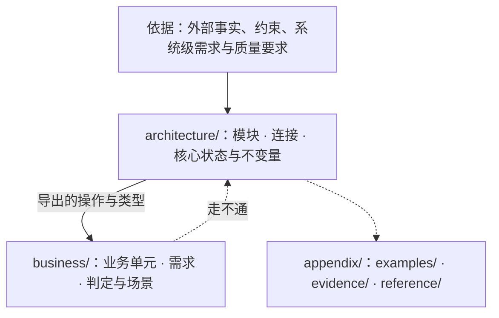

# ssot

设计是代码化的文档：把程序的核心与不变量写成可机械检验的文学式规格（Markdown + VDM-SL）；实现对照它检验，它不随实现改变。

**没有编译步骤，也没有排版。** 设计的使用者是 VDMJ 与读 Markdown 的人：规格放在 ```` ```vdm ```` 代码块里由 `ssot check` 与模型审查验收，文字在任何 Markdown 查看器里直接阅读。不把设计转换成别的格式去查看效果，也不为显示效果改动内容。

完整通过检查的示例设计见 [`references/example/design/`](references/example/design/)。

---

## 一、设计的思考脉络（五步推演链）

写设计与审设计走的是同一条思考脉络。写设计是从第 1 步推到第 5 步把结构立起来；审设计是顺着第 1 步到第 5 步核对每一步的推演是否走通。


### 第 1 步：从外部约束立边界（什么进设计，什么归实现）
先问：**外部世界有什么我们控制不了、却必须面对的事实或约束？面对它，系统承诺什么外部行为？**
- **只写核心承诺，可替换的做法归实现。** 两个独立实现者各写一份时必须得出同一外部行为的核心内容，才写进设计；只规定怎样兑现连接、换一种做法时对外连接与不变量都不变的，属于实现，挡在设计之外。
- **边界之外不存在。** 一旦设计通过连接与类型划定了边界，只承认跨边界交出的值与结局；被挡在边界外的物理细节（底层传输、序列化字节、内存锁、存储表结构）在设计模型里不存在。
- **写不变量，不写保护它的机制。** 一段细节只是为了保护某条不变量时，设计只写这条不变量与可观察结局，不在设计里造保护它的内部机制。
- **失败与并发按同一判据划分。** 会改变部件、连接、状态空间或使用方可观察承诺的决定属于设计（如“结果未知”是否为一支结局、崩溃后由谁接管）；逐项拒绝原因、具体算法选择属于实现。
- **不要求组合成整体。** 组合根、适配器、总入口不属于设计；写设计只从问题域事实与需求出发，不参考实现代码。

### 第 2 步：从视角切模块与定展开（谁持有、谁观察）
有了边界内的核心概念，接着问：**哪些决定可以彼此隐藏、分成独立的模块？每个概念在不同模块眼里是什么形态？**
- **按抽象切模块，沿两条轴组织：**
  - **抽象层级轴（目录树深度）**：根模块粗，子模块细；子模块可用祖先的材料，父模块绝不依赖子模块，多子模块共用的材料放共同父模块；并列模块各自负责一类独立边界，彼此保持正交。
  - **模块三部分轴**：每个架构模块固定由**外部连接**（`exports`）、**核心代码**（本模块的类型、状态、不变量、函数与操作）与**内部设计**（子模块与本模块「语义」）组成。
- **用视角决定每个概念在哪里定义、要不要展开**（以信号灯 `SignalColour = <Red> | <Amber> | <FlashingAmber> | <Green>` 为例）：
  - **定义在持有者，全局只展开一次：** 信号灯有这几种状态，所以 `SignalColour` 定义在信号灯模块；展开两处就有多重解释。
  - **由观察者决定是否展开：** 观察者需要知道状态并在分支上做不同决定时，持有者才写出内部结构并带 `struct` 导出（如 `Report` 要按 `StartOutcome` 分支，所以 `StartOutcome` 展开并带 `struct` 导出）；观察者只需要原样传递凭据、靠调用连接办事时，它在设计里（包括在持有者内部）就只是一个 `token`（如 `RunId = token`），不展开内部构成，也不追问运行期数据如何装填进 `token`。
  - **行为归做出方，规则归持有方：** 红灯不能过路口是司机的行为，写在司机那里；信号灯切换规则由谁持有，就在谁那里展开细节。
  - **隐含前提有位置：** 隐含前提属于软件一部分时，在观察者处是 `imports` 的占位符，在持有者处可找到定义；非软件前提（如电力）不进设计。

### 第 3 步：从连接与状态定不变量与生命周期（怎样相接、什么永远成立）
模块切开后，接着问：**模块之间靠什么连接交换数据？连接背后守着什么永远成立的规律？**
- **从函数与值出发，源头事实是唯一状态：** 模块的 `state` 只保存不可派生的源头事实，不变量越简单越好；能由源头事实算出的上层状态一律写成纯函数投影。思考时只问“某件事由哪些值决定、这些值沿哪个连接传向哪里”，不从“存在哪张表、怎么持久保存”出发。
- **不变量、前置条件、后置条件各管一事**（以 Overture 交通灯 `Kernel` 与 `ToRed` 为例）：
  - **不变量（`inv`）**：类型的值或连接面的 `state` 在任何时刻都成立的性质（如冲突路径至少一条是红灯）；共享同一份 `state` 的操作共同维护这条不变量。
  - **前置条件（`pre`）**：函数或操作在什么条件下允许调用（如只有黄灯才能转红）；契约之外的调用不属于缺失结局。
  - **后置条件（`post`）**：调用后的状态、输出与调用前状态、输入之间的关系；结局并类型只列调用方在遵守契约时仍须区分处理的分支（含可观察失败及恢复走哪个连接）。
- **生命周期按锚点严格嵌套：** 写清对象由哪个连接开始、哪个连接结束、嵌套在谁之内、由谁确认；内层必须在外层开始锚点之后打开，结束外层前必须先关闭全部内层，内层关闭失败时不伪造外层结束锚点。

### 第 4 步：从一般到具体定业务与走通场景（上层立规律、下层做细化、场景作定序）
底座连接立住后，接着问：**业务怎样接在架构连接上跑通问题域的需求？**
- **架构立一般规律，业务在规律内细化：** 架构给出最一般的结构、等价关系许可与事实底线；业务单元只经架构导出的连接接入，在底线规律内取子集、定策略。下层比上层窄是正常的分层细化；只有业务需求需要区分某种情况而架构表达不了，或业务违反了架构底线不变量，才是冲突。
- **业务单元之间点对点或点对面组合：** 业务单元只写运行与组合的规律，不展开常变的业务内容本身；业务单元不建持久 `state`，依赖单向无环。
- **用纯函数算判定，用场景操作定次序并验走通：**
  - **确定性判定（显式 `functions`）**：两个实现面对同一输入必须算出同一结果的计算（以及对集合做全集划分/汇总），写成显式纯函数。
  - **场景（显式 `operations`）**：场景是连接调用的**定序器**——按先后次序调用连接，走通一条需求、一种可观察失败结局或一次生命周期中断（显式体不写循环与赋值，涉及集合元素时以单个代表元参数走通单步链路）。写不出某个场景，说明连接或结局缺了东西，回头修设计。

### 第 5 步：从概念落成规格与受控文字（形式化检验与名实对齐）
最后问：**怎样把上述四步准确无歧义地写进文件并接受机械检验？**
- **能形式化的写进 ```` ```vdm ````，说不清的写进文字：** 定时与调度、跨连接并发窗口、同进程/同部署包含关系、事实与副本区分、崩溃接管写进 `README.md` 的「语义」或主题文件。
- **名字即唯一词汇，说明、签名与谓词三者合一：** 文字只用双反引号限定名（如 ``` ``Run`Status`` ```）指认规格元素，不复述规格，不自造同义词；每个定义的 `--` 说明承诺、参数/字段签名与 `inv`/`pre`/`post` 谓词必须说同一件事。

---

## 二、三桶目录结构



| 目录 | 角色（对应思考脉络） | 约束 |
|---|---|---|
| `design/README.md` | 阅读次序导航 | `architecture/` 与 `business/` 下的每个 `.md` 恰好出现一次；不写规则 |
| `architecture/` | 承载第 1–3 步：核心模块树、对外连接（`exports`）、核心类型、状态与不变量 | 不引用 `business/`；父模块不依赖子模块；不包含只服务单一业务单元的定义或分支 |
| `business/` | 承载第 4 步：业务单元的问题域需求、确定性判定（纯函数）与走通需求的场景（操作） | 单向 `imports` 架构导出的连接；业务单元之间只经导出连接无环组合；不持有持久 `state` |
| `appendix/` | 承载边界外材料：`examples/`（示例）、`evidence/`（依据的证据）、`reference/`（可替换的实现参考） | 不出现在阅读次序里，不被 `check` 检查，不设立规则 |

---

## 三、工作流与阶段 Skill 路由

写设计与审设计沿着上述五步思考脉络分三阶段推进，每一阶段以前一阶段的推演结果为输入：

### 1. 写设计 / 改设计流水线

```text
问题域与外部约束 → [1. ssot-arch（脉络第 1–3 步）] → [2. ssot-business（脉络第 4 步）] → [3. ssot-spec（脉络第 5 步）] → design/
```

| 阶段 | Skill | 推演思路 | 阶段门控 |
|---|---|---|---|
| 1. 架构设计 | `ssot-arch` | 从外部约束立边界与依据 $\to$ 按抽象切模块树 $\to$ 由观察者定最小展开与 `token` $\to$ 定连接面、状态不变量与生命周期 | 架构三问清晰，无观察者消费的内部结构保持 `token`，并列底座正交，每条依据有来源与“所以” |
| 2. 业务设计 | `ssot-business` | 从问题域定需求与业务单元 $\to$ 在架构底线内定细化策略与纯函数判定 $\to$ 按连接次序写代表元场景 $\to$ 核对全链路值流转 | 业务只经导出连接接入，每条需求有场景走通，关键值首尾传通；场景走不通时回退 `ssot-arch` |
| 3. 形式化落地 | `ssot-spec` | 第一步先立最小 VDM 框架并跑通 `ssot check` $\to$ 第二步填完整谓词、纯函数、场景与受控文字并跑通 `ssot check` + `review.py` | `ssot check` 零错误零警告、QuickCheck 零反例、`review.py` 零检出、未定证明义务逐条成立 |

### 2. 审设计（Review）流水线

```text
design/ 全文 → [1. ssot-review-arch（核验脉络第 1–3 步）] → [2. ssot-review-flow（核验脉络第 4 步）] → [3. ssot-review-spec（核验脉络第 5 步）]
```

| 阶段 | Skill | 审查推演思路 | 阶段关注点 |
|---|---|---|---|
| 1. 审抽象与架构 | `ssot-review-arch` | 顺着依据还原抽象边界 $\to$ 顺着视角看模块切分与 `token`/展开是否恰当 $\to$ 看连接面状态不变量与架构/业务分层关系是否成立 | 模块边界与正交性、概念持有与最小展开、架构底线与业务细化是否自洽、有无混入可替换实现机制 |
| 2. 审业务走通与连接 | `ssot-review-flow` | 顺着每条业务需求走一遍主干调用链：看关键值从产生到消费是否传通 $\to$ 看全集纯函数与代表元场景是否走通正常与失败分支 $\to$ 看生命周期开闭次序是否闭合 | 跨模块值流转断链、校验与副作用次序、失败结局覆盖、待处理状态消费、生命周期嵌套与跨连接「语义」 |
| 3. 审规格严密与用词 | `ssot-review-spec` | 运行 `ssot check` 与 `review.py` $\to$ 推导未定证明义务的上下文守卫 $\to$ 核对每个定义的说明、签名与谓词是否合一 $\to$ 核对字面用词是否偏离函数与值语义 | 工具违规、缺失守卫的证明义务、说明与签名/谓词自相矛盾、恒真子句、`ext wr` 漏写保持条件、字面误导用词 |

### 3. 存量旧文档迁移

已有大量旧设计文档要迁入 `design/` 时，加载 **`ssot-migration`**：迁移期间遵循“只搬运、不判断对错、不改动原意”，等 `legacy-design/` 搬空后再进入审设计与写设计流水线。

---

## 四、命令与检查概览

命令 `ssot` 与 `vdmj` 在 PATH 上，直接调用。加载本 skill 时自动检查并按需安装（细节见 [`references/setup.md`](references/setup.md)）：

!`command -v ssot >/dev/null 2>&1 && command -v vdmj >/dev/null 2>&1 || bun "${CLAUDE_SKILL_DIR}/scripts/design.ts" setup 2>&1 || true`

| 命令 | 作用 |
|---|---|
| `ssot init <仓库根>` | 生成 `<仓库根>/design`：`README.md`（阅读次序）、根模块 `README.md`、三类附录目录 |
| `ssot module <design> <a/b>` | 建立架构子模块目录与 `README.md`，并加入阅读次序；父模块必须已存在 |
| `ssot unit <design> <名字>` | 建立业务单元目录与 `README.md`，并加入阅读次序 |
| `ssot check <design> [--json]` | 依次执行 8 阶段确定性检查与形式化验证（`layout`、`parse`、`structure`、`antipattern`、`form`、`prose`、`typecheck`、`quickcheck`），有违规时退出码为 1 |
| `ssot graph <design> [--json]` | 输出目录、模块与 `imports` 关系的 Mermaid 图或 JSON |
| `ssot vdmj <design> [参数]` | 用设计里的全部规格运行 VDMJ，例如 `-i` 进解释器、`-e` 求值 |
| `ssot review <design>` | 输出语义反模式模型审查的判断对象（JSON），由 `scripts/review.py` 在 omp `eval` 里交给 `jev` |
| `vdmj [参数] <文件>` | VDMJ 本身，带 QuickCheck 插件，读 `.vdmsl` 文件；设计目录里的 Markdown 用 `ssot vdmj` |

理论与方法论文献出处见 [`references/sources.md`](references/sources.md)。
