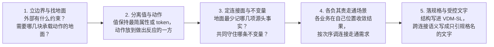

# ssot

设计是代码化的文档：把程序的核心与不变量写成可机械检验的文学式规格（Markdown + VDM-SL）；实现对照它检验，它不随实现改变。

**没有编译步骤，也没有排版。** 设计的使用者是 VDMJ 与读 Markdown 的人：规格放在 ```` ```vdm ```` 代码块里由 `ssot check` 与模型审查验收，文字在任何 Markdown 查看器里直接阅读。不把设计转换成别的格式去查看效果，也不为显示效果改动内容。

完整通过检查的示例设计见 [`references/example/design/`](references/example/design/)。

---

## 一、设计的三层核心直觉

在进入任何具体的模块划分或 VDM-SL 语法之前，先建立判断设计好坏的三层底层直觉。写设计与审设计都靠这三层直觉引路：

### 1. 发起动作的主体 $\neq$ 承载反作用力的地面 $\neq$ 解释动作算什么的观察者
无论是架构还是业务，**描述值（主体）的地方，与描述动作、解释动作含义的地方，往往不在同一个地点**。

想象一个动物跳跃：
- 动物只是一组静态属性，它可以发起动作（腿对地面施加反冲力），但这不代表它是某种“特别的会跳动物”，更不该去动物肚子里画肌肉；
- 首先得有**地面**承载反冲力，动作才可能发生；
- 更关键的是：**解释“什么叫跳跃”的，绝不是动物自己**——当腿对地面施加反冲力后，一只脚离地算跳跃吗（还是算奔跑/行走）？两只脚同时离地才算跳跃吗？这时候纳入的观察者绝不只有动物本身，而是取决于动物与地面的关系，以及外部观察者（裁判规则）按什么标准去定义和解释这次离地。

映射到软件设计里，这三者必须严格分开：
- **值 / 主体（动物）只管自身属性与原始发起：** 定义值的地方保持极简（甚至只是一个不透明的 `token`），绝不让值自己去解释“我在各种业务场景下算什么状态、能不能被复用、算不算成功”。
- **连接面（地面）只管承载基础事实与反作用力：** 连接面的 `state` 与 `inv` 只记录和守住最基础的关系（如请求号与运行身份的映射 `byRequest`、当前活着的集合 `live`），不掺杂上层五花八门的业务解释。
- **解释权归外部观察者（谁观察、谁定义规则，就在谁那里解释）：** “一只脚离地算不算跳”写在持有那条判定规则的观察者模块里（例如：一条运行记录本身不解释自己“需不需要找回”，而是由观察尝试序列的 `Attempt`Unresolved` 来定义什么叫未决待找回；一次调用本身不解释自己“在派生时算不算可引用”，而是由持有连线与派生规则的观察者来解释）。把外部观察者的解释硬塞回动物身上，是设计臃肿和职责错乱的头号根源。

### 2. 顺眼与不顺眼：「积压感」就是多来源汇集、责任失守的信号
看一份设计，首先靠的不是逐行挑语法刺的放大镜，而是退后一步看整体结构**顺眼不顺眼**：
- **好设计的长相是疏朗的：** 值是极简的，每个连接面（地面）只守一两条一眼看懂的不变量，每个函数和场景的参数很少，只办自己这一步的事。
- **不顺眼的地方，往往是因为被“积压”了：**
  如果一个函数、一条记录、一份状态或一个模块里，**积压了太多的参数、展开了太多层的值、或者叠了一长串分支**，看着臃肿别扭，这通常意味着：**这个地方正在同时应付多个不同的来源，而这是一种责任边界不清晰的病态。**
- **不可能所有的业务都在一个地方集中处理：**
  - 每个模块、每个阶段本来应该在自己的地面上把自己的事办完，跨过边界交出来的已经是收敛好的简单值；
  - 一旦某个地方不得不把三四个不同来源的原始材料（比如把初始输入、连线传递、循环回边、人工介入编辑）全拢到自己手里排优先级、拆包分发，就说明**上游没有在各自的位置把事结清，或者把根本不属于本模块的职责硬塞了进来**。
  - 更进一步：如果你在调用链上看到某处传了固定空值（如 `{|->}`）或别扭的绕路，**不要本能地去“补齐管道”把那个参数一路透传到全世界**——先停下来问：**是不是因为受了积压，那个参数代表的概念从一开始就不该出现在那个函数上？**

### 3. 直面更深层的东西：问“到底有多少东西需要被定义、定义得对不对”，绝不迁就错误的大体框架
审查设计（Review）与审查普通代码有着本质区别：
- 审代码往往迁就既有的大体框架，在不动筋骨的前提下看“这里缺不缺一个判空、那里漏没漏传一个参数”；
- 但 **SSoT 理论上是长期维护中保持不变的设计真源**。如果大体框架、核心概念的切分本身是歪的、积压的，你在错误的框架里小打小闹地讨论“每个点持有什么、缺不缺某个转换函数或某个字段”，就是在给错误的抽象刷漆，把它永久焊死在文档里。
- 因此，直面 SSoT 时，根本问题从来不是小打小闹的“缺不缺某个函数或值”，而是直接叩问大体框架本身：
  1. **整个系统到底有多少东西真正需要被定义？** 把塞在值身上的“肌肉”剥掉、把集中在一处的多来源积压拆回各自源头之后，现有设计里有多少类型、状态分量、阶段枚举和辅助函数其实**根本不需要存在**？
  2. **留下的这些核心概念与地面（连接面与不变量），定义得对不对？** 值的定义是否纯粹？承载动作的地面是否找对了位置？各模块的责任是否干净利落地分开，没有任何一处成为包揽一切的泥潭？

---

## 二、从直觉到落地的五步推演脉络

带着上面的三层直觉，写设计与审设计沿着同一条五步脉络推进：



1. **立边界与找地面（什么进设计，什么归实现）：**
   由外部改变不了的事实与约束（依据）推导出系统必须承诺的边界。在连接与不变量不变时可以替换的做法（以及仅用来保护某条不变量的内部机制，如引用计数、两阶段落盘、锁与存储格式）一律留在实现，设计只写那块承载外部承诺的“地面”与不变量。
2. **分离值与动作（视角与最小展开）：**
   - 定义在持有者，全局只展开一次；
   - **值只写观察者必须分支或读取的最小属性：** 观察者不需要拆开看、只当凭据传递的东西，在持有者内部也保持 `= token`；绝不把动作的中间过程塞进值里；
   - **动作归做出方，规则归持有方：** 谁根据状态做出反应，动作就写在哪一方；谁持有状态转换或判定的规则，规则就在谁那里展开。
3. **定连接面与不变量（源头事实与生命周期）：**
   共享同一份 `state` 的操作构成连接面，共同维护同一条状态不变量 `inv`。`state` 只存不可派生的源头事实，上层状态写成纯函数投影。有生命周期的对象按外层包内层的次序严格嵌套开闭。
4. **各负其责走通场景（分层细化、不造积压中心）：**
   架构立最一般的底线规律，业务单元在底线内定具体策略。每个业务单元只在自己的边界把事办完、交出干净的值，不在一处集中处理多个模块/阶段的来源。两个实现必须算出同一结果的计算写成显式纯函数（`functions`）；按先后次序调用连接走通需求与失败恢复的路径写成无循环代表元场景（`operations`）。
5. **落规格与受控文字（名实合一）：**
   类型、状态、不变量、前置/后置条件、纯函数与场景写进 ```` ```vdm ````；定时、并发窗口、进程包含关系与崩溃接管写成文字。规格里的名字是唯一词汇，文字只用双反引号限定名引用，且每个定义的 `--` 说明、签名与谓词三者完全一致。

---

## 三、三桶目录与阶段 Skill 路由

| 目录 | 角色 | 约束 |
|---|---|---|
| `design/README.md` | 阅读次序导航 | `architecture/` 与 `business/` 下的每个 `.md` 恰好出现一次；不写规则 |
| `architecture/` | 承载系统的核心概念（值）与提供反作用力的底座连接面（地面） | 不引用 `business/`；父模块不依赖子模块；不包含只服务单一业务单元的定义或分支 |
| `business/` | 承载各业务单元的需求、细分判定（纯函数）与走通需求的场景（定序器） | 单向 `imports` 架构导出的连接；业务单元之间只经导出连接无环组合；不持有持久 `state` |
| `appendix/` | `examples/`（示例）、`evidence/`（依据的证据）、`reference/`（可替换的实现参考） | 不出现在阅读次序里，不被 `check` 检查，不设立规则 |

### 1. 写设计 / 改设计流水线

| 阶段 | Skill | 核心思考任务 |
|---|---|---|
| 1. 架构设计 | `ssot-arch` | 问“到底需要定义多少核心概念与哪几块地面”：从外部依据推边界 $\to$ 分离静态值（优先 `token`）与承载动作的连接面 $\to$ 定最小源头事实、不变量与生命周期 |
| 2. 业务设计 | `ssot-business` | 问“各业务怎样在各自位置把事办完并串起需求”：切分业务单元避免多来源积压 $\to$ 在架构底线内写纯函数判定 $\to$ 用代表元场景定连接调用次序 |
| 3. 形式化落地 | `ssot-spec` | 第一步先立最小 VDM 框架跑通 `ssot check` $\to$ 第二步填完整谓词、纯函数、场景与受控文字跑通 `ssot check` + `review.py` |

### 2. 审设计（Review）流水线

| 阶段 | Skill | 核心审查直觉与任务 |
|---|---|---|
| 1. 审大体框架与概念定义 | `ssot-review-arch` | **不迁就现有框架，先看哪里不顺眼、被积压了：** 审视到底有多少东西真正需要被定义、定义得对不对；揪出塞进值里的“肌肉”（过度展开的内部机制）、找准提供反作用力的“地面”、拆开多来源汇集的责任泥潭 |
| 2. 审业务分流与主干走通 | `ssot-review-flow` | **看值是轻快流转还是在某处淤积断链：** 看到积压或传空值时先追问“是不是责任放错了模块”而非盲目补管道；顺着主干需求看各步是否在各自地面办完事、场景开闭次序是否走到底 |
| 3. 审规格严密与用词 | `ssot-review-spec` | 运行 `ssot check` 与 `review.py` $\to$ 核对未定证明义务守卫 $\to$ 核对说明、签名与谓词三者合一 $\to$ 清理把读者引向实例/肌肉/存储的字面用词 |

### 3. 存量旧文档迁移
已有大量旧设计文档要迁入 `design/` 时，加载 **`ssot-migration`**：迁移期间遵循“只搬运、不判断对错、不改动原意”，等 `legacy-design/` 搬空后再进入审设计与写设计流水线。

---

## 四、命令与检查概览

命令 `ssot` 与 `vdmj` 在 PATH 上，直接调用。加载本 skill 时自动检查并按需安装（细节见 [`references/setup.md`](references/setup.md)）：

!`command -v ssot >/dev/null 2>&1 && command -v vdmj >/dev/null 2>&1 || bun "${CLAUDE_SKILL_DIR}/scripts/design.ts" setup 2>&1 || true`

| 命令 | 作用 |
|---|---|
| `ssot init <仓库根>` | 生成 `<仓库根>/design`：`README.md`（阅读次序）、根模块 `README.md`、三类附录目录 |
| `ssot module <design> <a/b>` | 建立架构子模块目录与 `README.md`，并加入阅读次序；父模块必须已存在 |
| `ssot unit <design> <名字>` | 建立业务单元目录与 `README.md`，并加入阅读次序 |
| `ssot check <design> [--json]` | 依次执行 8 阶段确定性检查与形式化验证（`layout`、`parse`、`structure`、`antipattern`、`form`、`prose`、`typecheck`、`quickcheck`），有违规时退出码为 1 |
| `ssot graph <design> [--json]` | 输出目录、模块与 `imports` 关系的 Mermaid 图或 JSON |
| `ssot vdmj <design> [参数]` | 用设计里的全部规格运行 VDMJ，例如 `-i` 进解释器、`-e` 求值 |
| `ssot review <design>` | 输出语义反模式模型审查的判断对象（JSON），由 `scripts/review.py` 在 omp `eval` 里交给 `jev` |
| `vdmj [参数] <文件>` | VDMJ 本身，带 QuickCheck 插件，读 `.vdmsl` 文件；设计目录里的 Markdown 用 `ssot vdmj` |

理论与方法论文献出处见 [`references/sources.md`](references/sources.md)。
