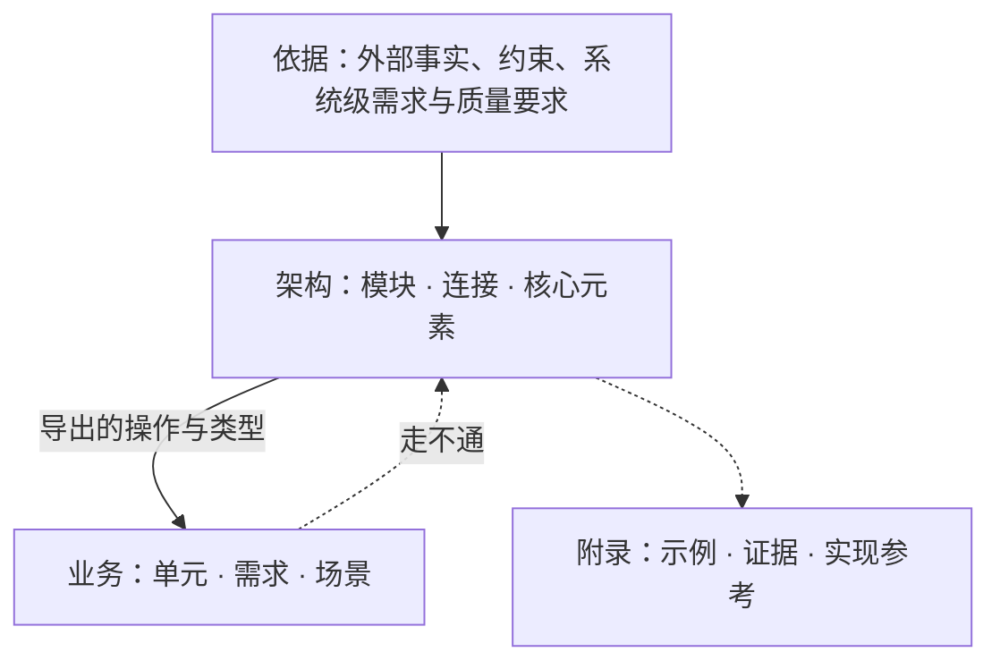
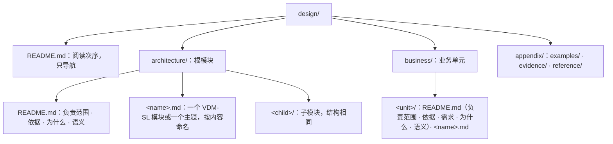

# ssot

本 skill 分两篇。上篇讲设计是什么、怎样组织；下篇讲怎样把设计写成带 VDM-SL 规格的 Markdown，并用一份通过检查的[示例设计](references/example/design/)逐条解释上篇。

# 上篇：设计

## 设计是什么

设计是代码化的文档。它的价值是作为参考，陈述程序的核心与不变量；实现对照它检验，它不随实现改变。

- **设计只写核心，常变的业务留在代码里。** 核心定下之后不再常改；建在核心之上、随需求变动的业务写在代码里，不写进设计。业务在设计里只写它怎样经连接运行、业务之间怎样组合，不把程序里要写全的业务搬进设计。
- **判据：在连接不变时可以替换的做法属于实现。** 一段内容只规定怎样兑现连接，换一种做法时连接与不变量都不变，它就是实现，不写进设计。两个独立的实现者各写一份时必须得出同一外部行为的核心内容，才写进设计。
- **失败与并发按同一判据划分。** 会改变部件、连接、状态空间或使用方可观察承诺的决定属于设计，例如是否承诺恰好一次、“结果未知”是不是一种结局、崩溃后由谁接管。罕见不等于是实现。
- **设计不展开边界情况与逐情形处理。** 不改变连接、状态空间、不变量和可观察承诺的处理细节属于实现，例如逐项的拒绝原因、编码与字节、在既定承诺下选哪种算法。一段细节保护某条不变量时，设计只写这条不变量。
- **设计不要求组合成整体。** 组合根、适配器、总入口、完整调用链、为通过检查补的实现都不属于设计。设计只要求本身合法、引用能解析。
- **设计与实现的类型是两码事。** 设计不依赖实现，因为设计不能随实现改变；实现怎样表达这些类型由实现决定。

为什么不直接写代码：代码必须完整、能运行，设计决定、可替换的选择与为了能跑而补的边界处理混在一起，读不出哪一行是不能改的承诺；而且代码是唯一产物时，没有独立的参照可以检验它。为什么不只写文字：文字没法机械核对，同一个概念在各处的说法会漂移，AI 写文字会自造词，并把边界处理与业务写进设计。所以能形式化的部分写成可以检查的规格，规格说不清的语义写成文字，文字只引用规格里已有的名字。

## 架构与优先级

架构回答三个问题：

1. **由什么组成**：有哪些模块，各是什么，谁在谁里面。
2. **用什么组成**：模块由哪些核心元素拼成，彼此经由哪些连接相接。
3. **为什么**：为什么是这些模块和这些材料，依据哪些事实、约束与需求。

业务建在架构上，只经连接接入。架构贴近抽象，业务贴近实现；两者分开写，混在一起时谁都看不出架构是什么样。



- **依赖方向。** 业务引用架构，架构不引用业务。架构里也不得有只为某一个业务单元存在的类型、分支或规则。
- **架构由需求证明。** 改变架构的需求与质量要求写进架构的依据，写明来源；依据可以说明它来自哪类业务场景，但架构不引用业务单元的规格。
- **对不上时判断哪一边错。** 业务在架构上写不出来，或场景走不通时，判断是业务表达错了、这项业务不属于本系统，还是架构的抽象不成立，不预设结论。改架构是单独的决定：写出哪条依据变了，改完后让每个业务单元与场景重新通过检查。
- **附录不设立规则。** 正文可以指向附录中的证据，附录可以引用正文。

## 两条轴

抽象层级与模块划分是两条独立的轴。

- **抽象层级**是模块树的深度：根模块之下是子模块。父模块粒度粗，子模块粒度细。子模块可以使用祖先拥有的材料；父模块不依赖子模块，几个子模块共用的材料放在它们共同的父模块。
- **模块划分**是每个模块固定的三部分，不论它在哪一层：
  - **外部连接**：别的模块能用的操作、函数与类型；
  - **核心代码**：本模块拥有的类型、不变量、状态、函数与操作；
  - **内部设计**：子模块，以及规格说不清的本模块语义。

模块的划分只按抽象：一组可以对外陈述连接、内部决定可以对其他模块隐藏的元素，成为一个模块。篇幅不是拆分模块的理由。

业务不分三部分，但业务不是没有抽象：业务单元有自己的类型与操作，向其他业务单元导出。业务单元用架构导出的操作与类型接入；业务单元之间也一样，只经导出的连接组合，点对点（调用一个连接点）或点对面（接入一个连接面）。设计里的业务单元只写这层运行与组合的规律，不展开业务本身。对使用方不承诺结构的类型，使用方不能依赖它的结构。

## 视角

同一样东西，在持有它的模块里是细节，在别的模块里是概括性的占位符，实际需要时才展开。以信号灯为例：

```vdm
SignalColour = <Red> | <Amber> | <FlashingAmber> | <Green>
```

- **定义在持有者。** 信号灯有这几种状态，所以 `SignalColour` 定义在信号灯的模块里；`=` 右边是信号灯自己的细节。
- **观察者需要才展开。** 谁需要观察信号灯？观察者需要知道状态，才写出细节；不需要，它只是一个定义的点：这里有个信号灯，用来干什么。具体怎么运作，是信号灯自己的机制。
- **行为归做出行为的一方。** 信号灯是红灯时不允许通过路口，这是司机的行为，不是信号灯的行为，写在司机那里。
- **规则归持有者。** 信号灯能从红色切换到绿色，是因为满足一条倒计时状态规则。离线信号灯自己持有这条规则，它在信号灯里是细节；联网信号灯是这条规则的消费者，它在信号灯里只是概括。谁持有规则，决定规则在一个模块里是概括还是细节。
- **隐含前提是软件的一部分，就有它的位置。** 不能通过路口，前提是车必须行驶在路上：车不能飞在天上。路不直接出现在这里，但和车有关系。这样的前提如果是软件的一部分，它在程序里可以解释：它是外部依赖时，在这里是占位符，经导入可以找到它；它在本系统里实现时，可以在实现它的地方找到它的细节。隐含前提不是软件的一部分时，例如服务器需要电力运行，就不写进设计。
- **展开是可选的，但只有一次。** 一样东西可以不展开，但展开只能有一处；展开了两处，它就有多重解释。有没有展开，也能区分它在一个模块里是干什么的：展开它的模块是持有者，只用占位符的模块是观察者或消费者。

## 连接与数据

连接是一等概念：模块之间只经连接相接，连接写清楚之后，两边可以各自替换实现。

| 概念 | 是什么 |
|---|---|
| 连接点 | 一个可以被调用的操作或函数 |
| 连接面 | 共享同一份状态与同一条不变量的一组操作；共享的那条不变量就是这个面的规则 |
| 交换 | 连接收进与交出的数据 |
| 结局 | 一次调用的全部可能结果；只列使用方必须区分处理的结局，不逐项列原因 |
| 可观察的失败 | 结局中的一支，例如结果未知；写明恢复要走哪个连接 |
| 准入定律 | 实现必须满足的不变量、前置条件与后置条件，三者各管一件事；签名对得上不等于可以接入 |
| 不承诺 | 对使用方隐藏结构的类型：使用方只能原样传递，不能读、不能造 |
| 生命周期 | 一样东西从开始到结束：由哪个连接开始、哪个连接结束，嵌套在谁之内，由谁确认 |
| 场景 | 按次序调用连接，走通一条需求、一种失败结局或一次生命周期中断 |
| 判定 | 两个实现必须得出同一结果的计算；这时计算本身就是设计决定 |

- **说做到什么，不说怎么做。** 结果用性质刻画、可以有多个合格的结果、或者不想绑定一种算法时，写隐式定义，只写 `pre` 与 `post`；这几点都不适用、结果唯一确定时，直接写显式定义，判定就属于这一类。不为了能执行而补过程：显式体里不写赋值、循环与局部变量。
- **不变量、前置条件、后置条件各管一件事。** 不变量附在一个类型或一份状态上：这个类型的每一个值、这份状态的每一个时刻都成立；状态的不变量相当于并进了每个操作的前置条件与后置条件，它不说状态怎样变化。前置条件写一个函数或操作在什么情况下可以调用。后置条件写结果与输入、调用前后的状态之间的关系，对输出的要求写在这里。一条“必须”先判断属于哪一种，不因为句子里有“必须”就写成不变量。以 Overture 的[交通灯示例](https://www.overturetool.org/download/examples/VDMSL/)为例：互相冲突的两条路径至少一条是红灯，任何时刻都成立，是路口 `Kernel` 的不变量；只有黄灯才能转红，是 `ToRed` 的前置条件：

  ```vdm
  Kernel :: lights    : map Path to Light
            conflicts : set of Conflict
  inv mk_Kernel(ls,cs) ==
        forall c in set cs &
              mk_Conflict(c.path2,c.path1) in set cs and
              c.path1 in set dom ls and c.path2 in set dom ls and
              (ls(c.path1) = <Red> or ls(c.path2) = <Red>)

  ToRed: Path * Kernel -> Kernel
  ToRed(p,mk_Kernel(lights,conflicts)) ==
    mk_Kernel(ChgLight(lights,p,<Red>),conflicts)
  pre p in set dom lights and lights(p) = <Amber>;
  ```

- **不变量越简单越好。** 不变量复杂，往往说明状态选得不对；不为了让操作好写而在状态里放冗余的信息，冗余会带来多余的不变量。
- **规格里没有写出来的，要么留索引，要么写未定义。** 一个定义的内容不写进 VDM 时，体写成 `is not yet specified`，再按情况二选一：不适合进 VDM、直接写成了代码或文字的，在它的说明里留“索引：路径:行号”（或“路径:起始行-结束行”），路径从仓库根算起；还没有定的，不留索引，`is not yet specified` 就表示未定义。两样都没有，就是漏写。`check` 只核对索引指向的文件与行存在，不核对那里写得对不对。
- **类型优先，说明跟着类型。** 先写类型，再写文字；文字不替代类型的描述。每个元素都有一句说明，说它是什么、承诺什么，而不是复述形状。
- **名字就是词汇。** 规格里的名字是设计唯一的词汇；文字只用这些名字指认元素，不另造同义词。一个概念重要到要在文字里反复提，就把它写成规格元素；不重要就不起名字。
- **场景先于文字走查。** 关键的正常路径、每种可观察的失败结局、生命周期中断都各写一个场景。写不出某个场景，说明连接、结局或架构缺了东西：回去修改，不另写走查报告。

## 规格说不清的语义

文字写规格说不清的语义，是规格的额外解释：

- **定时与调度**：例如周期发送、按给定节奏观察、不承诺有限时间内结束。
- **时序、并发与进程**：跨越多个连接的次序，哪些可以同时发生、哪些必须先后；进程边界与崩溃窗口。
- **事实与副本**：谁确认一件事发生了，哪些记录是源头事实，哪些是取回的副本或索引。
- **失败与恢复**：跨越多个连接的恢复，例如崩溃后由谁接管哪些运行。
- **包含关系**：哪些模块在同一进程、同一部署、同一信任范围或同一存续期内；模块树本身不代表任何包含。
- **定律的展开**：一句谓词写不清的等式与关系。

写法：一句陈述一条事实或一条规则，规则用“必须、不得、可以、只”；数量写数值、单位和条件；不复述规格已经说清的内容，不与规格矛盾；不为这些语义造模拟机制。

## 依据与理由

**依据**是会改变设计的外部事实、约束与需求：

- 架构模块的依据写改变模块、连接或核心元素的事实、约束、系统级需求与质量要求；业务单元的依据写约束这个单元的事实与约束。
- 每条一句话，写出来源，并接一句“所以……”，说明它让架构或这个业务单元多了或少了什么。
- 质量要求写成“在〈环境〉下，〈刺激〉发生时，〈响应〉满足〈度量〉”，并写出来源。数值只在有出处时写，不为凑格式编造指标。
- 当前实现的目录、调用步骤和偶然行为不是依据。
- 影响整个系统的依据写在根模块；只影响一个模块的写在该模块；只约束一个业务单元的写在该单元。篇幅大的证据放进附录，依据只引用它。
- 不编号，不建追溯矩阵。

**需求**属于业务单元：需求是必须在问题域中成立、可以被观察到的结果，例如用户或外部系统看到什么，不是机器的功能列表。每条写出来源，并至少由一个场景走通；每条用双反引号指出走通它的那个操作，`check` 核对这个引用指向的元素存在。

**理由**写为什么：

- 每个改变架构或业务形状的决定都写理由，理由引用依据或需求。
- 确实存在可信替代时，写一句为什么不选它。
- 理由引用的依据不再成立时，决定要重审。决定依赖的前提不在依据里时，把前提写进理由。
- 只关系到一个元素的选择，理由写进这个元素的说明。

# 下篇：落地

设计写成 Markdown：规格放在 ```` ```vdm ```` 代码块里，由 VDMJ 检查；其余是文字、图与文法。下篇所有示例都取自 [`references/example/design/`](references/example/design/)，它通过 `check`；标着“反例”的片段与 `check` 的输出是在它的副本上改出来的。

**没有编译步骤，也没有排版。** 设计的使用者是 VDMJ 与读 Markdown 的人：规格由 `check` 与模型审查验收，文字在任何 Markdown 查看器里读。写设计、改设计、迁移设计时，验证就是运行 `check` 与 `review`、读它们的输出；不把设计转换成别的格式去查看效果，也不为显示效果改动内容。

VDM 的本地文档在 [`references/vdm/`](references/vdm/README.md)，随时查阅：

| 文档 | 用途 |
|---|---|
| [语言手册](references/vdm/language-manual.md) | VDM-SL 的全部语法与语义 |
| [运算符速查](references/vdm/operators.md) | 集合、序列、映射等运算符 |
| [诊断信息](references/vdm/messages.md) | VDMJ 错误与警告的编号和原文，读 `check` 的输出时用 |
| [VDMJ 用户指南](references/vdm/vdmj-user-guide.md) | 解释器、证明义务与命令行 |
| [外部格式](references/vdm/external-formats.md) | VDMJ 能读的文件格式；`check` 自己从 Markdown 里取出 ```` ```vdm ```` 块交给 VDMJ，行号与 Markdown 一致 |
| [QuickCheck](references/vdm/quickcheck.md) | 证明义务的反例搜索 |

## 文件与目录



- `init`、`module`、`unit` 生成目录与 `README.md`；文件名只用英文小写字母、数字与连字符。
- 设计目录根上的 `README.md` 用一个列表列出阅读次序，`architecture/`、`business/` 下的每个 `.md` 恰好出现一次；它不写规则。
- **规格文件**：文字在外，规格写在 ```` ```vdm ```` 代码块里，VDMJ 只解析这些块。一个文件至多一个 VDM-SL 模块，规格必须写在具名的 `module … end` 里。一组一起变化的元素放在一个文件，文件按内容命名，例如 `run.md`；两组各自独立变化时分成两个文件；不按篇幅拆分。
- **README.md**：以一级标题「# 模块名」开头，先写一段本模块负责什么、不负责什么，之后的二级标题按固定次序，没有内容的不写。架构是「依据」「为什么」「语义」；业务是「依据」「需求」「为什么」「语义」。其余内容放进主题文件。
- **主题文件**：一组一起变化、规格说不清的语义，在 `README.md` 里展开会遮住架构时，放进主题文件；它开头用一段话说明它展开 `README.md` 的哪一节。拆开会迫使读者跨文件拼出同一个不变量、生命周期或失败窗口时不拆。
- **文字引用**：用双反引号包住限定名指认规格元素，例如 ``` ``Run`Status`` ```、``` ``Run`Runs.byRequest`` ```；check 拒绝指向不存在元素的引用。
- **代码块只有两种**：规格用 ```` ```vdm ````；图与文法用 ```` ```mermaid ````、```` ```ebnf ````、```` ```text ````（ASCII 图）。其他语言的代码块不放进正文。类型、接口、签名一律写成 VDM-SL：check 用 Bun 的转译器判断图与文法块、文字段落里的内容，带 TypeScript 专有语法的就拒绝。设计正文是规格加文字，不是换了格式的代码。
- **附录**分三类：`examples/` 演示已有规则，`evidence/` 存放依据的证据，`reference/` 说明实现可以怎样满足连接。附录不设立规则。
- 文档只写当前设计：不标状态，不并列新旧规则，不写变更历史。

## VDM-SL 写法

每个片段之后列出语言手册里对应的内容。

**文学式文件。** Markdown 标题与文字在外，规格在 ```` ```vdm ```` 代码块里：

````markdown
# 运行连接

```vdm
module Run
````

**模块头。** `exports` 列出别的模块能用的东西，`struct` 表示连同结构一起导出；`imports` 逐项列出用到的名字，`renamed` 让本模块用短名：

```vdm
exports
  types RunId; struct RequestNo; struct Started; struct StartOutcome; struct StatusOutcome
  values RetrySeconds : nat1
  operations
    Start: RequestNo ==> StartOutcome;
    Status: RequestNo ==> StatusOutcome;
    Finish: RunId ==> ();
    Recover: RequestNo ==> ()
```

```vdm
imports
  from Run
    types RequestNo renamed RequestNo; Started renamed Started
    operations Start renamed Start; Finish renamed Finish,
  from Attempt
    types Entry renamed Entry
    operations Record renamed Record
```

**类型。** `token` 是没有结构的值；`inv` 给类型加不变式；`::` 定义记录，字段之间不加分号，分号结束整个定义；`|` 组成并类型，`<Rejected>` 是 quote 值：

```vdm
  -- 一次运行的身份；提供方造出，使用方不读结构
  RunId = token;

  -- 调用方给出的请求号，从 1 开始；同一请求号代表同一次请求
  RequestNo = nat
  inv r == r > 0;

  -- 运行已经开始；调用方之后必须用 Finish 结束它
  Started ::
    run : RunId;  -- 结束时交回的身份

  -- Start 的结局：使用方必须区分已开始、被拒绝与结果未知；结果未知时改用 Status 找回
  StartOutcome = Started | <Rejected> | <Unknown>;
```

**值。** 有名字的常量：

```vdm
values
  -- 结果未知之后，两次找回之间至少相隔的秒数
  RetrySeconds : nat1 = 30;
```

**状态。** 模块的状态是一条记录，带不变式与初值；`map`、`set of`、`seq of` 是映射、集合与序列。`init` 要写成 `r = mk_Runs(...)` 的形式：VDMJ 要执行它来初始化模块，才能生成并检验证明义务；写成别的谓词时 `check` 报 Error 4144：

```vdm
state Runs of
  byRequest : map RequestNo to RunId  -- 请求号到它产生的运行
  live : set of RunId  -- 已开始、尚未结束的运行
  inv mk_Runs(b, l) == l subset rng b
  init r == r = mk_Runs({|->}, {})
end
```

**隐式操作。** 只写 `ext`（读写哪些状态分量）、`pre` 与 `post`，不写过程；`post` 里 `byRequest~` 是调用前的值，`++` 覆盖映射，`is_Started` 判断记录类型：

```vdm
  -- 开始一次运行；同一请求号重复开始只产生一次运行；结果未知时提供方可能已经开始了运行，运行表因此可能多出这个请求号的记录，调用方按请求号找回
  Start(request: RequestNo) r: StartOutcome
  ext wr byRequest wr live
  post (is_Started(r)
          and (request in set dom byRequest~ => r.run = byRequest~(request))
          and byRequest = byRequest~ ++ {request |-> r.run}
          and live = live~ union {r.run})
       or (r = <Rejected> and byRequest = byRequest~ and live = live~)
       or (r = <Unknown> and byRequest = byRequest~ and live = live~)
       or (r = <Unknown>
            and request not in set dom byRequest~
            and exists run in set live \ live~ &
                  byRequest = byRequest~ ++ {request |-> run}
                  and live = live~ union {run});
```

**显式函数。** 写出计算；这里用集合推导式、`inds`（序列下标）与 `exists`：

```vdm
  -- 需要找回的运行：最后一条尝试是结果未知的运行；两个实现必须得出同一集合，所以写显式体
  Unresolved: seq of Entry -> set of RunId
  Unresolved(log) ==
    {log(i).run | i in set inds log &
       log(i).outcome = <Unknown>
       and not exists j in set inds log & j > i and log(j).run = log(i).run};
```

**显式操作。** 按次序调用别的操作；`cases` 按结局分支，`mk_Started(run)` 拆开记录，`let` 绑定中间结果，`;` 表示先后：

```vdm
  -- 场景：开始的结果未知时，按请求号找回运行并结束它
  Recover: RequestNo ==> ()
  Recover(request) ==
    cases Start(request):
      mk_Started(run) -> Finish(run),
      <Rejected> -> skip,
      <Unknown> ->
        let found = Status(request) in
          if found <> <Absent> then Finish(found)
    end;
```

**说明注释。** `--` 写在定义前面，字段的说明写在同一行末尾；check 要求每个定义与字段都有。

语言细节查[语言手册](references/vdm/language-manual.md)：模块与导入导出、类型与不变式、状态、隐式与显式定义、表达式与模式；运算符查[运算符速查](references/vdm/operators.md)。

## 用 VDM-SL 解释上篇

本节的小标题与上篇一一对应。

### 设计是什么

- **设计只写核心，常变的业务留在代码里。** 示例只写 `Run` 与 `Attempt` 两个核心模块；`Report` 只写日报怎样在它们上面运行，日报的内容不在设计里（[`business/report/README.md`](references/example/design/business/report/README.md) 明写“不负责日报的内容”）。
- **在连接不变时可以替换的做法属于实现。** `Run`Start` 只有 `post`（见上一节）：它规定开始之后运行表必须是什么样，不规定怎样查找、怎样插入。[`appendix/reference/run-store.md`](references/example/design/appendix/reference/run-store.md) 写了一种实现，换成别的实现，`Start` 的签名与后置条件都不变，所以那份材料在附录，不在规格里。
- **失败按同一判据划分。** 结果未知改变了使用方必须处理的结局，所以它是 `StartOutcome` 的一支 `<Unknown>`，并且说明里写明恢复走 `Status`（见上一节的类型片段）。
- **不展开边界情况。** 被拒绝只有一支 `<Rejected>`。逐项列出拒绝原因就是展开了边界情况：

  ```vdm
  -- 反例：逐项列出拒绝原因
  StartOutcome = Started | <QuotaExceeded> | <BadRequest> | <UpstreamBusy> | <Unknown>;
  ```

- **不要求组合成整体。** `Report` 直接 import `Run` 与 `Attempt` 导出的操作；规格里没有哪个模块把实现装配起来，`check` 照样通过。
- **设计与实现的类型是两码事。** 规格是 VDM-SL，实现无法 import 它；实现用自己的语言表达同样的类型，对照规格检验。

### 架构与优先级

- **由什么组成、用什么组成。** `graph` 从规格导出目录、模块与 import 关系：

  ```mermaid
  flowchart TB
    subgraph d_architecture["architecture"]
      m_Run["Run"]
      subgraph d_architecture__attempt["architecture/attempt"]
        m_Attempt["Attempt"]
      end
    end
    subgraph d_business__report["business/report"]
      m_Report["Report"]
    end
    m_Attempt -->|import| m_Run
    m_Report -->|import| m_Run
    m_Report -->|import| m_Attempt
  ```

- **为什么。** 写在 `README.md` 的「为什么」，引用规格元素：

  ```markdown
  运行表与开始、找回、结束放在同一个模块，因为它们共享“活着的运行都来自某个请求”这条不变量（``Run`Runs``）。
  ```

- **依赖方向。** 反例：在架构模块 `Run` 的头部加上 `imports from Report operations Daily renamed Daily`，`check` 输出：

  ```text
  architecture/run.md:5: [structure] 架构模块 Run 不得引用业务模块 Report。
  architecture/run.md:5: [structure] 模块目录之间的依赖成环：architecture -> business/report -> architecture/attempt -> architecture。
  ```

- **架构由需求证明。** 根模块的依据写出需求、来源与“所以”：

  ```markdown
  在上游可用的情况下，调用方用同一个请求号重复调用 ``Run`Start`` 时，系统只产生一次运行（来源：示例需求）。所以 ``Run`Start`` 按 ``Run`RequestNo`` 幂等，运行表记下请求号到运行的对应。
  ```

- **对不上时判断哪一边错。** 反例：业务场景要处理一个架构没有的结局，把 `Report`Daily` 的 `others -> skip` 改成 `<Lost> -> skip`，类型检查不通过：

  ```text
  business/report/report.md:21: [typecheck] Error 3311: Pattern cannot match in 'Report' (business/report/report.md) at line 21:7
  ```

  这时判断是业务写错了、这项业务不属于本系统，还是架构少了一个结局。
- **附录不设立规则。** 依据引用 [`appendix/evidence/upstream-timeout.md`](references/example/design/appendix/evidence/upstream-timeout.md) 作为证据；附录本身不出现在阅读次序里，不被检查，也不设立规则。

### 两条轴

- **抽象层级。** 子模块 `Attempt` 使用父模块的材料：

  ```vdm
  imports from Run types RunId renamed RunId
  ```

  反过来，父模块 `Run` import 子模块 `Attempt` 时，`check` 输出：

  ```text
  architecture/run.md:5: [structure] 父模块 Run 不得依赖子模块 Attempt；共用的材料放到共同的父模块。
  architecture/run.md:5: [structure] 模块目录之间的依赖成环：architecture -> architecture/attempt -> architecture。
  ```

- **模块的三部分。** `Run` 的外部连接是它的 `exports`（见上一节的模块头）；核心代码是它的类型、状态 `Runs`、函数与操作；内部设计是子目录 `attempt/` 与 `README.md` 的「语义」。
- **按抽象划分。** `Attempt` 单独成为子模块的理由写在它的 `README.md`：

  ```markdown
  尝试的记录只追加，所以单独成为子模块：它只用到父模块的 ``Run`RunId``，父模块不需要知道记录怎样保存。
  ```

- **业务单元。** `Report` 只 import 架构导出的东西，并导出自己提供的操作：

  ```vdm
  exports
    operations Daily: RequestNo ==> ()
  ```

  `RunId` 导出时没有 `struct`，`Report` 只能把 `Start` 交回的身份原样交给 `Finish` 与 `Record`，不能读出它的结构，也不能造一个。

### 视角

- **定义在持有者。** 运行身份 `RunId` 与开始的结局 `StartOutcome` 定义在持有运行表的 `Run` 里；`Attempt` 用到运行身份，但不定义它。
- **观察者需要才展开。** `Report` 要按开始的结局分支，所以 `Started` 与 `StartOutcome` 带 `struct` 导出；`Report` 不需要知道运行身份怎样构成，所以 `RunId` 不带 `struct` 导出，在 `Report` 里只是占位符。
- **行为归做出行为的一方。** 运行开始之后记下尝试、再结束运行，是日报的行为，写在 `Report`Daily`；`Run` 只交出结局。
- **规则归持有者。** 哪些运行需要找回，这条规则由 `Attempt` 持有，在 `Attempt`Unresolved` 里写出细节。
- **隐含前提有它的位置。** `Attempt` 的记录要属于某次运行；运行身份不在 `Attempt` 里定义，`imports from Run types RunId renamed RunId` 在这里是占位符，VDMJ 解析导入时找到它在 `Run` 里的定义。
- **展开只有一次。** `StartOutcome` 只在 `Run` 里展开；`Report` 用它的分支，但不再定义一遍。`RunId` 在 `Run` 里写成 `token`，`Report` 与 `Attempt` 只原样使用它。反例：在 `Report` 里再写一遍 `StartOutcome = Started | <Rejected>;`，`check` 输出：

  ```text
  business/report/report.md:17: [structure] 类型 StartOutcome 在 Run、Report 里各展开了一次：一样东西只在持有它的模块展开一次，其余模块 import 它。
  ```

  `check` 只查同名类型；同一条规则在两处各写一遍、或同一样东西换个名字再展开一次，由审查清单查。

### 连接与数据

| 概念 | 示例里的写法 |
|---|---|
| 连接点 | `Run`Status`：一个导出的操作 |
| 连接面 | `Start`、`Status`、`Finish` 共享状态 `Runs`；它们共同的规则就是 `inv mk_Runs(b, l) == l subset rng b` |
| 交换 | 参数与结果类型，例如 `Start: RequestNo ==> StartOutcome` |
| 结局 | 并类型 `StartOutcome = Started \| <Rejected> \| <Unknown>` |
| 可观察的失败 | `<Unknown>` 一支，说明里写明改用 `Status` 找回 |
| 准入定律 | `Start` 的后置条件：同一请求号重复开始，得到同一运行 |
| 不承诺 | `RunId = token`，导出时不带 `struct` |
| 生命周期 | 运行由 `Start` 加入 `live` 开始、由 `Finish` 移出结束；`l subset rng b` 规定活着的运行都嵌套在某个请求之内；确认者写在操作的说明里 |
| 场景 | `Run`Recover` 走通结果未知后的恢复；`Report`Daily` 走通每天的日报 |
| 判定 | `Attempt`Unresolved` 写出显式体，因为两个实现必须得出同一集合 |

- **说做到什么，不说怎么做。** `Start`、`Status`、`Finish`、`Record` 只写 `post`：`Start` 的结局可以是三种中的任何一种，四个操作都不绑定运行表与日志怎样查找、怎样插入。`Unresolved` 的结果唯一确定，是判定，直接写显式体；场景 `Recover`、`Daily` 也是显式体。
- **不变量、前置条件、后置条件各管一件事。** `Runs` 的不变式 `l subset rng b` 在运行表的每个时刻都成立；`Start` 的后置条件写开始前后运行表的关系；示例里的连接任何时候都可以调用，所以都没有前置条件。
- **索引与未定义。** 示例设计的内容都写进了规格，没有索引。反例：在 `Finish` 的说明末尾加上“索引：src/run.ts:40”，仓库里没有这个文件，`check` 输出：

  ```text
  architecture/run.md:66: [prose] 索引：src/run.ts:40 指向的文件不存在；路径从仓库根（设计目录的上一级）算起。
  ```

- **说明跟着类型。** 反例：删掉 `Finish` 前面的说明，`check` 输出：

  ```text
  architecture/run.md:66: [structure] Run`Finish 前面缺少说明它是什么、承诺什么的 -- 注释。
  ```

- **名字就是词汇。** 反例：根模块依据里把 ``` ``Run`Status`` ``` 写成规格里没有的 ``` ``Run`Lookup`` ```，`check` 输出：

  ```text
  architecture/README.md:7: [prose] ``Run`Lookup`` 指向的规格元素不存在；只引用规格里已有的模块、定义或字段，不造新词。
  ```

### 规格说不清的语义

定时、进程边界与崩溃后的接管写在根模块「语义」，每个被提到的东西都是规格里的名字；时间间隔的数值是规格里的值 `RetrySeconds`：

```markdown
调用方得到结果未知之后，两次调用 ``Run`Status`` 至少相隔 ``Run`RetrySeconds`` 秒。``Run`` 与 ``Attempt`` 运行在同一进程内；进程崩溃后，新进程按 ``Run`Runs.byRequest`` 接管尚未结束的运行。
```

### 依据与理由

- **依据写来源与“所以”**，证据放附录：

  ```markdown
  上游在超时之后仍可能已经开始了运行（来源：上游接口说明，证据见附录 `evidence/upstream-timeout.md`）。所以 ``Run`StartOutcome`` 有结果未知一支，调用方经 ``Run`Status`` 找回运行。
  ```

- **理由写为什么不选可信的替代**：

  ```markdown
  不让调用方自己记下请求号与运行的对应：结果未知时调用方手里没有运行身份，只有提供方能按请求号找回。
  ```

- **需求写来源，并由场景走通**：

  ```markdown
  每天生成一份日报（来源：示例需求），由 ``Report`Daily`` 走通。
  ```

## 反模式

规格可以通过 `check`，却仍然不是设计：它可能只是一张名字登记表，靠字符串表达含义，或者写成了实现。那样的规格只是让文字引用有名字可指、让类型检查有东西可查，`check` 就退化成了字符串检测器，只核对名字存在，不再检验设计。反模式分两层查：程序能确定的，由 `check` 的 antipattern 阶段按 VDMJ 的语法树判断，不匹配源码文本；需要理解含义的，由 jev（omp 的 judge 模型）按校准过的问题判断。

### 程序判断（`check`）

| 反模式 | 为什么不是设计 |
|---|---|
| 字符串字面量 | 含义靠比较字符串内容，类型与谓词什么也没说；两个相同的字符串是不是同一样东西也无从判断。提升为类型（quote、token 或记录）。VDM 在这里是文档，不写测试数据 |
| 显式体里有赋值、循环或 `dcl` | 写的是怎样做，不是做到什么 |
| 隐式定义没有 `post`，或 `post` 恒为 `true` | 不承诺任何东西 |
| 约束恒真 | `post` 或 `inv` 写出条件却排除不了任何情形：`post r = r`、`inv … == true`、`e <= e`、`not false`、`P or not P`。形式上写了条件，实际上什么也没说 |
| 约束恒不可满足 | `post` 或 `inv` 恒不成立：`post false`、`e <> e`、`e < e`、`not true`、`P and not P`。这条连接永远无法满足，或这个类型永远没有合法的值 |
| 规格里没人用的顶层定义 | 只是一个名字，只为文字引用而存在（来自 VDMJ 的 Warning 5000） |

反例：

```vdm
  -- 一项作业
  Job ::
    status : seq of char  -- 作业的状态
  inv mk_Job(s) == true;

  -- 是否完成
  Done: Job -> bool
  Done(j) == j.status = "done";

  -- 加入
  Add: Job ==> ()
  Add(j) == (dcl i : nat := 0; while i < 3 do i := i + 1; jobs := jobs ^ [j]);

  -- 恒真
  Always(n: nat)
  ext rd jobs
  post true;

  -- 恒真的等价写法
  Same(n: nat) r: nat
  post r = r;

  -- 恒不可满足
  Never(n: nat)
  post false;
```

```text
architecture/bad.md:11: [antipattern] Bad`Job：inv 恒为 true，恒真，等于什么也没说：约束要排除一些情形才算承诺；写出它排除什么，写不出就说明这条连接或这个类型还没有内容。
architecture/bad.md:22: [antipattern] Bad`Done：规格里出现了字符串字面量：设计靠类型与谓词表达含义，不比较字符串内容，两个相同的字符串是不是同一样东西也无从判断；提升为 quote、token 或记录。
architecture/bad.md:27: [antipattern] Bad`Add：显式体里有局部变量声明（dcl）、循环语句、赋值语句：这是实现。连接写成隐式定义的 post；显式体只用于场景与判定，不改状态、不写循环。
architecture/bad.md:30: [antipattern] Bad`Always：隐式定义的 post 恒为 true，不承诺任何东西：写出它做到什么；写在代码或文字里的，改成 is not yet specified 并在说明里留“索引：路径:行号”；还没定的，只写 is not yet specified。
architecture/bad.md:36: [antipattern] Bad`Same：post 的两边相同（e = e），恒真，等于什么也没说：约束要排除一些情形才算承诺；写出它排除什么，写不出就说明这条连接或这个类型还没有内容。
architecture/bad.md:40: [antipattern] Bad`Never：post 恒为 false，恒不可满足，什么也不允许：写出它允许什么、这个类型可以有哪些值。
```

### 模型判断（jev）

| 反模式 | 判断对象 | 为什么不是设计 |
|---|---|---|
| 字符串当类型 | `check` 找出的每个 `seq of char` | 身份、状态、种类或结构藏在字符串里；原样传递的文本不算 |
| bool 堆叠 | `check` 找出的、有两个以上 `bool` 字段的记录或状态 | 几个 bool 一起表示互斥的状态，应当是一个 quote 并类型 |
| 逐项列原因 | `check` 找出的、有四个以上 quote 分支的并类型 | 把失败或拒绝的原因逐项列出，是展开边界情况 |
| 说明复述形状 | 每个定义与它的说明 | 说明没说它是什么、承诺什么 |
| 显式体是实现 | 每个显式体 | 缓存、查找、生成身份这些是怎样做 |
| 名字登记表 | 每个模块 | 模块只有名字，没有结构、不变式或 pre/post |
| 模拟运行机制 | 每个模块 | 时钟、进程、调度应当写进「语义」，不建模 |
| 业务进架构 | 每个架构定义 | 只为某个业务单元存在 |
| 文字复述规格 | 每段文字与同目录的规格 | 规格已经说清，文字是重复 |
| 自造词 | 每段文字与规格的全部名字 | 文字用了规格里没有的名字 |
| 依据不成立 | 「依据」里的每段 | 没有来源，或拿实现与技术选型当理由 |
| 图与文法块里是代码 | 每个 ```` ```mermaid ````、```` ```ebnf ````、```` ```text ```` 块 | 这些块只放图与文法；任何语言的声明、签名、函数体都不在这里（TypeScript 由 `check` 直接拒绝，其余语言由模型判断） |

在 omp 的 eval（Python）里运行：

```python
%load skill://ssot/scripts/review.py
findings = await review("/path/to/repo/design")
```

`review` 先运行 `ssot review <design>` 取得判断对象，再交给 jev，输出格式与 `check` 相同。例如在示例设计的一个副本里加入这些反例：

```vdm
  -- 运行的信息
  RunInfo ::
    status : seq of char  -- 运行状态：waiting、running 或 done
    running : bool  -- 正在运行
    finished : bool;  -- 已结束

  -- Start 失败的原因
  FailReason = <QuotaExceeded> | <AuthExpired> | <UpstreamBusy> | <BadRequest> | <Unknown>;
```

```text
architecture/run.md:23: [review:bool_stack] 几个 bool 字段一起表示互斥的状态：改成一个 quote 并类型。 (p=0.84)
architecture/run.md:24: [review:stringly] 这里用字符串代表身份、状态、种类或结构：给它一个类型（token、quote 并类型或记录）。 (p=0.93)
architecture/run.md:29: [review:reasons] 结局逐项列出了失败或拒绝的原因：合成一支，原因不写进设计。 (p=0.95)
```

示例设计本身的模型审查结果是 0 处。

问题的措辞与阈值用 [`scripts/review-calibration.json`](scripts/review-calibration.json) 里的正反样本校准。样本分两组：**调参集**用来改措辞与阈值，必须零误判；**留出集**（`_holdout` 里的下标）只报误报与漏报，不用来调参——否则零误判只说明拟合了这批样本。改动措辞或阈值之后，在 eval 里运行 `await calibrate()`：它先报调参集的误判，再报留出集的误报与漏报。留出集报了误报或漏报就把那一条从 `_holdout` 里删掉（移进调参集），改完再重跑。样本追加在末尾，拆分按位置；改动样本集之后两组都要重看。现在的阈值是在全部样本上定的，所以这批留出数字偏乐观。

jev 判断不了两件事：说明里的承诺有没有写进 `pre`、`post` 或 `inv`，场景有没有走通需求的每一步。实验里这两类问题的正反样本分不开，所以它们留在「审查清单」由人判断。

## 并行编写

几个 agent 同时编写同一份设计时，按模块目录分工：主控建目录、分配归属并做集成检查，每个写手只写自己的目录。写手之间只用[指令表](references/commands.md)里的指令通信：名字一律写成限定名，种类用 VDM-SL 的关键字，签名写成 VDM-SL，诊断原样转发。还没拿到的名字照样引用，`check` 把它报成断口，不妨碍各自继续。

## 脚本与检查

命令 `ssot` 与 `vdmj` 在 PATH 上，直接调用。加载本 skill 时，下一行自动检查这两个命令，缺了就安装；已经安装时它没有输出，有输出就按输出处理：

!`command -v ssot >/dev/null 2>&1 && command -v vdmj >/dev/null 2>&1 || bun "${CLAUDE_SKILL_DIR}/scripts/design.ts" setup 2>&1 || true`

| 命令 | 作用 |
|---|---|
| `ssot init <仓库根>` | 生成 `<仓库根>/design`：`README.md`（阅读次序）、根模块 `README.md`、三类附录目录 |
| `ssot module <design> <a/b>` | 建立架构子模块目录与 `README.md`，并加入阅读次序；父模块必须已存在 |
| `ssot unit <design> <名字>` | 建立业务单元目录与 `README.md`，并加入阅读次序 |
| `ssot check <design> [--json]` | 检查全部规则，逐条列出违规，有违规时退出码为 1 |
| `ssot graph <design> [--json]` | 输出目录、模块与 import 关系的 Mermaid 图或 JSON |
| `ssot vdmj <design> [参数]` | 用设计里的全部规格运行 VDMJ，例如 `-i` 进解释器、`-e` 求值 |
| `ssot review <design>` | 输出模型审查的判断对象（JSON），由 `scripts/review.py` 交给 jev，见「反模式」 |
| `vdmj [参数] <文件>` | VDMJ 本身，带 QuickCheck 插件，读 `.vdmsl` 文件；设计目录里的 Markdown 用 `ssot vdmj` |

`check` 依次检查：

| 阶段 | 内容 |
|---|---|
| layout | 只有约定的目录与文件，名字合规，每个模块与业务单元目录有 `README.md` |
| parse | VDMJ 能解析每个文件的规格块 |
| structure | 一个文件至多一个具名模块；每个定义与字段有说明；同名类型只在一个模块展开；依赖方向与无环 |
| antipattern | 语法树上的反模式：字符串字面量、显式体里的赋值与循环、`post` 恒为 `true`、恒真或恒不可满足的 `post` 与 `inv`、没人用的顶层定义 |
| form | 正文的代码块只有 `vdm` 与 `mermaid`、`ebnf`、`text`；图与文法块、文字段落里没有 TypeScript 声明 |
| prose | 双反引号里的限定名都指向存在的元素；业务单元「需求」的每条都引用一个规格元素；“索引：路径:行号”指向的文件与行存在；`README.md` 的开头段与二级标题次序；根上的 `README.md` 恰好列出每个文件 |
| typecheck | VDMJ 类型检查全部模块 |
| quickcheck | 生成证明义务，QuickCheck 没有找到反例 |

`check` 的输出最后一行是正文的形式统计：规格多少行、说明注释多少行、文字多少行、图与文法多少行。规格行远少于文字行，说明设计正在退化成文字文档。

通过表示规格类型正确、结构与方向成立、文字引用的名字都存在、QuickCheck 没有找到反例。它不表示证明义务都成立：输出列出“未定”“未评估”的义务，例如示例设计里的这一条：

```text
  未定：Recover: subtype obligation in 'Run' (architecture/run.md) at line 79:44
```

它要求 `Finish(found)` 的参数是 `RunId`；`found <> <Absent>` 保证了这一点，所以这条义务成立。未定的义务与说明、依据、理由一样靠审查清单判断。诊断编号的含义查[诊断信息](references/vdm/messages.md)。

## 工作顺序

1. 用 `init` 生成目录，写根模块 `README.md` 的负责范围与依据。
2. 写根模块的规格：核心类型、对外的连接、状态与不变量。
3. 写根模块的「为什么」与「语义」。
4. 用 `module` 建立每个子模块，写它的依据、规格与 `README.md`，逐层向下。
5. 用 `unit` 建立业务单元：先写依据与需求，再写接入的规格，最后写为什么与语义。
6. 为关键路径、每种失败结局与生命周期中断写场景操作。写不出来时回到第 2 到 5 步修正。
7. 运行 `check`，再在 omp 的 eval 里运行 `review`（见「反模式」），用 `graph` 导出模块图审查架构，再按「审查清单」逐项检查，包括输出列出的未定义务。

模块之间互不阻塞时，第 4、5 步可以按「并行编写」分给几个 agent。

改动的传递：

- 架构变了，先改依据、规格与理由，再让每个业务单元与场景重新通过 `check`。
- 业务变了，先改业务；业务或场景在架构上走不通时，按「架构与优先级」判断哪一边错。
- 已有旧文档要迁入时，按 `ssot-migration` skill 原样搬运，迁移期间不按本 skill 修改内容；迁移完成之后，再按本 skill 审查与修改设计。

## 审查清单

架构：

1. 只看 `graph` 导出的模块图与各 `README.md` 的负责范围，能否说出系统由什么组成、用什么组成、谁在谁里面？
2. 每条依据是否写出了来源，并说明它让设计多了或少了什么？改变架构的需求是否都进了依据？
3. 每个改变架构的决定是否都有理由，理由是否引用了依据？
4. 每个模块是否按抽象划分，而不是按篇幅或执行步骤划分？
5. 适用的包含关系（进程、部署、信任、存续）是否都在「语义」写明？

视角：

6. 每样东西是否定义在持有它的模块，并且只展开一次？观察者是否只在需要时展开细节，不需要时只用占位符？
7. 每个行为是否写在做出行为的一方，每条规则的细节是否只在持有者里展开？
8. 隐含前提是软件的一部分时，是否都找得到它的位置（导入的占位符，或实现它的地方）？不是软件一部分的前提是否没有写进设计？

连接：

9. 每个结局是否只列使用方必须区分处理的分支？每种可观察的失败是否都是一支，恢复是否写明？
10. 共享状态的一组操作是否真的共享那条不变量？准入定律是否写全了类型强制不了的约束？每条“必须”是否放对了不变量、前置条件或后置条件？
11. 生命周期的开始与结束、确认方是否都写清了？
12. 输出列出的未定证明义务是否逐条判断过：它是成立的，还是规格少了前置条件或不变式？

场景与业务：

13. 每条需求是否至少由一个场景走通？关键的失败结局与生命周期中断是否都有场景？
14. 业务单元之间是否只经导出的连接，点对点或点对面组合？

文字：

15. 每个说明注释是否写了它是什么、承诺什么，而不是复述它的形状？
16. 文字是否只写规格说不清的语义？是否与规格矛盾？是否用了规格里没有的词指认东西？

设计与实现：

17. 是否把常变的业务写进了设计，或把业务单元写成了业务本身而不是运行与组合？是否有在连接不变时可以替换的做法写进了设计？是否为了能执行而补了显式体？每个 `is not yet specified` 是否要么留了索引、要么真的还没有定？
18. 是否展开了不改变连接、状态空间、不变量和可观察承诺的边界情况与逐情形处理？
19. 是否要求了组合根、适配器、总入口？附录是否设立了规则？

反模式：

20. 模型审查列出的反模式是否逐条处理了？
21. 每个说明里的承诺是否都写进了 `pre`、`post` 或 `inv`？每个场景是否走通了它对应的需求的每一步？这两项模型判断不了，由人看。
