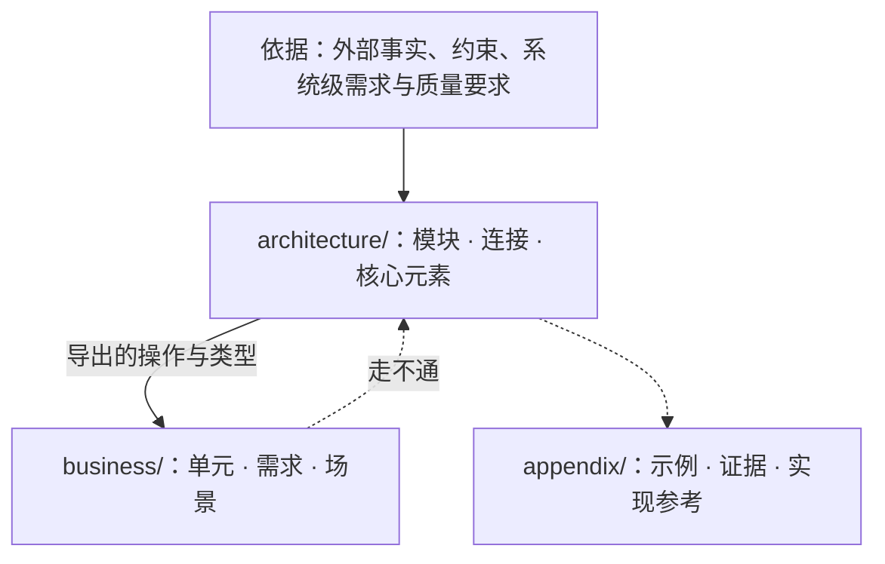

# ssot

设计是代码化的文档：把程序的核心与不变量写成可机械检验的文学式规格（Markdown + VDM-SL）；实现对照它检验，它不随实现改变。

**没有编译步骤，也没有排版。** 设计的使用者是 VDMJ 与读 Markdown 的人：规格放在 ```` ```vdm ```` 代码块里由 `ssot check` 与模型审查验收，文字在任何 Markdown 查看器里直接阅读。不把设计转换成别的格式去查看效果，也不为显示效果改动内容。

完整通过检查的示例设计见 [`references/example/design/`](references/example/design/)。

---

## 一、设计的思路

### 1. 视角与权衡：到底需要定义什么
无论是架构还是业务，描述“值”的地方，和描述“动作”的地方，往往不在同一个地点。

想象一只兔子跳跃：
- 值只是兔子的属性，兔子能跳不代表它是某种特别的动物。如果问“为什么兔子能跳”，只盯着兔子去找它身上的肌肉，就走进了思维死角——兔子能跳，首先得有地面承载跳跃的反作用力。
- 而解释“什么是跳跃”，也不是兔子自己说了算：当腿对地面施加反冲力后，一只脚离地算跳跃吗？两只脚离地算跳跃吗？这时候纳入的观察者绝不只有兔子本身。
- 但软件不要求把所有视角都观察一遍，也不一定只观察某一个视角：
  - 当软件是用来**测量兔子的力量**时，观察对象就只有兔子和地面；
  - 当软件只是想知道**兔子跳了多远**时，观察对象几乎不关注兔子本身，甚至连地面也不关心——因为空间坐标可以只有相对值，参照物是什么都行。

因此，**到底有哪些东西需要被定义、怎么定义，是在多个视角下的权衡**。同一样东西，在持有它的模块里是细节，在别的模块里是概括性的占位符，实际需要时才展开。以信号灯为例：

```vdm
SignalColour = <Red> | <Amber> | <FlashingAmber> | <Green>
```

- **定义在持有者。** 信号灯有这几种状态，所以 `SignalColour` 定义在信号灯的模块里；`=` 右边是信号灯自己的细节。
- **观察者需要才展开。** 谁需要观察信号灯？观察者需要知道状态，才写出细节；不需要，它只是一个定义的点（`token`）：这里有个信号灯，用来干什么。具体怎么运作，是信号灯自己的机制。
- **行为归做出行为的一方。** 信号灯是红灯时不允许通过路口，这是司机的行为，不是信号灯的行为，写在司机那里。
- **规则归持有者。** 信号灯能从红色切换到绿色，是因为满足一条倒计时状态规则。离线信号灯自己持有这条规则，它在信号灯里是细节；联网信号灯是这条规则的消费者，它在信号灯里只是概括。谁持有规则，决定规则在一个模块里是概括还是细节。
- **隐含前提是软件的一部分，就有它的位置。** 不能通过路口，前提是车必须行驶在路上：车不能飞在天上。路不直接出现在这里，但和车有关系。这样的前提如果是软件的一部分，它在程序里可以解释：它是外部依赖时，在这里是占位符，经导入可以找到它；它在本系统里实现时，可以在实现它的地方找到它的细节。隐含前提不是软件的一部分时，例如服务器需要电力运行，就不写进设计。
- **展开是可选的，但只有一次。** 一样东西可以不展开，但展开只能有一处；展开了两处，它就有多重解释。

### 2. 顺眼与不顺眼：积压感与责任边界
看一份设计，要点不是拿着清单找茬，而是要有一种微妙的感觉：这个地方看着**顺眼不顺眼**。

- **如果一个地方被积压了或者展开了太多的值，通常意味着这个地方有多个来源要处理。** 这是一种责任不清晰的信号——不可能所有的业务都在一个地方集中处理。当多个视角或多个来源的事堆在同一处时，往往说明它们没有在各自的边界把事情处理干净，或者模块之间的视角权衡出了偏差。
- **审视架构的根本，不在于挨个盘点每个点持有什么东西，而在于到底有多少东西需要被定义、定义得对不对。** 审代码往往尽可能保住既有的大体框架，在里面看缺不缺某个函数或某个值；而 SSoT 在长期维护中保持不变，直面它时看的不是这些小打小闹的修补，而是更深层的大体框架：在这套软件所选的视角下，哪些东西根本不需要存在，留下的核心概念与关系定义得对不对。

### 3. 核心、连接与不变量
- **设计只写核心，常变的业务留在代码里。** 核心定下之后不再常改；建在核心之上、随需求变动的业务写在代码里。在连接不变时可以替换的做法属于实现，不写进设计；一段细节保护某条不变量时，设计只写这条不变量。
- **架构与优先级。** 架构回答三个问题：**由什么组成**（有哪些模块，谁在谁里面）、**用什么组成**（模块由哪些核心元素拼成，经哪些连接相接）、**为什么**（依据哪些外部事实、约束与需求）。业务建在架构上，只经连接接入；业务引用架构，架构不引用业务。
- **两条轴。** 抽象层级是模块树的深度（父模块粗、子模块细，父不依赖子，共用材料放共同父模块）；模块划分是每个架构模块固定的三部分（外部连接、核心代码、内部设计）。业务单元不分这三部分，但业务也有抽象：业务单元之间只经导出的连接点对点或点对面组合。
- **连接、状态与生命周期。** 连接点是可以被调用的操作或函数；共享同一份状态与同一条不变量的一组操作构成连接面。说做到什么（隐式 `pre`/`post`），不说怎么做；两个实现必须算出同一结果的判定写成显式纯函数（`functions`）；按次序调用连接走通需求、失败结局或生命周期中断的路径写成场景（`operations`）。不变量、前置条件、后置条件各管一件事，不变量越简单越好。

---

## 二、三桶目录与阶段 Skill 路由



| 目录 | 角色 | 约束 |
|---|---|---|
| `design/README.md` | 阅读次序导航 | `architecture/` 与 `business/` 下的每个 `.md` 恰好出现一次；不写规则 |
| `architecture/` | 根模块与子模块：核心概念、对外连接（`exports`）、状态与不变量 | 不引用 `business/`；父模块不依赖子模块；不包含只为单一业务单元存在的类型或规则 |
| `business/` | 业务单元：需求、确定性判定与接入场景 | 单向 `imports` 架构导出的连接；业务单元之间只经导出连接无环组合 |
| `appendix/` | `examples/`（示例）、`evidence/`（依据的证据）、`reference/`（实现参考） | 不出现在阅读次序里，不被 `check` 检查，不设立规则 |

### 1. 写设计 / 改设计流水线

| 阶段 | Skill | 做什么 |
|---|---|---|
| 1. 架构设计 | `ssot-arch` | 从外部依据出发，在多视角下权衡本系统到底需要定义哪些核心概念与连接面，确定模块树、视角展开与生命周期 |
| 2. 业务设计 | `ssot-business` | 在架构连接之上划分业务单元，让各单元各司其职避免多来源集中积压，编写确定性判定与走通需求的场景 |
| 3. 形式化落地 | `ssot-spec` | 先立最小 VDM 框架跑通 `ssot check`，再填入完整谓词、纯函数、场景与受控文字，通过 `ssot check` 与 `review.py` |

### 2. 审设计（Review）流水线

| 阶段 | Skill | 做什么 |
|---|---|---|
| 1. 审架构与概念定义 | `ssot-review-arch` | 不迁就现有大体框架，从“顺眼与积压感”出发审视到底有多少东西需要被定义、定义得对不对，视角权衡与模块切分是否成立 |
| 2. 审业务分流与走通 | `ssot-review-flow` | 看值与动作在模块间的流转是否自然，识别因责任混杂造成的积压或断链，核对每条需求、失败结局与生命周期能否顺畅走通 |
| 3. 审规格严密与用词 | `ssot-review-spec` | 运行 `ssot check` 与 `review.py`，核对未定证明义务、说明注释与谓词的一致性、以及字面用词是否准确 |

审查按阶段顺序推进：
- **边读边想，不走过场翻页：** 按 `design/README.md` 的次序每读完一个模块，当场想清楚它的视角、它定义了什么、哪里看着顺眼或积压，不把“读完所有文件”当成不带思考的机械前置任务。
- **先审框架与流转，最后跑机械工具：** 先完成阶段 1（`ssot-review-arch`）与阶段 2（`ssot-review-flow`）的思考，最后进入阶段 3（`ssot-review-spec`）时才运行 `ssot check` 与 `review.py`。（`ssot check` 一次运行就会跑完 AST 反模式、VDMJ 类型检查与 QuickCheck，不需要把 `design/` 复制到 `/tmp` 修改后重跑。）

### 3. 存量旧文档迁移
已有大量旧设计文档要迁入 `design/` 时，加载 **`ssot-migration`**：迁移期间遵循“只搬运、不判断对错、不改动原意”，等 `legacy-design/` 搬空后再进入审设计与写设计流水线。

---

## 三、命令与检查概览

命令 `ssot` 与 `vdmj` 在 PATH 上，直接调用。加载本 skill 时自动检查并按需安装（细节见 [`references/setup.md`](references/setup.md)）：

!`command -v ssot >/dev/null 2>&1 && command -v vdmj >/dev/null 2>&1 || bun "${CLAUDE_SKILL_DIR}/scripts/design.ts" setup 2>&1 || true`

| 命令 | 作用 |
|---|---|
| `ssot init <仓库根>` | 生成 `<仓库根>/design`：`README.md`（阅读次序）、根模块 `README.md`、三类附录目录 |
| `ssot module <design> <a/b>` | 建立架构子模块目录与 `README.md`，并加入阅读次序；父模块必须已存在 |
| `ssot unit <design> <名字>` | 建立业务单元目录与 `README.md`，并加入阅读次序 |
| `ssot check <design> [--json]` | 检查全部规则（`layout`、`parse`、`structure`、`antipattern`、`form`、`prose`、`typecheck`、`quickcheck`），有违规时退出码为 1 |
| `ssot graph <design> [--json]` | 输出目录、模块与 `imports` 关系的 Mermaid 图或 JSON |
| `ssot vdmj <design> [参数]` | 用设计里的全部规格运行 VDMJ，例如 `-i` 进解释器、`-e` 求值 |
| `ssot review <design>` | 输出语义反模式模型审查的判断对象（JSON），由 `scripts/review.py` 在 omp `eval` 里交给 `jev` |
| `vdmj [参数] <文件>` | VDMJ 本身，带 QuickCheck 插件，读 `.vdmsl` 文件；设计目录里的 Markdown 用 `ssot vdmj` |

理论与方法论文献出处见 [`references/sources.md`](references/sources.md)。
