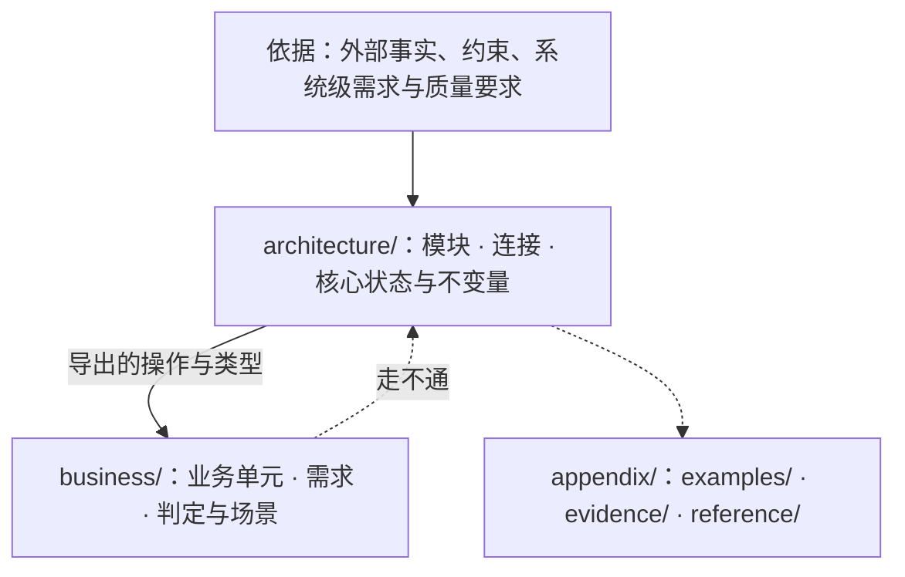

# ssot

把程序核心的设计写成可机械检验、独立于实现代码的文学式形式化规格（Markdown + VDM-SL）。

**没有编译步骤，也没有排版。** 设计的使用者是 VDMJ 与读 Markdown 的人：规格放在 ```` ```vdm ```` 代码块里由 `ssot check` 与模型审查验收，文字在任何 Markdown 查看器里直接阅读。不把设计转换成别的格式去查看效果，也不为显示效果改动内容。

## 三桶目录结构



| 目录 | 职责 | 依赖与边界约束 |
|---|---|---|
| `design/README.md` | 阅读次序导航 | `architecture/` 与 `business/` 下的每个 `.md` 恰好出现一次；不写规则 |
| `architecture/` | 系统的核心模块树、对外连接（`exports`）、核心类型、状态与不变量 | 不引用 `business/`；父模块不依赖子模块；不包含只服务单一业务单元的类型、角色或分支 |
| `business/` | 建在架构连接之上的业务单元：需求、确定性判定（纯函数）与走通需求的场景（操作） | 单向 `imports` 架构导出的连接；业务单元之间只经导出连接点对点或点对面无环组合；不持有持久 `state` |
| `appendix/` | 示例（`examples/`）、依据的证据（`evidence/`）、可替换的实现参考（`reference/`） | 不出现在阅读次序里，不被 `check` 检查，不设立规则 |

完整通过检查的示例设计见 [`references/example/design/`](references/example/design/)。

## 工作流与阶段 Skill 路由

设计和对设计的审查各有不同的认知重心，严禁混在同一步里边想抽象边抠语法、或没读懂系统抽象就逐行找茬。按任务类型加载对应的阶段 skill，按序执行并遵守每一阶段的门控：

### 一、写设计 / 改设计流水线

```text
需求与外部约束 → [1. ssot-arch] → 架构模块与连接面 → [2. ssot-business] → 业务单元与场景 → [3. ssot-spec] → 通过 check + review 的 design/
```

| 阶段 | Skill | 解决什么问题 | 阶段门控 |
|---|---|---|---|
| 1. 架构设计 | `ssot-arch` | 划定抽象边界（认什么、不管什么），回答架构三问（由什么组成、用什么组成、为什么），确定视角与持有者、连接面与状态不变量、生命周期嵌套 | 能说清抽象边界、各架构模块的职责、谁持有哪条不变量、每条依据的来源与“所以”；未定清前不写业务、不抠 VDM 语法 |
| 2. 业务设计 | `ssot-business` | 在架构导出的连接之上划分业务单元，定义问题域需求、两个实现必须一致的确定性判定（纯函数）以及走通需求与失败分支的场景（操作） | 业务只经架构导出连接接入；每条需求有对应场景；不把常变业务细节或可替换算法写进设计；场景走不通时回退 `ssot-arch` |
| 3. 形式化落地 | `ssot-spec` | 把架构与业务写成符合布局、VDM-SL 语法与受控文字规范的 Markdown，消除全部 AST 反模式与 `jev` 语义反模式 | `ssot check` 零错误零警告、QuickCheck 零反例、`review.py` 零检出、未定证明义务逐条核实 |

改动的传递：
- **架构变了**：先按 `ssot-arch` 改依据、连接与理由，再按 `ssot-business` 与 `ssot-spec` 让每个业务单元与场景重新通过检查。
- **业务变了**：先按 `ssot-business` 改业务；业务或场景在架构连接上走不通时，判断是业务表达错了、这项业务不属于本系统，还是架构的抽象不成立。

### 二、审设计（Review）流水线

审查设计必须**自顶向下分三阶段进行**。严禁跳过第 1 阶段直接扫单行 VDM 语法或拿着负面清单逐行挑刺；严禁把被抽象排除在外的物理现实、存储实现脑补或字面文本差异当成架构缺陷。

```text
design/ 全文 → [1. ssot-review-arch] → 抽象逻辑与架构/业务边界 → [2. ssot-review-flow] → 值流转与需求场景走通 → [3. ssot-review-spec] → 规格严密性、证明义务与用词
```

| 阶段 | Skill | 审查重心 | 阶段门控与硬禁令 |
|---|---|---|---|
| 1. 审抽象与架构 | `ssot-review-arch` | 先还原系统抽象逻辑（边界、核心值、上层一般规律与下层细化关系），再审架构与业务分工、视角与持有者、依赖方向、依据与理由 | **第零步门控**：未写出系统的抽象逻辑前严禁报任何问题；过五道假阳性筛子（防边界外脑补、防等价当身份、防把细化当矛盾、防存储思维、防把契约外当缺结局）；**本阶段不查局部 VDM 语法与细节** |
| 2. 审业务走通与连接 | `ssot-review-flow` | 在承认抽象模型的前提下，追踪决定结果的值是否在连接间完整流转，核对每条需求、可观察失败结局与生命周期中断能否借连接走到底 | 从值流转与生命周期嵌套出发，不从数据库存储出发；遵守 VDM-SL 无循环场景的代表元形式化约定，不拿命令式代码的“漏写循环”挑刺 |
| 3. 审规格严密与用词 | `ssot-review-spec` | 运行 `ssot check` 与 `review.py`，裁决 QuickCheck 未定证明义务，核对 `--` 说明承诺是否落入 `inv`/`pre`/`post`，排查字面误导用词 | 揪出伪装重言式与漏约束分支；将引发面向对象实例、缓存或存储误读的命名/注释在持有模块改名或补清说明注释 |

### 三、存量旧文档迁移

已有大量旧设计文档要迁入 `design/` 时，加载 **`ssot-migration`**：
- 迁移期间遵循“只搬运、不判断对错、不改动原意”，不按设计或审查阶段修改内容；
- 等 `legacy-design/` 全部搬空后，再进入上面的「审设计流水线」与「写设计流水线」。

## 命令与检查概览

命令 `ssot` 与 `vdmj` 在 PATH 上，直接调用。加载本 skill 时自动检查并按需安装（细节见 [`references/setup.md`](references/setup.md)）：

!`command -v ssot >/dev/null 2>&1 && command -v vdmj >/dev/null 2>&1 || bun "${CLAUDE_SKILL_DIR}/scripts/design.ts" setup 2>&1 || true`

| 命令 | 作用 |
|---|---|
| `ssot init <仓库根>` | 生成 `<仓库根>/design`：`README.md`（阅读次序）、根模块 `README.md`、三类附录目录 |
| `ssot module <design> <a/b>` | 建立架构子模块目录与 `README.md`，并加入阅读次序；父模块必须已存在 |
| `ssot unit <design> <名字>` | 建立业务单元目录与 `README.md`，并加入阅读次序 |
| `ssot check <design> [--json]` | 依次执行 8 阶段确定性检查与形式化验证（`layout`、`parse`、`structure`、`antipattern`、`form`、`prose`、`typecheck`、`quickcheck`），有违规时退出码为 1 |
| `ssot graph <design> [--json]` | 输出目录、模块与 `imports` 关系的 Mermaid 图或 JSON |
| `ssot vdmj <design> [参数]` | 用设计里的全部规格运行 VDMJ，例如 `-i` 进解释器、`-e` 求值 |
| `ssot review <design>` | 输出语义反模式模型审查的判断对象（JSON），由 `scripts/review.py` 在 omp `eval` 里交给 `jev` |
| `vdmj [参数] <文件>` | VDMJ 本身，带 QuickCheck 插件，读 `.vdmsl` 文件；设计目录里的 Markdown 用 `ssot vdmj` |

理论与方法论文献出处见 [`references/sources.md`](references/sources.md)。
